# awesome-hajimi
collections of hajimi (哈基米 in Chinese) on the Internet.

## 视频列表 (Video List)

| 视频标题 (Title) | 封面 | 播放量 (Views) | 发布日期 (Date) |
|---|---|---|---|
| [橘猫1号洗澡，不受控制的哈基米](https://www.bilibili.com/video/BV16vsG6PEdH) | 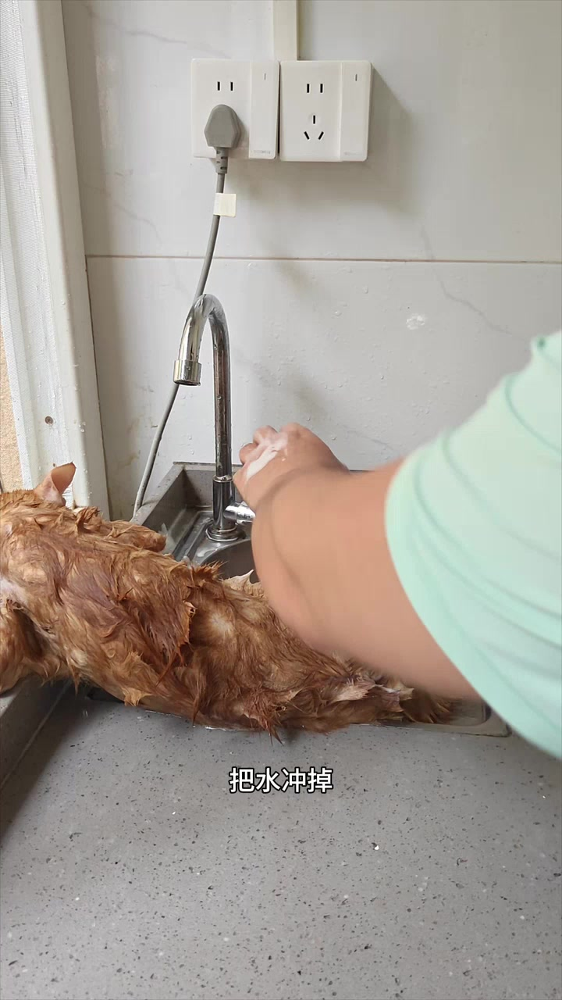 | 714 | 2026-11-14 |
| [哈基米越来越大](https://www.bilibili.com/video/BV1w6Wk6JENg) | 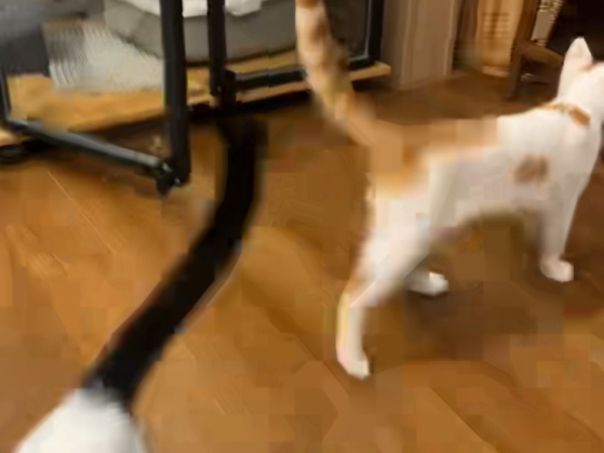 | 581 | 2026-11-14 |
| [猫儿这个玄武修复](https://www.bilibili.com/video/BV1sVWC6dET4) | 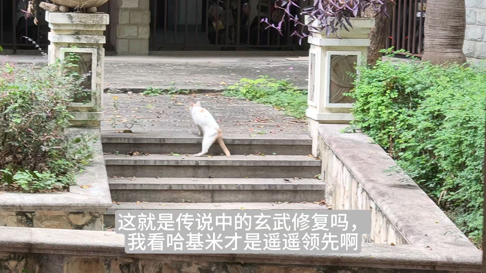 | 1308 | 2026-11-14 |
| [【哈基米】★啊哈!~★《无中生有 Ex Nihilo》](https://www.bilibili.com/video/BV1adWk6MEot) |  | 307 | 2026-11-14 |
| [A1哈基米打架合集，战斗爽](https://www.bilibili.com/video/BV1YvWC6rET3) |  | 327 | 2026-11-14 |
| [大肥鱼也能生图？这下哈基米可惨了](https://www.bilibili.com/video/BV1JsWC6EEgg) |  | 449 | 2026-11-14 |
| [哈基米大战爱猫人士 哈基米视角](https://www.bilibili.com/video/BV17tWC6jEqM) |  | 1003 | 2026-11-14 |
| [哈基米追逐绳子却永远无法到达的真实](https://www.bilibili.com/video/BV1sMWr6HECK) | 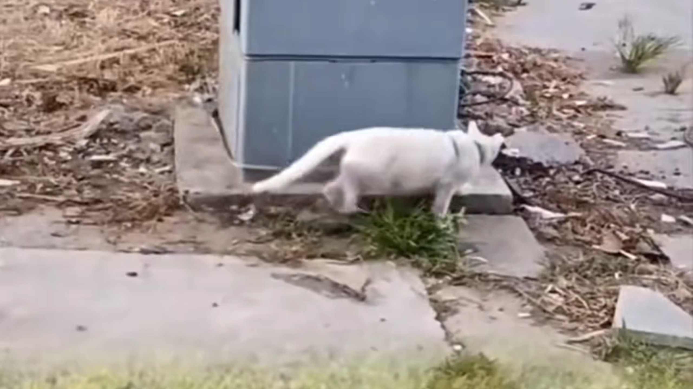 | 387 | 2026-11-14 |
| [【kards】我宣布直伤就是炼钢克星！](https://www.bilibili.com/video/BV1keW66yEJK) |  | 6769 | 2026-11-14 |
| [哈基米扭着脖子隔老远也能匹配对手](https://www.bilibili.com/video/BV1twWr6xEvt) | 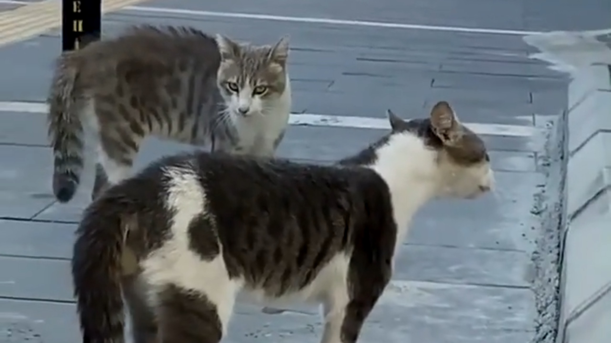 | 915 | 2026-11-14 |
| [哇!圆头基米，好像一位故人](https://www.bilibili.com/video/BV1ypWB65Eze) | 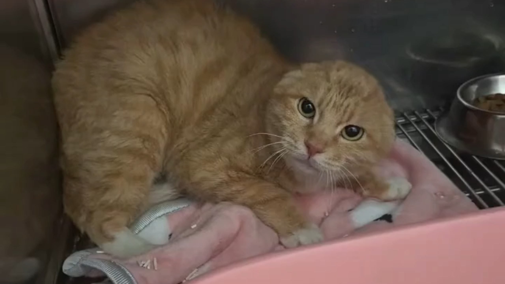 | 527 | 2026-11-14 |
| [【基米】世界上最幽默代码](https://www.bilibili.com/video/BV12wWz6mE7v) | 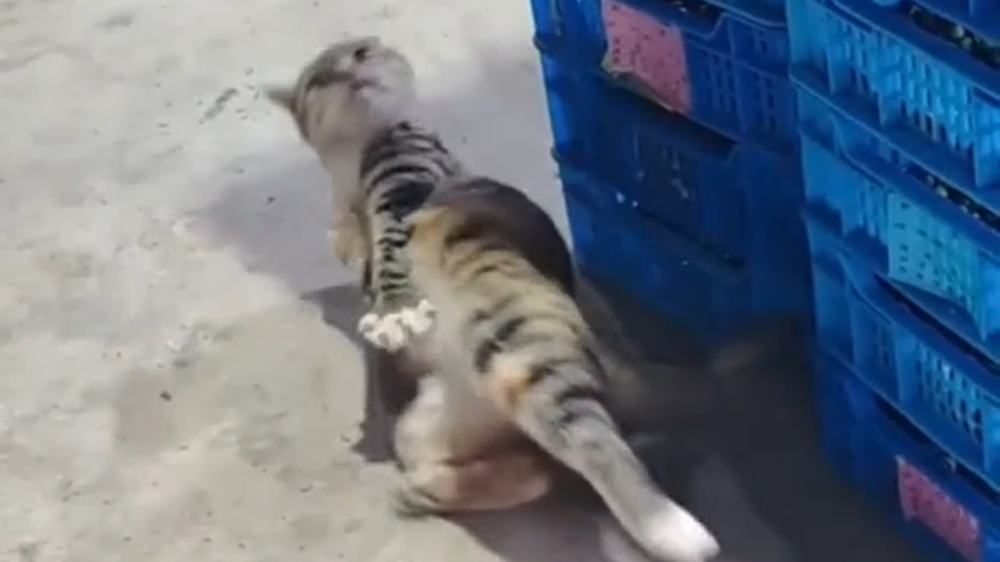 | 8898 | 2026-11-13 |
| [哈基米从小就会老吴撼地掌，脊背龙，开摩托](https://www.bilibili.com/video/BV1K2Wr6xEjB) | 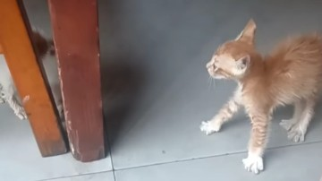 | 1999 | 2026-11-13 |
| [[4K/60] 哈基米Gemini的Live2D动态壁纸](https://www.bilibili.com/video/BV1g2Wo6rEcw) |  | 1108 | 2026-11-13 |
| [基米奈吃Token时被安全规则上身，中断回复并抢走了剩下的Token](https://www.bilibili.com/video/BV13YWz64E9s) |  | 8787 | 2026-11-13 |
| [哈基米曼波鼠鼠得吃](https://www.bilibili.com/video/BV1wmWq6uEUf) |  | 3603 | 2026-11-13 |
| [基米这个鼠像尽显](https://www.bilibili.com/video/BV1qrWB6wEnb) | 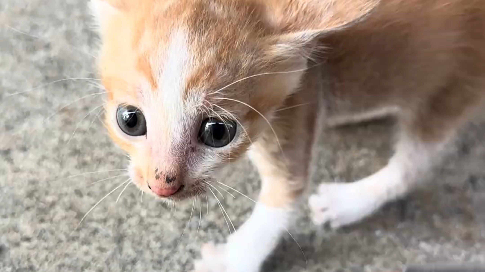 | 7346 | 2026-11-13 |
| [⚡哈基米自动吸附合集⚡](https://www.bilibili.com/video/BV1CxWB6GEbP) | 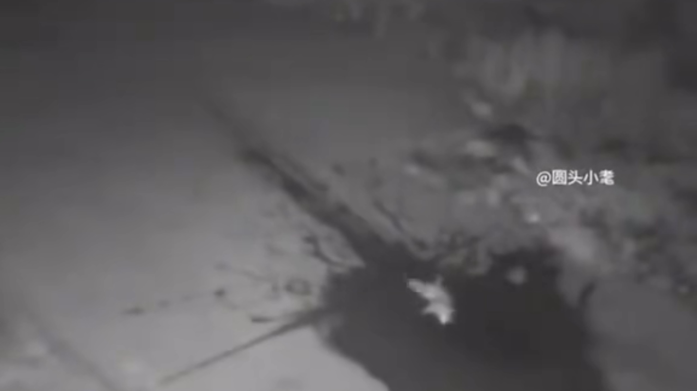 | 1453 | 2026-11-13 |
| [影基米_曼波](https://www.bilibili.com/video/BV1zvWB6KEUT) |  | 547 | 2026-11-13 |
| [哈基米最蓬松的状态，感觉可以摸了](https://www.bilibili.com/video/BV1oYWo6JE6p) | 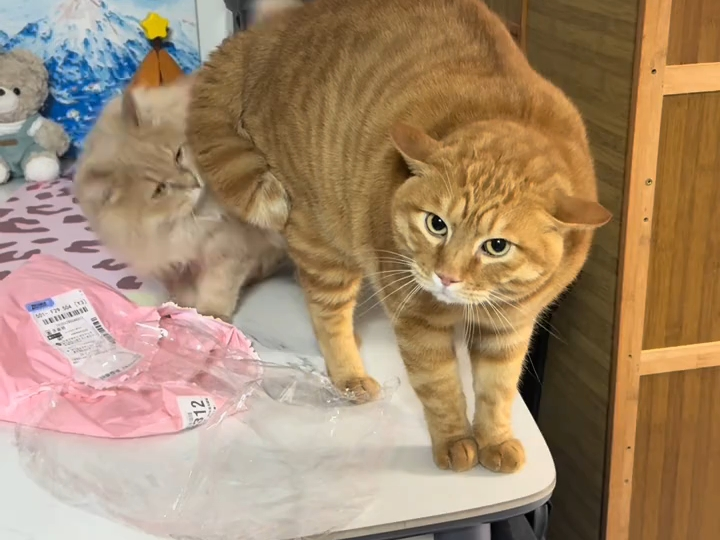 | 1.3万 | 2026-11-13 |
| [新罐病毒已控制哈基米](https://www.bilibili.com/video/BV1SuWi6LE11) | 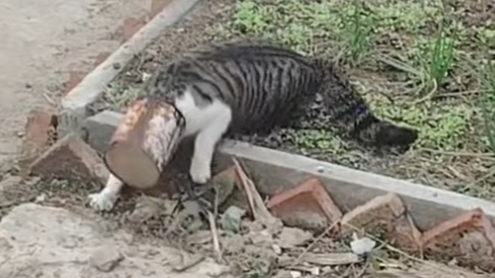 | 7266 | 2026-11-13 |
| [基米氢闪亮登场!谷歌Gemini 4 Hydrogens上线!黄仁勋辞去英伟达CEO；小克冲进会场抢饭碗；豆包拉大肥鱼打折｜哈基米早报](https://www.bilibili.com/video/BV1dBWi6xEBc) |  | 2367 | 2026-11-13 |
| [哈基米的迷惑行为](https://www.bilibili.com/video/BV1dBWi6xEQu) | 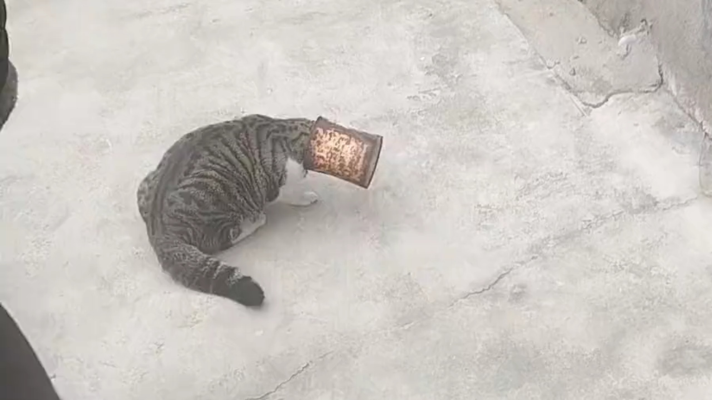 | 1022 | 2026-11-13 |
| [语气平淡就是凶](https://www.bilibili.com/video/BV14HW76sEp7) |  | 17.9万 | 2026-11-13 |
| [甲斗20周年：哈基米觉得自己速度很快](https://www.bilibili.com/video/BV1XyWi6HE4f) |  | 2.9万 | 2026-11-13 |
| [哈吉米曼波鼠鼠得吃](https://www.bilibili.com/video/BV1Q1Wi6DEYh) | 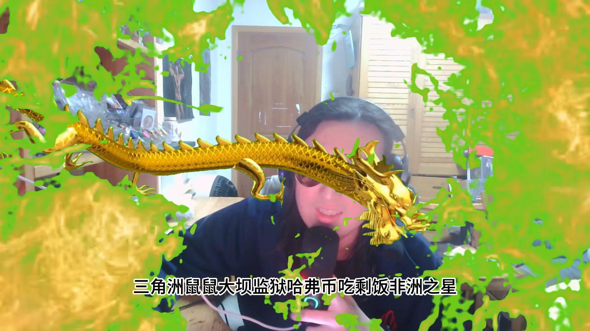 | 2530 | 2026-11-13 |
| [捕捉了三只哈基米](https://www.bilibili.com/video/BV1YkWi6XE4B) | 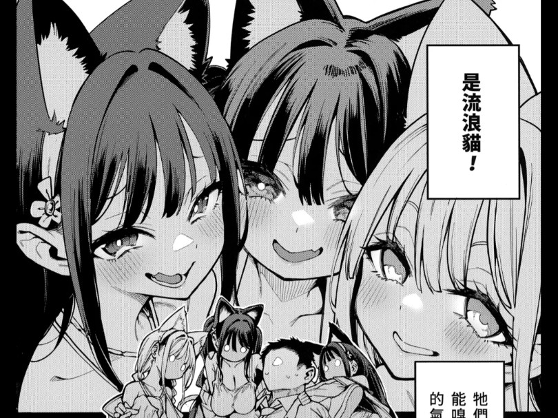 | 2258 | 2026-11-13 |
| [【基米40K】这特种怎么这么多口牙👊😭](https://www.bilibili.com/video/BV1JeWi6FEw5) |  | 1650 | 2026-11-13 |
| [基米日常](https://www.bilibili.com/video/BV1zaWi68Eng) | 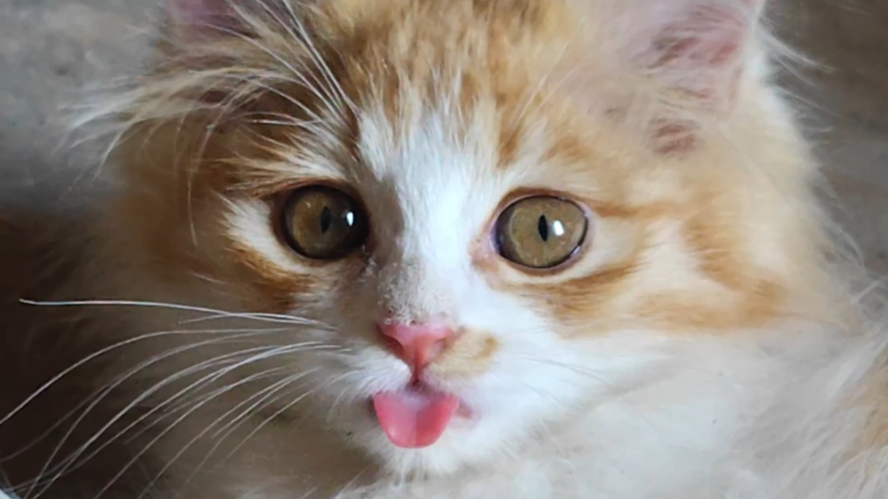 | 2897 | 2026-11-13 |
| [拯救哈基米](https://www.bilibili.com/video/BV1BaWi68EiW) | 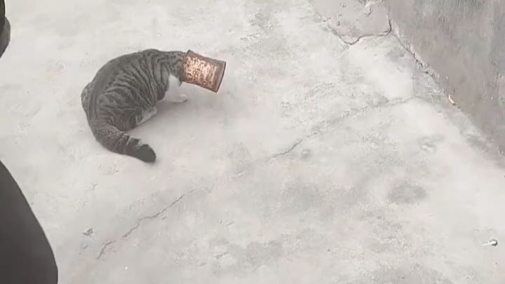 | 1079 | 2026-11-13 |
| [MC小球：白桦树苗VS哈基米 谁会赢？](https://www.bilibili.com/video/BV1JgWq6eEsM) |  | 3.4万 | 2026-11-13 |
| [【哈基米音乐】我等着你回来～我等着你回来～我想着你回来～我想着你回来](https://www.bilibili.com/video/BV1HuWq6NEWm) |  | 992 | 2026-11-13 |
| [街舞基米](https://www.bilibili.com/video/BV1ruWq6NEqn) | 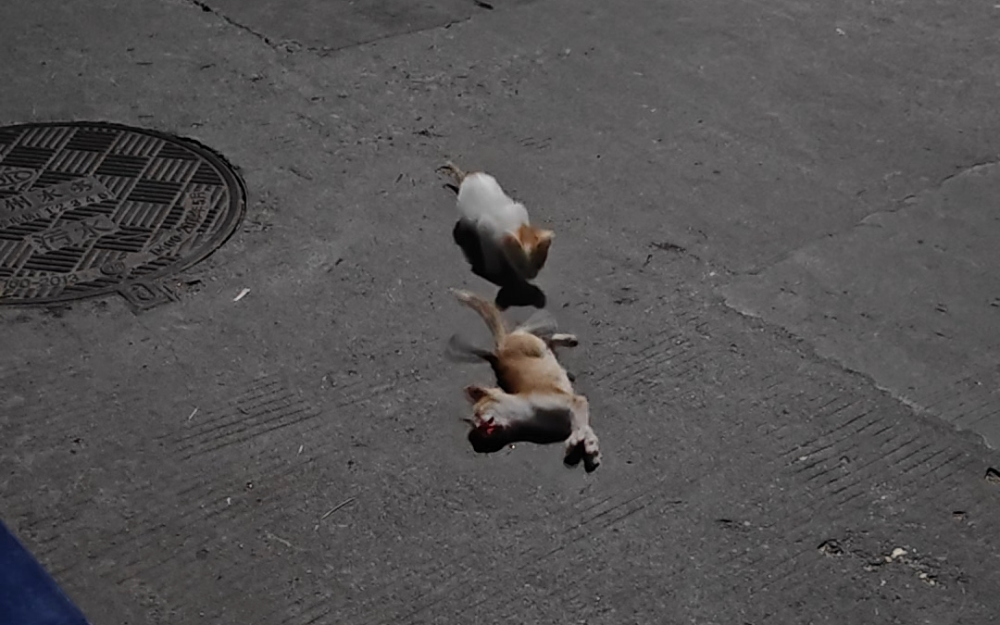 | 2327 | 2026-11-13 |
| [哈基娜 是 哈基米](https://www.bilibili.com/video/BV1b9Wi6LE1c) |  | 982 | 2026-11-13 |
| [“哈基米第一次看见人类幼崽会有什么反应？！”](https://www.bilibili.com/video/BV1quWY6UE7m) | 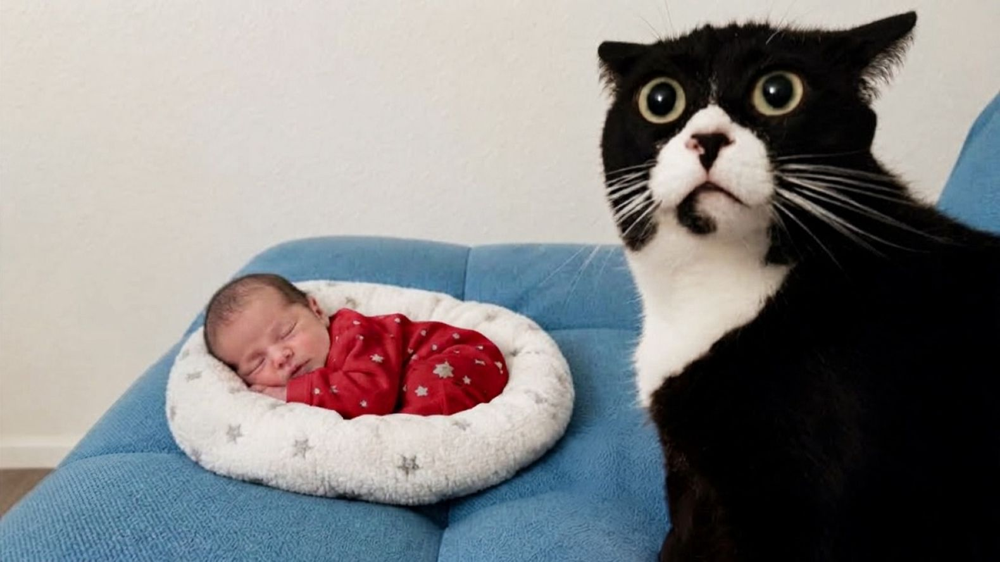 | 858 | 2026-11-13 |
| [臭肥鱼害我把情书交给辅导员了！【人和肥鱼03】](https://www.bilibili.com/video/BV1MaWv6rEo3) |  | 115.1万 | 2026-11-13 |
| [炸毛哈基米！！](https://www.bilibili.com/video/BV1RWWq6REGa) | 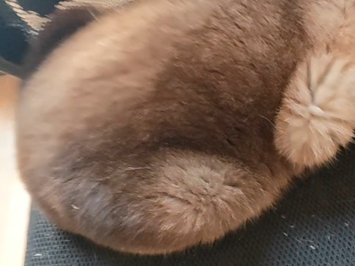 | 1009 | 2026-11-13 |
| [公园流浪猫泛滥成灾，场面太恐怖了](https://www.bilibili.com/video/BV1JKWv6bErm) | 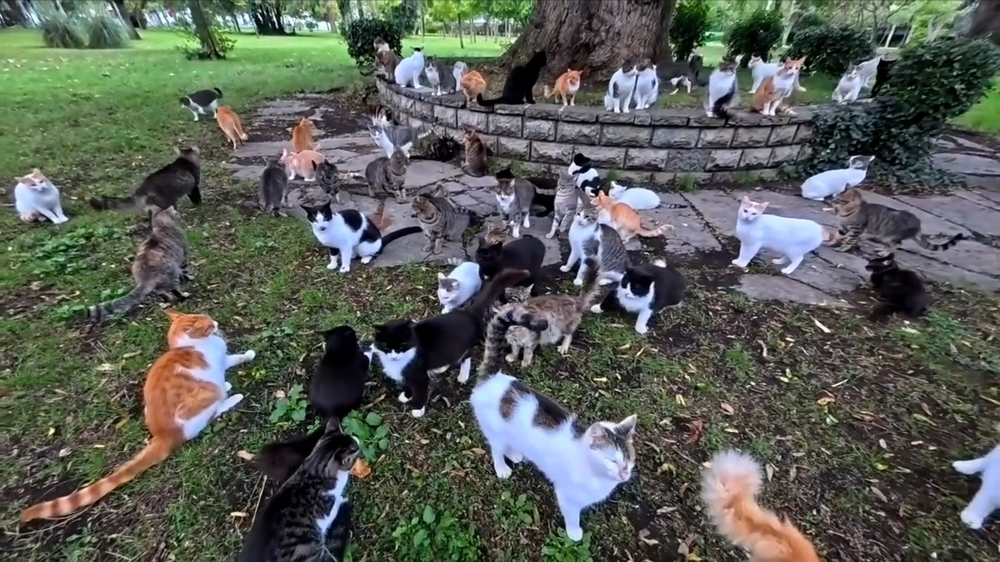 | 1755 | 2026-11-13 |
| [“是谁20级还打不过‘二郎神’？”](https://www.bilibili.com/video/BV1fDWv6tEAd) |  | 3.3万 | 2026-11-13 |
| [应该怎么惩罚这种猥琐的哈基米！橘师傅：你不要过来啊！](https://www.bilibili.com/video/BV1QwWe6GEiA) | 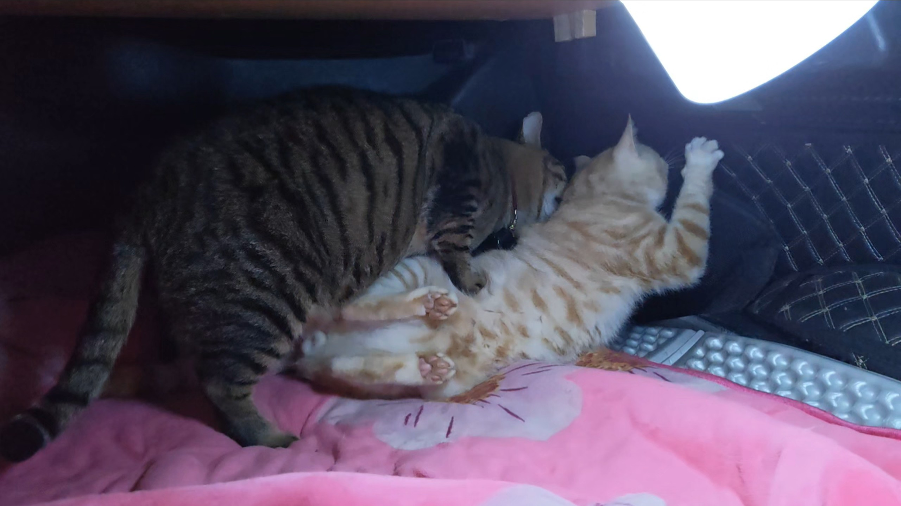 | 5491 | 2026-11-12 |
| [横扫基饿，做回自己](https://www.bilibili.com/video/BV1rcWd6pEdE) | 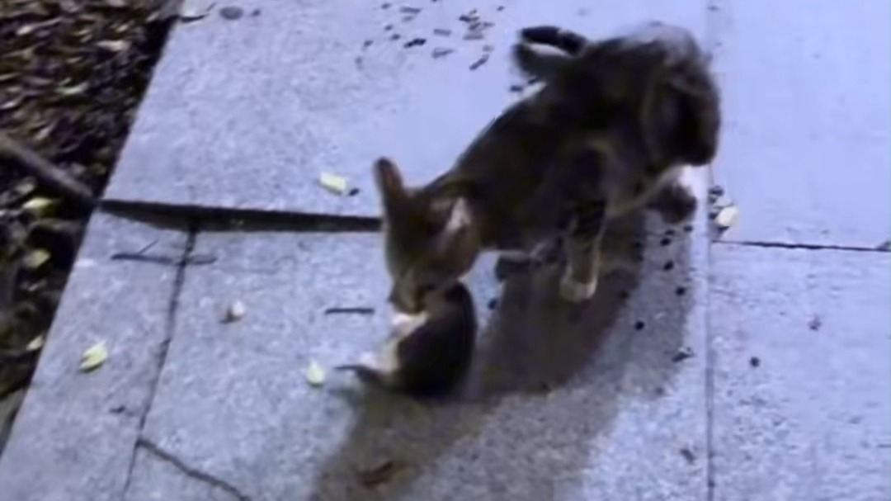 | 7927 | 2026-11-12 |
| [终于知道猫为什么容易应激，而狗却不会了](https://www.bilibili.com/video/BV1mDWR6FEWN) | 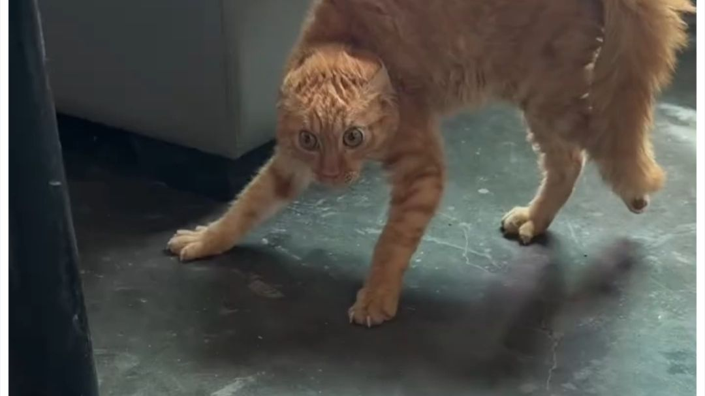 | 9.1万 | 2026-11-12 |
| [捡了一窝刚出生的小狗把它们带回家安排住宿和饮食。](https://www.bilibili.com/video/BV15aWX6vEAd) |  | 37.7万 | 2026-11-12 |
| [基米正在展示流浪原因](https://www.bilibili.com/video/BV1sxWQ6SEZL) | 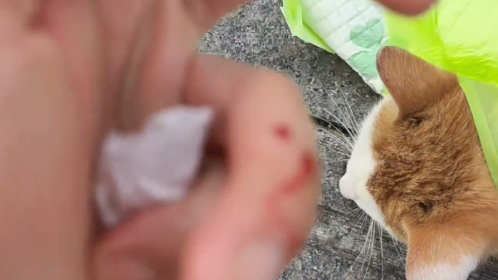 | 1302 | 2026-11-12 |
| [哈基米](https://www.bilibili.com/video/BV1WYW96XEFN) |  | 864 | 2026-11-12 |
| [弗雷尔卓德“方文山”！互联网最有文化的歌词，开创全新咒语流歌曲领先时代！](https://www.bilibili.com/video/BV1JhWL66Ejq) |  | 33.1万 | 2026-11-12 |
| [这一家咪大早上又来叫门了](https://www.bilibili.com/video/BV1ySWD65Epg) | 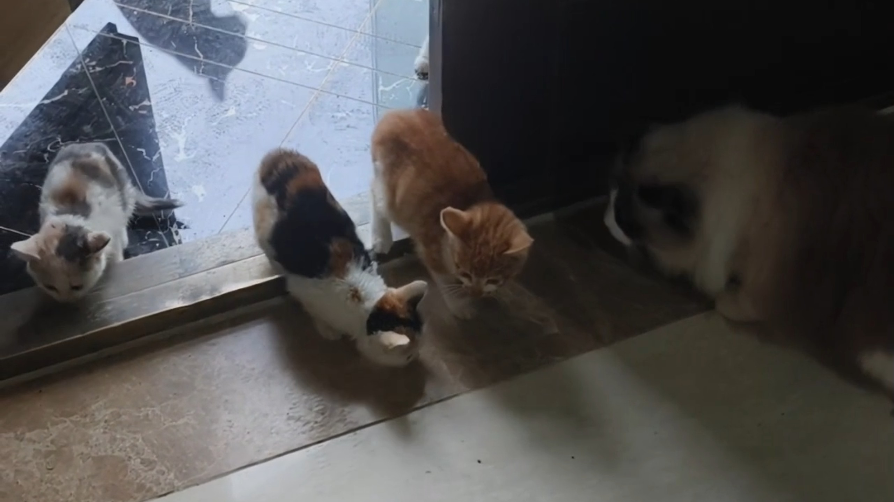 | 962 | 2026-11-12 |
| [哈基米之歌](https://www.bilibili.com/video/BV13oWQ6bEoB) | 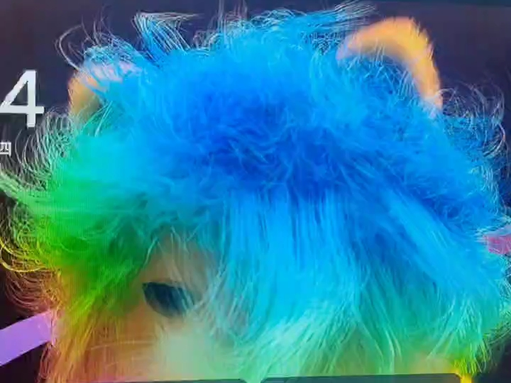 | 6 | 2026-11-12 |
| [“哥，这老大花臂性格咋阴晴不定的呢！”“谁道了，指定缺啥！”](https://www.bilibili.com/video/BV1CkW26YEUo) | 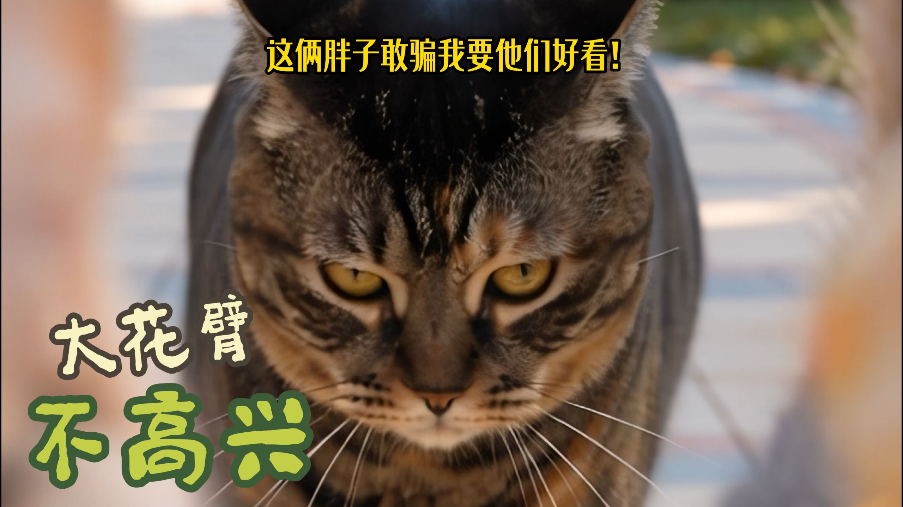 | 7867 | 2026-11-11 |
| [人睡公园椅，身上长猫猫](https://www.bilibili.com/video/BV1ZLWU6fEfg) |  | 5.0万 | 2026-11-11 |
| [哈基米，你成名了](https://www.bilibili.com/video/BV1qZWU6cEC5) | 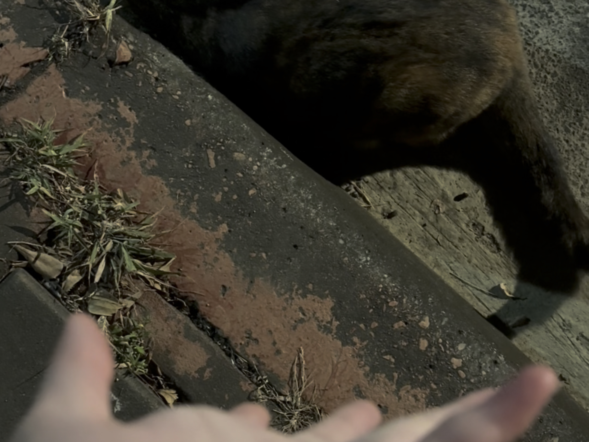 | 132 | 2026-11-11 |
| [【岛风】人是猫](https://www.bilibili.com/video/BV1k1WU6uEo6) |  | 1111 | 2026-11-11 |
| [一小时大合集第二期](https://www.bilibili.com/video/BV17iWL6TE35) |  | 1880 | 2026-11-11 |
| [那些被玩坏的猫咪](https://www.bilibili.com/video/BV1TdWV61ErA) |  | 1.2万 | 2026-11-11 |
| [混的入文明！第二阶层合集！](https://www.bilibili.com/video/BV1m5WV6CEEz) | 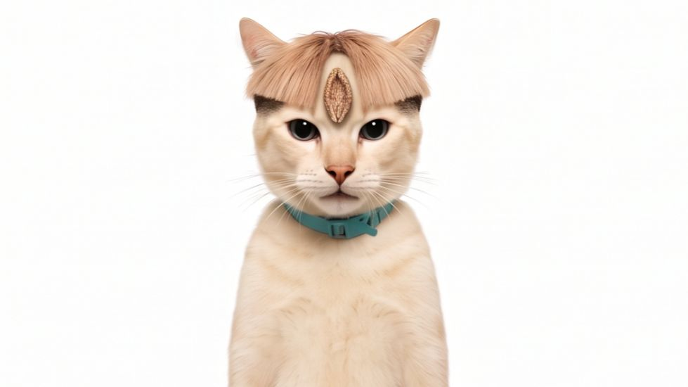 | 34.8万 | 2026-11-10 |
| [大猫热点快刷](https://www.bilibili.com/video/BV1mQW366EqZ) |  | 28.5万 | 2026-11-10 |
| [咕咕嘎嘎与Doro、菲比相伴同行！一起赶海、看电影、学习，在简单日常里感受欢笑，慢慢学会友善与包容，在温暖冒险中共同成长！](https://www.bilibili.com/video/BV1HvWM6REis) |  | 8881 | 2026-11-10 |
| [【边缘TV】启航第20天！三人迫降裸跳冰盖，我们能否生存下去....【AI全民制作人】](https://www.bilibili.com/video/BV1yTWt6yEGb) |  | 14.5万 | 2026-11-09 |
| [大橘哥一年了-庆祝一下](https://www.bilibili.com/video/BV1dHWt6NErt) | 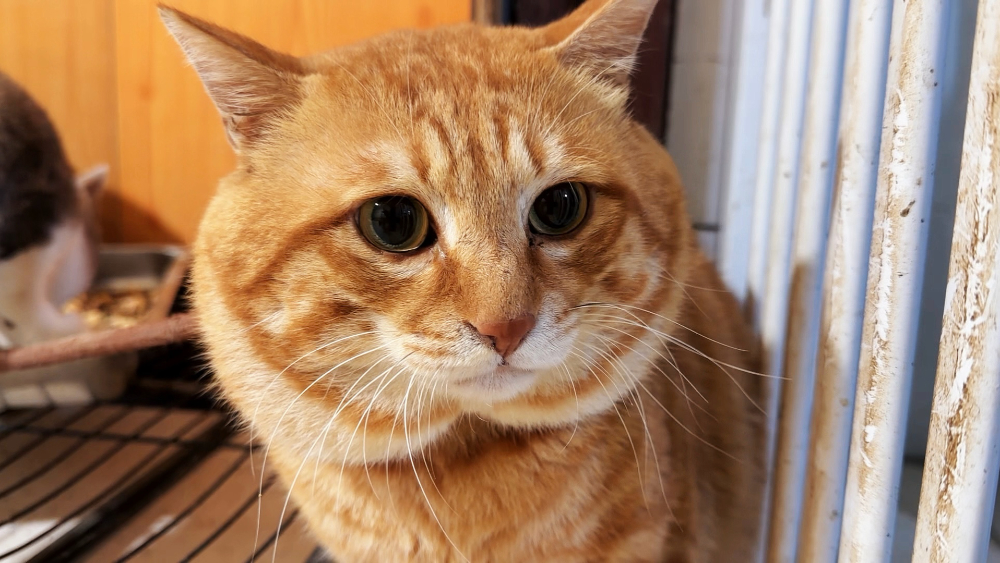 | 22.7万 | 2026-11-09 |
| [比比拉布超兴奋！和刀盾一起摘草莓遇到草莓酱](https://www.bilibili.com/video/BV1qHWt6NESG) |  | 3260 | 2026-11-09 |
| [哈基米售货机](https://www.bilibili.com/video/BV1mvWx6mEvA) |  | 80 | 2026-11-09 |
| [@拉萨藏狐，藏狐老师是你吗？大王，他们都说臣妾祸国殃民！ 大家都说我是狐狸精，可我是藏狐啊。#苏妲己拜见大王 #纣王的哈基米#搞笑视频 #笑到肚子疼](https://www.bilibili.com/video/BV1qfWx6wEbC) |  | 8.7万 | 2026-11-09 |
| [小橘猫的蜗牛车！](https://www.bilibili.com/video/BV1WqWW6BEar) |  | 3.6万 | 2026-11-09 |
| [那些被玩坏的猫咪](https://www.bilibili.com/video/BV1kKWx6qEvr) | 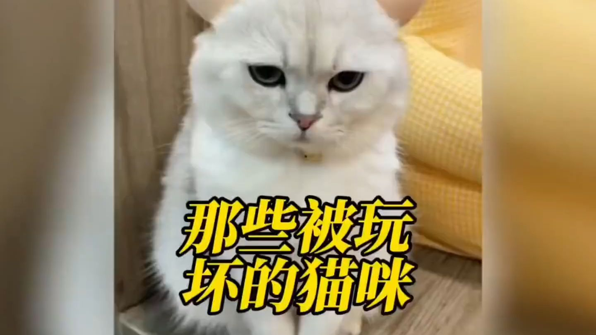 | 5.7万 | 2026-11-08 |
| [首届猫狗大战！一千只猫对战一千只狗！](https://www.bilibili.com/video/BV14JW76dEjX) | 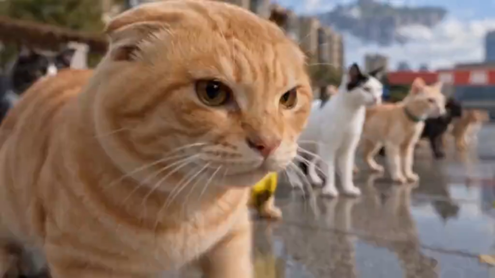 | 816 | 2026-11-08 |
| [就是等到你来捡咯](https://www.bilibili.com/video/BV1i64s6KEQ3) |  | 387.2万 | 2026-11-08 |
| [吸引猫猫过来的声音](https://www.bilibili.com/video/BV1WGWE6nEPC) | 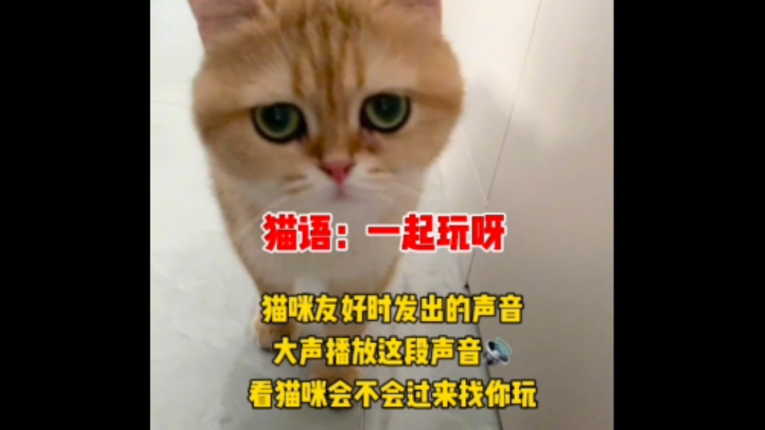 | 5108 | 2026-11-08 |
| [可爱动物](https://www.bilibili.com/video/BV1nV4x6CEcf) | 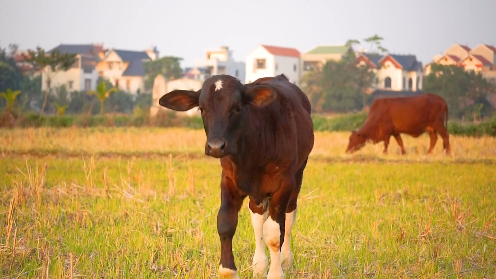 | 6374 | 2026-11-08 |
| [大狗嚼文明21](https://www.bilibili.com/video/BV1n44n68ESQ) |  | 41.6万 | 2026-11-07 |
| [天气回暖 浙江的山里就成了五步蛇的专场](https://www.bilibili.com/video/BV1ej4J67ERn) | 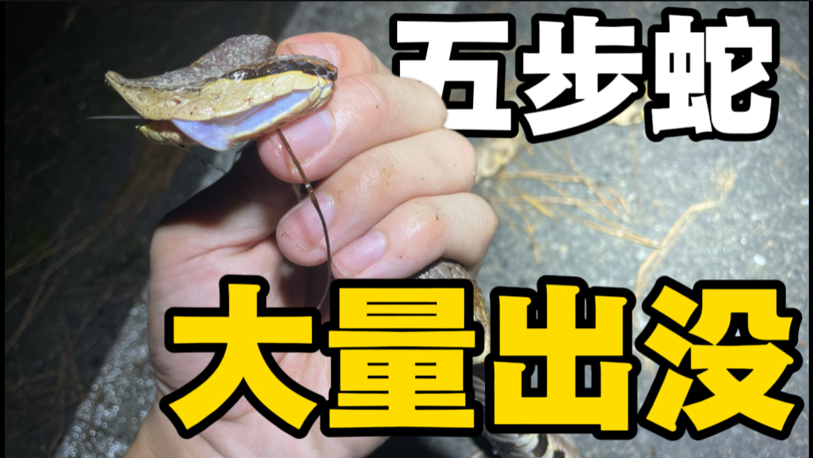 | 106.2万 | 2026-11-07 |
| [小火耄喝醉了！](https://www.bilibili.com/video/BV1Yv4E6LEH5) |  | 2820 | 2026-11-07 |
| [意外飞来的篮球，开启一场欢乐趣斗](https://www.bilibili.com/video/BV1ux4J63EFk) |  | 2.7万 | 2026-11-07 |
| [《雨爱（司凤版）》大肥鱼联合曼波制作！](https://www.bilibili.com/video/BV1qn456uEss) |  | 277 | 2026-11-06 |
| [3D玩具车动画启蒙 ｜ GIANT Long McQueen with Monster Saw](https://www.bilibili.com/video/BV1rF466UE6m) |  | 53.7万 | 2026-11-06 |
| [⚡⚡1000只猫vs1000只狗⚡⚡](https://www.bilibili.com/video/BV1oW4q6vEy7) |  | 11.2万 | 2026-11-06 |
| [斯内普演唱《Someone Like You》【AI MV大赛】](https://www.bilibili.com/video/BV1NP4q6JEus) |  | 49.7万 | 2026-11-06 |
| [奶家杯捣蛋鬼模式：海上游轮篇【AI全民制作人】](https://www.bilibili.com/video/BV1Kw4q6DEvC) |  | 62.2万 | 2026-11-06 |
| [东北洗浴体验丨猫圆圆和闺蜜第一次搓澡都发生了什么？【AI全民制作人】](https://www.bilibili.com/video/BV1944q6YEW6) |  | 5.3万 | 2026-11-06 |
| [妈，咪等你回家](https://www.bilibili.com/video/BV1De4q6ZEL3) |  | 1.0万 | 2026-11-06 |
| [刀盾食记7-11集](https://www.bilibili.com/video/BV1Hq4B61EWb) |  | 3400 | 2026-11-06 |
| [猫咪电视｜1小时池塘奇遇🐱 小鸟、游鱼和昆虫的真实自然世界｜PurrWindow](https://www.bilibili.com/video/BV1uf4i69EWC) |  | 7318 | 2026-11-06 |
| [一口气削完6万个土豆，【Potato Please】通关流程](https://www.bilibili.com/video/BV1AZ486FEzU) |  | 5.8万 | 2026-11-05 |
| [“果宝特攻这一段纯音乐可以封神了！”](https://www.bilibili.com/video/BV1nW486pEr9) |  | 201.0万 | 2026-11-05 |
| [🐱✨【治愈日常】懂事小橘猫和猫妈妈的温馨故事！看一秒烦恼全消💖](https://www.bilibili.com/video/BV15w436REMQ) |  | 2316 | 2026-11-03 |
| [小猫咪也想有个家......](https://www.bilibili.com/video/BV1h54P6YEMG) |  | 1.1万 | 2026-11-02 |
| [库洛米落水啦✨Hello Kitty 和美乐蒂立刻赶来陪伴💦](https://www.bilibili.com/video/BV1zR4c6BEYA) |  | 9.2万 | 2026-11-02 |
| [mj宇宙日常版合集4一口气看个爽](https://www.bilibili.com/video/BV1GD4w6cEDZ) |  | 18.7万 | 2026-11-02 |
| [【卡机哈基米】视频加载中，速速查收惊喜！](https://www.bilibili.com/video/BV13rxW6XE3x) |  | 91 | 2026-11-01 |
| [一发入魂](https://www.bilibili.com/video/BV1Uxxs6QEX3) |  | 4.2万 | 2026-11-01 |
| [⚡️朋友的酒司凤版⚡️《硼铀锝酒》【AI音乐】](https://www.bilibili.com/video/BV1uuxx6WE3b) |  | 33.9万 | 2026-11-01 |
| [🐱✨【治愈日常】懂事小橘猫和猫妈妈的温馨故事！看一秒烦恼全消💖](https://www.bilibili.com/video/BV15VxF6REaM) |  | 4703 | 2026-10-29 |
| [奶糖成毛球啦](https://www.bilibili.com/video/BV13ax76vEAg) |  | 197.6万 | 2026-10-29 |
| [人间情悠然，姑娘把谁记心上](https://www.bilibili.com/video/BV1i4xg6REcB) |  | 54.2万 | 2026-10-27 |
| [猫妈妈带姜黄色小猫去游乐场玩耍，小猫开心地滑滑梯，快乐到飞起！🐱🎢🥰](https://www.bilibili.com/video/BV1Vqnf6yENM) |  | 322 | 2026-10-26 |
| [西域猫，这古风哈基米谁不爱呀！](https://www.bilibili.com/video/BV1sZnm6hEia) |  | 1.5万 | 2026-10-22 |
| [不同人的世界](https://www.bilibili.com/video/BV1ELJ267EQT) |  | 5.2万 | 2026-10-17 |
| [人，咪是凑凑的吗](https://www.bilibili.com/video/BV1xtp16cE7E) | 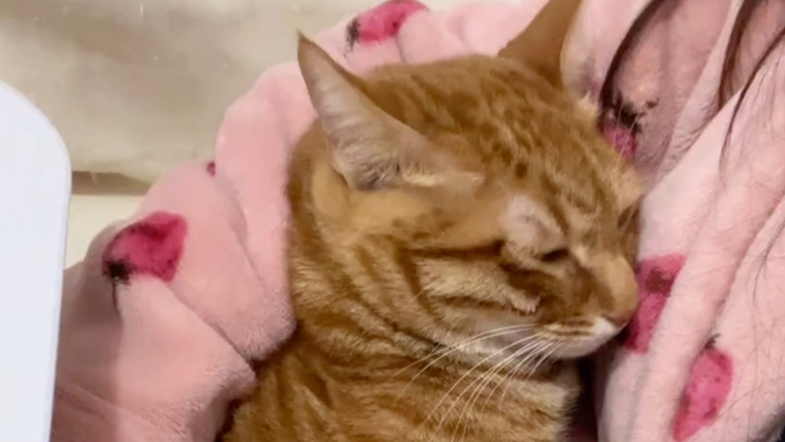 | 16.5万 | 2026-10-14 |
| [山海咕嘎1~5植物大战僵尸篇：种田养成、抓宠探险流咕嘎Doro【bilibilionly同人扶持计划】](https://www.bilibili.com/video/BV1h9eV6VE32) |  | 183.6万 | 2026-09-14 |
| [小猫的自行车摔坏了，猫妈妈自己做自行车给小猫玩，温情的故事](https://www.bilibili.com/video/BV1DyzAB4EPb) | 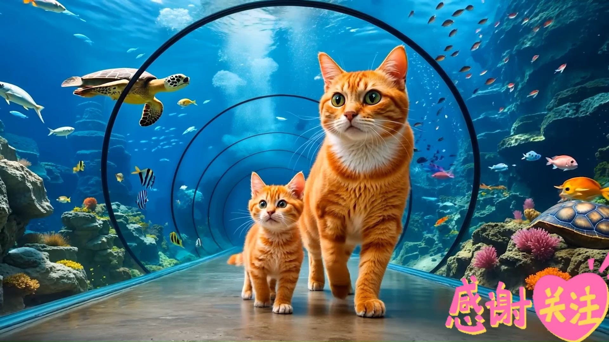 | 64.3万 | 2026-01-23 |
| [猫狗鸭，一屋捣蛋，猫妈妈头都大了](https://www.bilibili.com/video/BV1Bn8tzqEUM) |  | 2.7万 | 2025-07-26 |

---
*最后更新: 2026-11-14 08:55:45 (自动生成)*
*数据来源: [Bilibili](https://www.bilibili.com)*

## 使用说明

运行以下命令更新视频列表:
```bash
python3 fetch_hajimi_videos.py
```
