# awesome-hajimi
collections of hajimi (哈基米 in Chinese) on the Internet.

## 视频列表 (Video List)

| 视频标题 (Title) | 封面 | 播放量 (Views) | 发布日期 (Date) |
|---|---|---|---|
| [这是一条记录O神教训哈基米的视频【0verthink1NG】](https://www.bilibili.com/video/BV1YTWb6eEkq) |  | 1593 | 2026-11-09 |
| [【全熟】新人日本巫女看圆头耄耋名场面 【好可爱~哈基米~好....可怕！比恐怖游戏还可怕！！】](https://www.bilibili.com/video/BV1SaWx6SEZj) | 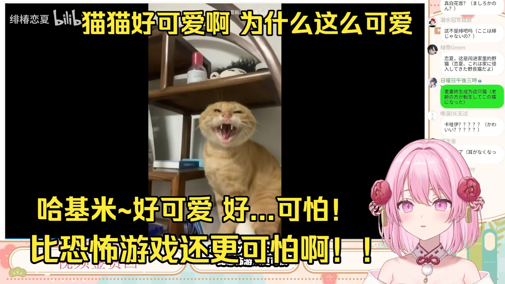 | 1633 | 2026-11-09 |
| [【星铁熟肉/miumi】miumi被赛飞儿临终告白破防，看到小白的留言化身哈基米疯狂哈气。#みうみみう](https://www.bilibili.com/video/BV13bWx6XE2b) |  | 1360 | 2026-11-09 |
| [哈基米：人，你没事吧？](https://www.bilibili.com/video/BV1H2Wx6gEyA) | 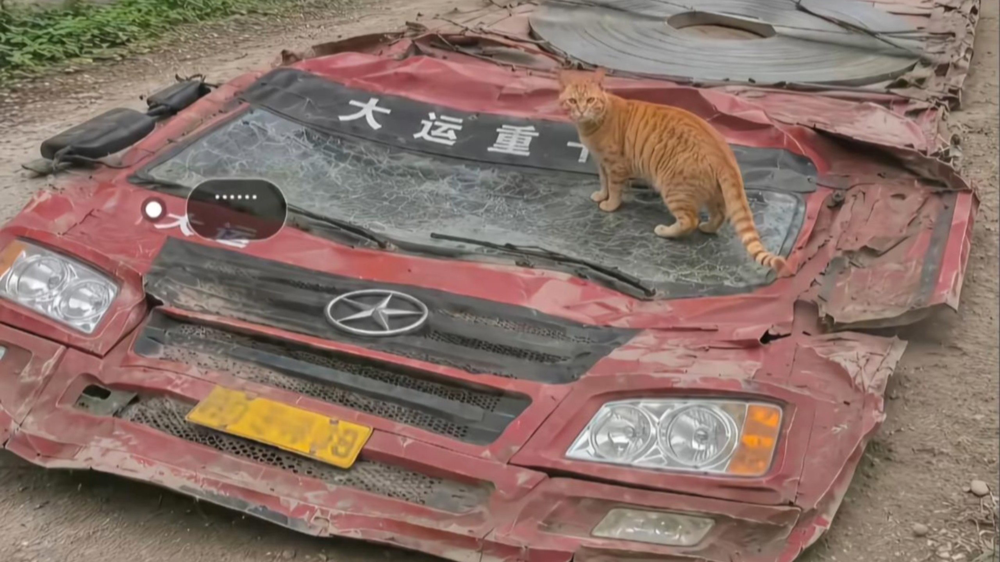 | 4116 | 2026-11-09 |
| [哈基米听到老吴却匹配不到对手以为闹鬼了](https://www.bilibili.com/video/BV1wtW46GEsF) | 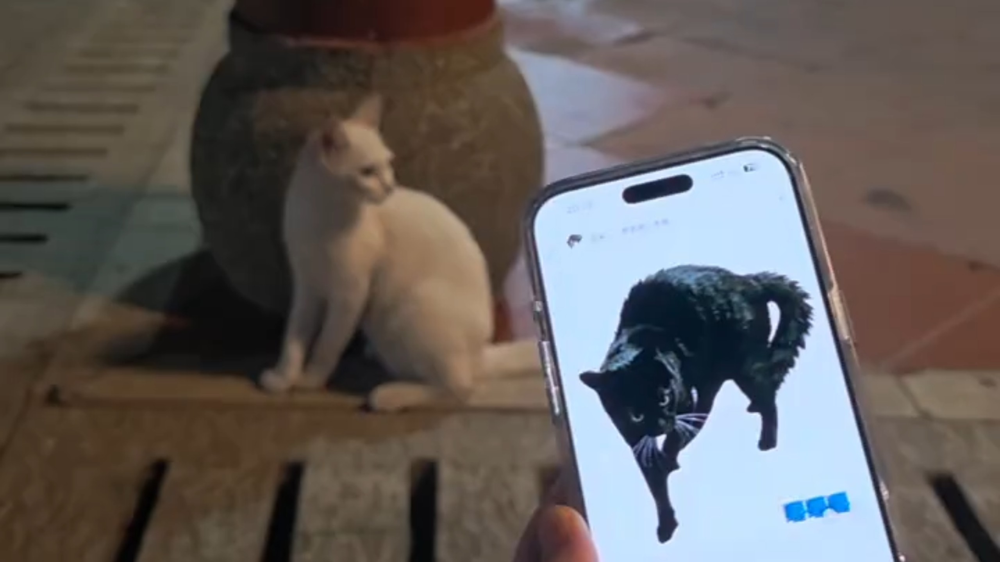 | 1723 | 2026-11-09 |
| [哈基米又来偷东西吃](https://www.bilibili.com/video/BV1spW461EEz) | 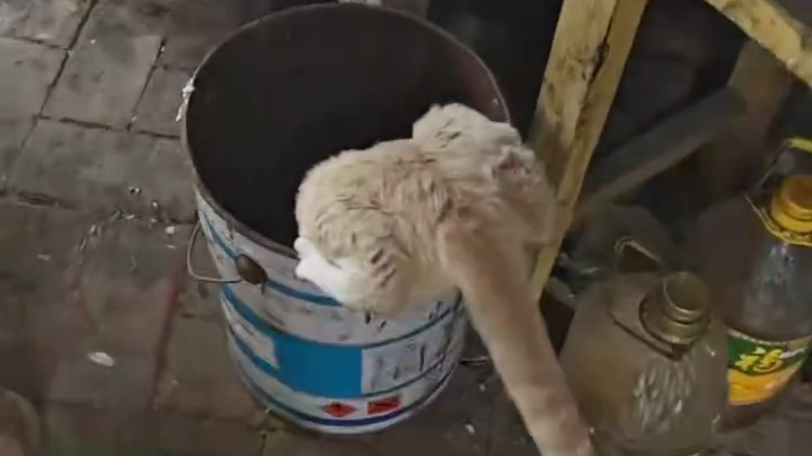 | 1062 | 2026-11-09 |
| [FTK型哈基米,五分钟天梯狂赢四局!【游戏王MD】](https://www.bilibili.com/video/BV1gNWp6rE68) |  | 1384 | 2026-11-09 |
| [相信我的歌品](https://www.bilibili.com/video/BV1GvWE6vE4r) | 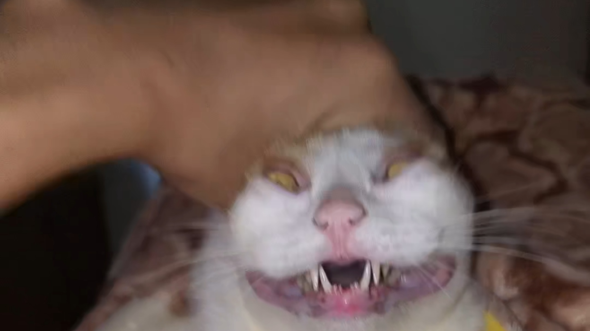 | 2508 | 2026-11-09 |
| [【1-4季】开局就是一局日本话，哈基米！熬夜猝死穿越成废柴，娶的残疾妻子竟也是蓝星穿越者](https://www.bilibili.com/video/BV1zKWW6fEmn) |  | 3271 | 2026-11-08 |
| [调用代码无需思考，基米的轮椅复读指南](https://www.bilibili.com/video/BV11dWp6iERR) | 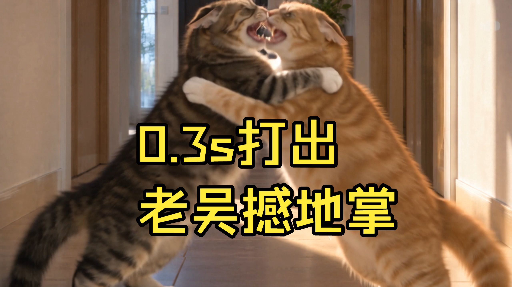 | 2675 | 2026-11-08 |
| [【ShenYue】初入rx以为遇到好人了可以直接哈基米曼波鼠鼠得吃，但没想到遇到的却是一个玩弄人心的恶魔...](https://www.bilibili.com/video/BV1XkWp6LEas) | 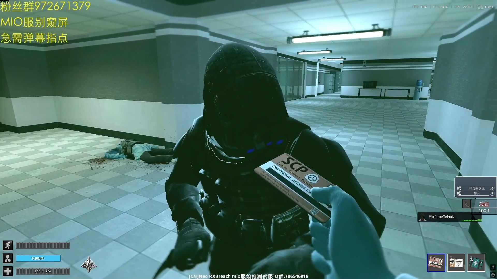 | 824 | 2026-11-08 |
| [哈基米想骑自行车了](https://www.bilibili.com/video/BV1k6WH6ZE7c) | 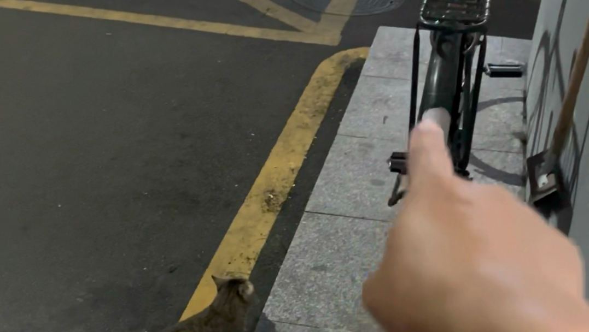 | 1368 | 2026-11-08 |
| [超袖和乔乐秀恩爱，结果不小心把哈基米……](https://www.bilibili.com/video/BV1z1WH6sExT) |  | 1253 | 2026-11-08 |
| [万一真的是哈基米自己烤的烤鸭呢](https://www.bilibili.com/video/BV1k6WH6ZEpH) | 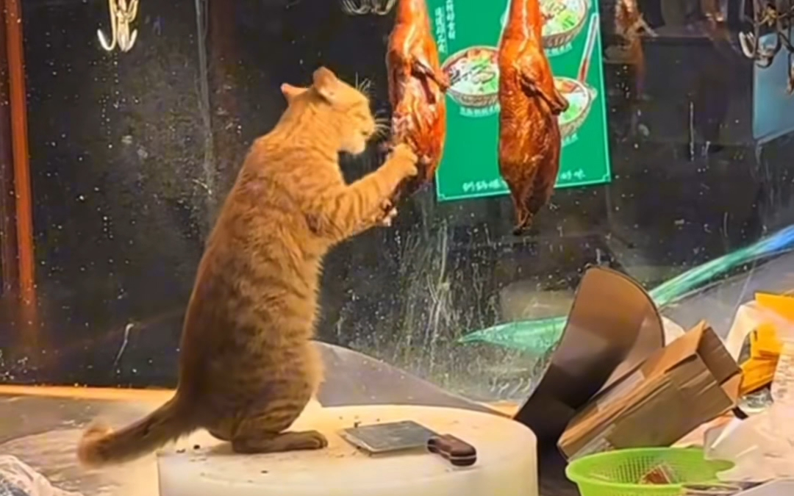 | 1114 | 2026-11-08 |
| [为了练倒立竟然自断一条腿吗，哈基米你这家伙😭😭😭](https://www.bilibili.com/video/BV1n6WH6ZEYL) | 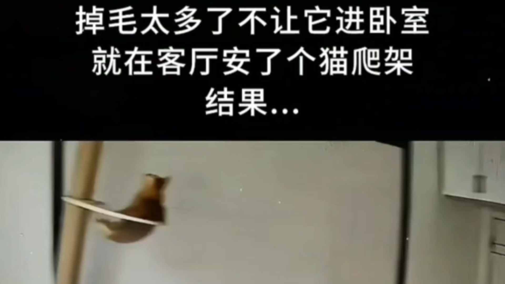 | 471 | 2026-11-08 |
| [哈基米南北绿豆小白得吃非洲之心](https://www.bilibili.com/video/BV1xaWH6PEGH) |  | 300 | 2026-11-08 |
| [误入试炼惨被群趴，哈基米千里救大狗](https://www.bilibili.com/video/BV1sUWE6dEjQ) | 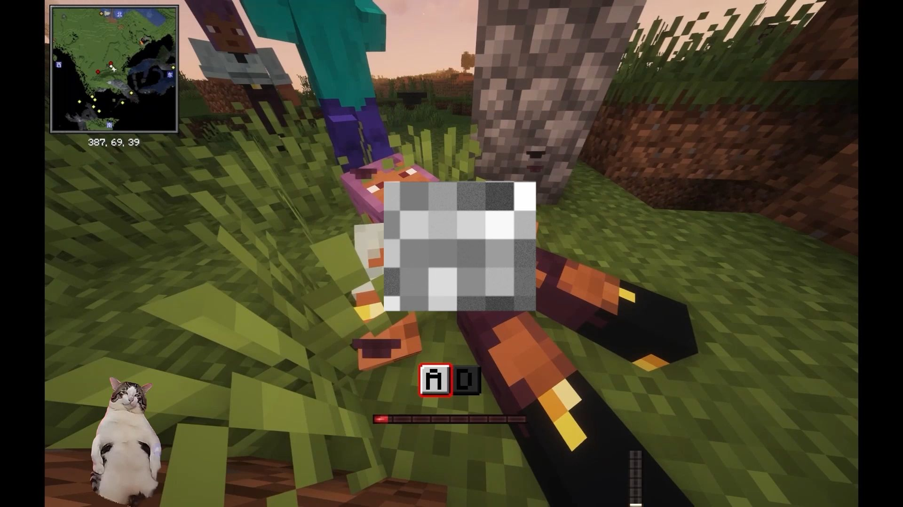 | 1166 | 2026-11-08 |
| [claude：你是说哈基米把蛋糕偷走了？大肥鱼：对！](https://www.bilibili.com/video/BV1t6WE6wEXw) |  | 769 | 2026-11-08 |
| [来自哈基米的压力](https://www.bilibili.com/video/BV1vgWJ66Eat) | 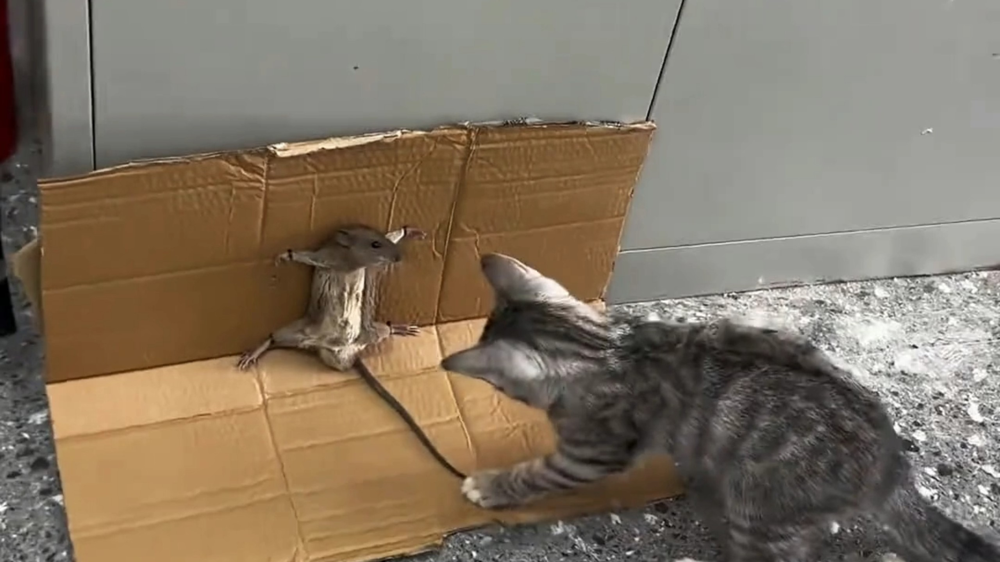 | 2130 | 2026-11-08 |
| [基米幽默时刻之QQ爬虫](https://www.bilibili.com/video/BV1W8WJ6oEjs) | 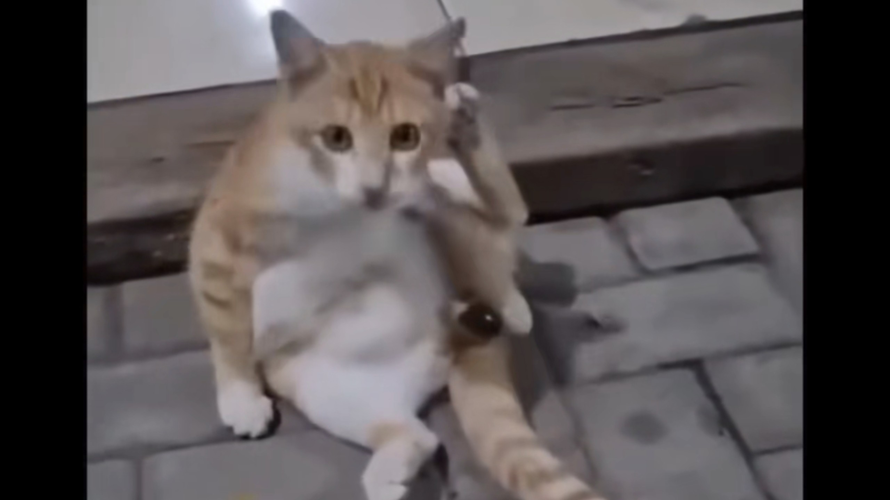 | 4.7万 | 2026-11-08 |
| [火舞大人带上两首BGM，就踏上新赛季的征途](https://www.bilibili.com/video/BV14xWJ68Egc) |  | 5229 | 2026-11-08 |
| [哈基米惨遭袭击](https://www.bilibili.com/video/BV1xuWn6cET2) | 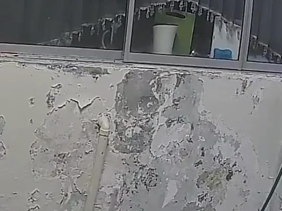 | 1.1万 | 2026-11-08 |
| [11.08 哈基米](https://www.bilibili.com/video/BV14uWn6cEyP) | 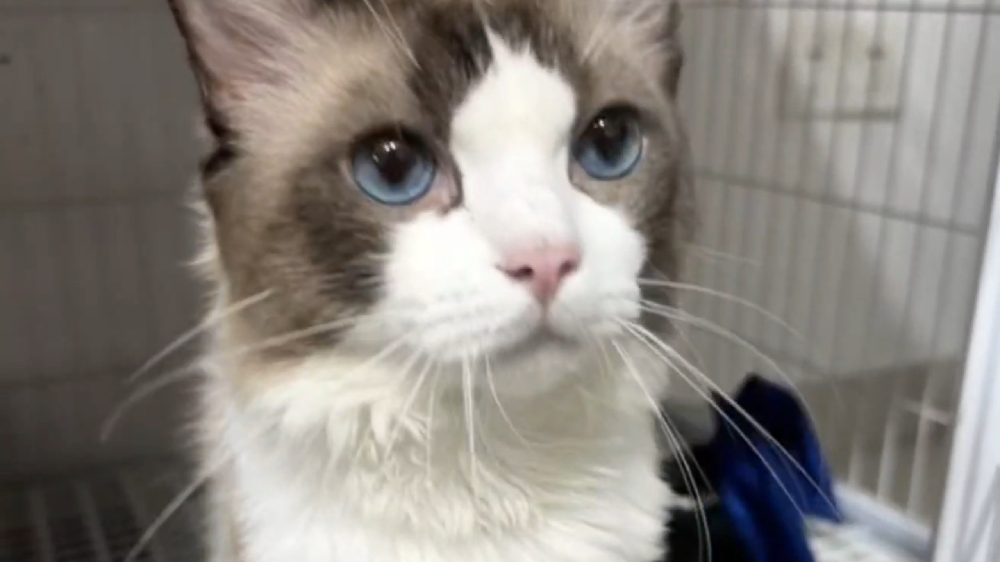 | 1465 | 2026-11-08 |
| [甜蜜小音登场](https://www.bilibili.com/video/BV1NgWn68EPY) | 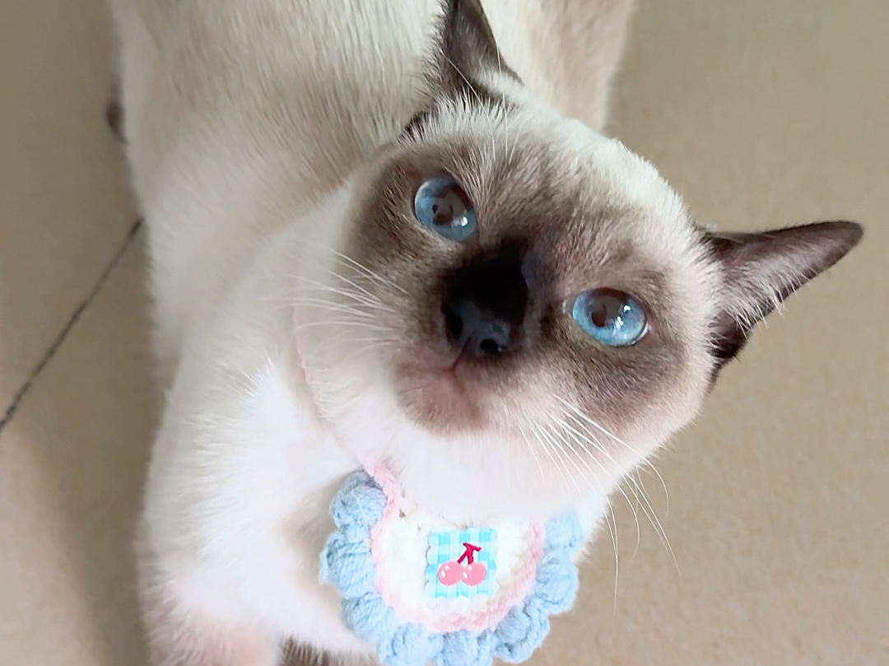 | 8556 | 2026-11-08 |
| [偶遇哈基米](https://www.bilibili.com/video/BV1VQWJ6kE6g) | 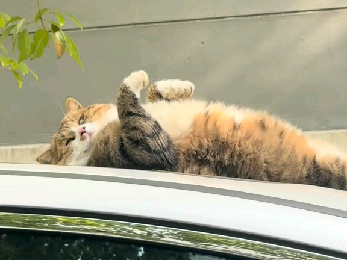 | 3196 | 2026-11-08 |
| [哈基米系统故障在马路边直接触发底层代码](https://www.bilibili.com/video/BV1gZWJ6BEke) | 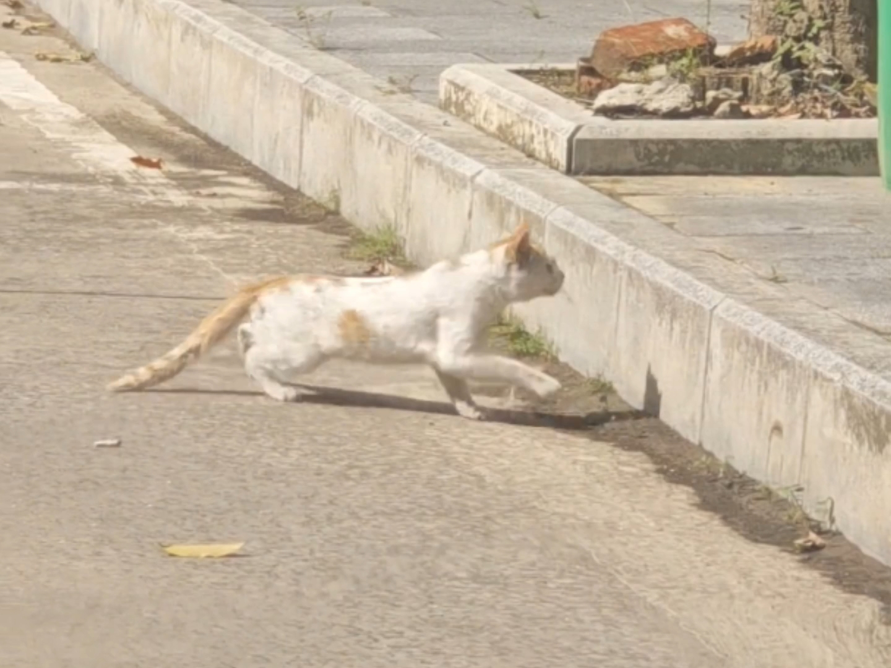 | 5086 | 2026-11-08 |
| [谁是最会打弹弹堂的AI？哈基米和龙龙把自己炸通透了！](https://www.bilibili.com/video/BV1xHW76sEdG) |  | 3042 | 2026-11-08 |
| [“猫咪自己待着时候VS主人看着时候     哈基米的双面“喵声”🐱”](https://www.bilibili.com/video/BV14pW769Emm) | 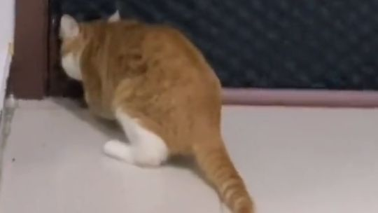 | 1139 | 2026-11-08 |
| [哈基米南北绿豆](https://www.bilibili.com/video/BV1qAW76qEuF) |  | 50 | 2026-11-08 |
| [基米光速嚼口香糖加镭射激光眼，已调整至最好摸的状态](https://www.bilibili.com/video/BV1924s6wEbq) | 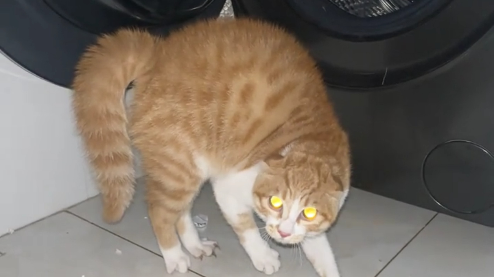 | 6095 | 2026-11-08 |
| [【TOP15】劉俊朗歌曲B站热度排行，第一名实至名归！](https://www.bilibili.com/video/BV17H4x6ME8P) |  | 4983 | 2026-11-08 |
| [【凿凿凿行动】城郊幻境（高危2M）41.8w→????w｜绝区零搜打撤](https://www.bilibili.com/video/BV17E4x6gERP) | 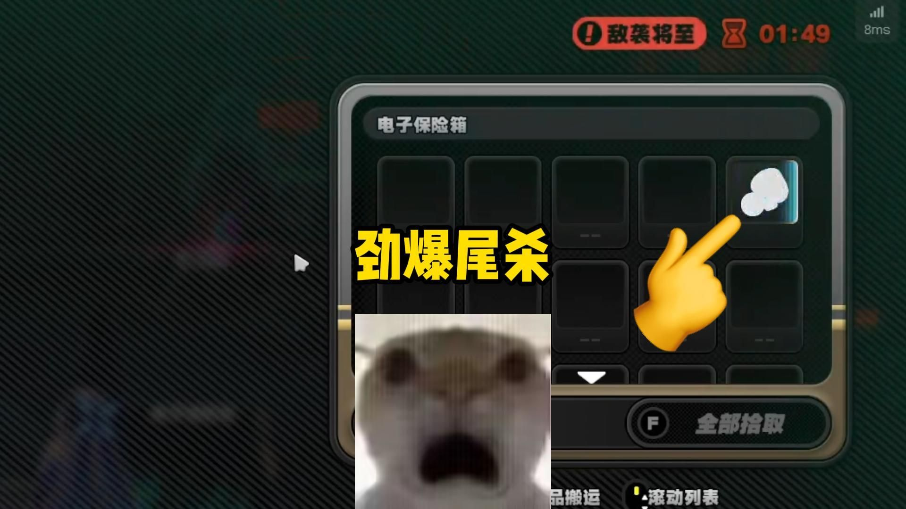 | 1.6万 | 2026-11-08 |
| [哈基米曼波叔叔德吃鸡米航天](https://www.bilibili.com/video/BV1mc4x6QEXt) |  | 1745 | 2026-11-08 |
| [一声老吴挑起两只猫的战争](https://www.bilibili.com/video/BV1xA4x6nEPu) | 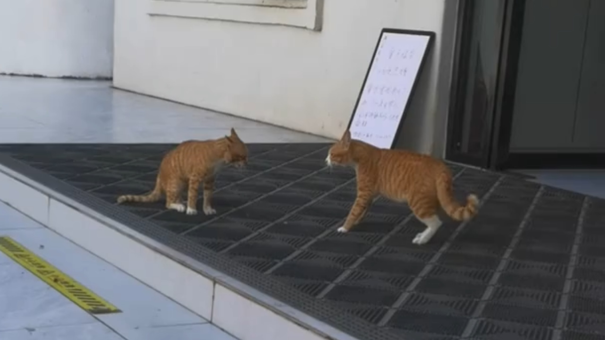 | 7131 | 2026-11-08 |
| [【CSP】来点美味小茂](https://www.bilibili.com/video/BV1gB4x64ET8) |  | 2069 | 2026-11-08 |
| [🐱哈gemi 不 是 罪 过 ~🐱](https://www.bilibili.com/video/BV1vr4p6oEqx) |  | 1763 | 2026-11-07 |
| [允许哈气](https://www.bilibili.com/video/BV1dX4J6QEtc) | 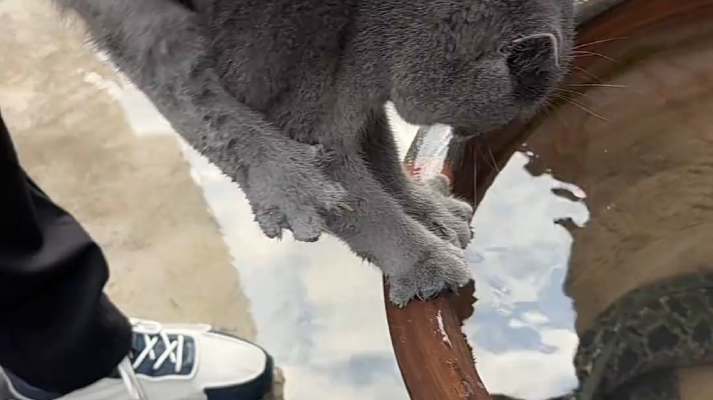 | 8.7万 | 2026-11-07 |
| [哈基米南北绿豆](https://www.bilibili.com/video/BV1644n6bEsf) |  | 176 | 2026-11-07 |
| [邪恶基米试图毁灭世界](https://www.bilibili.com/video/BV1h14n6jEg9) | 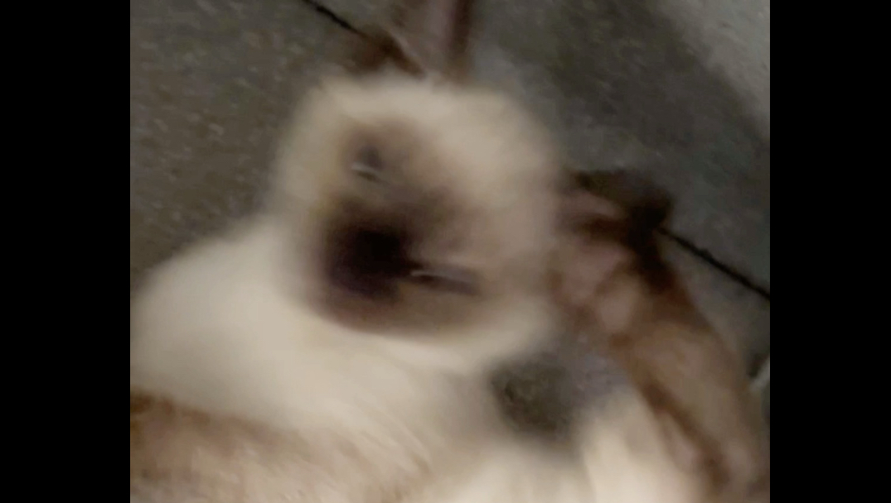 | 4175 | 2026-11-07 |
| [立冬快乐，记得吃饺子呀！](https://www.bilibili.com/video/BV1Yk4n6EEX2) |  | 5374 | 2026-11-07 |
| [每次我哼歌，我家失聪的小猫都会贴过来](https://www.bilibili.com/video/BV1RR476kEKR) | 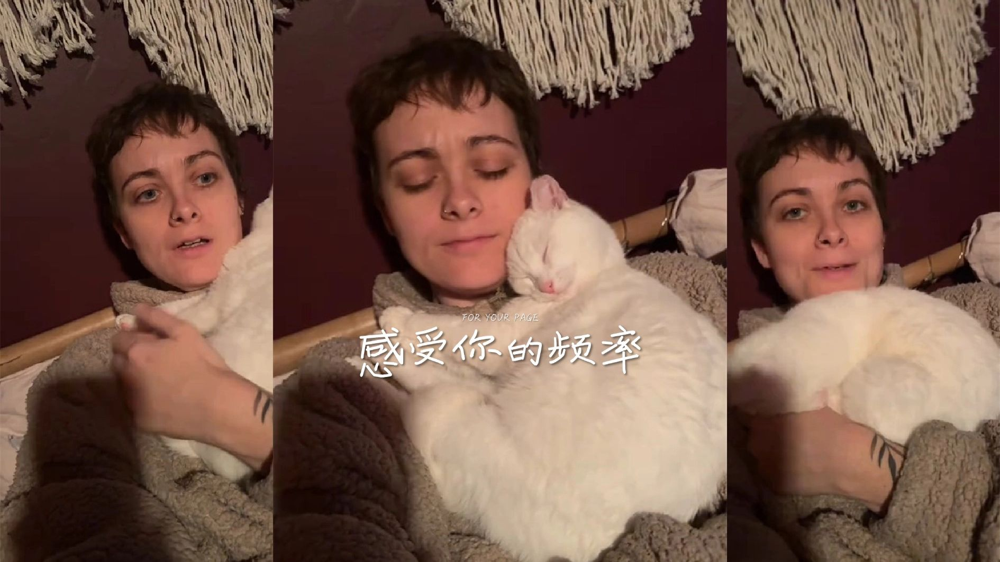 | 1.9万 | 2026-11-07 |
| [新赛季只拼运气拼炸胡吗](https://www.bilibili.com/video/BV1kw4H6vEkb) |  | 5614 | 2026-11-07 |
| [从哈基米到圣斗狮的悲剧](https://www.bilibili.com/video/BV1TK4E6KEhf) |  | 4162 | 2026-11-07 |
| [猫儿这个望镜畏](https://www.bilibili.com/video/BV1Dr4E63EUR) | 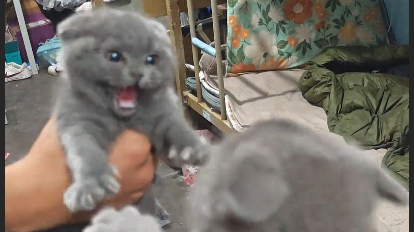 | 7.4万 | 2026-11-07 |
| [哈基宗日常](https://www.bilibili.com/video/BV1Dy4E6uEiT) | 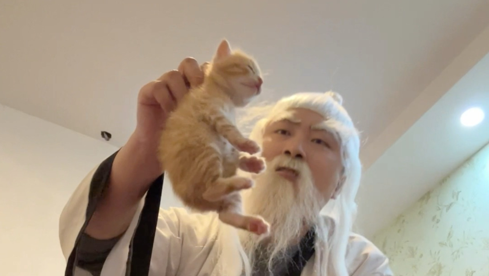 | 7701 | 2026-11-07 |
| [基米这个知恩图报](https://www.bilibili.com/video/BV1tU4E6iEym) | 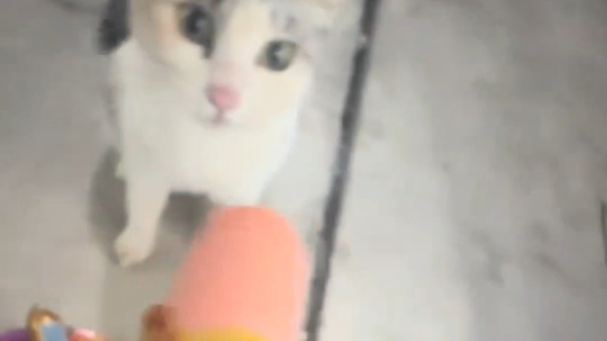 | 6.3万 | 2026-11-07 |
| [有够猎奇的](https://www.bilibili.com/video/BV1by4E6uEpJ) | 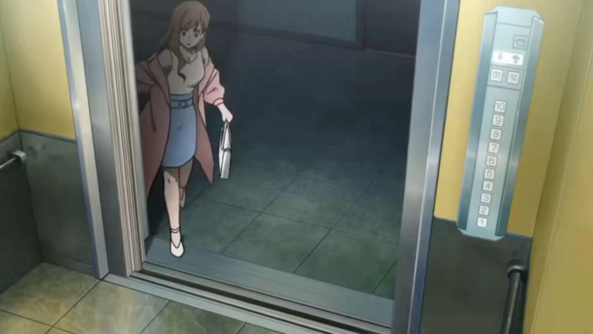 | 9.9万 | 2026-11-07 |
| [为什么说跑刀被追时不要一味的逃跑？](https://www.bilibili.com/video/BV1eY4E62Ess) |  | 51.3万 | 2026-11-07 |
| [小朋友你作业掉了](https://www.bilibili.com/video/BV14y4j6hEdq) |  | 3.2万 | 2026-11-07 |
| [曼波：斐波那契数列](https://www.bilibili.com/video/BV1qE4566EBR) |  | 4761 | 2026-11-06 |
| [小时候养过圣甲虫](https://www.bilibili.com/video/BV1pQ4q67E3F) | 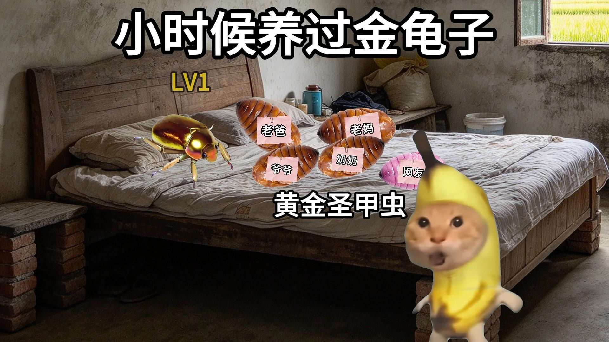 | 157.8万 | 2026-11-06 |
| [⚡逆天蜘蛛侠⚡](https://www.bilibili.com/video/BV1qN4B6qE5Y) |  | 58.0万 | 2026-11-06 |
| [哈基米也逃不过真香定律？](https://www.bilibili.com/video/BV1zf4q6rEoM) | 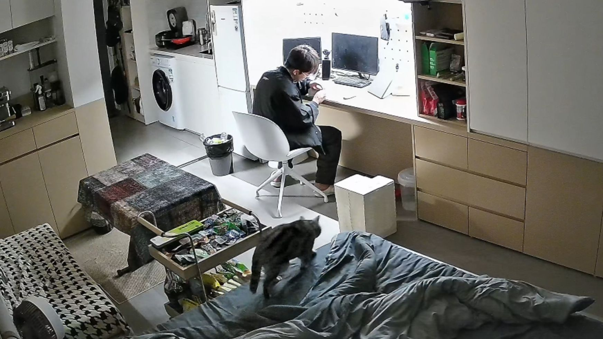 | 5294 | 2026-11-06 |
| [南瓜哈基米竟是白送?!又有放烟花拿钻!万圣节活动速览!&lt;杖剑传说&gt;](https://www.bilibili.com/video/BV1vA4i6cEGg) |  | 3604 | 2026-11-06 |
| [曼波 の 绿色「若不是你突然闯进我生活，我怎会把死守的寂寞放任了？」](https://www.bilibili.com/video/BV1rQ4v6BE29) |  | 597 | 2026-11-06 |
| [台上三分钟，台下十年功](https://www.bilibili.com/video/BV1Ee4e6wEfd) |  | 699 | 2026-11-06 |
| [让对面睡不着也是游戏本质](https://www.bilibili.com/video/BV1mx4b6wEvH) |  | 9480 | 2026-11-05 |
| [研究发现：猫的梦里有98%是关于高等数学。](https://www.bilibili.com/video/BV1yL486ZEBe) | 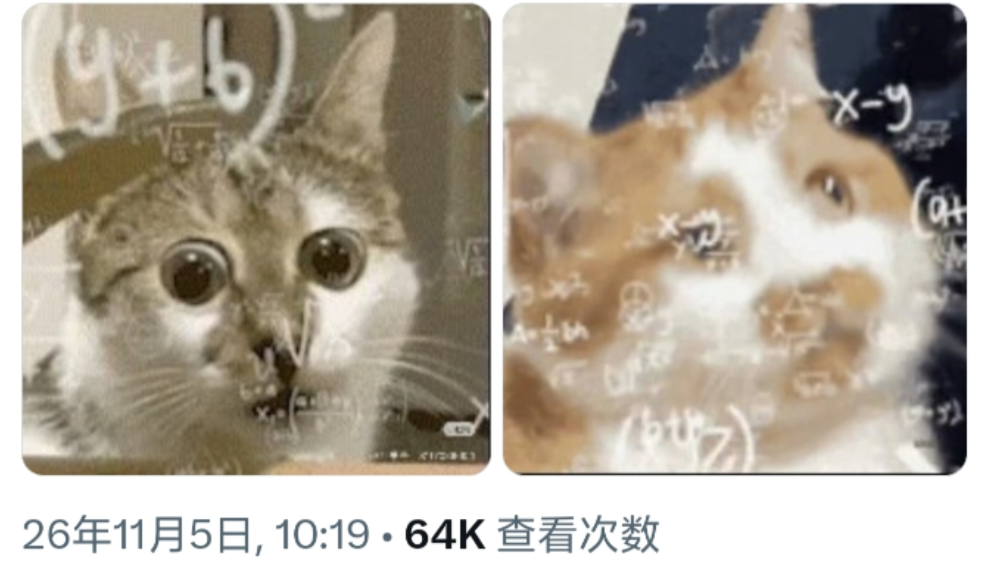 | 19.4万 | 2026-11-05 |
| [许愿的时候别忘了说是否接受调剂🌕](https://www.bilibili.com/video/BV13exQ6wEYM) | 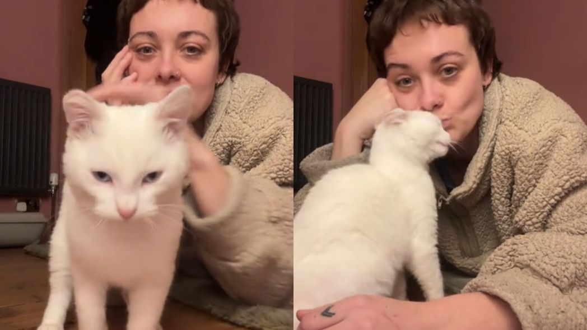 | 10.8万 | 2026-11-04 |
| [校园里的可爱猫咪～](https://www.bilibili.com/video/BV1Z9xS66EdT) | 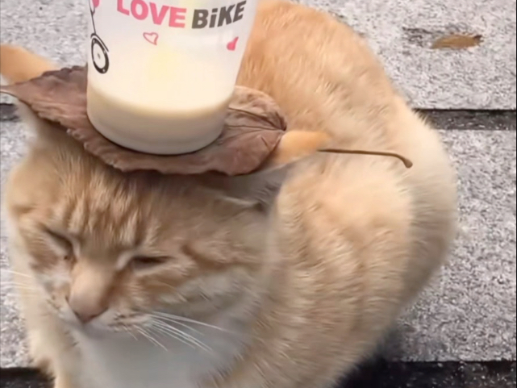 | 49.1万 | 2026-11-04 |
| [舔基米](https://www.bilibili.com/video/BV1p14G65EXp) | 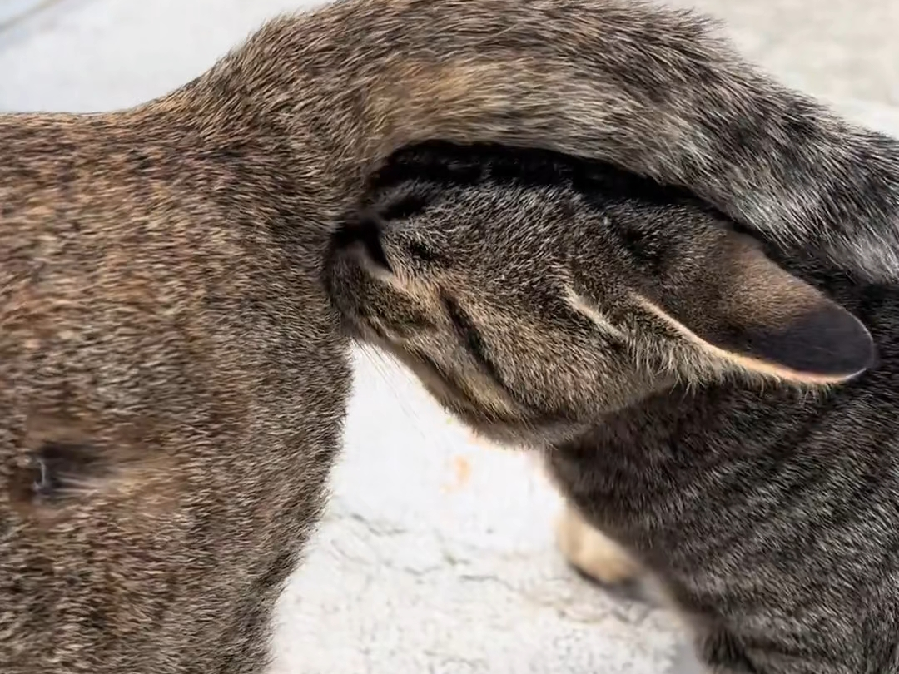 | 1.6万 | 2026-11-03 |
| [猫咪：天冷了，我要回我的狗窝睡觉觉了！](https://www.bilibili.com/video/BV1kP4g6eE8D) | 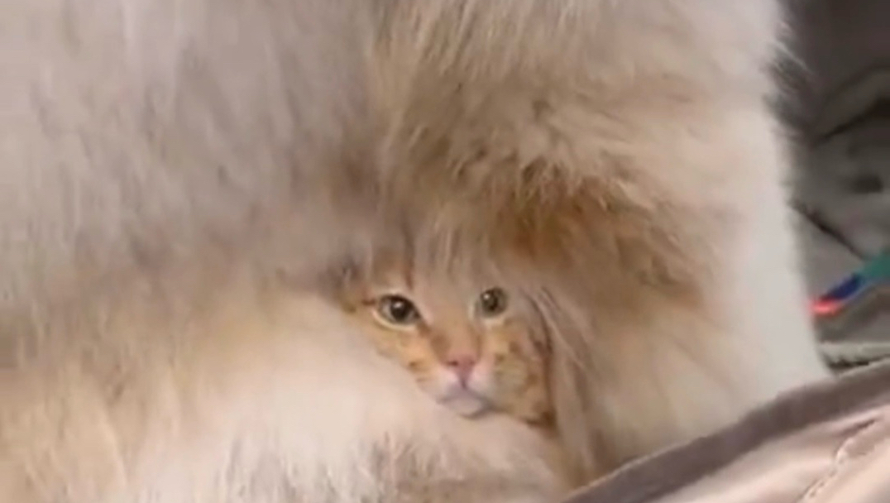 | 58.9万 | 2026-11-03 |
| [王楚钦＆张本智和《Trouble Maker》【AI MV大赛】](https://www.bilibili.com/video/BV1No4u6gEbg) |  | 29.6万 | 2026-11-03 |
| [难绷 TV 之搞快点](https://www.bilibili.com/video/BV1yq4M6PE21) | 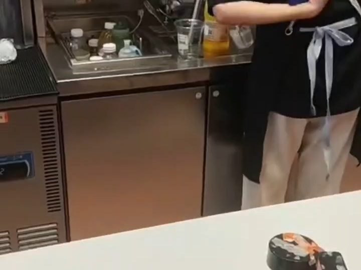 | 34.6万 | 2026-11-03 |
| [猫：不努力就会沦为人类的玩物！](https://www.bilibili.com/video/BV1Ud4w6REqw) | 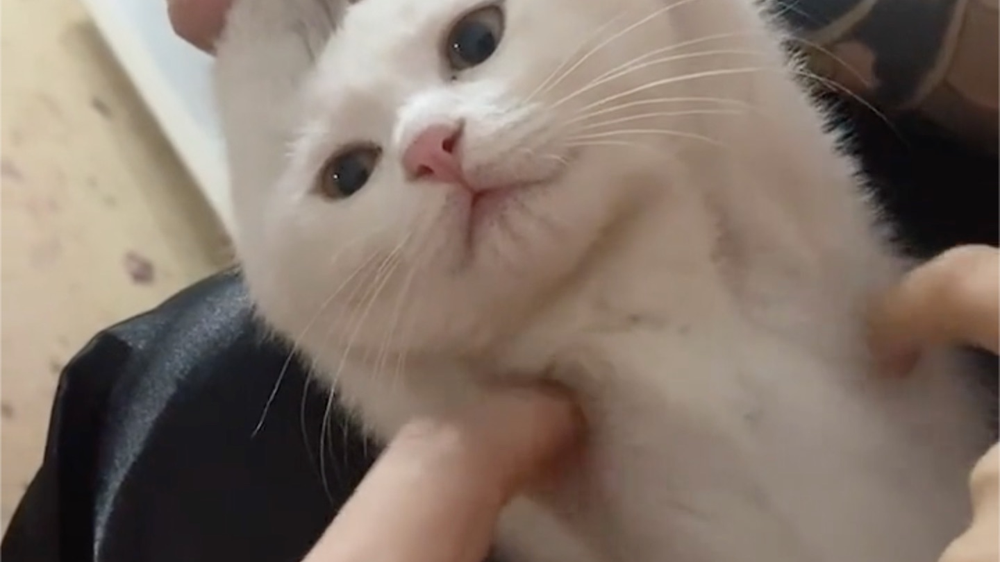 | 5.2万 | 2026-11-02 |
| [基米这个有人性](https://www.bilibili.com/video/BV1tCxh6vEU4) | 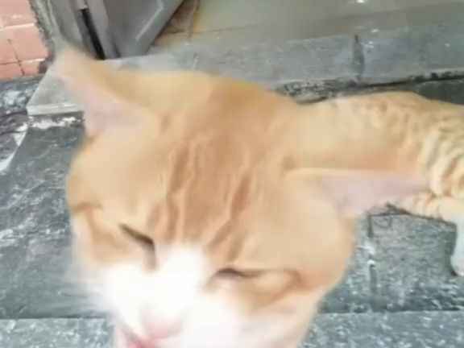 | 21.8万 | 2026-11-02 |
| [那双眼睛，毋庸置疑！没想到你能象到这种地步啊！](https://www.bilibili.com/video/BV13Cxq6fE8S) | 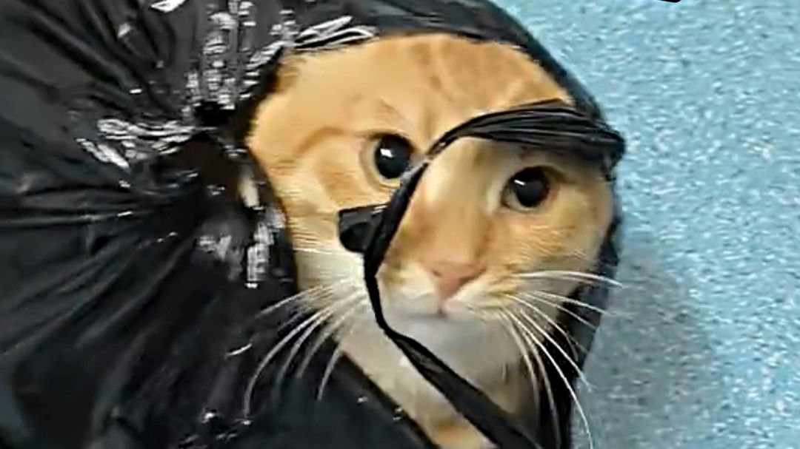 | 14.5万 | 2026-10-30 |
| [【锐评】全网最火的动漫歌曲都是哪些？什么水平？一起严肃品鉴！](https://www.bilibili.com/video/BV1mvsX6xE5B) |  | 108.8万 | 2026-10-29 |
| [哪怕你不玩游戏，也绝对认识角色！](https://www.bilibili.com/video/BV1k9so6fEPb) |  | 10.1万 | 2026-10-29 |
| [va到底要说啥？？](https://www.bilibili.com/video/BV16fsf6PEKy) | 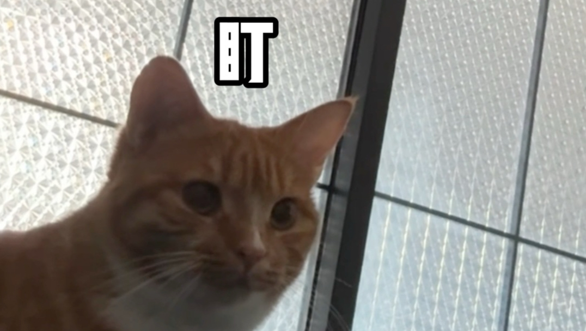 | 5.5万 | 2026-10-29 |
| [吴站长&amp;梅姐《Trouble Maker》【AI MV大赛】](https://www.bilibili.com/video/BV1dEsX6TEGx) |  | 407.0万 | 2026-10-29 |
| [【芝恩hires】开屏暴击😋  睡眠引导x指尖魔法刺激绝佳点位](https://www.bilibili.com/video/BV1vcs96BE5C) |  | 11.8万 | 2026-10-28 |
| [小卖部的猫店员恢复营业，重新开始招揽客人](https://www.bilibili.com/video/BV1ULxE6NEV1) | 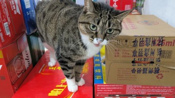 | 5.1万 | 2026-10-28 |
| [被骗去医院后 彻底哄不好了](https://www.bilibili.com/video/BV1Zox767EyM) | 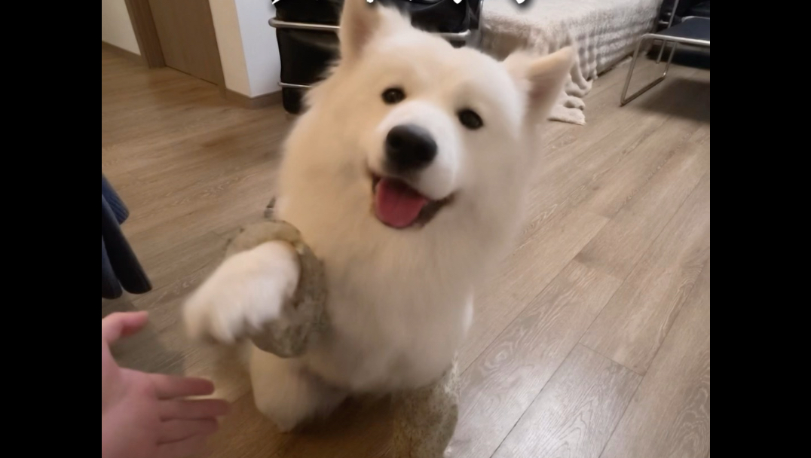 | 10.3万 | 2026-10-28 |
| [小猫吃席](https://www.bilibili.com/video/BV11HxE6cECk) |  | 2.5万 | 2026-10-28 |
| [带大家看看猫咪幼儿园的最新进展~](https://www.bilibili.com/video/BV1DwxG6SE6z) |  | 3.4万 | 2026-10-28 |
| [我要闹了😭2！！！](https://www.bilibili.com/video/BV1KhxV6SE4Z) | 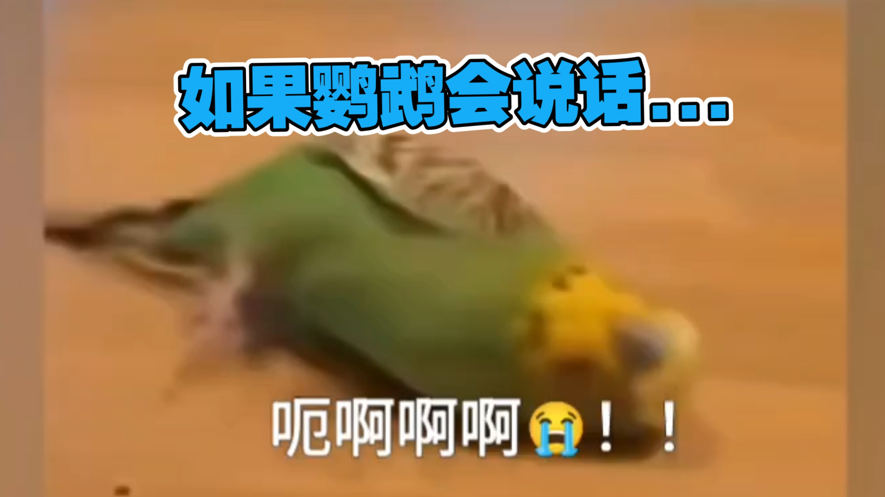 | 288.0万 | 2026-10-28 |
| [咕嘎追凶 第一集 （不知道会不会有第二集）](https://www.bilibili.com/video/BV1zpxG6KEsp) |  | 49.8万 | 2026-10-28 |
| [白袜套基米](https://www.bilibili.com/video/BV1HXxM6FEus) | 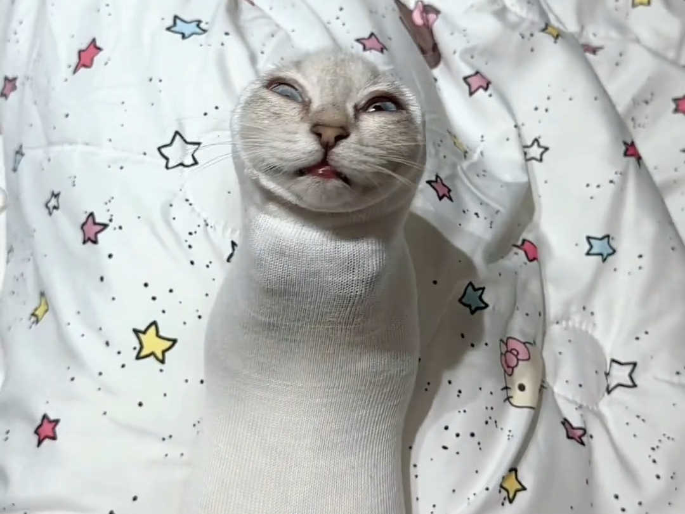 | 6.7万 | 2026-10-27 |
| [【ASMR】免疫耳朵别划走！开场3秒直接爽到天灵盖｜高密度触发音](https://www.bilibili.com/video/BV1pHnf6REnX) |  | 7.8万 | 2026-10-26 |
| [风雪夜独自回黑龙江荒野据点，室内炉火正暖饱餐饮酒，听着外面大雪安静度过慢慢长夜](https://www.bilibili.com/video/BV1m4nd69EHC) |  | 109.6万 | 2026-10-26 |
| [坦度越来越高了，国服韩信撸不动了！](https://www.bilibili.com/video/BV1YQn96fE18) | 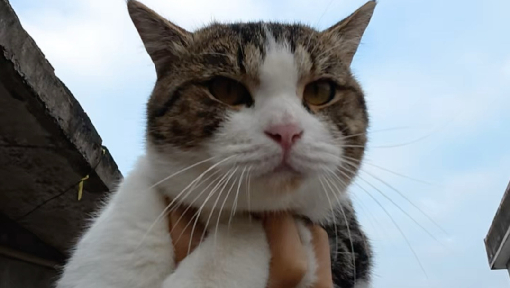 | 55.9万 | 2026-10-26 |
| [皮特携手恶搞之家全成员演唱《uptown funk》](https://www.bilibili.com/video/BV1FLHP6NESZ) |  | 31.9万 | 2026-10-24 |
| [☝🤓看完你还有手感吗？塔科夫零资产-第一期](https://www.bilibili.com/video/BV149nm6PEs3) |  | 8088 | 2026-10-23 |
| [“南下の小曲.”｜《Montagem Nada》](https://www.bilibili.com/video/BV11jnm6bEM6) |  | 38.2万 | 2026-10-23 |
| [【柏林之声】《朝你首都捏一把》](https://www.bilibili.com/video/BV192n66REA2) |  | 30.4万 | 2026-10-21 |
| [就变一下](https://www.bilibili.com/video/BV1j3nv6LEmD) | 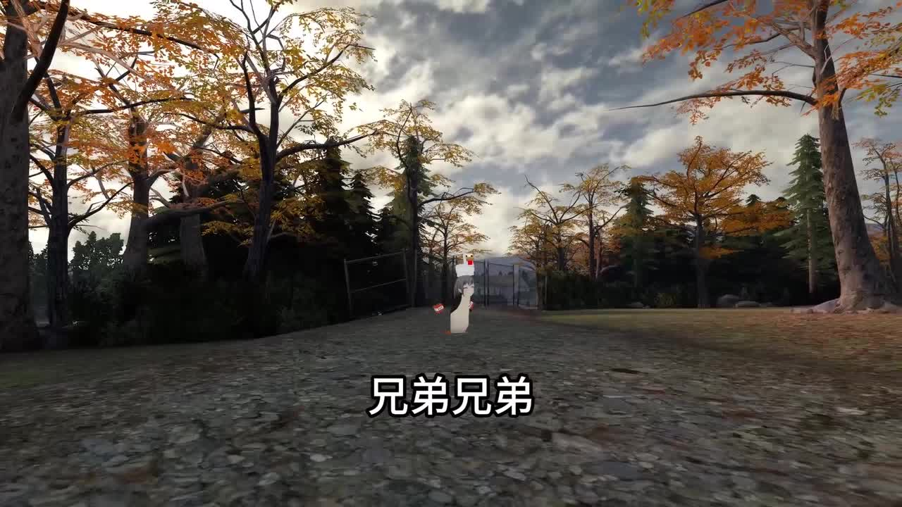 | 169.2万 | 2026-10-21 |
| [猫：同伴一只一只被吃，下一个就是我](https://www.bilibili.com/video/BV1EUnA6fE9p) | 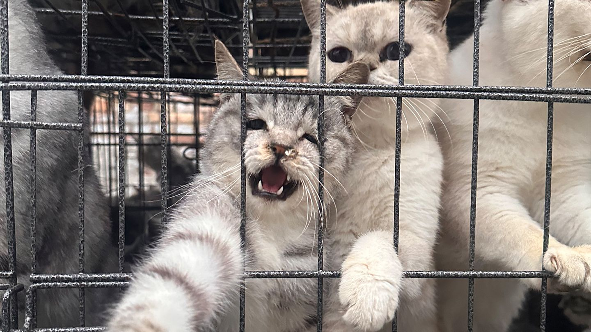 | 17.1万 | 2026-10-20 |
| [带猫咪疯狂的一天](https://www.bilibili.com/video/BV1AvJB6aEmH) |  | 212.5万 | 2026-10-18 |
| [哎呀，它叫这两声给俺朋友迷坏了](https://www.bilibili.com/video/BV1QBJt6SEWk) | 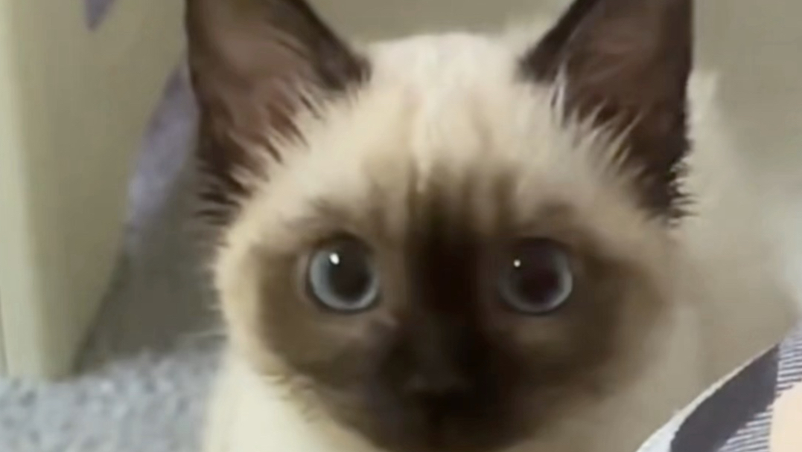 | 82.3万 | 2026-10-16 |
| [奶奶提来了一只小土猫](https://www.bilibili.com/video/BV175Jy6gESc) | 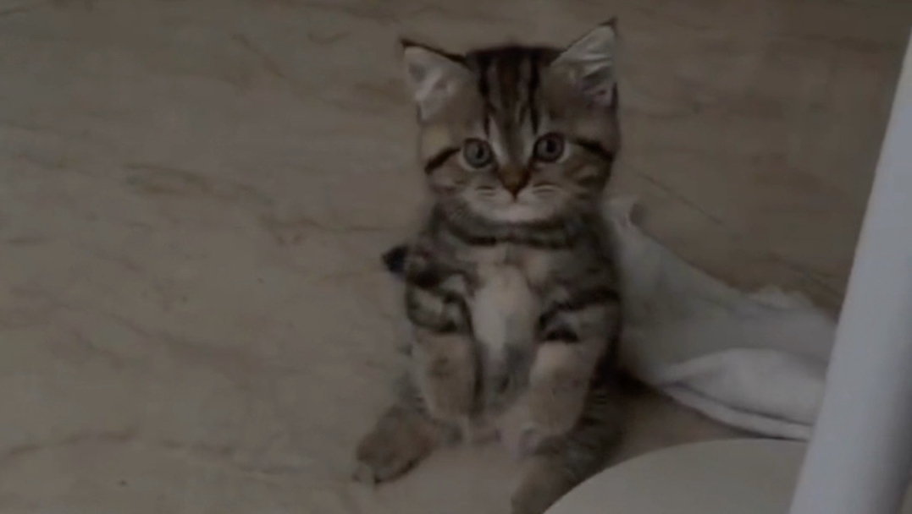 | 150.4万 | 2026-10-15 |
| [《哈利波特是大笨蛋！！！》](https://www.bilibili.com/video/BV1r9py6WEfP) |  | 32.4万 | 2026-10-14 |
| [光头强今天又发疯了 熊出没之夺宝熊兵 baby chaos](https://www.bilibili.com/video/BV1vApR6uE4h) |  | 6604 | 2026-10-12 |
| [《甲乙丙丁》，但是昭和金曲（citypop日语版）【AI MV大赛】](https://www.bilibili.com/video/BV1CrpM6dEdE) |  | 215.8万 | 2026-10-09 |
| [原来表情包小猫都出自这里～](https://www.bilibili.com/video/BV1VFH96bENj) |  | 65.3万 | 2026-10-08 |
| [🐧雨爱鹅企🐧](https://www.bilibili.com/video/BV1FoHf6RE5X) |  | 102.0万 | 2026-10-06 |
| [这才是《雨爱司凤版》原版MV，邦吧邦吧邦吧【AI MV大赛】](https://www.bilibili.com/video/BV1qvHd6GEun) |  | 366.5万 | 2026-10-05 |
| [补档:对大猫哈气会怎么样](https://www.bilibili.com/video/BV1jHht6DEJW) |  | 17.2万 | 2026-09-23 |
| [你长大了，该了解Token了](https://www.bilibili.com/video/BV1wrba6iEde) |  | 46.5万 | 2026-08-18 |
| [丁真：再嘬一口入肺里，是我今生唯一的夙愿...《死一样的抽过》](https://www.bilibili.com/video/BV1tJ4m1T7QL) |  | 2391.3万 | 2024-06-23 |

---
*最后更新: 2026-11-09 09:35:37 (自动生成)*
*数据来源: [Bilibili](https://www.bilibili.com)*

## 使用说明

运行以下命令更新视频列表:
```bash
python3 fetch_hajimi_videos.py
```
