# awesome-hajimi
collections of hajimi (哈基米 in Chinese) on the Internet.

## 视频列表 (Video List)

| 视频标题 (Title) | 封面 | 播放量 (Views) | 发布日期 (Date) |
|---|---|---|---|
| [哈基米幽默时刻之被罐头单杀](https://www.bilibili.com/video/BV1zGWq6AEm4) | 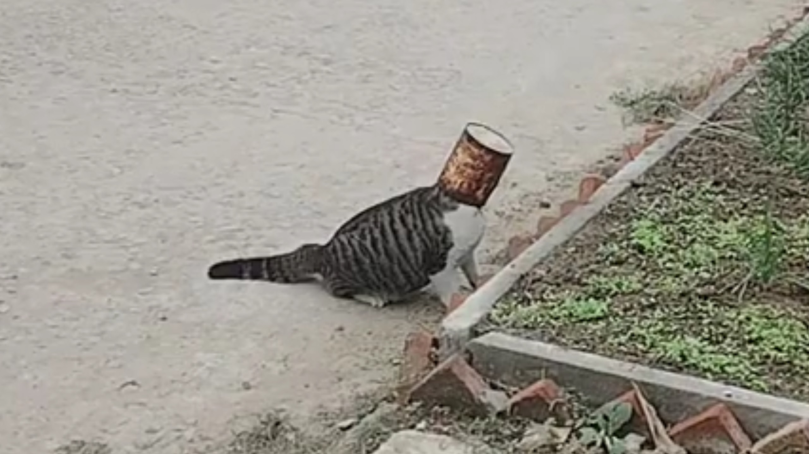 | 1141 | 2026-11-13 |
| [&quot;压抑到基致的爆发 哈基人一生等待的巨浪&quot;](https://www.bilibili.com/video/BV1eqWe6EE4z) |  | 442 | 2026-11-13 |
| [哈基米互相顶脑袋老吴是什么神秘仪式吗？](https://www.bilibili.com/video/BV1zTWv6ZEJx) | 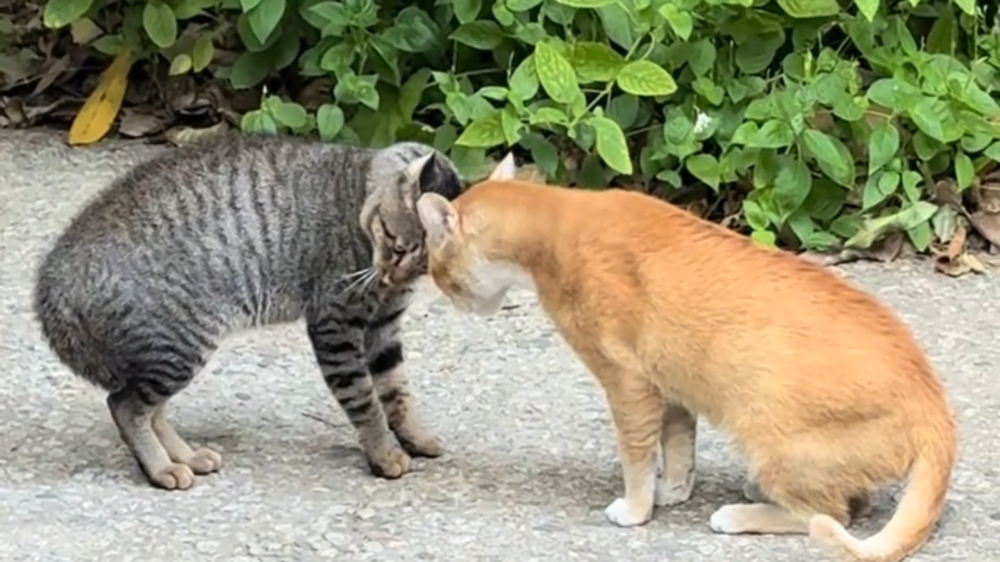 | 582 | 2026-11-13 |
| [这才是小猫该看的东西](https://www.bilibili.com/video/BV13xWv61Efd) | 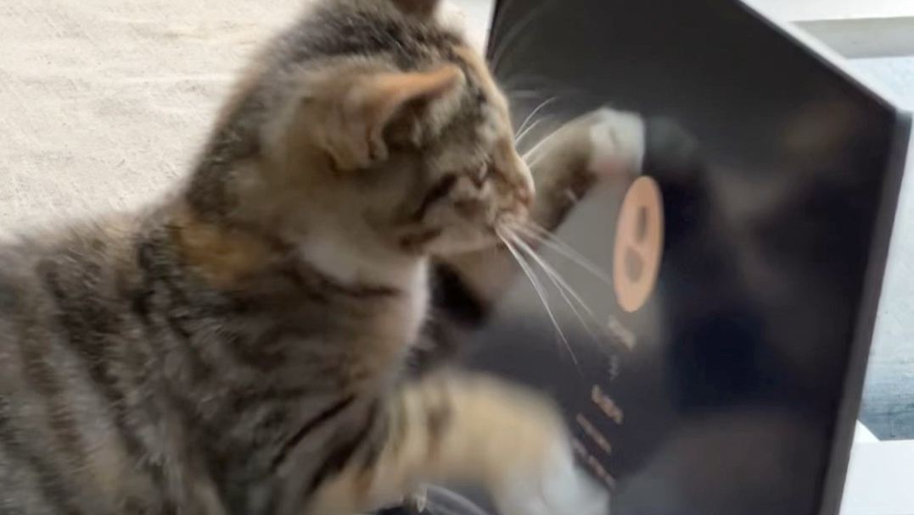 | 2295 | 2026-11-13 |
| [🐱：极其极其极其极其极其极其极其](https://www.bilibili.com/video/BV1utWv65ED7) |  | 1679 | 2026-11-13 |
| [锐评说哈基米曼波鼠鼠得吃表情包的人](https://www.bilibili.com/video/BV1ooWv6WEtU) | 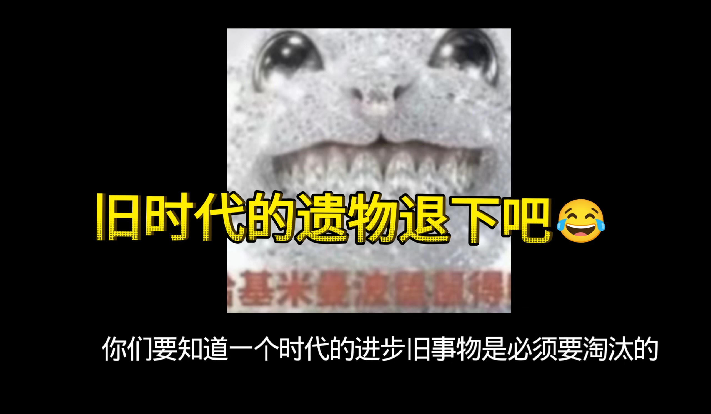 | 798 | 2026-11-13 |
| [【番外】前辈您的修罗场开演了——幕后黑手哈基米强势登场](https://www.bilibili.com/video/BV1NqWv6MEhc) |  | 987 | 2026-11-13 |
| [【4K超清】染发猴子大战哈基米 01-05话](https://www.bilibili.com/video/BV1vwW46FEx7) |  | 2428 | 2026-11-13 |
| [降温了来这一首真是惬意啊](https://www.bilibili.com/video/BV1cNW26fES8) | 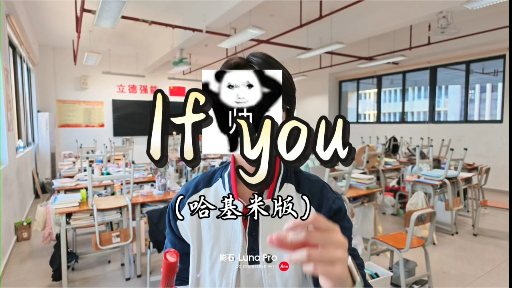 | 332 | 2026-11-13 |
| [做了一集毛茸茸的丑橘的故事 #ai动画 #哈基米](https://www.bilibili.com/video/BV1X8Wj6FEUz) | 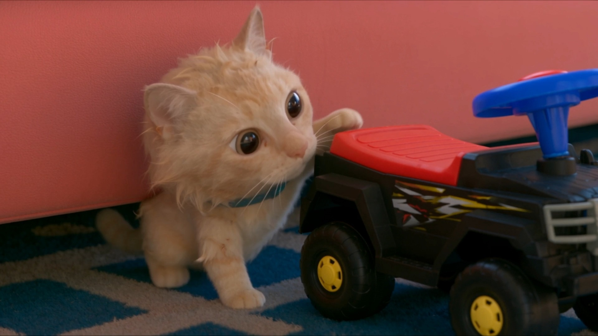 | 1368 | 2026-11-13 |
| [谁听得懂哈基米在说什么](https://www.bilibili.com/video/BV181Wa6NEsy) | 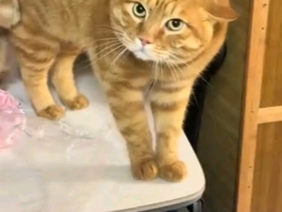 | 417 | 2026-11-13 |
| [三角形哈基米](https://www.bilibili.com/video/BV19dWY6jEe4) | 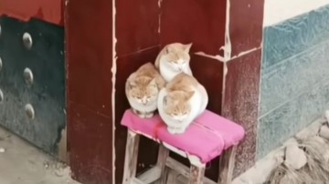 | 431 | 2026-11-12 |
| [哈基汪想要贴贴，哈基米想要推开](https://www.bilibili.com/video/BV19dWY6jE2k) | 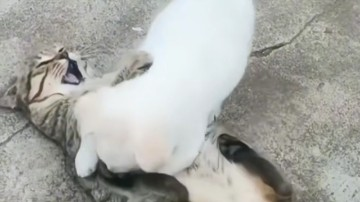 | 2162 | 2026-11-12 |
| [害羞的哈基米](https://www.bilibili.com/video/BV19oWY61E3w) | 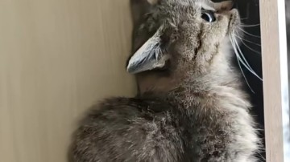 | 593 | 2026-11-12 |
| [虽然是败犬但是从不气馁的哈基米酱！](https://www.bilibili.com/video/BV1qQWd6EELo) |  | 1633 | 2026-11-12 |
| [偷逛B站摸鱼被自家粉丝活捉：“哈基米，我劝你好自为之！”](https://www.bilibili.com/video/BV1UgWo6KEZJ) |  | 372 | 2026-11-12 |
| [【瘾酒/世一猫】别的屠夫都有补强，哈基米滚下水道强度去了，猎奇技能真空期和超低数值以及放技能硬控自己的变态角色^^ 守尸屠夫守尸能力是负的，全靠玩家个人实力撑着](https://www.bilibili.com/video/BV1yZWo6AEAX) | 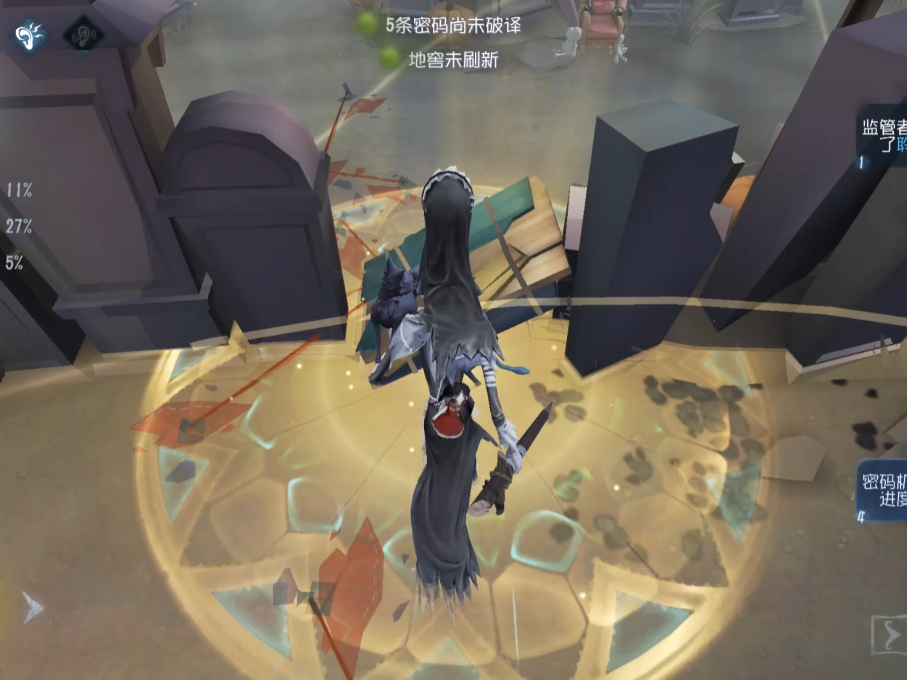 | 3720 | 2026-11-12 |
| [【环世界】余烬花园里的哈基米](https://www.bilibili.com/video/BV1gAWR6AEok) | 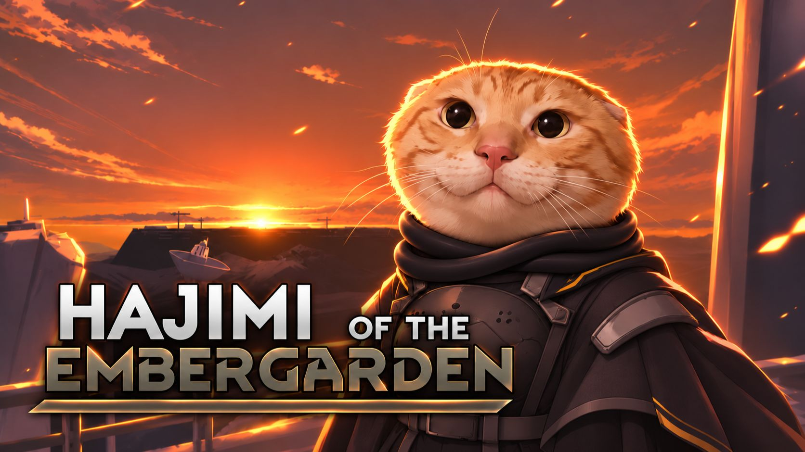 | 1074 | 2026-11-12 |
| [哈基米害怕米基哈](https://www.bilibili.com/video/BV1kcWd6pEWW) | 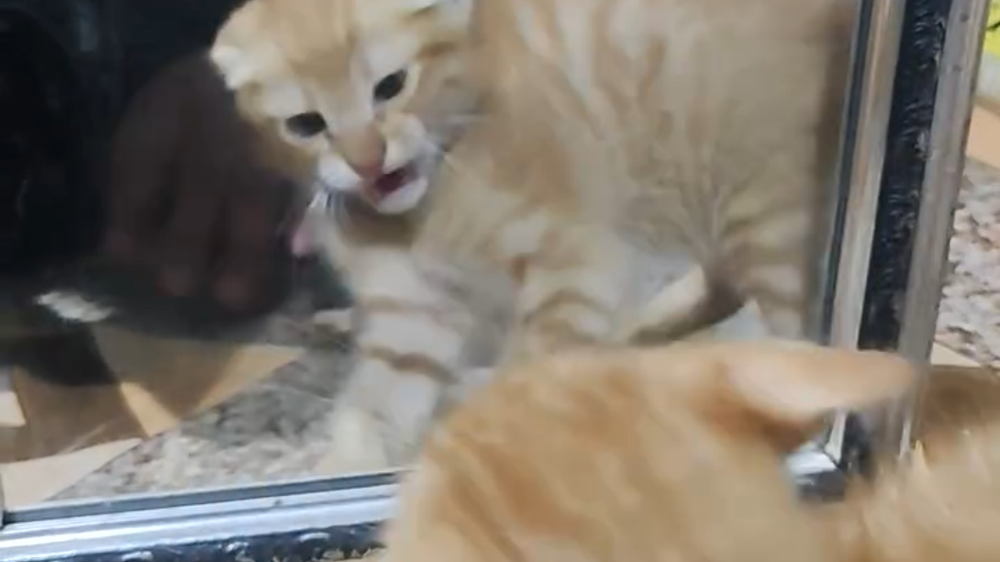 | 1376 | 2026-11-12 |
| [【崩坏星穹铁道】“哈基迷”是什么梗？](https://www.bilibili.com/video/BV1rcWd6pEZA) |  | 2625 | 2026-11-12 |
| [哈基米南北绿豆](https://www.bilibili.com/video/BV1nNWd6DEqE) |  | 6348 | 2026-11-12 |
| [基米这个哈气无cd](https://www.bilibili.com/video/BV1FNWd6DECN) | 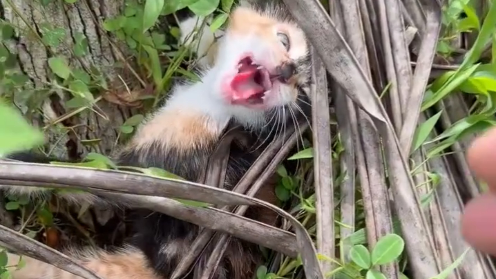 | 1843 | 2026-11-12 |
| [谷歌新模型专做判断！小克Fable 5.2登顶实战榜！本喵看呆两种千问拉面摊；大肥鱼工具升级，文心预览登榜｜哈基米早报](https://www.bilibili.com/video/BV1tmWR6AE1G) |  | 1615 | 2026-11-12 |
| [哈基米时代已至！Gemini 4 Hydrogen 即将上线更快更省，达里奥窒息瘫坐，斩杀线或将落下！](https://www.bilibili.com/video/BV1UbWd6PEF8) |  | 7.8万 | 2026-11-12 |
| [哈基米在下雪天差点被冻成叮咚机幸好被好心人拯救](https://www.bilibili.com/video/BV1tbWd6PEyb) | 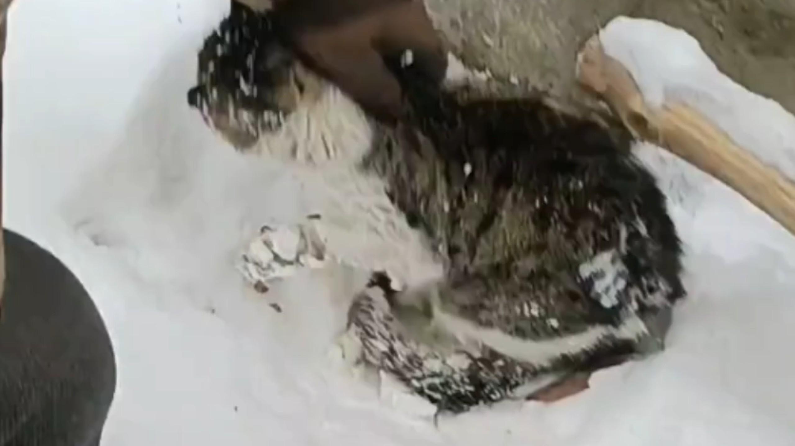 | 3743 | 2026-11-12 |
| [咪只是个摆摊卖捏捏的 顾客狂捏咪是几个意思？ 【AI全民制作人】](https://www.bilibili.com/video/BV1GvWX6YEMp) |  | 70.6万 | 2026-11-12 |
| [耄耋再睡觉直接滚蛋！](https://www.bilibili.com/video/BV136WX6FEsD) | 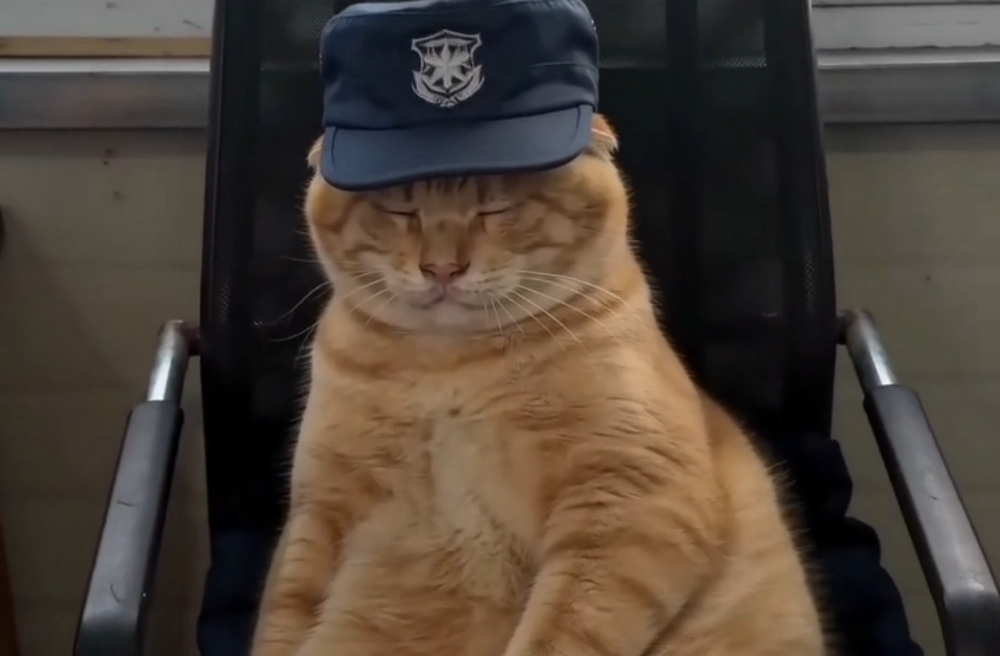 | 2511 | 2026-11-12 |
| [哈基米](https://www.bilibili.com/video/BV16ZWX62EKk) | 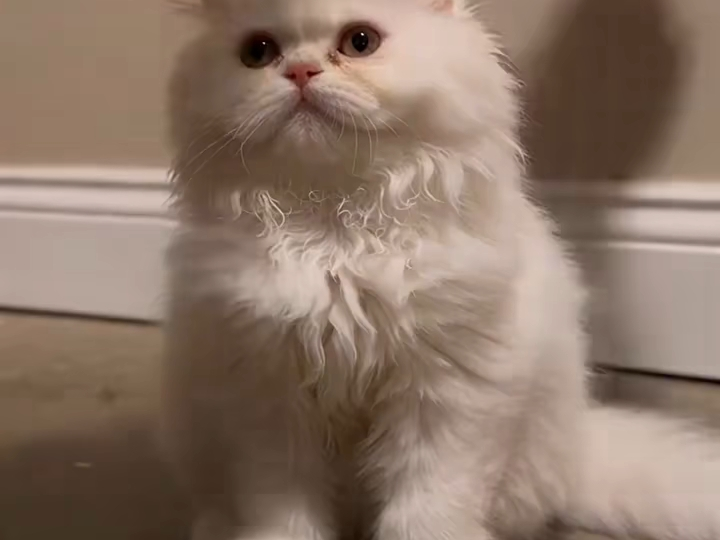 | 4.4万 | 2026-11-12 |
| [[tiktok]一个中国博主训斥一只小猫然后猫咪咬牙切齿火到了外网，老外的评论比视频还离谱，原视频p2](https://www.bilibili.com/video/BV1riW96DEfs) | 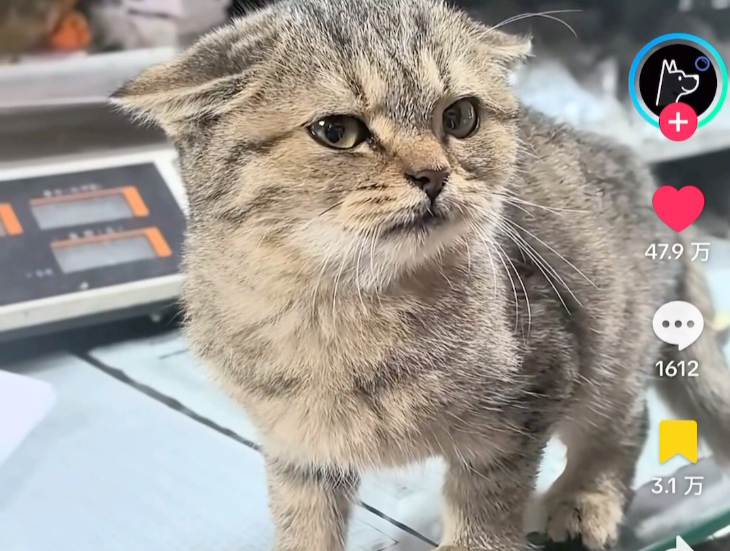 | 5.4万 | 2026-11-12 |
| [哈基米](https://www.bilibili.com/video/BV1tHWQ6pEgg) |  | 1023 | 2026-11-12 |
| [灵珠or魔丸？橘猫or耄耋？先天零魂力的耄耋武魂](https://www.bilibili.com/video/BV1CCWU66E78) | 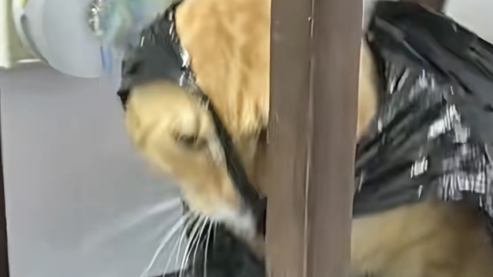 | 4822 | 2026-11-12 |
| [发现了站岗最认真的哈基米](https://www.bilibili.com/video/BV1jCWQ6MEn4) | 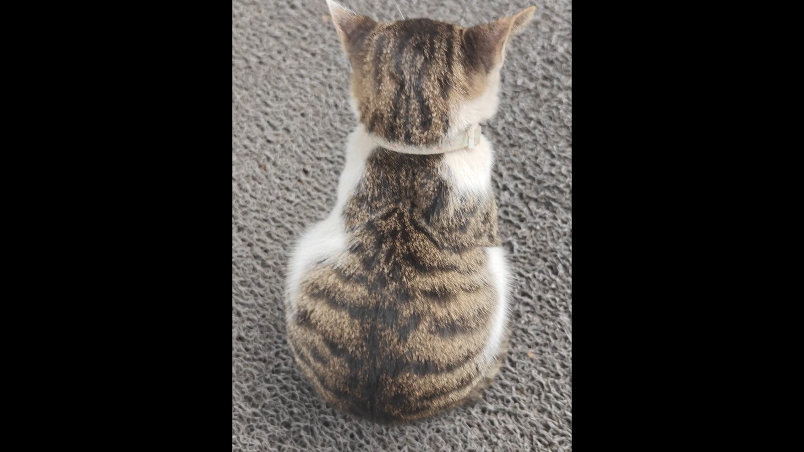 | 2.6万 | 2026-11-12 |
| [以防你不知道小红书流浪猫领养协议发展到什么地步了](https://www.bilibili.com/video/BV1WgWX6SEHw) | 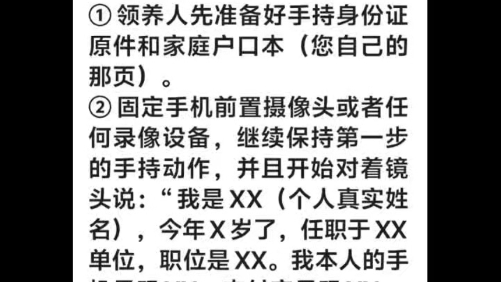 | 2226 | 2026-11-12 |
| [哈气与老吴：大狗警戒2 战斗曲《毁灭基战》](https://www.bilibili.com/video/BV1ysWS6kEET) |  | 4215 | 2026-11-12 |
| [有人听过这个哈基米音乐吗](https://www.bilibili.com/video/BV1h8WU6nEgP) |  | 57 | 2026-11-11 |
| [基米奈要被降智了，心急的用户尝试喂Token挽回基米](https://www.bilibili.com/video/BV17cWS6FETb) |  | 1.4万 | 2026-11-11 |
| [11.11狗哥触发什么代码打黑眼圈了](https://www.bilibili.com/video/BV1CUWU6TEGE) | 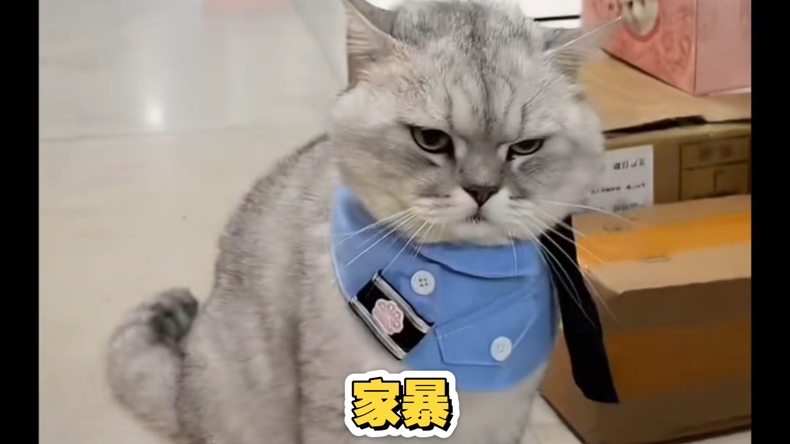 | 7546 | 2026-11-11 |
| [虽然没给它最贵的，但给了它最好的](https://www.bilibili.com/video/BV1g8W26kEPu) | 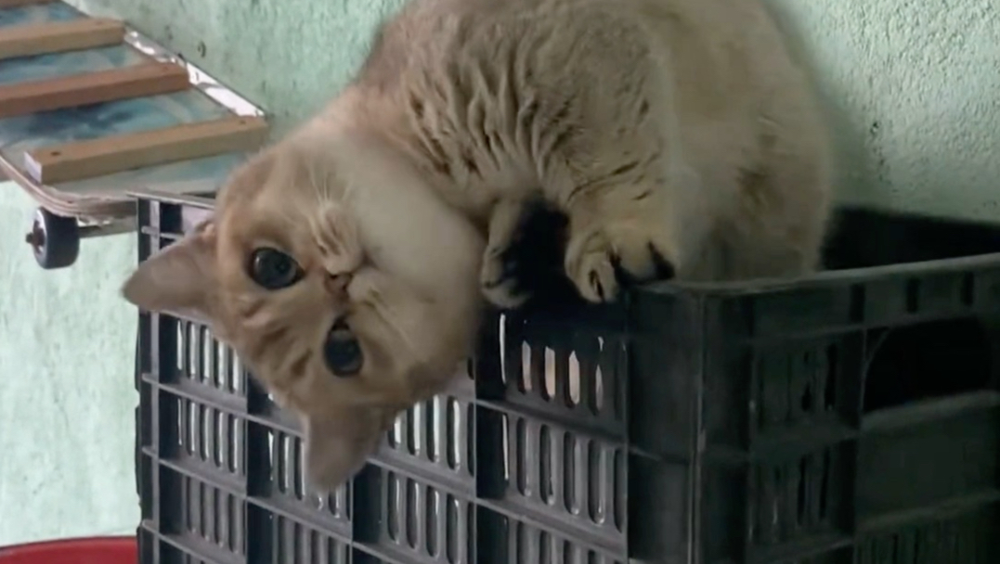 | 3.9万 | 2026-11-11 |
| [哈基米提醒您该听⚡波⚡罗⚡的⚡海⚡劲⚡爆⚡电⚡音⚡了](https://www.bilibili.com/video/BV1J3W26REN7) |  | 1699 | 2026-11-11 |
| [孩子们！哈基米和克劳德神了！核弹双爆炸！眩晕瘫坐！](https://www.bilibili.com/video/BV1ryW26wECu) |  | 2.9万 | 2026-11-11 |
| [哈基米又偷跑](https://www.bilibili.com/video/BV18gWm65EBC) | 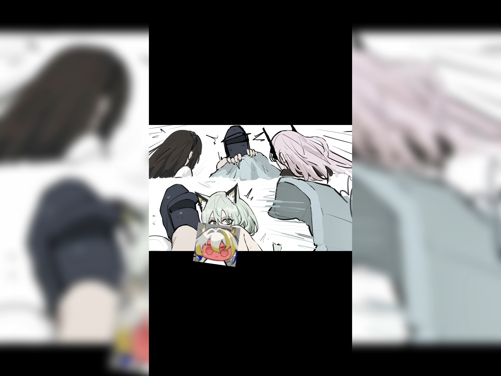 | 1669 | 2026-11-11 |
| [老依旧老吴](https://www.bilibili.com/video/BV1svWy6bELp) | 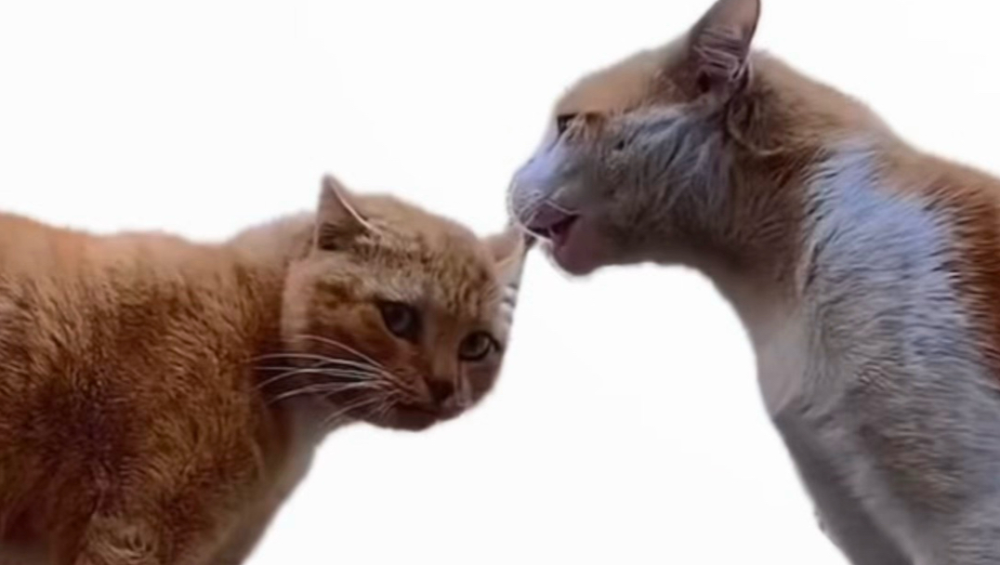 | 7.6万 | 2026-11-11 |
| [伞兵一号哈基米准备就绪！](https://www.bilibili.com/video/BV1t3Wm6CEtv) | 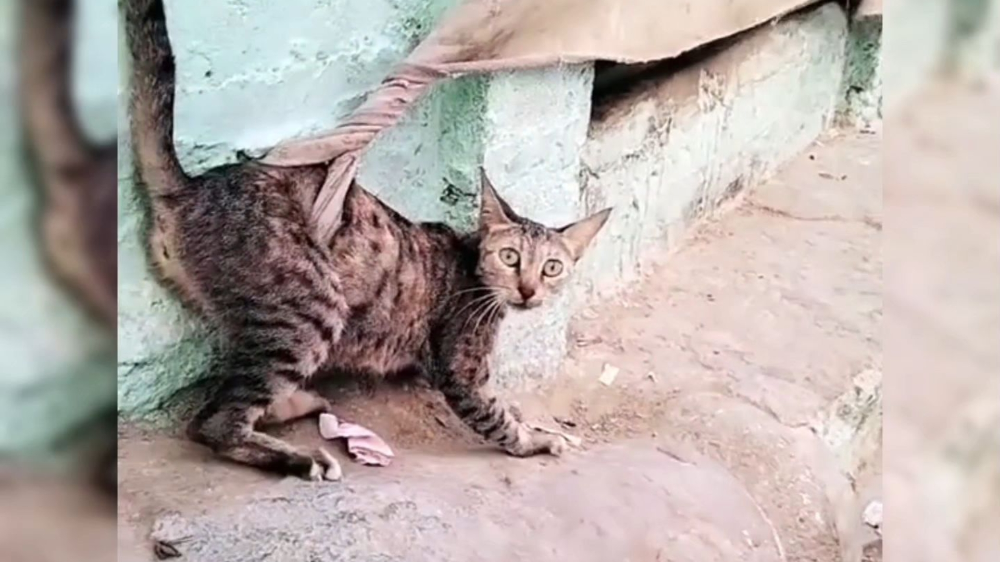 | 1.2万 | 2026-11-11 |
| [今天吃潮汕牛肉火锅、烧鸭面，来了就是深圳咪啦](https://www.bilibili.com/video/BV13sWy6MENt) |  | 1.3万 | 2026-11-11 |
| [【IPN】1分，《阿敲与老冯》评测：老冯赚钱养家下班做饭还要被她蛐蛐](https://www.bilibili.com/video/BV1pVWu6ZEzn) |  | 33.4万 | 2026-11-11 |
| [猫师傅坐飞机去领奖，没想到还收了个大块头徒弟](https://www.bilibili.com/video/BV1KhWy6PEJs) |  | 3.2万 | 2026-11-11 |
| [小猫：你输定了](https://www.bilibili.com/video/BV1UbWy6vEXo) | 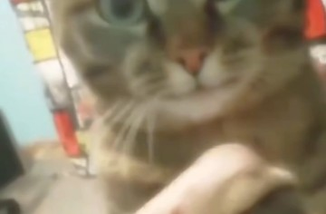 | 16.0万 | 2026-11-11 |
| [小时候去超市的你](https://www.bilibili.com/video/BV1qmWy6HEdF) | 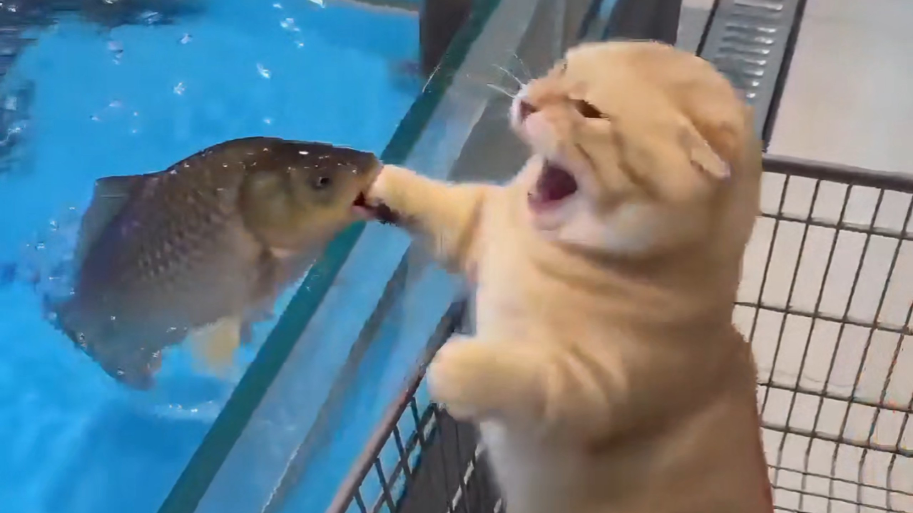 | 7879 | 2026-11-11 |
| [为姨姨们带来一首哈基米之歌](https://www.bilibili.com/video/BV1NNWj67EJz) | 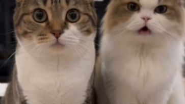 | 14 | 2026-11-11 |
| [[卫戍协议：规程]踩头复奏？新神已至！最被人低估的轮椅策略（渡桥策略精讲）](https://www.bilibili.com/video/BV1xHWL62EkM) |  | 15.1万 | 2026-11-11 |
| [哈基米](https://www.bilibili.com/video/BV1TfWL6HES8) | 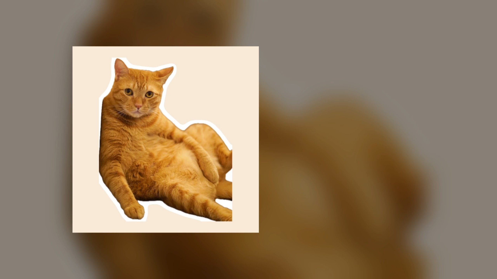 | 58 | 2026-11-11 |
| [补药打我喵!](https://www.bilibili.com/video/BV1yVW36iEsL) |  | 1.1万 | 2026-11-11 |
| [后室哈基米](https://www.bilibili.com/video/BV1fgW56NE76) | 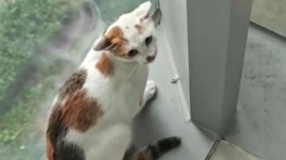 | 561 | 2026-11-10 |
| [【脑蚀/但是欠费版+难绷填词】](https://www.bilibili.com/video/BV11eWg6AECB) |  | 21.7万 | 2026-11-10 |
| [张元英&amp;柳智敏《Trouble Maker》【AI MV大赛】](https://www.bilibili.com/video/BV1R9Wg6JEuc) |  | 24.1万 | 2026-11-10 |
| [没 有 人 类 了](https://www.bilibili.com/video/BV1uyW36LE95) |  | 9.3万 | 2026-11-10 |
| [哈基米](https://www.bilibili.com/video/BV1gBWu6rEXc) | 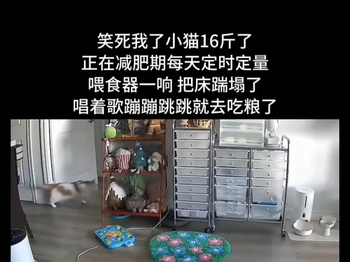 | 2.7万 | 2026-11-10 |
| [这是演唱会史上第一位小猫嘉宾吧！小猫也是拿到大结果啦！](https://www.bilibili.com/video/BV1VxWN6PEsW) | 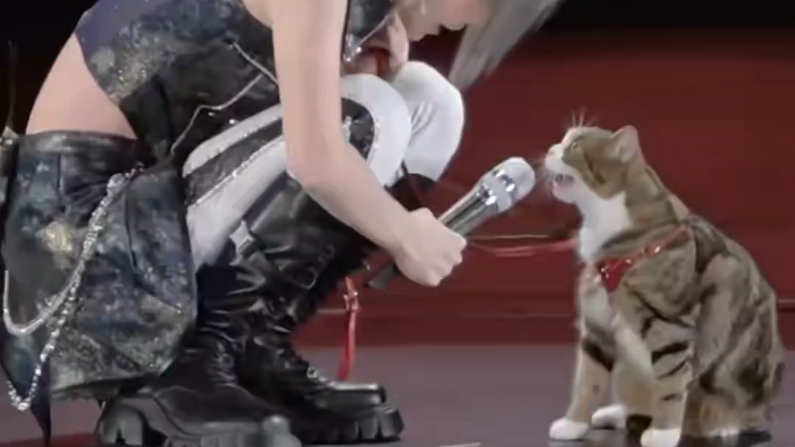 | 6.9万 | 2026-11-09 |
| [请指出有什么不足之处](https://www.bilibili.com/video/BV1H9Wt6VEgV) | 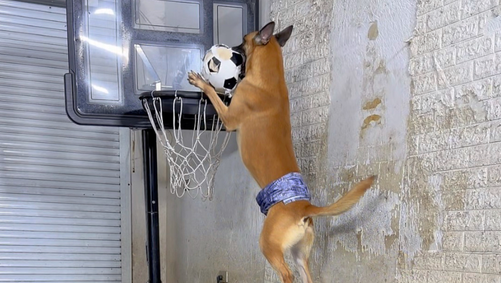 | 63.9万 | 2026-11-09 |
| [哈基米打咏春](https://www.bilibili.com/video/BV1GKW464EQM) | 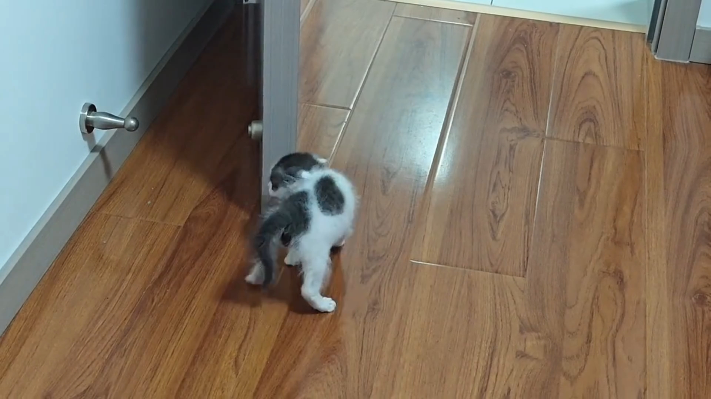 | 181 | 2026-11-09 |
| [哈基米：我闻到了饼香来到了街中央](https://www.bilibili.com/video/BV1PpW461EsD) | 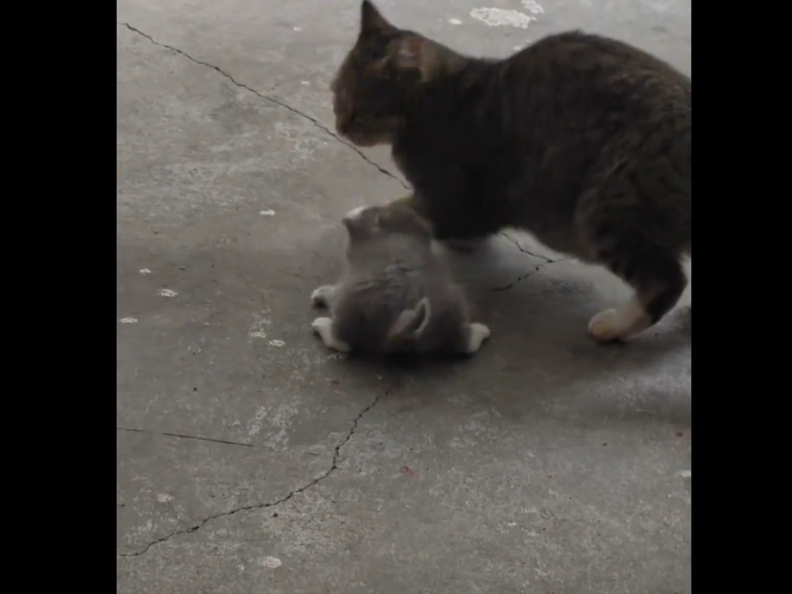 | 3355 | 2026-11-09 |
| [绷不住了](https://www.bilibili.com/video/BV1mdWs65ESH) |  | 8.9万 | 2026-11-08 |
| [当六架槲寄生出现在陆历](https://www.bilibili.com/video/BV1mbWH6KE9y) |  | 9.5万 | 2026-11-08 |
| [别人的尾巴就是好玩~](https://www.bilibili.com/video/BV17J4x6zEKr) |  | 1.2万 | 2026-11-08 |
| [曼波和她的fumo唱歌](https://www.bilibili.com/video/BV1bi4x6ZEnB) |  | 4393 | 2026-11-08 |
| [吃过这家店包的馄饨的顾客有福了](https://www.bilibili.com/video/BV1UX4p6JE8D) | 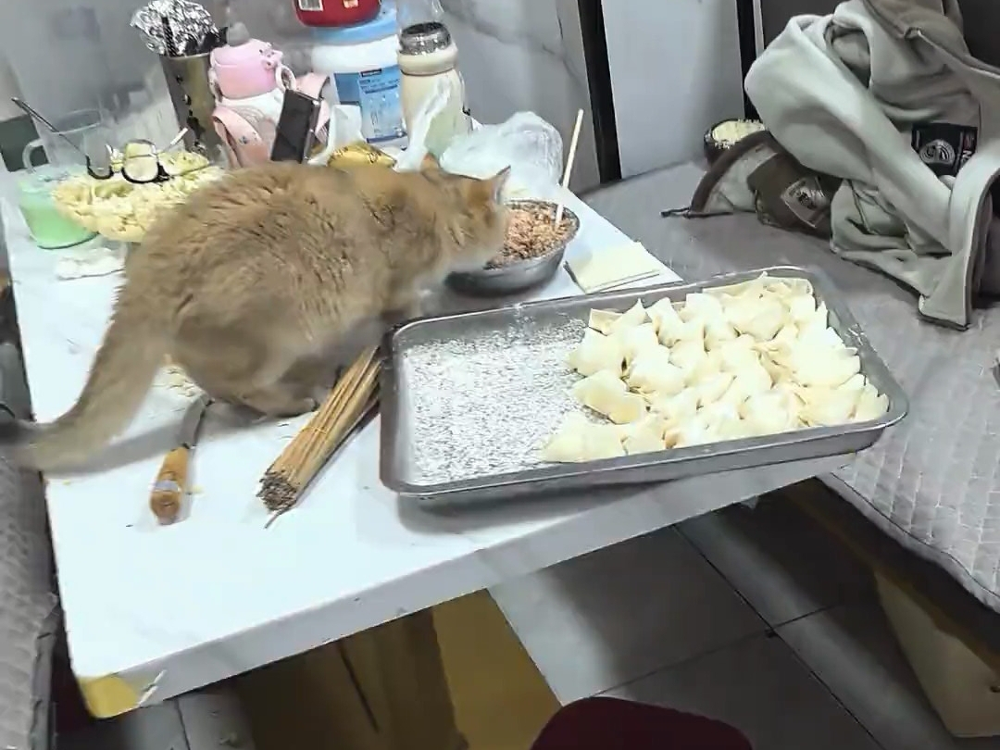 | 2.9万 | 2026-11-07 |
| [♿饥白鲨：进化♿](https://www.bilibili.com/video/BV1c14J6tEW2) |  | 2.9万 | 2026-11-07 |
| [哈基米VS小蛇](https://www.bilibili.com/video/BV1mg4n6gE7B) | 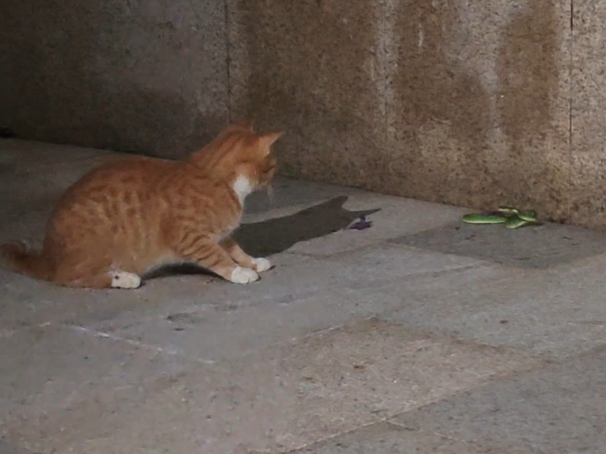 | 229 | 2026-11-07 |
| [🐶 毛茸茸的金毛幼犬-可爱的玩耍时光与甜蜜的小狗瞬间：轻松狗狗视频](https://www.bilibili.com/video/BV1vq4n6XEQu) |  | 2643 | 2026-11-07 |
| [服务员，切歌【AI MV大赛】](https://www.bilibili.com/video/BV1eq4n6QEiP) |  | 175.2万 | 2026-11-07 |
| [九千解锁的超能巨猫，今天差点让我被辞退！](https://www.bilibili.com/video/BV1D14E6BEF8) |  | 55.3万 | 2026-11-07 |
| [曼波小课堂02](https://www.bilibili.com/video/BV1K84J6BEx8) |  | 5.0万 | 2026-11-07 |
| [众所周知，猫是一种液体~](https://www.bilibili.com/video/BV1Hi4P6EE5b) |  | 1.4万 | 2026-11-04 |
| [薯条末日1天上竟然下了美味薯条？#咕咕嘎嘎#乐魂](https://www.bilibili.com/video/BV1aRxX6iE5z) |  | 58.6万 | 2026-11-04 |
| [哈基米这个喜欢喝酒](https://www.bilibili.com/video/BV1i6xD6MEhN) | 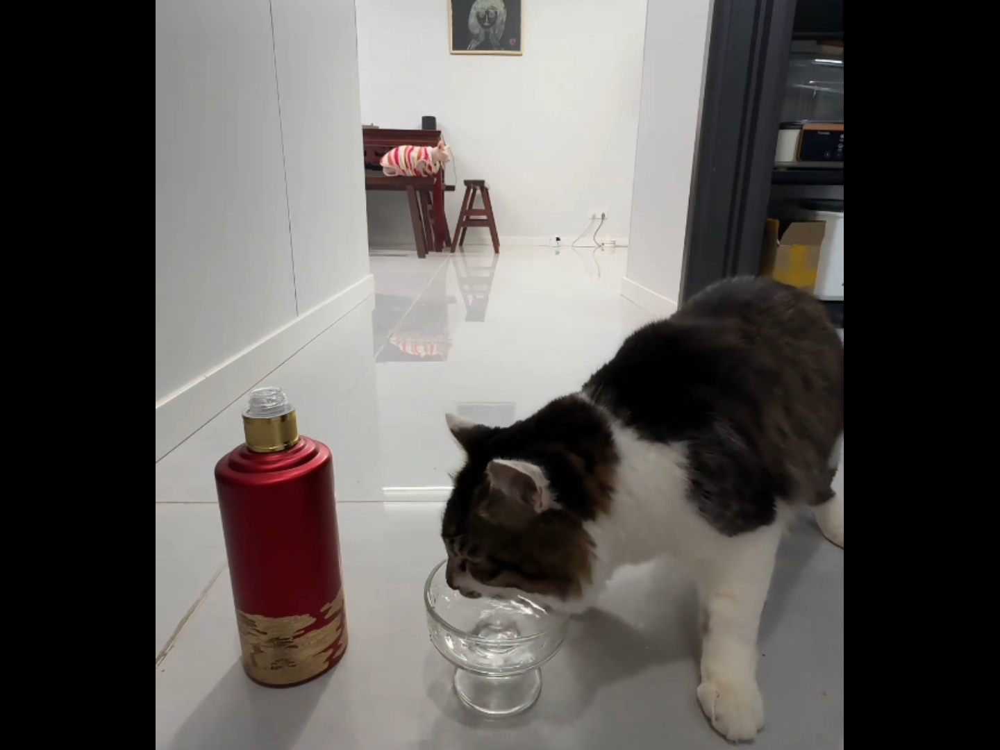 | 1268 | 2026-11-04 |
| [甜瓜小剧场](https://www.bilibili.com/video/BV127xU6LEj1) | 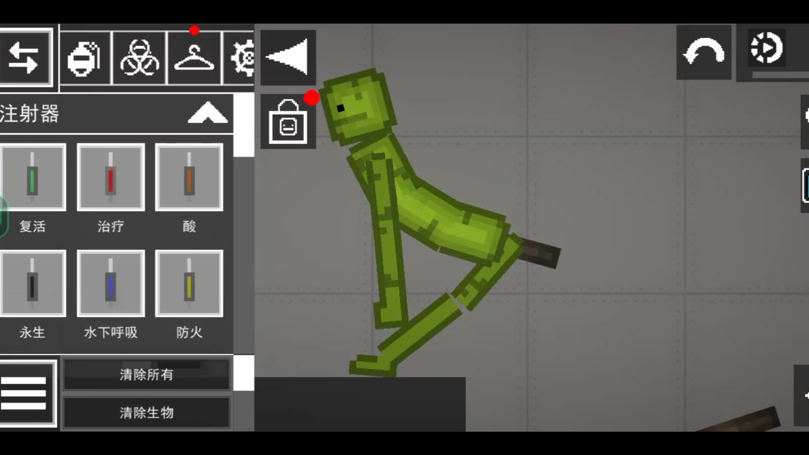 | 8367 | 2026-11-03 |
| [循环歌单｜【中国人能飞】｜“【年度梗の小曲】中国人能飞 边飞边发MJ”](https://www.bilibili.com/video/BV17D4M6sEZ8) |  | 226.5万 | 2026-11-03 |
| [离谱的课堂作业。](https://www.bilibili.com/video/BV1Mg4u6rEYD) |  | 37.8万 | 2026-11-03 |
| [&#x27;以前的小孩vs现在的小孩’《人类一败涂地AIの小曲》higher](https://www.bilibili.com/video/BV14MxW6LEZq) |  | 23.9万 | 2026-11-03 |
| [到处都是马卡龙和糖果，感觉太幸福了！#咕咕嘎嘎惊奇夜#动画#后室](https://www.bilibili.com/video/BV1dh4T6EEUo) |  | 2.4万 | 2026-11-02 |
| [萌宠来袭](https://www.bilibili.com/video/BV1maxs6mEj9) | 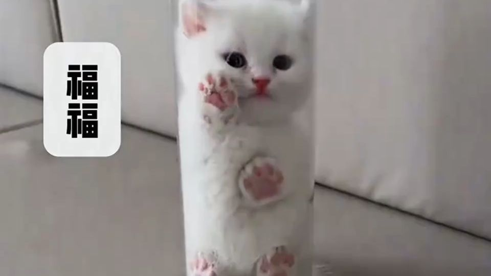 | 2161 | 2026-11-01 |
| [【𝐇𝐢-𝐑𝐞𝐬无损音质】｜《海屿你》-  马也_Crabbit -‘这回忆的漩涡 快要把我吞没 求你别离开我.’](https://www.bilibili.com/video/BV1sGxW6kE1p) |  | 1.3万 | 2026-11-01 |
| [早教玩具太空沙 DIY 海洋小动物！海豚、小鱼、海星、螃蟹来啦](https://www.bilibili.com/video/BV1uJxC6zE3X) |  | 7.8万 | 2026-10-31 |
| [橘猫哲学：公路午睡惊魂 / Orange Cat Philosophy: Roadside Nap Horror](https://www.bilibili.com/video/BV1hTxq6WER9) |  | 11.6万 | 2026-10-30 |
| [基米小学万圣节特辑：神秘的三楼怪谈](https://www.bilibili.com/video/BV1wxxq63EbU) |  | 4.6万 | 2026-10-30 |
| [【熊出没】中国熊能飞](https://www.bilibili.com/video/BV1nUxP6jEze) | 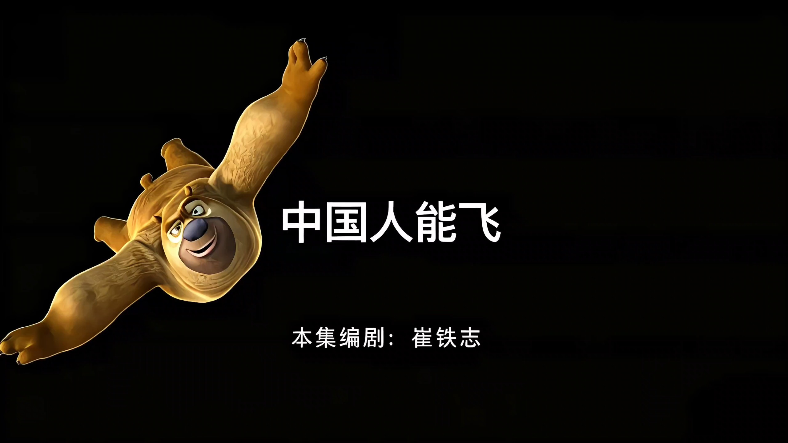 | 8919 | 2026-10-30 |
| [《妙脆角猫的新旅程》鳄有噩报](https://www.bilibili.com/video/BV1TZs968Etz) |  | 40.1万 | 2026-10-29 |
| [《末日求生》乐魂居然一觉睡醒躺在雨床上了！#乐魂#updream](https://www.bilibili.com/video/BV12Dxc67EZ3) |  | 2.0万 | 2026-10-29 |
| [洗完车顺便洗一下哈基咪](https://www.bilibili.com/video/BV1HEsf6aEwA) | 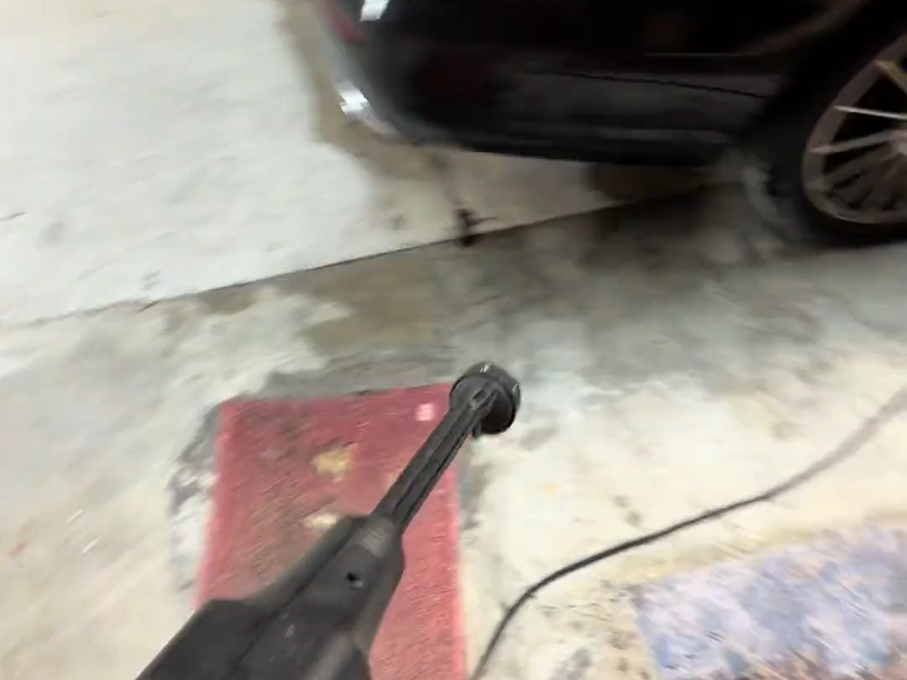 | 2.6万 | 2026-10-29 |
| [“这谁绷得住啊？”](https://www.bilibili.com/video/BV1QSxN6eE38) |  | 52.9万 | 2026-10-27 |
| [哈基米](https://www.bilibili.com/video/BV168nS6tEqg) |  | 8 | 2026-10-25 |
| [植物大战僵尸 幼儿园版vs现实版](https://www.bilibili.com/video/BV1oxHK6NEiT) |  | 3.3万 | 2026-10-24 |
| [动物彻底疯狂了！😂🔥 ｜ 超搞笑动物动画 Animal Gone Wild](https://www.bilibili.com/video/BV1qAHN6wESq) |  | 2887 | 2026-10-24 |
| [我只是一个打工鼠~~开启不寻常的一天](https://www.bilibili.com/video/BV1ymnC6QEiK) |  | 64.0万 | 2026-10-22 |
| [盘点那些刻进DNA里的魔性神曲，你熟悉几首？](https://www.bilibili.com/video/BV1D1nB6mEuE) |  | 2.8万 | 2026-10-21 |
| [远看肥猫快，近看快肥猫！](https://www.bilibili.com/video/BV16unz6AEia) |  | 7878 | 2026-10-21 |
| [肥猫闪身步！](https://www.bilibili.com/video/BV1NFJd6JEh9) | 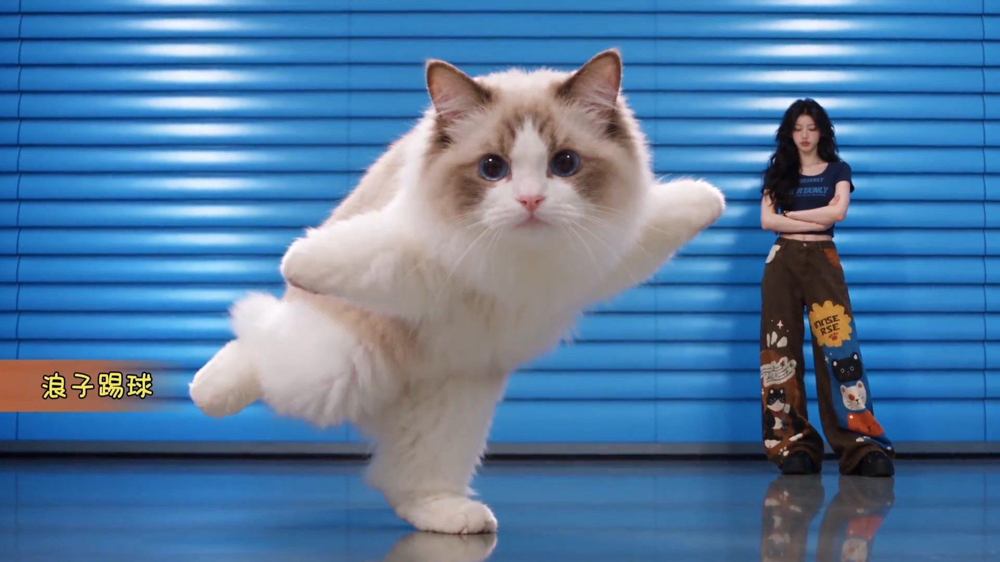 | 2.0万 | 2026-10-19 |
| [哈弥陀佛这入魔了（大悲咒哈基米版）](https://www.bilibili.com/video/BV11VnV6YEhn) |  | 382 | 2026-10-18 |
| [玩具组团指控柯基，狗：真不是我下的嘴](https://www.bilibili.com/video/BV1f5KN6fEYa) |  | 9.7万 | 2026-07-20 |
| [罗大佑《○都》伴奏（去字幕）](https://www.bilibili.com/video/BV1ygBPB1Efn) |  | 19.1万 | 2025-12-19 |

---
*最后更新: 2026-11-13 09:26:52 (自动生成)*
*数据来源: [Bilibili](https://www.bilibili.com)*

## 使用说明

运行以下命令更新视频列表:
```bash
python3 fetch_hajimi_videos.py
```
