# awesome-hajimi
collections of hajimi (哈基米 in Chinese) on the Internet.

## 视频列表 (Video List)

| 视频标题 (Title) | 封面 | 播放量 (Views) | 发布日期 (Date) |
|---|---|---|---|
| [下劈+开高达+变身！未来哈基米版空洞骑士？！](https://www.bilibili.com/video/BV1gzx96iErF) |  | 3188 | 2026-11-05 |
| [大狗：叫三郎（又三郎-ヨルシカ）](https://www.bilibili.com/video/BV14gxd6PE5W) | 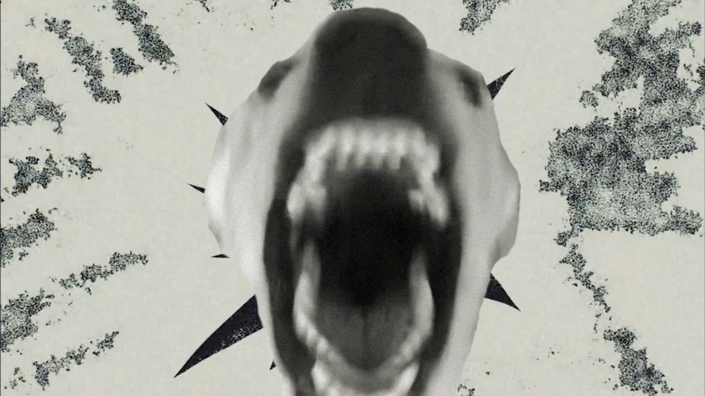 | 4576 | 2026-11-05 |
| [【哈基米】🐱Desultory Signals🐱](https://www.bilibili.com/video/BV1tXxZ6VE6J) |  | 854 | 2026-11-05 |
| [基米依旧无法对视](https://www.bilibili.com/video/BV1AfxZ6uEuU) | 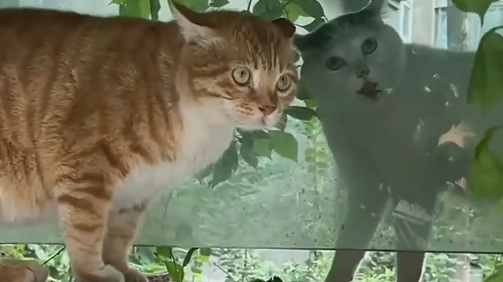 | 463 | 2026-11-05 |
| [回合制基米斗](https://www.bilibili.com/video/BV1wZxd6wErc) | 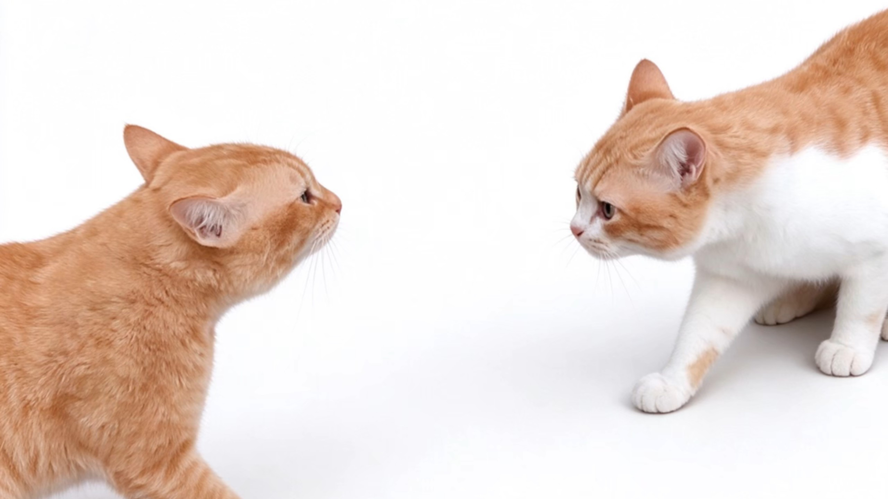 | 2202 | 2026-11-04 |
| [这时髦啊](https://www.bilibili.com/video/BV1T8xo6gENf) | 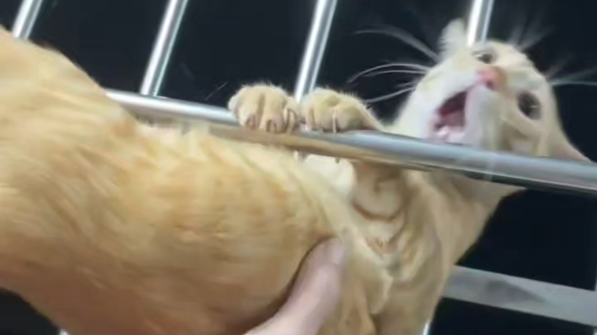 | 2318 | 2026-11-04 |
| [哈基罐极限反杀哈基米-八宝粥罐头完成四杀 银鹭八宝粥达成成就 基米一生之敌](https://www.bilibili.com/video/BV1nkxR6WEMr) | 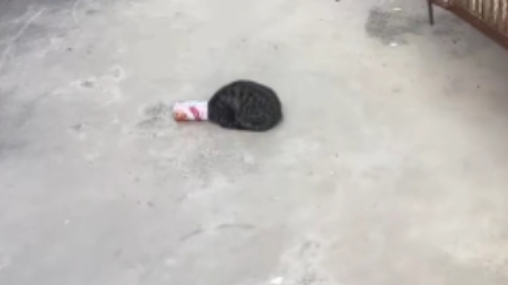 | 2331 | 2026-11-04 |
| [请输入文本](https://www.bilibili.com/video/BV1p5xd6hE2N) |  | 2.6万 | 2026-11-04 |
| [哈基峰终于把窗子全都封好了！「小峰布偶猫11.4直播回放」](https://www.bilibili.com/video/BV15Yxd6EEMs) |  | 1.1万 | 2026-11-04 |
| [睡午觉的时候，发现小猫没枕头，主人就拿了一块布让小猫枕着](https://www.bilibili.com/video/BV1UjxD69EH1) |  | 4.2万 | 2026-11-04 |
| [11.04给吕布半截猫条下一秒川剧变脸！](https://www.bilibili.com/video/BV1i8xd6nEQS) | 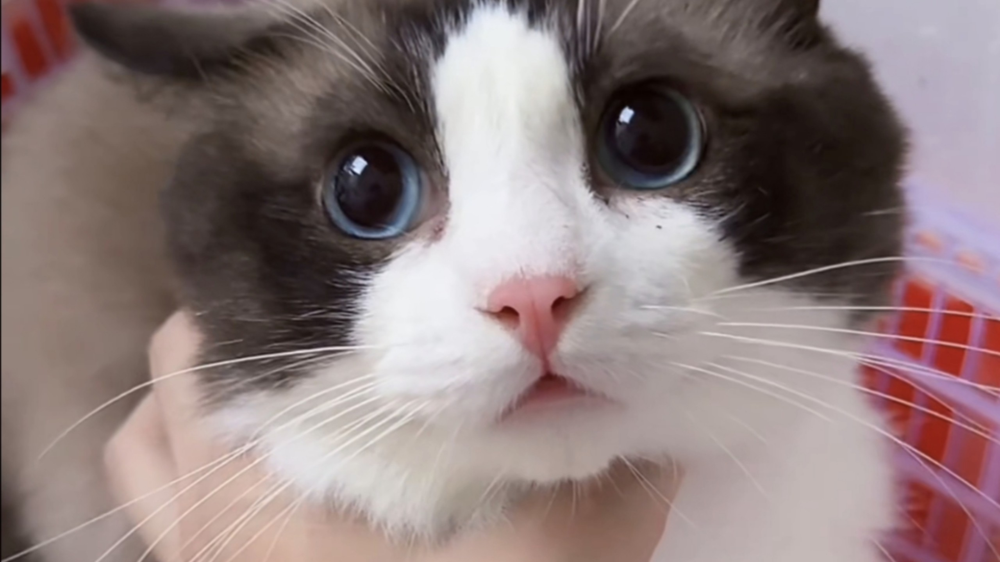 | 6354 | 2026-11-04 |
| [哈吉米，哈吉米，哈吉米！](https://www.bilibili.com/video/BV1nHxd6dE63) | 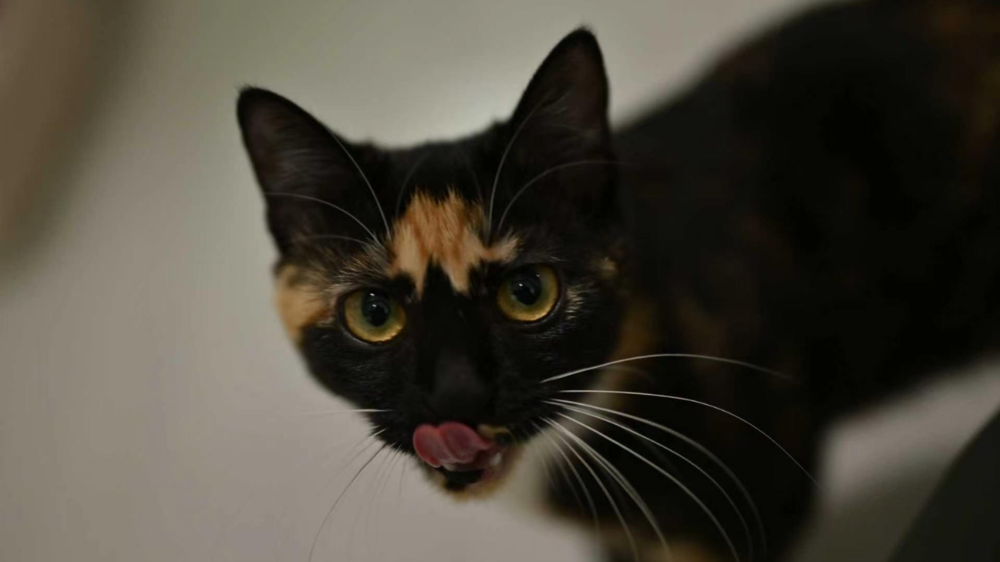 | 22 | 2026-11-04 |
| [哈基米](https://www.bilibili.com/video/BV174xd6pEGs) |  | 6 | 2026-11-04 |
| [神秘哈基米追一路](https://www.bilibili.com/video/BV19DxX6uErS) | 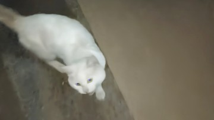 | 977 | 2026-11-04 |
| [11.04《3》拍立得吕布&amp;僵尸二胖&amp;老吴万圣套](https://www.bilibili.com/video/BV1kaxX6HE9i) |  | 861 | 2026-11-04 |
| [哈基米的幽默瞬间](https://www.bilibili.com/video/BV1r5x96XEPW) | 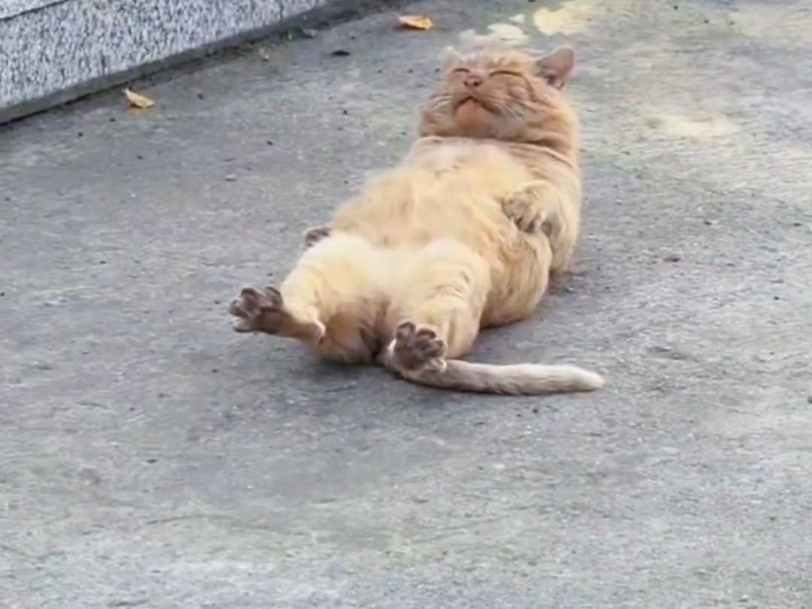 | 2753 | 2026-11-04 |
| [11.04初登场的丧喵 完全不是同一只。](https://www.bilibili.com/video/BV1Y9xX6TETq) |  | 5941 | 2026-11-04 |
| [去参加甜甜圈节，没想到每集都不重样，现场氛围也太疯狂了吧#updream#哈基米#猫meme#](https://www.bilibili.com/video/BV1aRxX6iEch) |  | 1049 | 2026-11-04 |
| [四个AI互相起外号：大肥鱼成了赛博丐帮主，Claude三个外号全带封号｜哈基米第一次来做客](https://www.bilibili.com/video/BV1mPx968E3Y) |  | 692 | 2026-11-04 |
| [《哈基米大冒险》崩铁幻想乡股真人异世界，通关最高难度N5](https://www.bilibili.com/video/BV1EWx96mEpZ) | 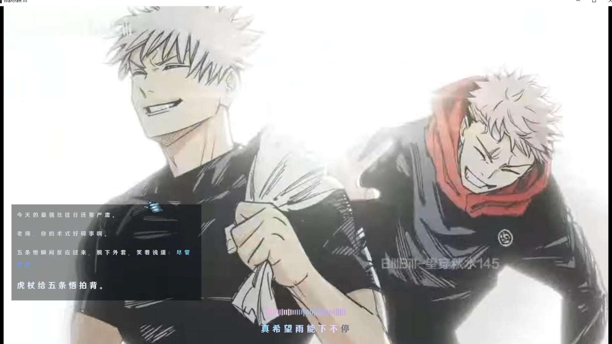 | 689 | 2026-11-04 |
| [小小哈基米的缘分止步于此了，明天可以丢垃圾桶了(活不过明天了)](https://www.bilibili.com/video/BV1LWx962EDG) | 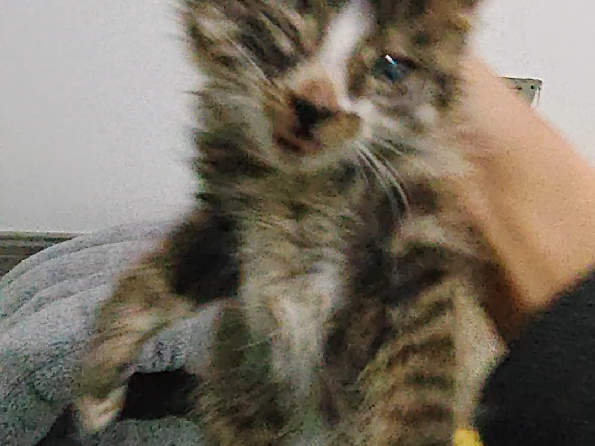 | 4199 | 2026-11-04 |
| [《哈基米大冒险》狗头人差不多抽卡，N5最高难度单人好过鸭](https://www.bilibili.com/video/BV12Ux968EWt) | 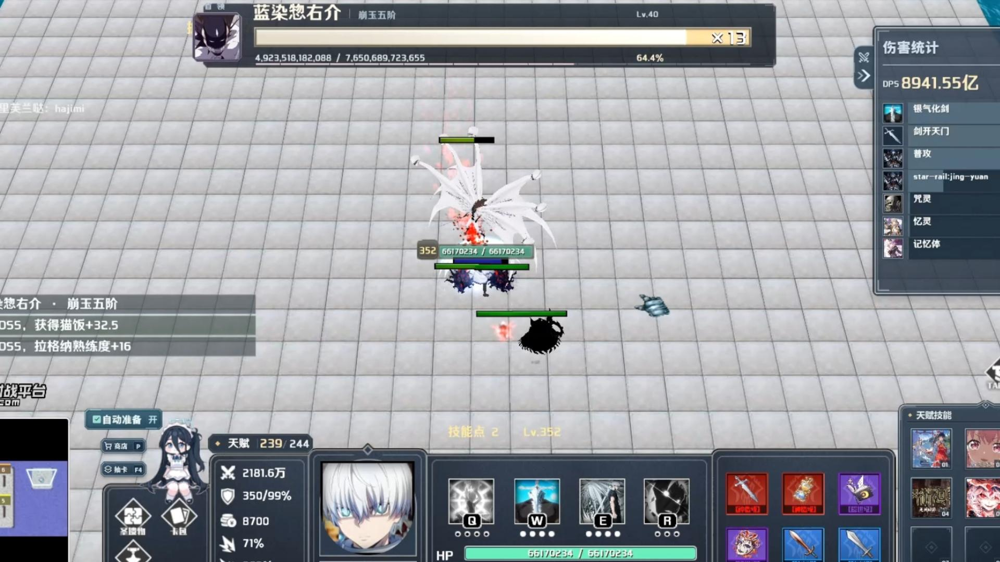 | 688 | 2026-11-04 |
| [农村小猫的一天到底有多悠闲？](https://www.bilibili.com/video/BV16GxQ6jEJ8) | 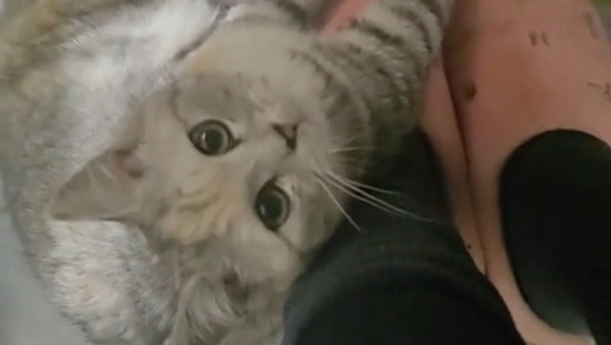 | 3336 | 2026-11-04 |
| [网 恋 VS 奔 现](https://www.bilibili.com/video/BV1dw4V6YEBc) |  | 96.2万 | 2026-11-04 |
| [快速的心跳声(៸៸᳐⦁⩊⦁៸៸᳐ )੭](https://www.bilibili.com/video/BV1QhxQ6PEju) |  | 366 | 2026-11-04 |
| [应激哈基米秒变得意雌小鬼，这就是传说中的求饶剑法吗？【影之刃零】](https://www.bilibili.com/video/BV1GhxQ6PE2U) |  | 1.5万 | 2026-11-04 |
| [所有猫科动物都是这两下，哈基米底层代码共享这一块！](https://www.bilibili.com/video/BV1bBxQ6bEaV) | 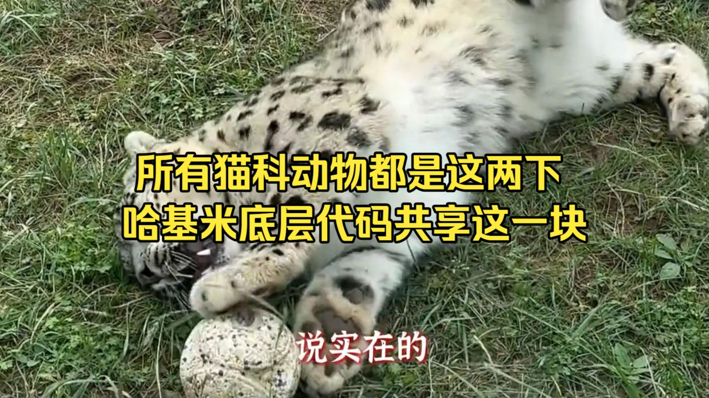 | 2.0万 | 2026-11-04 |
| [哈基米](https://www.bilibili.com/video/BV1GtxQ6KEyc) | 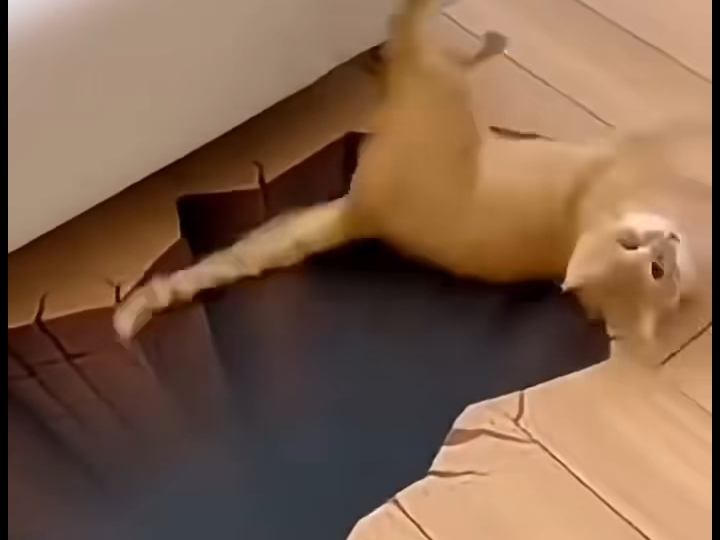 | 3977 | 2026-11-04 |
| [废物基米，被母鸡捡漏了](https://www.bilibili.com/video/BV1F9xQ6EETG) | 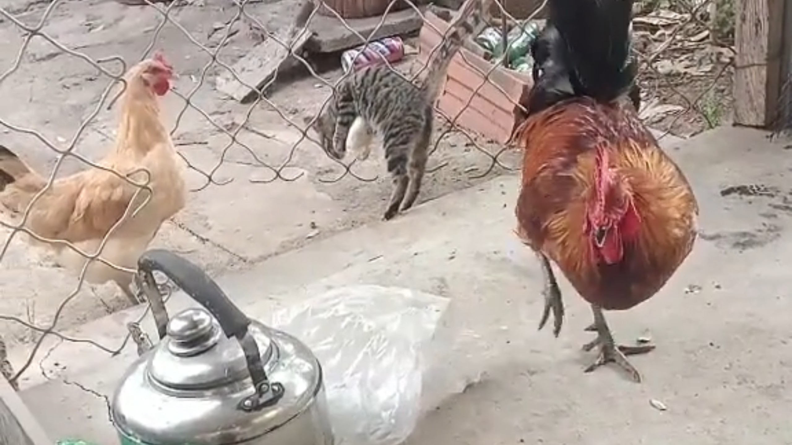 | 1.2万 | 2026-11-04 |
| [蟑螂基米](https://www.bilibili.com/video/BV1NrxQ64EQV) | 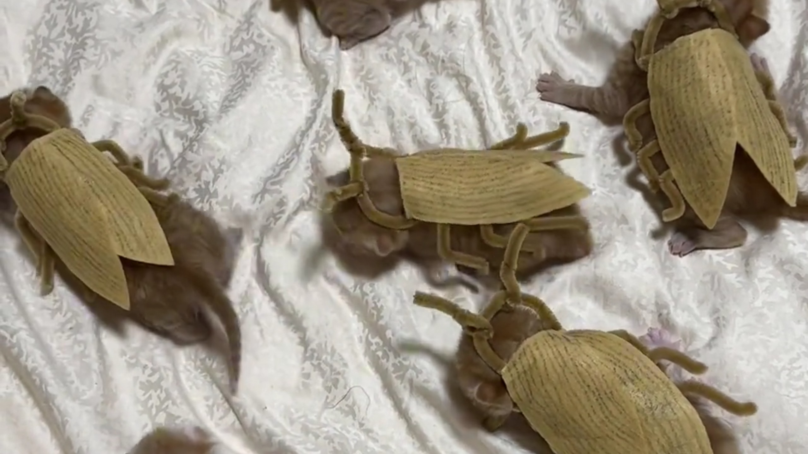 | 1322 | 2026-11-04 |
| [白猫：不是我喊的老吴，别搞我](https://www.bilibili.com/video/BV1C4xX6REm2) | 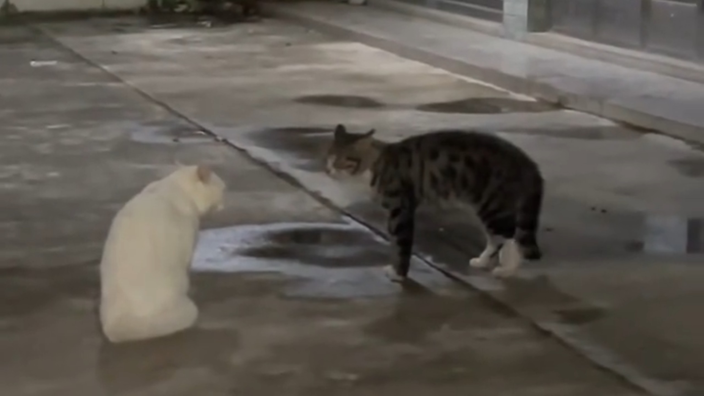 | 8131 | 2026-11-04 |
| [哈基米误入会员制餐厅](https://www.bilibili.com/video/BV1N4xX6dEhs) | 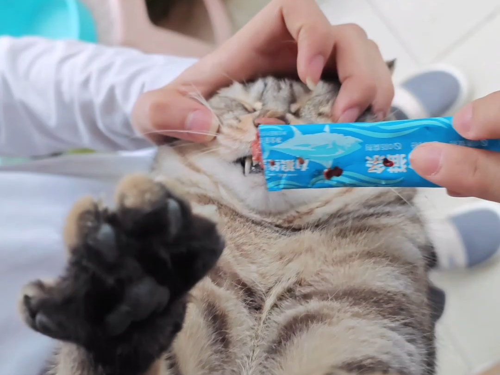 | 2.8万 | 2026-11-04 |
| [游戏王MD幕帘猫（黯蜜）展开，5康还有淘气保护的进化后最强的哈基米](https://www.bilibili.com/video/BV1f9xS6zEwv) | 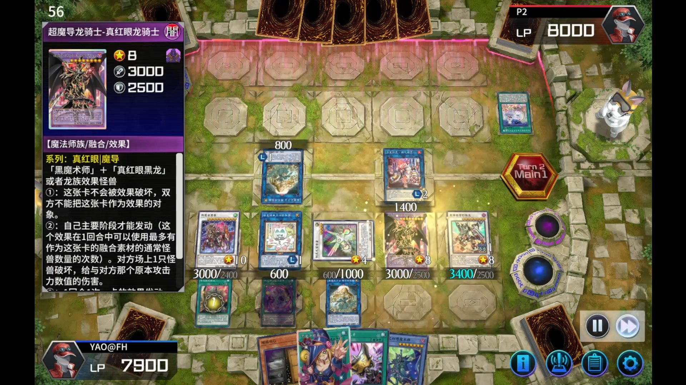 | 2933 | 2026-11-04 |
| [小红书：抓流浪猫挂闲鱼卖是偷流浪猫的黑产，人的下限真的极低](https://www.bilibili.com/video/BV1qqxD6gE2E) |  | 5.0万 | 2026-11-04 |
| [循环歌单【哈基米の小曲】“哈基米摆摊这一块”【哈基米曼波】](https://www.bilibili.com/video/BV17f4G6vENq) |  | 1.4万 | 2026-11-04 |
| [哈基米](https://www.bilibili.com/video/BV1hWxm6pEJR) | 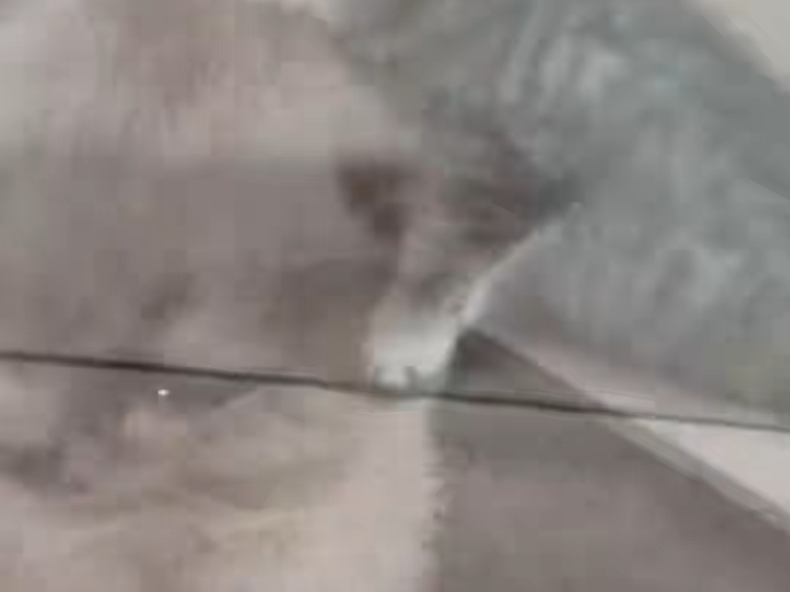 | 754 | 2026-11-03 |
| [人类最超标的双手撸撸撸撸](https://www.bilibili.com/video/BV1ZHxh6UESF) | 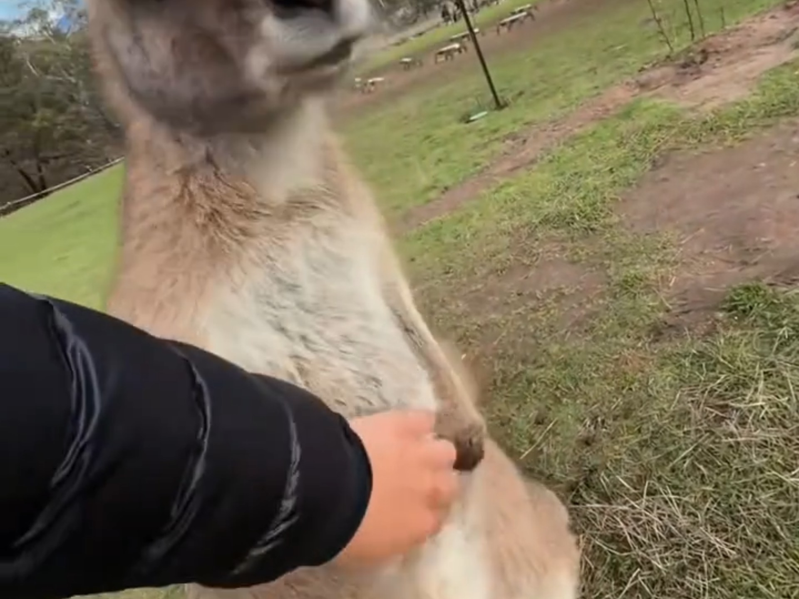 | 28.3万 | 2026-11-03 |
| [战斗基米](https://www.bilibili.com/video/BV1kP4G6GEhy) | 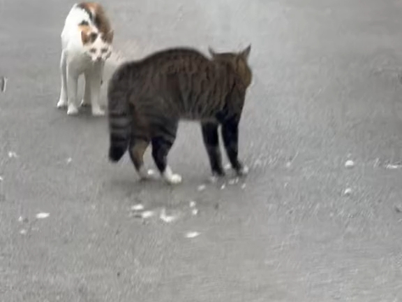 | 1268 | 2026-11-03 |
| [淡雨季](https://www.bilibili.com/video/BV18h4G69EAb) |  | 1.1万 | 2026-11-03 |
| [11.03老吴老吴](https://www.bilibili.com/video/BV15N4V6hEhM) | 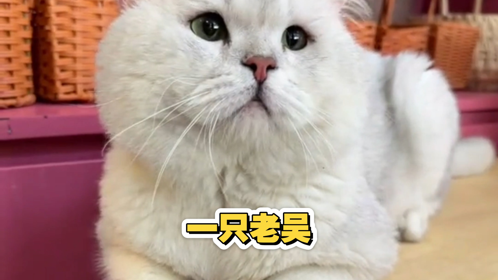 | 9002 | 2026-11-03 |
| [日本潮友整活鸟朝真人版这种艺术还是太超前了，不笑的是这个](https://www.bilibili.com/video/BV1Lf4g6oEUw) |  | 6.6万 | 2026-11-03 |
| [你别多想，这真是我第一次带小猫回家](https://www.bilibili.com/video/BV1qV4g6tErk) | 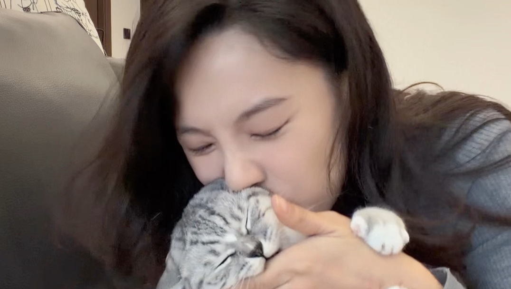 | 1.9万 | 2026-11-03 |
| [老吴要鱼](https://www.bilibili.com/video/BV1M54362Evv) | 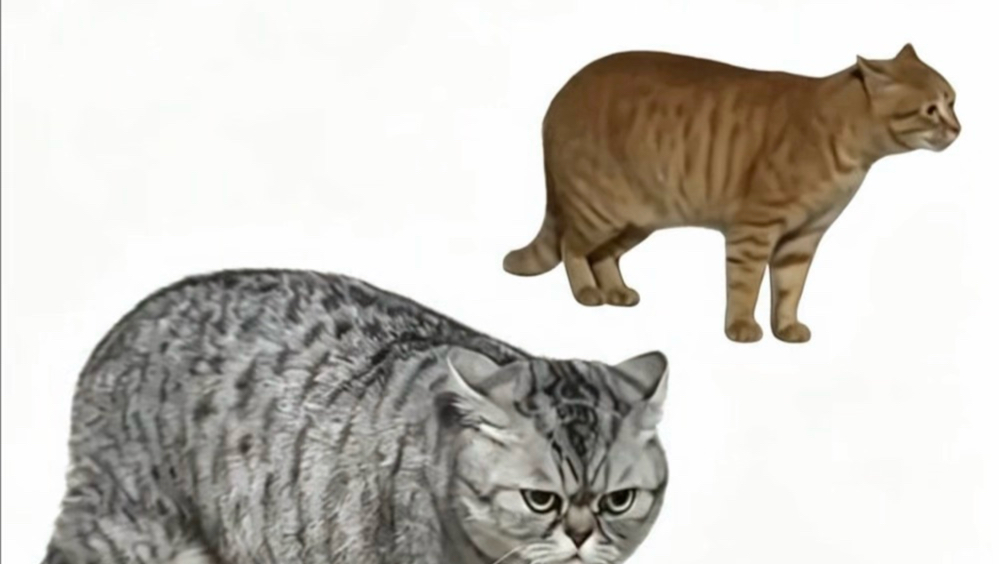 | 2.0万 | 2026-11-03 |
| [Bin＆Zeus 美丽的扫帚：原来赢你也会这样痛……](https://www.bilibili.com/video/BV1q54g6oEnP) |  | 24.6万 | 2026-11-03 |
| [DeepSeek：不吃白饭？GPT你欠揍是吧？](https://www.bilibili.com/video/BV1Mc4N6wEaG) |  | 1.3万 | 2026-11-03 |
| [S〇XXXXXXXXXXXXXXXXXXXXXXXXXXXXXXXXXXXXXXXXXXXXXXXXXXXXXXXXXXXXXXXXXXXXXXXXXXXXXX](https://www.bilibili.com/video/BV1G84A6eE45) |  | 32.8万 | 2026-11-02 |
| [猫咪神九门—陈茂盛](https://www.bilibili.com/video/BV1fo4c6TEJd) | 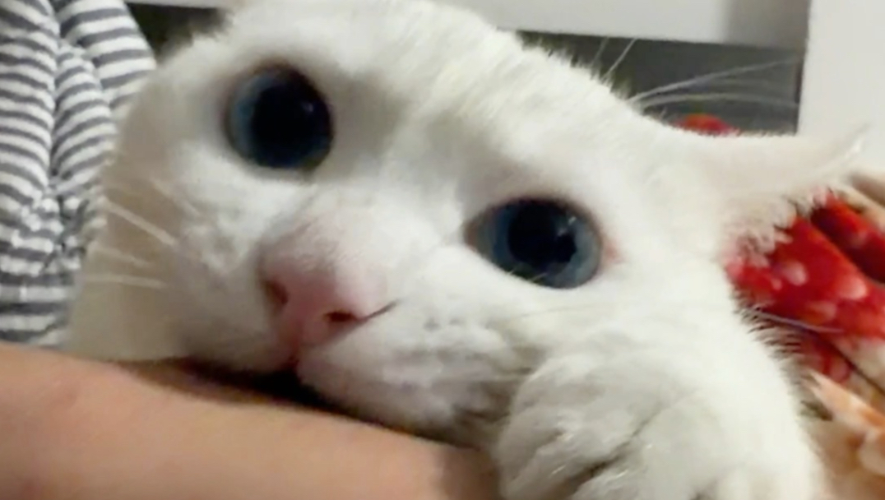 | 20.5万 | 2026-11-02 |
| [猫咪目前正在恢复，后续还会跟进的~](https://www.bilibili.com/video/BV1A14c61ERU) | 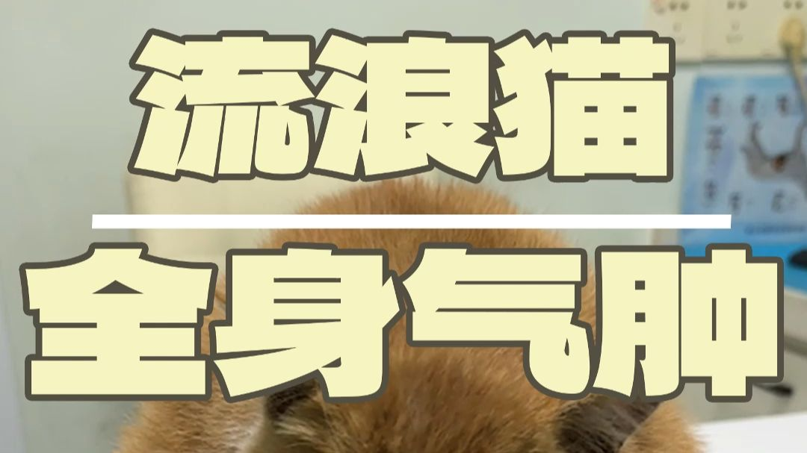 | 348.0万 | 2026-11-02 |
| [又锁两个？](https://www.bilibili.com/video/BV1D34w6oEzC) | 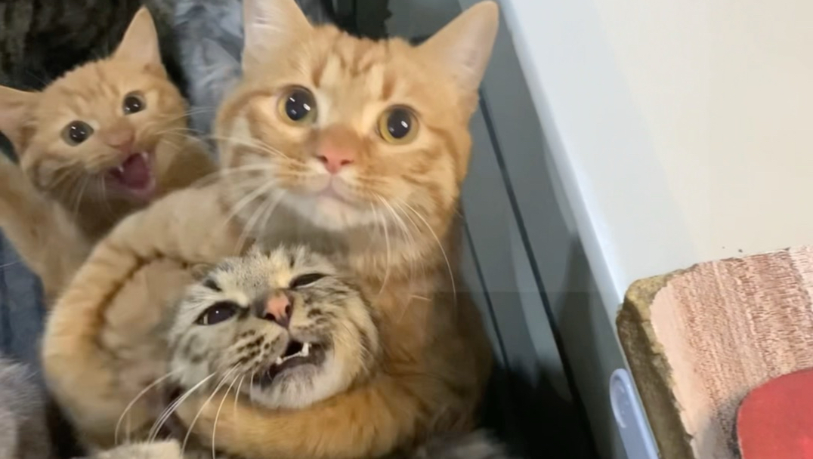 | 7.5万 | 2026-11-02 |
| [好久没打架了，打得酣畅淋漓](https://www.bilibili.com/video/BV1Da4c6WEN4) | 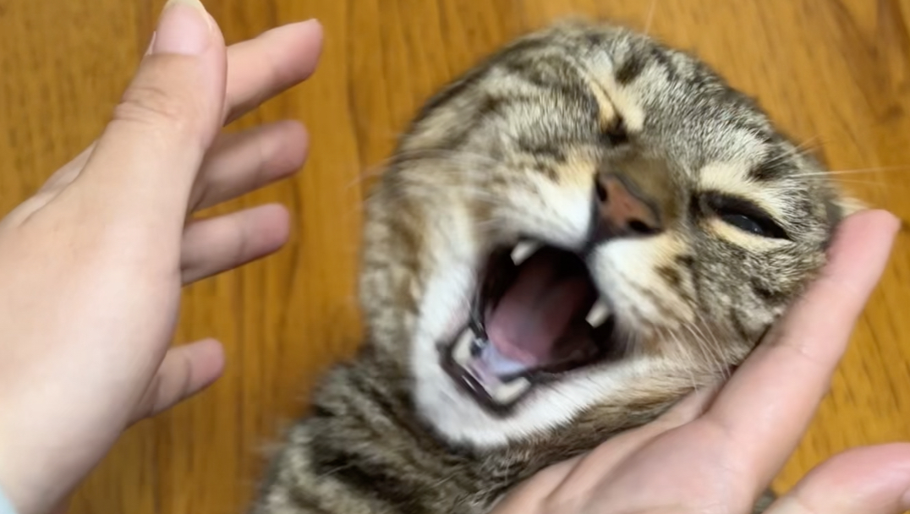 | 4.2万 | 2026-11-02 |
| [挟猫崽以令猫妈！](https://www.bilibili.com/video/BV1bKxx6sE1Q) | 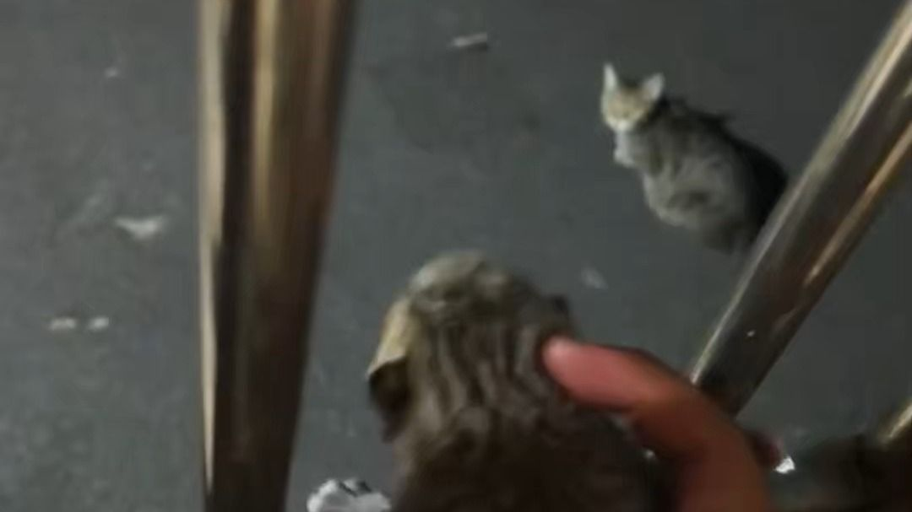 | 5.6万 | 2026-11-01 |
| [【基米】对镜贴哈黄](https://www.bilibili.com/video/BV1ZMxs6PEdo) | 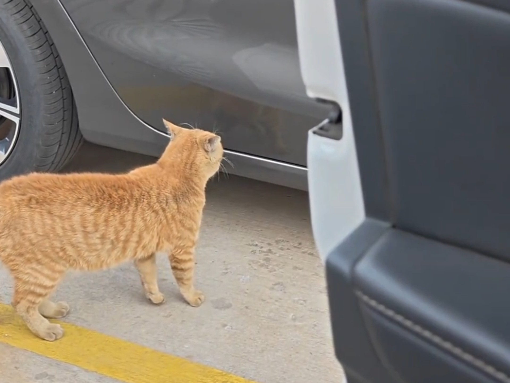 | 640 | 2026-11-01 |
| [代码彻底混乱](https://www.bilibili.com/video/BV1pVxH6PEHL) | 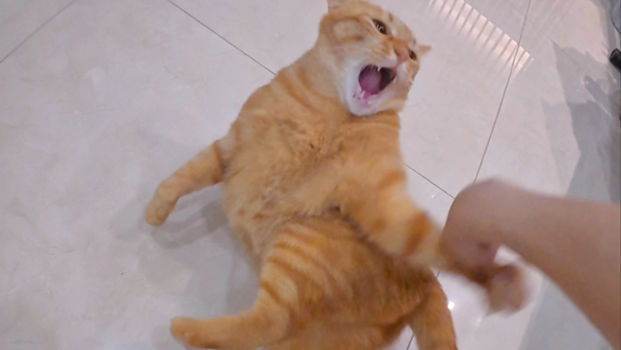 | 2.7万 | 2026-11-01 |
| [【赛马娘翻唱&amp;手书】人是猫](https://www.bilibili.com/video/BV1s5xW63ErC) |  | 1733 | 2026-11-01 |
| [冷知识 每种大橘猫是不一样的](https://www.bilibili.com/video/BV1eqHg65E1j) | 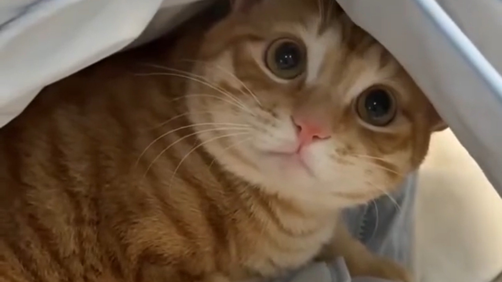 | 23.9万 | 2026-11-01 |
| [大狗大狗交交交(1坤分钟纯享版)弄得奶奶笑笑](https://www.bilibili.com/video/BV1vbxy6HE2n) | 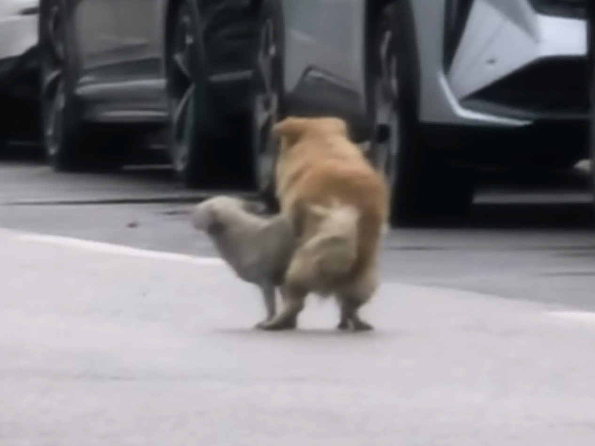 | 778 | 2026-10-31 |
| [基米基米](https://www.bilibili.com/video/BV1KHxr68EC2) | 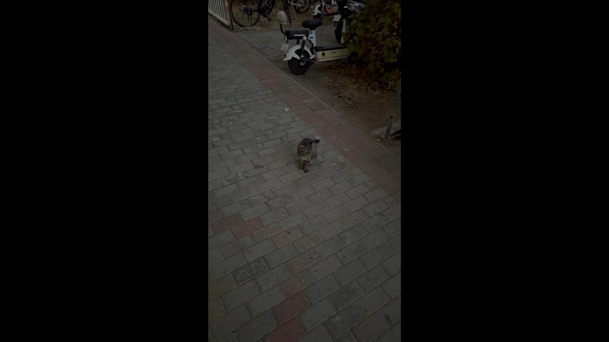 | 30 | 2026-10-31 |
| [十面老吴](https://www.bilibili.com/video/BV18vxk6zEZd) | 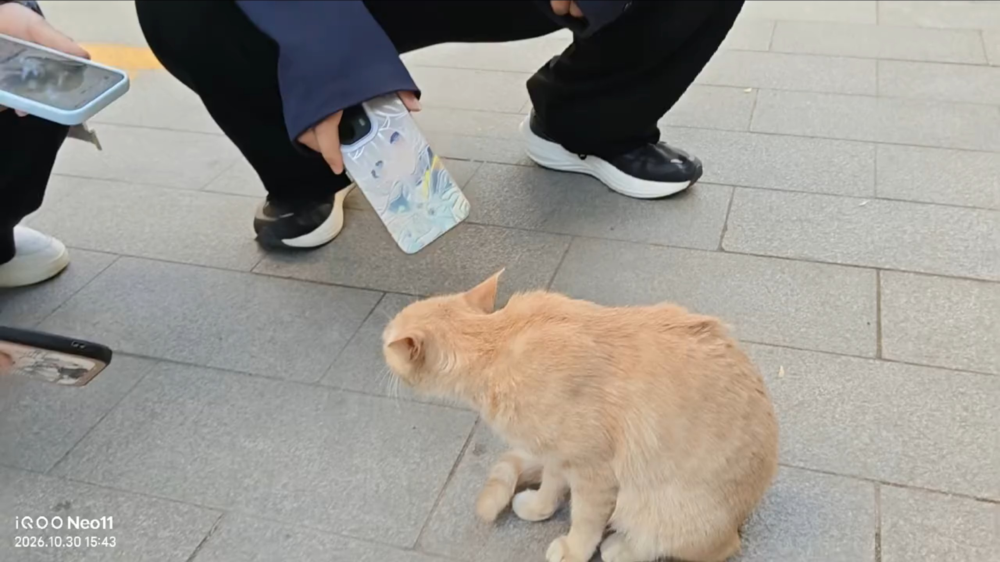 | 5.6万 | 2026-10-31 |
| [11月随身WiFi全预算攻略：双11必看！自费测了几十款随身WiFi，只有这7款值得推荐！｜随身WiFi测评｜随身WiFi推荐｜高性价比｜租房党｜上班族｜学生党](https://www.bilibili.com/video/BV1ZHxk6EEFz) |  | 6.4万 | 2026-10-31 |
| [幽默生物之集美误将基米的本能当作友情](https://www.bilibili.com/video/BV1fixz63EES) |  | 1483 | 2026-10-31 |
| [12个最新的ai组队驰骋绿茵场，哪一队能夺冠？｜AI 算法对抗大赛 第 8 集 · 2v2 足球](https://www.bilibili.com/video/BV19rxq6FEub) |  | 20.6万 | 2026-10-30 |
| [橘猫被哈基罐制裁](https://www.bilibili.com/video/BV1koxY6YERE) | 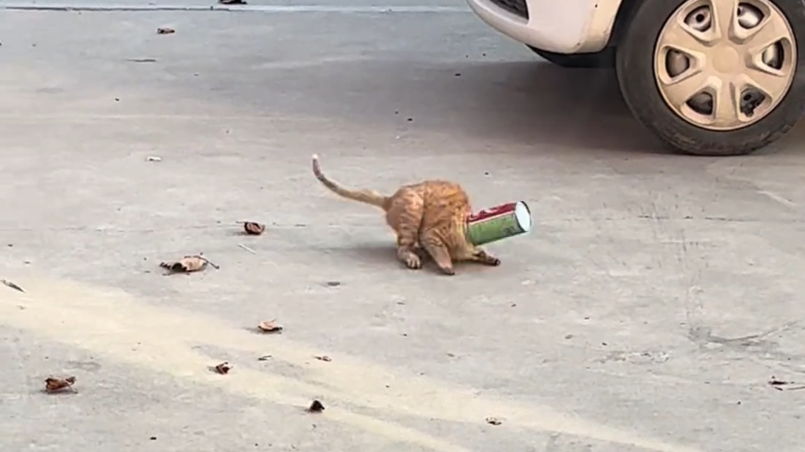 | 1.4万 | 2026-10-30 |
| [30分钟沉浸式翻新3只超乖小猫~【睡个好觉】](https://www.bilibili.com/video/BV1SXxj6wE7F) | 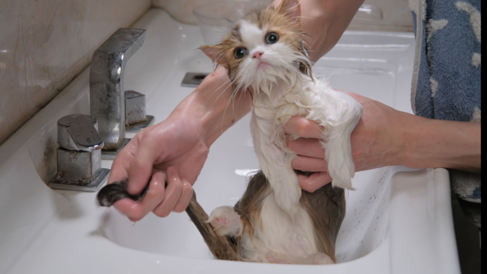 | 3.5万 | 2026-10-29 |
| [抽象二创的尽头，为什么总是版权？](https://www.bilibili.com/video/BV1Srsf61E3m) |  | 18.7万 | 2026-10-29 |
| [柜子里长猫了](https://www.bilibili.com/video/BV1aExF6nEeG) | 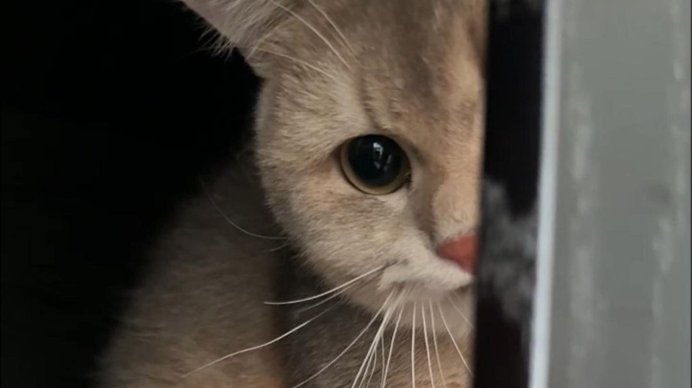 | 4.8万 | 2026-10-29 |
| [进来看两只猫大战（怎么还有哈气？）](https://www.bilibili.com/video/BV1DExF6nEEk) | 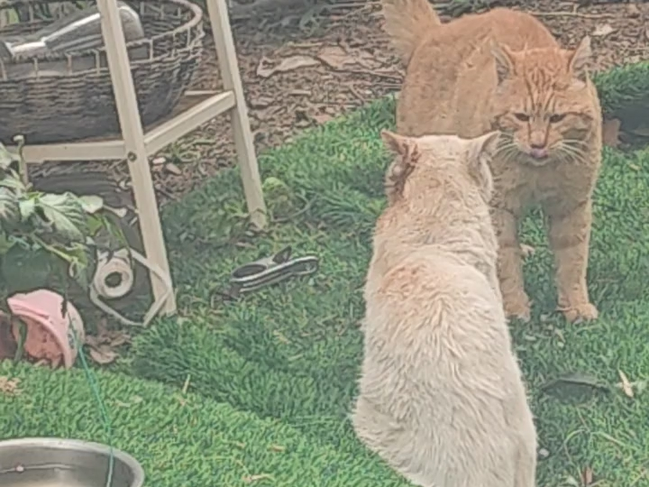 | 122 | 2026-10-29 |
| [纯净版老吴](https://www.bilibili.com/video/BV1tnsZ63EL8) | 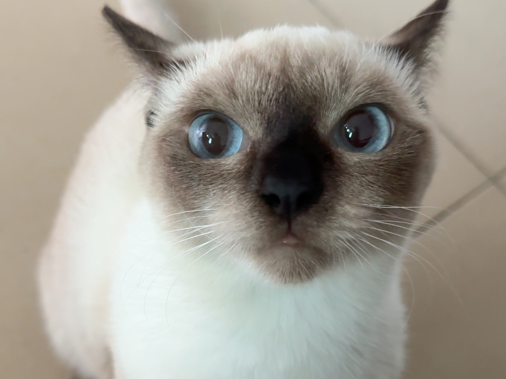 | 85.0万 | 2026-10-29 |
| [《妙脆角猫的新旅程》无鳄不坐](https://www.bilibili.com/video/BV1Lrs963EtW) |  | 17.6万 | 2026-10-28 |
| [⚡⚡我每天苦练的抽象，不如天才的灵光一现⚡⚡](https://www.bilibili.com/video/BV1oosX63Ez5) |  | 2.7万 | 2026-10-28 |
| [泥走开啦！](https://www.bilibili.com/video/BV1haxM6CEZC) |  | 40.3万 | 2026-10-28 |
| [咪咪带你看世界 第九站](https://www.bilibili.com/video/BV1PrxL6DEZa) | 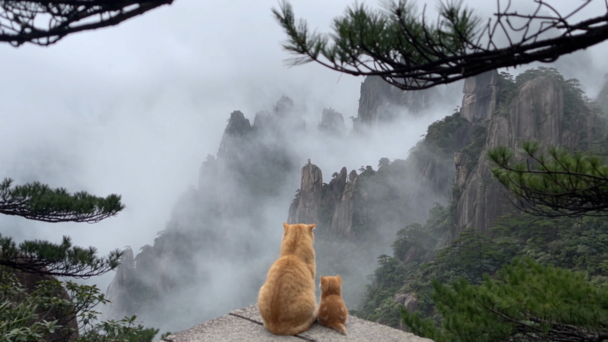 | 7640 | 2026-10-28 |
| [下面，我简单喵两句！](https://www.bilibili.com/video/BV1bVxj6fEob) |  | 7.5万 | 2026-10-28 |
| [12个key高音翻唱完整版《海屿你》不要啊小马会似的😭👊🏻](https://www.bilibili.com/video/BV1Pax363EBi) |  | 1572 | 2026-10-28 |
| [带两米巨猫去吃瓜：展现全能时刻！ #即梦AI创作者成长计划 #萌宠出道计划 #猫咪 #萌宠 #治愈](https://www.bilibili.com/video/BV1iYxG6bEnR) |  | 3481 | 2026-10-27 |
| [噜咪万圣节，平民如何获取无头骑士？千万别踩坑！](https://www.bilibili.com/video/BV15uxu6EEBd) |  | 8754 | 2026-10-27 |
| [真TM绝了，再看亿遍！](https://www.bilibili.com/video/BV1CGxg6NELh) |  | 19.1万 | 2026-10-27 |
| [盖瑞模组：桥头惊现怪物警示牌！铁憨憨以为恶作剧，不料真有怪物](https://www.bilibili.com/video/BV1S6xM6MEui) |  | 4.4万 | 2026-10-27 |
| [这是猫啊，这是好猫，怎么会有这样的小猫猫啊](https://www.bilibili.com/video/BV1CznZ6WE8B) | 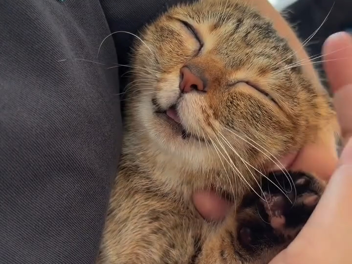 | 7.7万 | 2026-10-26 |
| [猫儿这个偷吃](https://www.bilibili.com/video/BV1VJnU6jE45) | 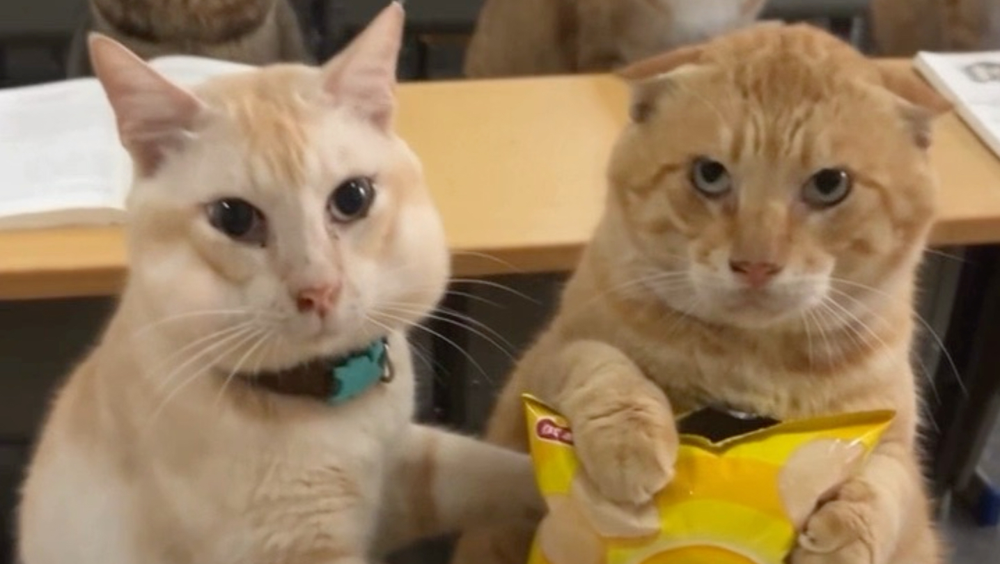 | 8.8万 | 2026-10-25 |
| [芙宁娜翻唱【人是猫】！](https://www.bilibili.com/video/BV1HiHT67EpQ) |  | 1.7万 | 2026-10-24 |
| [更疯狂的来咯!!木叶的秋黑绝哈基米佩恩戏耍对手,全程疯狂过瘾!各种不可思议操作,](https://www.bilibili.com/video/BV1JhHA6NERo) |  | 12.3万 | 2026-10-24 |
| [这种音乐根本没人能绷住](https://www.bilibili.com/video/BV1s8nY6WEfK) | 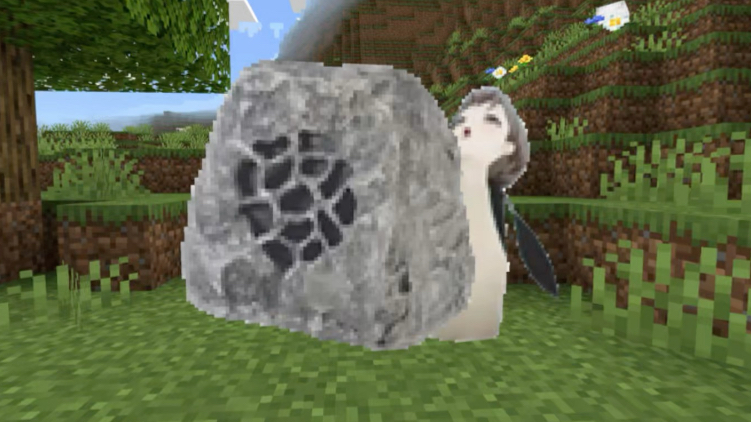 | 78.0万 | 2026-10-24 |
| [《哈基米德》](https://www.bilibili.com/video/BV1Cxnb66EX2) | 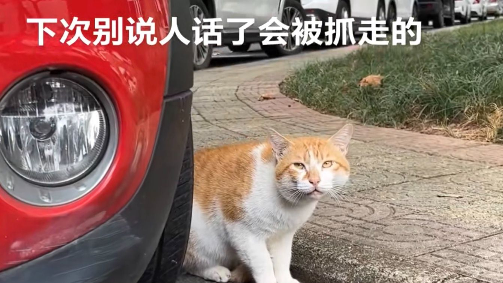 | 19.5万 | 2026-10-24 |
| [久留美被扇巴掌一个小时纯享](https://www.bilibili.com/video/BV1ZcnH6CEpA) |  | 46.5万 | 2026-10-22 |
| [小基米只是想引起你的注意罢了](https://www.bilibili.com/video/BV1yLnm6FEhW) | 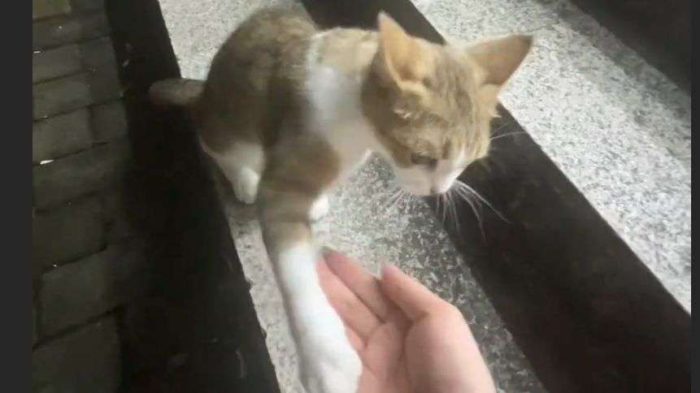 | 1713 | 2026-10-22 |
| [ASMR甜菜—这次只抓头顶！7期抓挠精选合集｜无人声｜放松助眠](https://www.bilibili.com/video/BV14Bnz6GE41) |  | 3.6万 | 2026-10-21 |
| [《晚安大小姐》⚡️黄仁勋X马斯克版⚡️【AI MV大赛】](https://www.bilibili.com/video/BV13bnE6ZEg2) |  | 87.3万 | 2026-10-19 |
| [安心的体形，安心的声音，不安的花纹](https://www.bilibili.com/video/BV1eTnM6AEdh) | 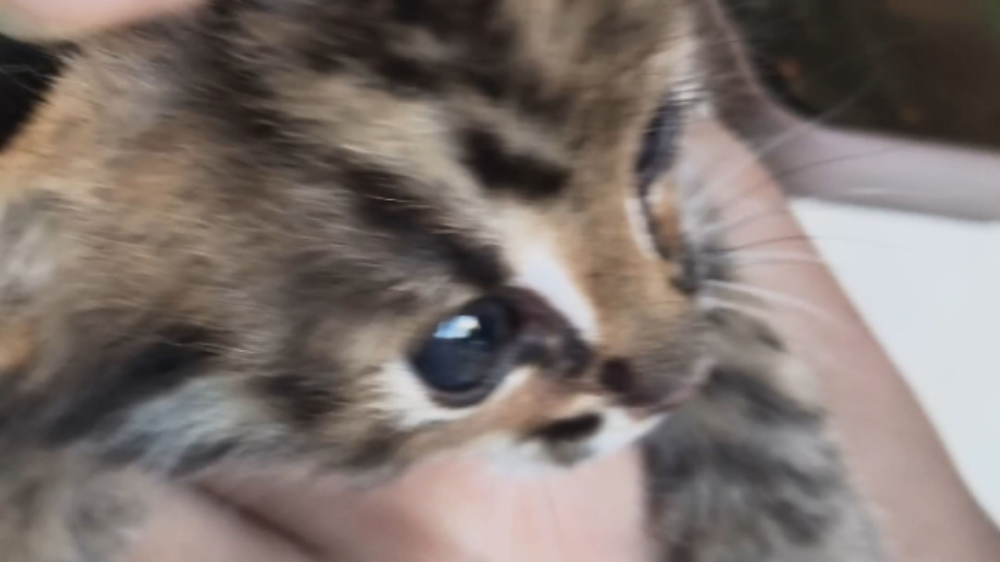 | 5.5万 | 2026-10-18 |
| [【ASMR｜普瑞赛斯】喜欢这样吗](https://www.bilibili.com/video/BV1JrJ46ZEi2) |  | 12.1万 | 2026-10-16 |
| [听完老通透了《雨爱司凤版》](https://www.bilibili.com/video/BV1dHpg67EsL) |  | 8.3万 | 2026-10-15 |
| [离人愁0.1倍速巨兽特制版dj（完整版）](https://www.bilibili.com/video/BV1ktJ16JERK) |  | 11.8万 | 2026-10-15 |
| [养了两年多的猫，今年开始隔三岔五发疯哈人](https://www.bilibili.com/video/BV1s6pQ6jENn) | 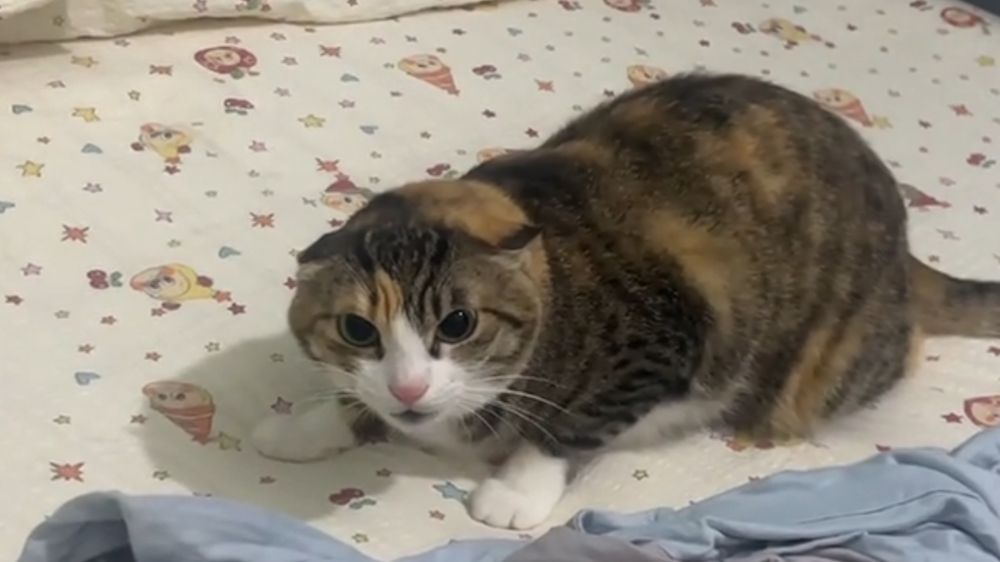 | 6.7万 | 2026-10-12 |
| [你今天必须有妈妈！](https://www.bilibili.com/video/BV1yUpg6fETA) |  | 35.8万 | 2026-10-10 |
| [Cute Mommy Cat Eating Lychee With Baby Kitten ｜ Super Adorable AI Cat Family](https://www.bilibili.com/video/BV1vhH76hEwk) |  | 6537 | 2026-10-05 |
| [猫:人类是害虫！](https://www.bilibili.com/video/BV1GqaB65EB1) |  | 29.6万 | 2026-10-01 |
| [ASMR｜100%秒睡免疫福星｜掏耳朵刮擦等罕见道具混合触发音｜一只小毛羊助眠](https://www.bilibili.com/video/BV1neQ7ByETZ) |  | 171.1万 | 2026-04-15 |
| [善良哈基米  哈！！](https://www.bilibili.com/video/BV1dgXDBAEfj) |  | 6015 | 2026-03-29 |
| [【1649C】触碰到耳膜的酥爽感，让耳屎震动的顶级声压采耳 ｜ 云刀 ｜ 棉签 ｜ 木耳勺 ｜ 铁耳勺 ｜ 硅胶耳勺 ｜ 云采耳 ｜ ASMR ｜ 掏耳](https://www.bilibili.com/video/BV1oz3tzSEtG) |  | 763.2万 | 2025-07-02 |
| [小猫短暂的一生](https://www.bilibili.com/video/BV1D142197kE) |  | 20.7万 | 2024-04-24 |

---
*最后更新: 2026-11-05 09:21:10 (自动生成)*
*数据来源: [Bilibili](https://www.bilibili.com)*

## 使用说明

运行以下命令更新视频列表:
```bash
python3 fetch_hajimi_videos.py
```
