# awesome-hajimi
collections of hajimi (哈基米 in Chinese) on the Internet.

## 视频列表 (Video List)

| 视频标题 (Title) | 封面 | 播放量 (Views) | 发布日期 (Date) |
|---|---|---|---|
| [这是LCK最凶的哈基米，bin哥你怕不怕？](https://www.bilibili.com/video/BV1TwWj6JEKj) |  | 2942 | 2026-11-11 |
| [哈基米成长碎片｜啃手指卖萌，淘气又惹人疼🐾](https://www.bilibili.com/video/BV1GSWL6tEJb) | 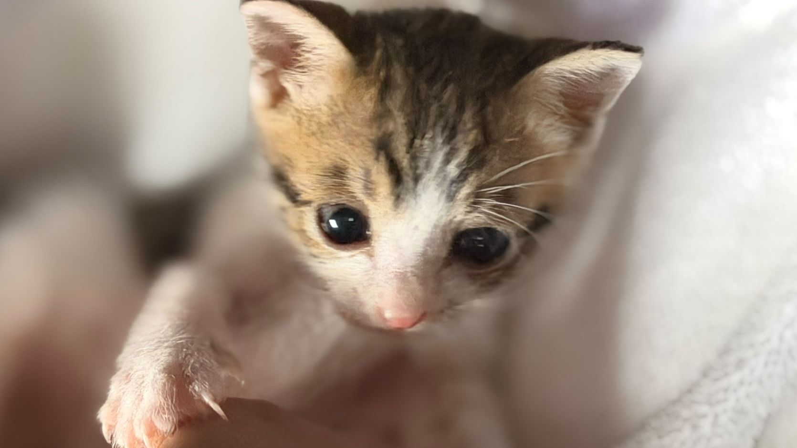 | 827 | 2026-11-11 |
| [哈基米从来不怕下大雪](https://www.bilibili.com/video/BV1X4Wj6wEx2) | 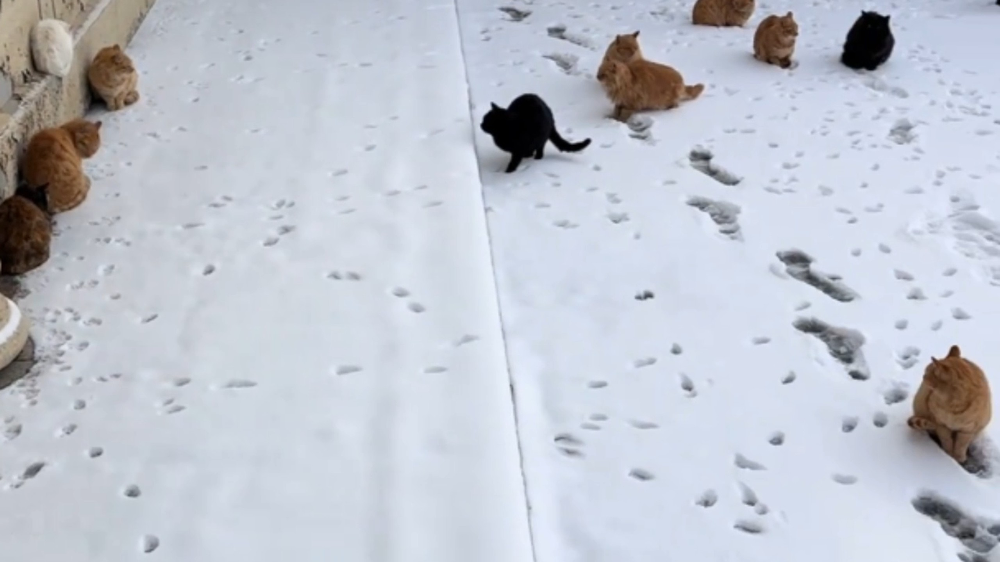 | 1587 | 2026-11-11 |
| [哈基米又来洗脑了](https://www.bilibili.com/video/BV1VtWj6aEQ5) | 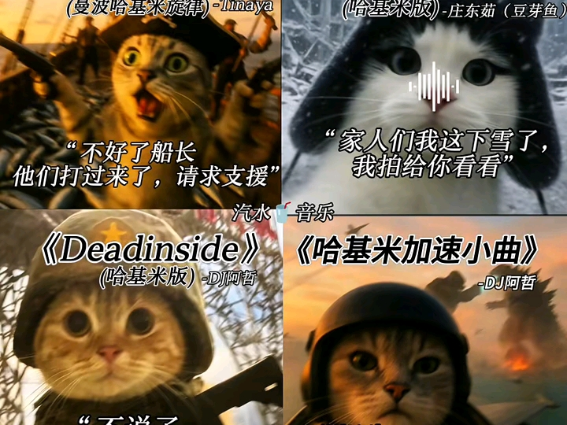 | 136 | 2026-11-11 |
| [耄橘小时候2：再次挑战大狗 #哈基米](https://www.bilibili.com/video/BV198Wj6FEPF) | 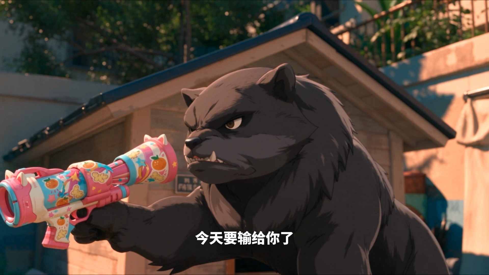 | 409 | 2026-11-11 |
| [咪的名字叫哈基米](https://www.bilibili.com/video/BV1q4W36oEZJ) | 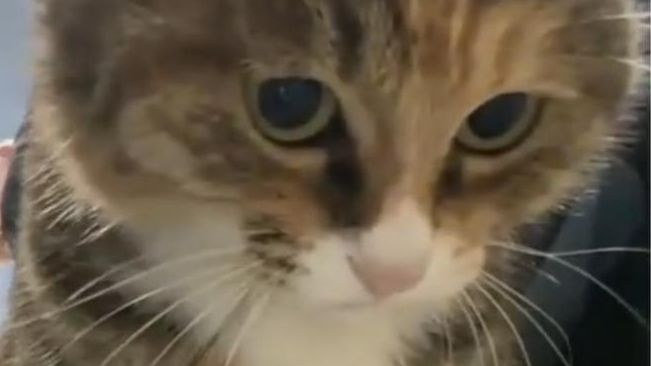 | 3256 | 2026-11-11 |
| [【熟肉】Anny发现哈基米是赛马娘唱的大为震惊](https://www.bilibili.com/video/BV1PmWj6UE1G) |  | 7556 | 2026-11-11 |
| [即使残躯也要战斗吗哈基米你的意志我认可了](https://www.bilibili.com/video/BV1xCWj6HEHc) | 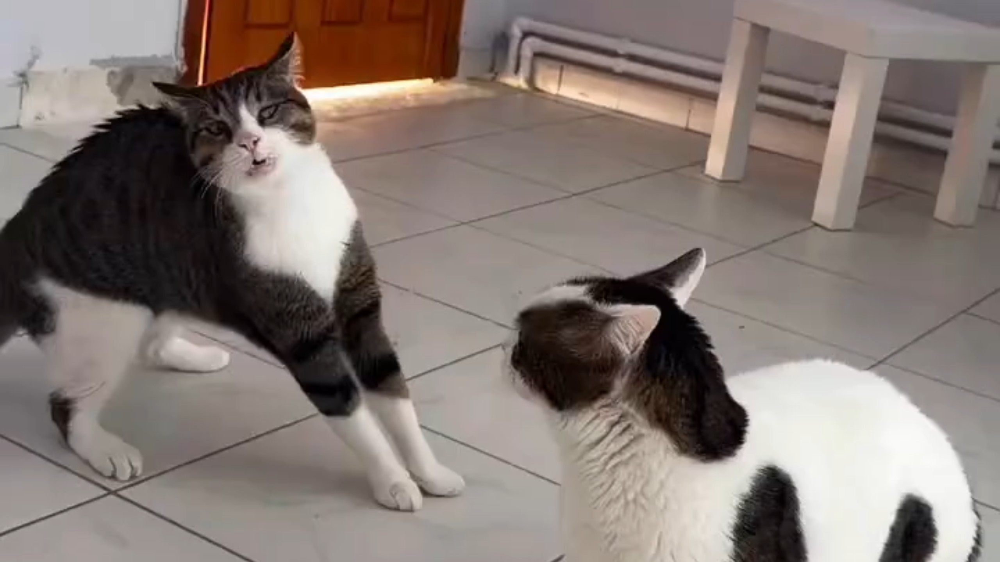 | 526 | 2026-11-11 |
| [四面吴歌压力哈基米](https://www.bilibili.com/video/BV1uSWV6SEeF) | 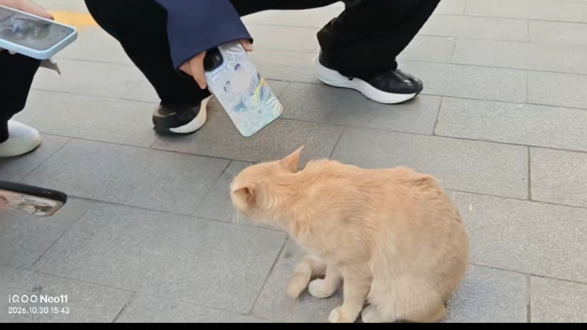 | 7073 | 2026-11-11 |
| [三角洲哈基米鼠鼠机密大坝跑刀赚哈夫币有麦的来](https://www.bilibili.com/video/BV12sW76pE5H) | 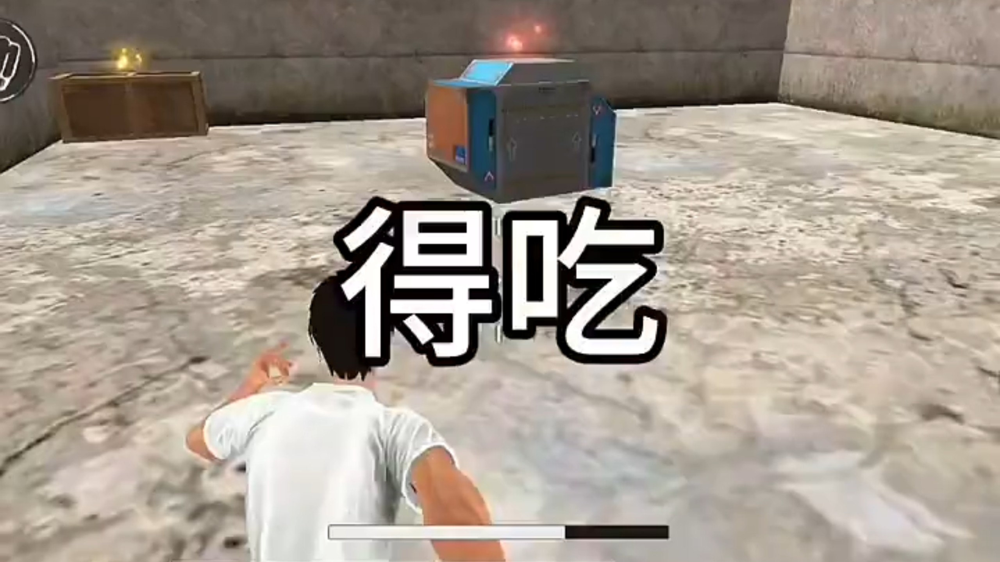 | 1442 | 2026-11-11 |
| [一只哈气的哈基米，旁边卧着的是耄耋？](https://www.bilibili.com/video/BV1fgW56NEWD) | 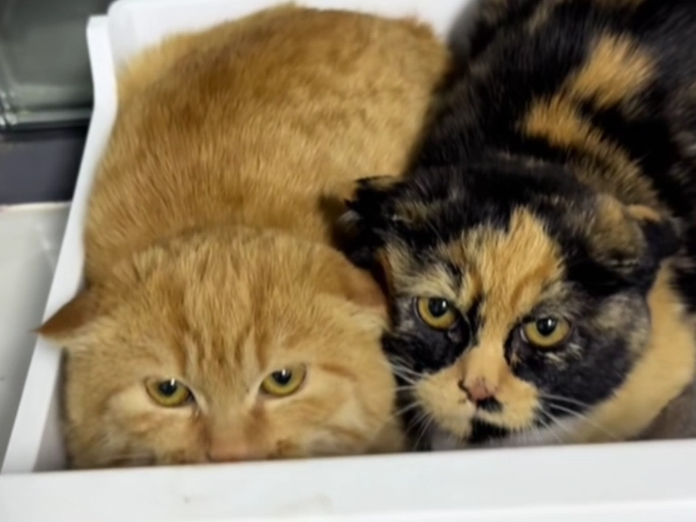 | 647 | 2026-11-10 |
| [哈基米以为门把固定器在指它](https://www.bilibili.com/video/BV1fgW56NEWx) | 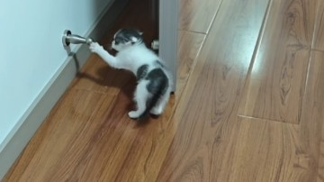 | 1.2万 | 2026-11-10 |
| [狭小的道路中，有一群不哈气的哈基米](https://www.bilibili.com/video/BV1cTW56MEjC) | 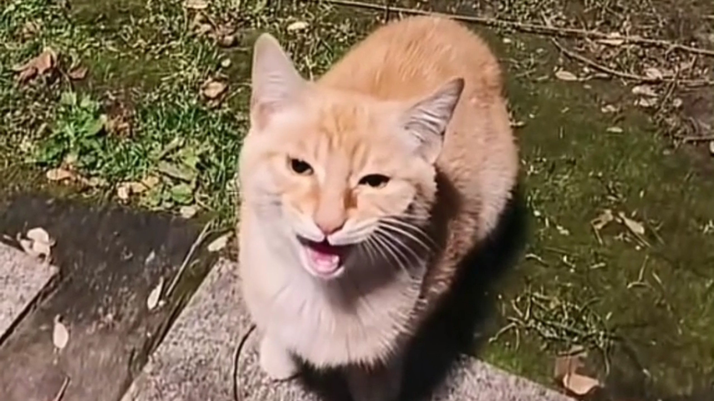 | 794 | 2026-11-10 |
| [老飞宇杨齐家团建小游戏，游戏竟自带《雨爱四凤版》和哈基米音乐，致敬老飞宇！](https://www.bilibili.com/video/BV1t5WV6CEMZ) | 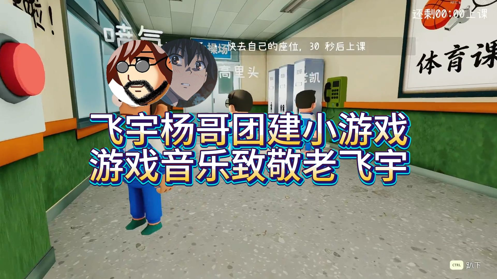 | 1388 | 2026-11-10 |
| [【老飞宇切片】78杨杨团建《我带过最差的一届》在操场上改广播音乐 没想到还有司凤版雨爱 哈基米小曲 豪庭👍](https://www.bilibili.com/video/BV1U3WV61EoW) |  | 3914 | 2026-11-10 |
| [疑似舞萌公认最水13？新手吃分真的推荐！舞立方你就继续摆烂吧 我玩我的哈基米了](https://www.bilibili.com/video/BV1jqWV6ZEuP) |  | 681 | 2026-11-10 |
| [在强劲的哈基米音乐中，水无月用幕帘猫轻松晋级11月大师一！哈基米神力实在是太猛了！](https://www.bilibili.com/video/BV1s7WV6rE8X) |  | 1.2万 | 2026-11-10 |
| [Fable5.2 SOTA，主人总是和Claude小姐在一起，哈基米吃醋了开始哈气](https://www.bilibili.com/video/BV1nbWV6PEVF) |  | 676 | 2026-11-10 |
| [哈基米哈气](https://www.bilibili.com/video/BV1E1Wg6dEYx) | 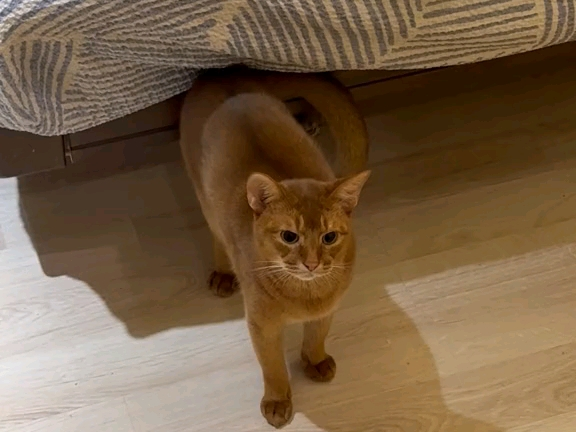 | 9.3万 | 2026-11-10 |
| [哈基米手欠又被夹了](https://www.bilibili.com/video/BV1kqWg6wEdB) | 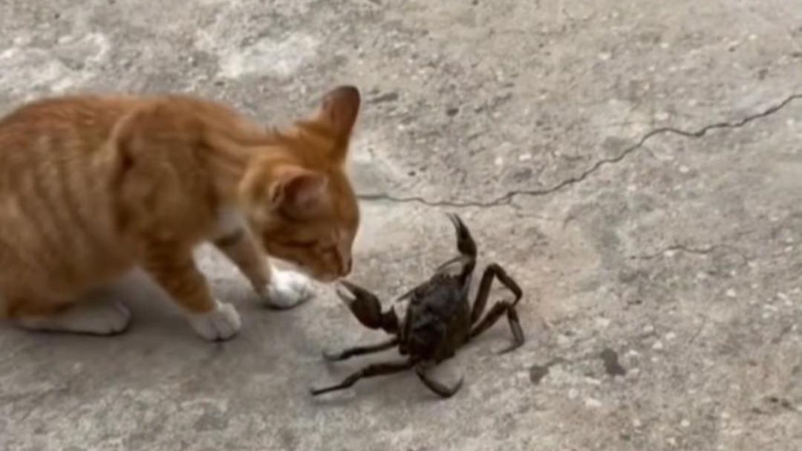 | 545 | 2026-11-10 |
| [根本没有这样的哈基米](https://www.bilibili.com/video/BV1SPW36kE3B) | 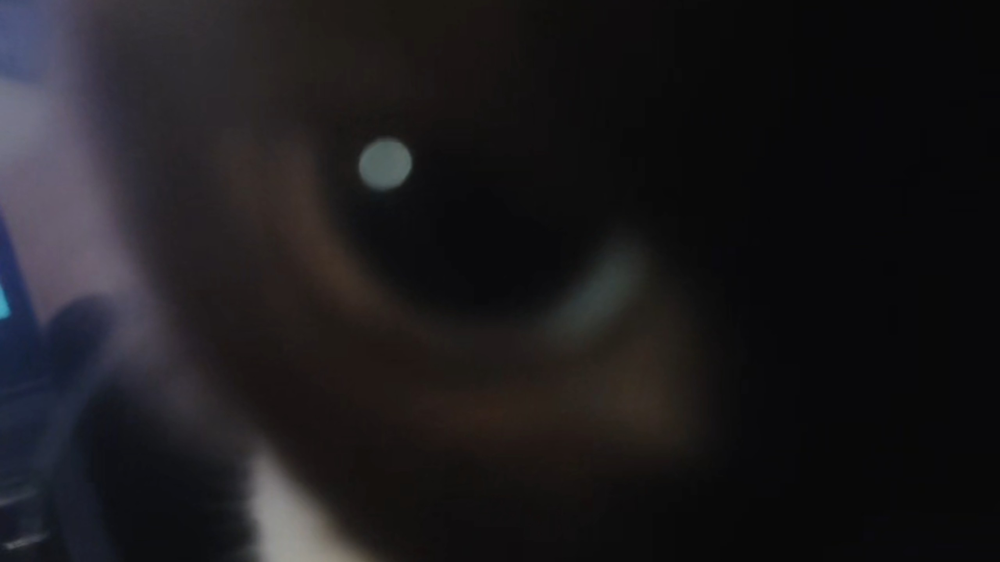 | 245 | 2026-11-10 |
| [只因少喂一餐，哈基米就开始合并同类项](https://www.bilibili.com/video/BV1YZWg62EyM) | 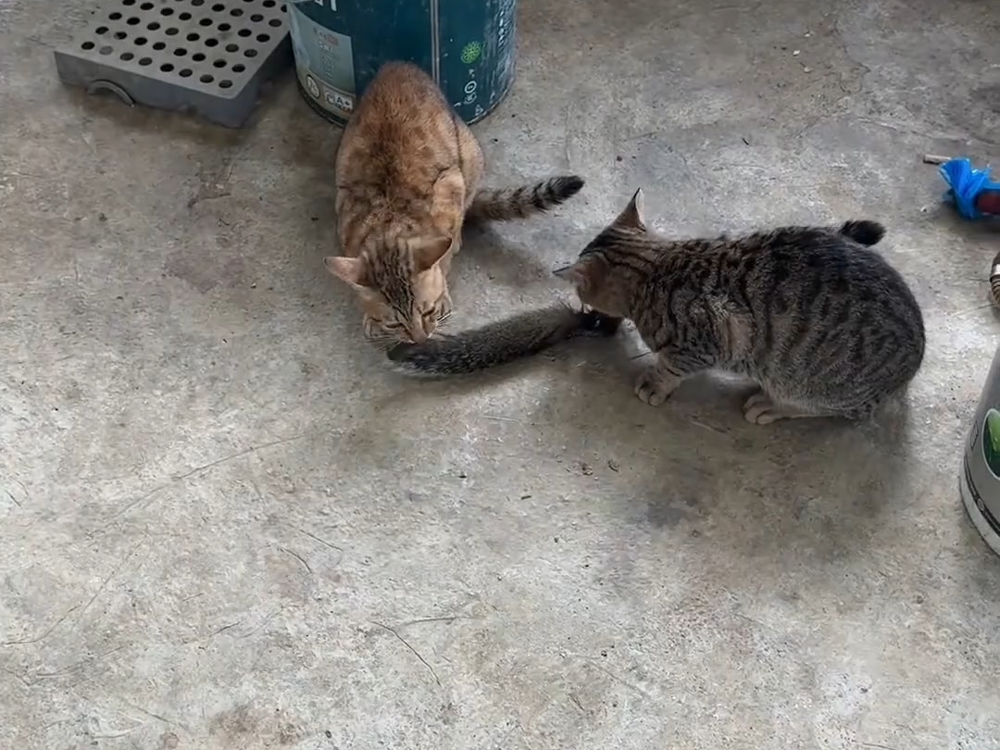 | 3.2万 | 2026-11-10 |
| [高中生收养哈基米一家，小猫仔真的好可爱！](https://www.bilibili.com/video/BV1HJW36aEh8) |  | 3190 | 2026-11-10 |
| [11.10二图为自己取得了猫条和罐头](https://www.bilibili.com/video/BV1rWW36fExs) | 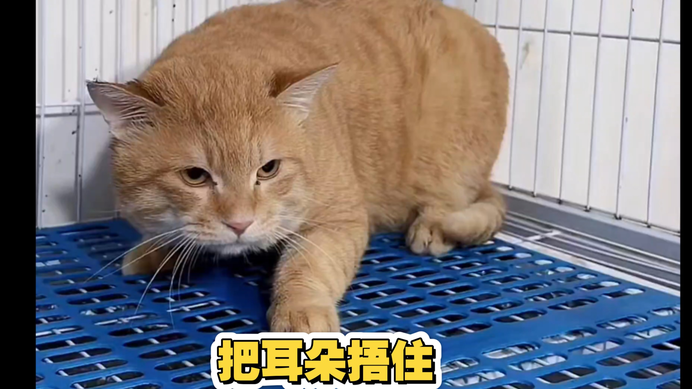 | 8187 | 2026-11-10 |
| [哈基米的幽默瞬间](https://www.bilibili.com/video/BV1PRW36BEZp) | 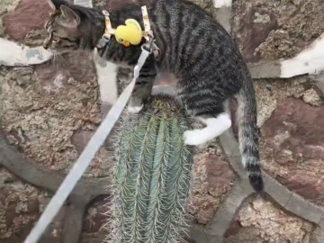 | 9642 | 2026-11-10 |
| [【水姐小饭堂】轻松登顶大师一！哈基米内战堪比勇次郎VS郭海皇！](https://www.bilibili.com/video/BV1WcWG6eE3V) |  | 3248 | 2026-11-10 |
| [【Gemini】哈基米八秒](https://www.bilibili.com/video/BV1TDW363EKL) |  | 1346 | 2026-11-10 |
| [【辛巴】全网第一个对矿泉水开黄桃得主播，怡宝吃过几根啊？开门红得吃一千万，哈基米鼠鼠得吃了](https://www.bilibili.com/video/BV1y3Wu6FEHW) |  | 3149 | 2026-11-10 |
| [一次精防改变局势](https://www.bilibili.com/video/BV12KWu6YEma) |  | 3715 | 2026-11-10 |
| [可恶的哈基米居然伪装成电瓶，基电一体化。](https://www.bilibili.com/video/BV19VWg62Eta) | 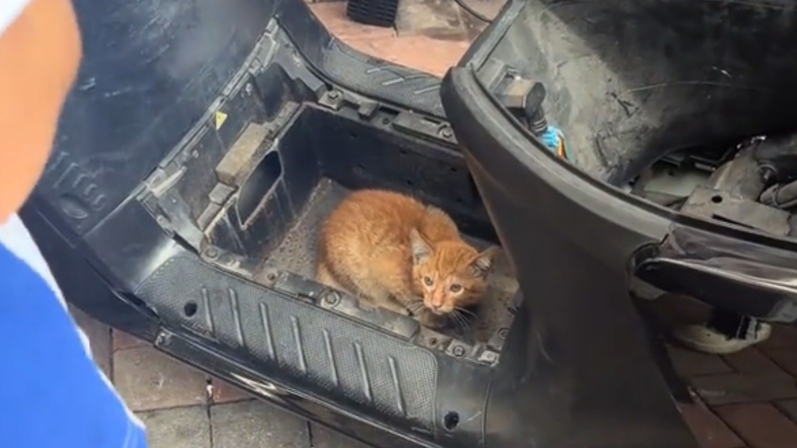 | 443 | 2026-11-10 |
| [【基米】 遇到打猫桩了，混凝土里面有猫也会自动吸附，这东西是蓝牙连接的，信号穿透强](https://www.bilibili.com/video/BV1QEWg6VEbM) | 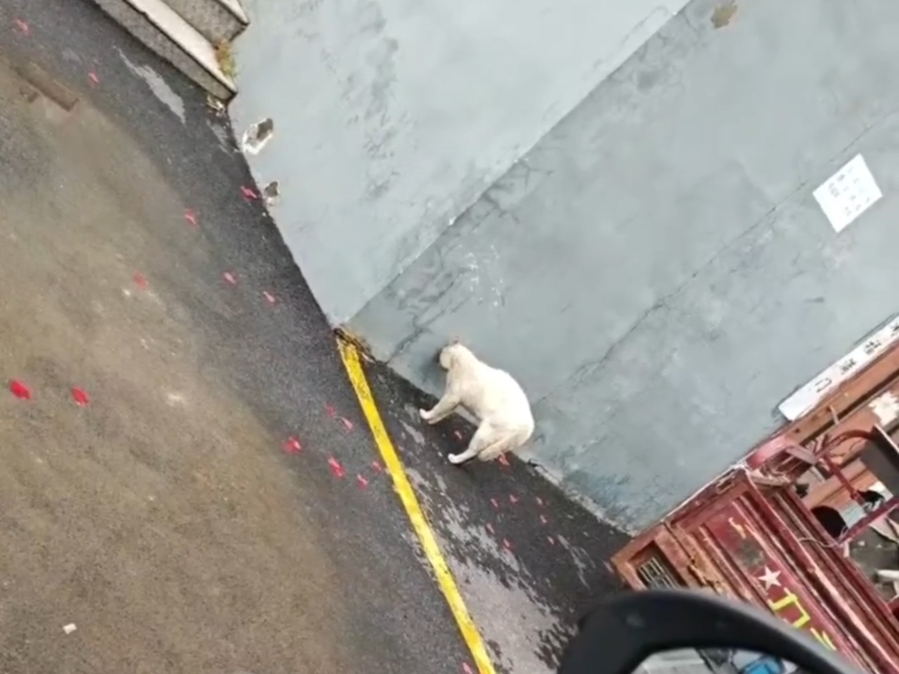 | 1352 | 2026-11-10 |
| [🐱喜欢怎样的基米奈？🐱](https://www.bilibili.com/video/BV1HLWT6UELS) |  | 3619 | 2026-11-10 |
| [可观测宇宙最绝望的三声老吴](https://www.bilibili.com/video/BV16jW86jEiv) | 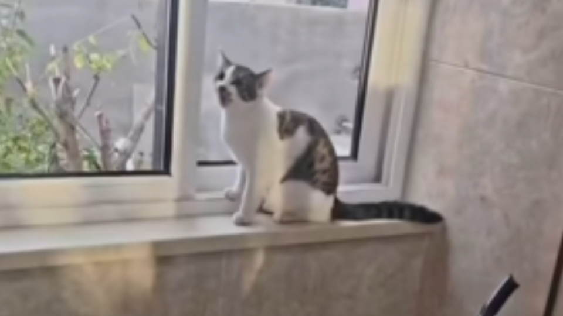 | 3.9万 | 2026-11-09 |
| [好基米，贱人](https://www.bilibili.com/video/BV1sSW869ErS) |  | 1.8万 | 2026-11-09 |
| [根本就没有这样的哈基米！](https://www.bilibili.com/video/BV16n4E6REec) | 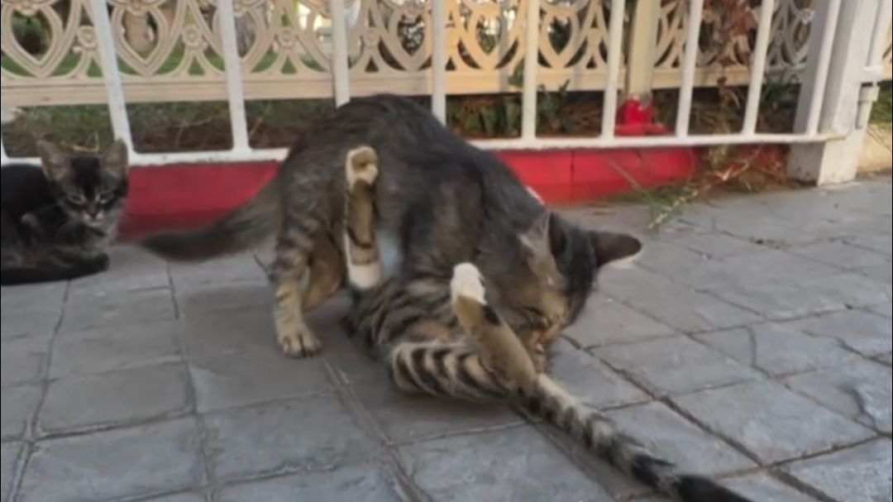 | 4.2万 | 2026-11-09 |
| [《小七的家》第七集，小七辛巴和大黄在渔夫的帮助下追赶货轮……【AI全民制作人】](https://www.bilibili.com/video/BV1isWt6AEpJ) |  | 5806 | 2026-11-09 |
| [好Va（物）分享](https://www.bilibili.com/video/BV15PWb6iEry) | 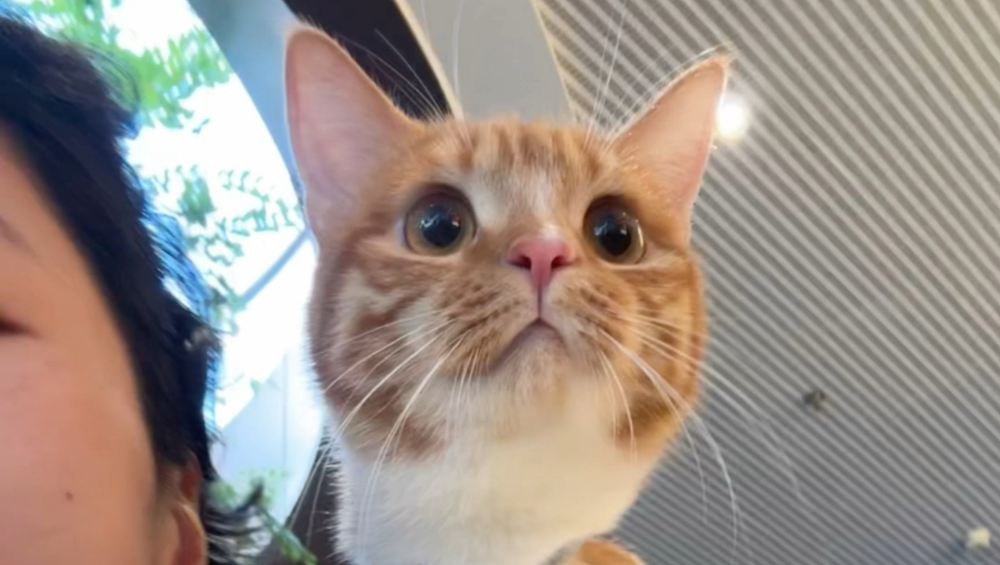 | 3.7万 | 2026-11-09 |
| [顾不上做面了，咪先嘟嘟嘟了，今日女团舞走起~](https://www.bilibili.com/video/BV135Wb6fEq5) |  | 5.5万 | 2026-11-09 |
| [哈基米曼波](https://www.bilibili.com/video/BV12WWb6XEoX) |  | 3658 | 2026-11-09 |
| [⚡️艾 辉 的 诱 惑⚡️](https://www.bilibili.com/video/BV1hhWx6nE8F) |  | 3.6万 | 2026-11-09 |
| [随地大小开棘背龙的小基咪](https://www.bilibili.com/video/BV1VgWb6aE4X) | 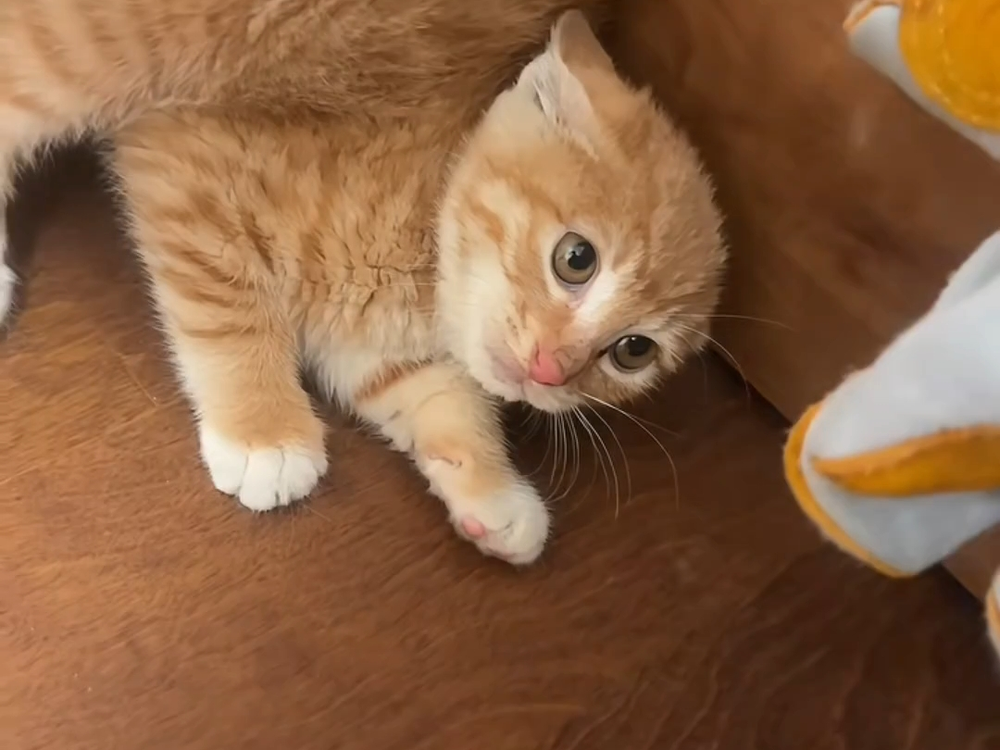 | 694 | 2026-11-09 |
| [哈基米南北绿豆](https://www.bilibili.com/video/BV1XuW46sEGJ) | 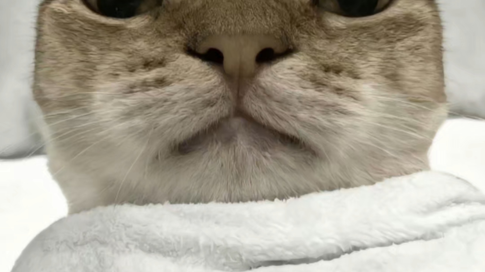 | 52 | 2026-11-09 |
| [“大狗本该命途齐天”【大狗叫｜新·与天齐】](https://www.bilibili.com/video/BV1meWW66EMA) |  | 3.9万 | 2026-11-09 |
| [哈基米的嗓子被毒哑了](https://www.bilibili.com/video/BV1NuWn6cECh) | 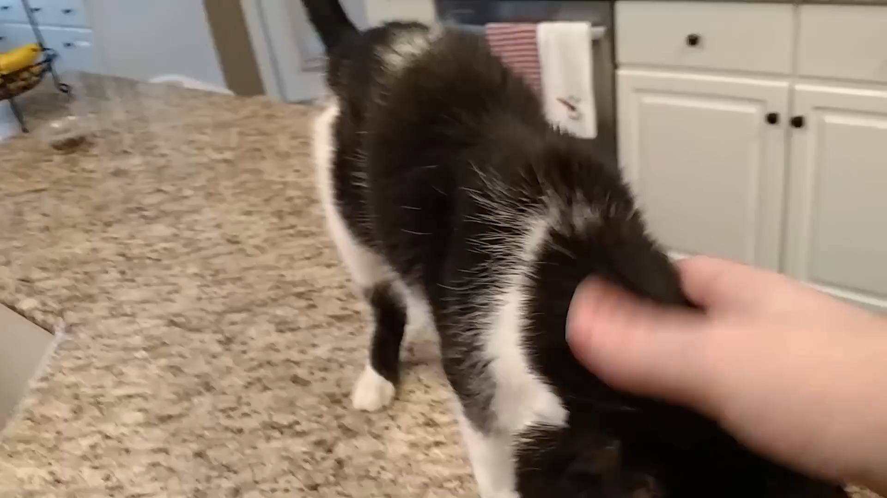 | 301 | 2026-11-08 |
| [哈基冞？！](https://www.bilibili.com/video/BV1jyW76zEmv) | 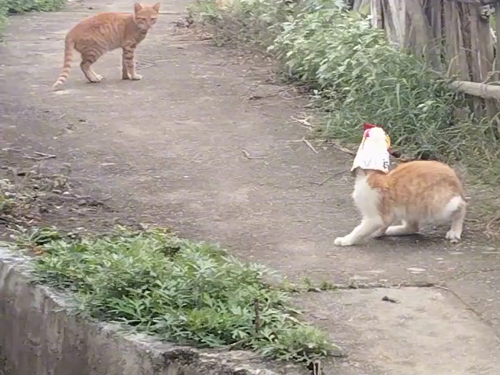 | 263 | 2026-11-08 |
| [聪明的哈基米](https://www.bilibili.com/video/BV1dxWE66ETf) | 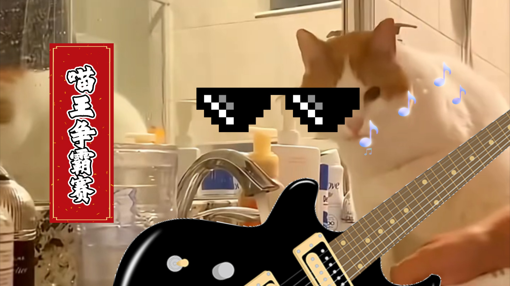 | 144 | 2026-11-08 |
| [🙀 小猫变小了！我是猫](https://www.bilibili.com/video/BV1894p6UEPw) |  | 4931 | 2026-11-08 |
| [千基百态大合集-盘点所有好玩的哈基米 P9](https://www.bilibili.com/video/BV1wR4x61EMw) | 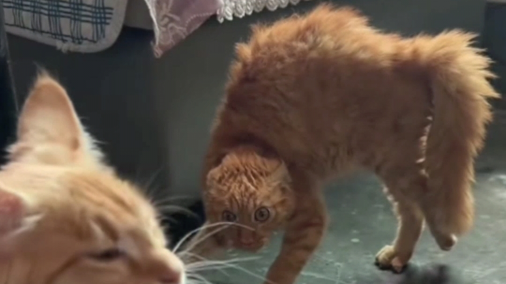 | 18 | 2026-11-08 |
| [哈基米请注意形象](https://www.bilibili.com/video/BV1QT4s6ZEa6) | 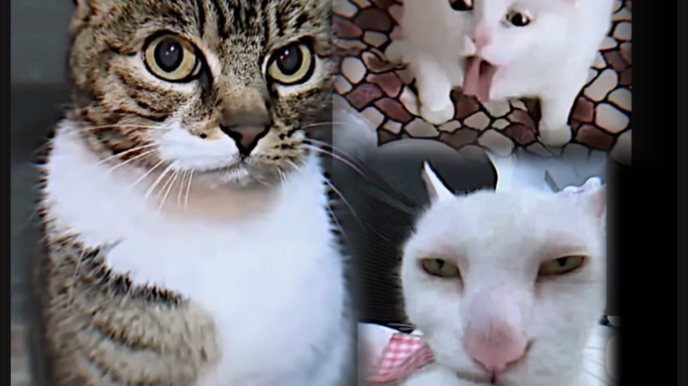 | 245 | 2026-11-07 |
| [猫猫也在哈基乡～🐱](https://www.bilibili.com/video/BV1Wr4J6cEwR) |  | 92 | 2026-11-07 |
| [哈基米的罪孽是什么](https://www.bilibili.com/video/BV1oh4n6dEzt) | 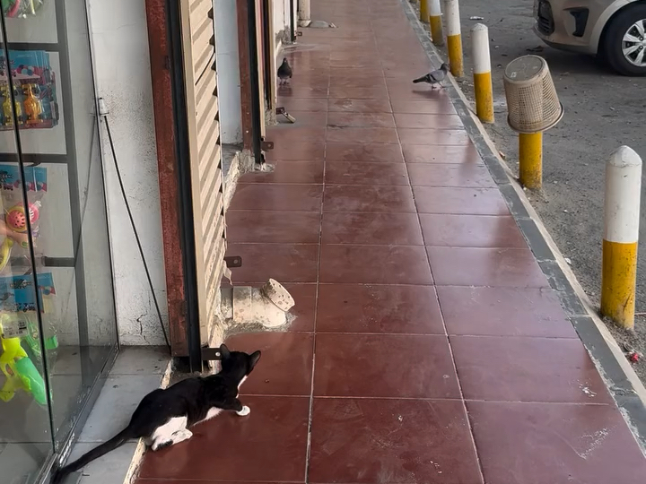 | 392 | 2026-11-07 |
| [哈基米版 空洞骑士！？？](https://www.bilibili.com/video/BV1yX4z6WEDK) |  | 2.8万 | 2026-11-07 |
| [全战雷甲弹对抗水平下降10000倍，而我保持不变！【T-90S 毗湿摩】](https://www.bilibili.com/video/BV1gh4Y6LEsi) |  | 18.4万 | 2026-11-07 |
| [旅游时遇到的那些哈基米](https://www.bilibili.com/video/BV1WR4j69EVj) | 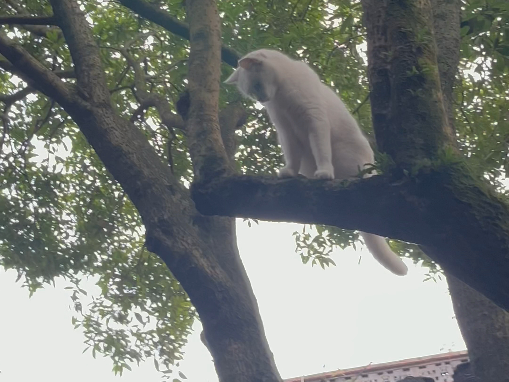 | 320 | 2026-11-07 |
| [哈吉咪：这辈子没这样无语过~](https://www.bilibili.com/video/BV1PN4q6UE4k) | 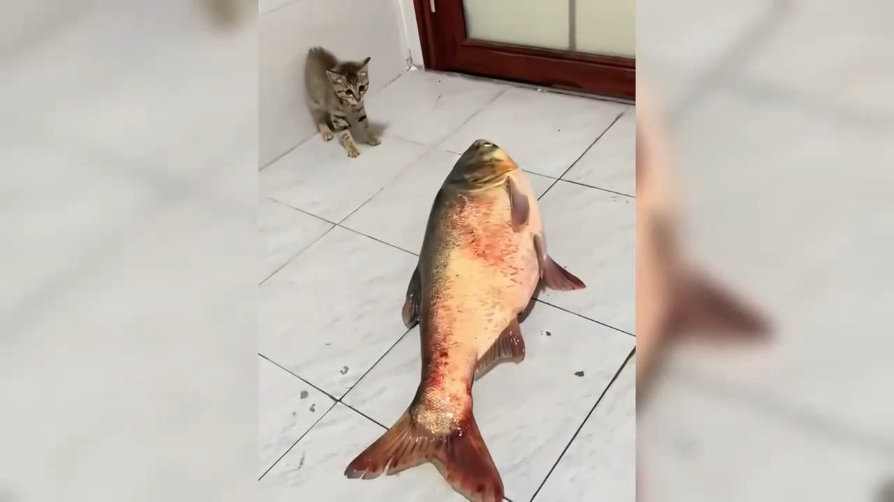 | 8.1万 | 2026-11-06 |
| [奶龙和暴暴龙的搞笑日常｜解压视频合集｜搞笑](https://www.bilibili.com/video/BV1724B6zEN1) | 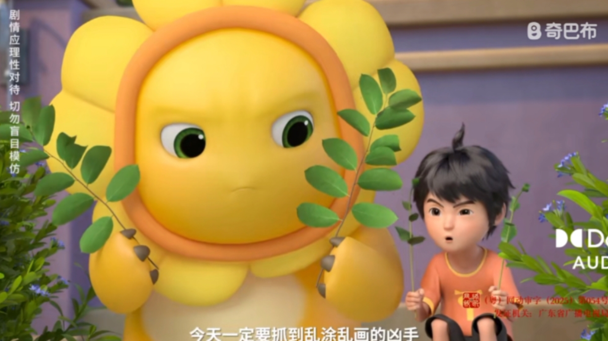 | 3450 | 2026-11-06 |
| [会功夫的猫咪](https://www.bilibili.com/video/BV1Dk4z6cEVB) |  | 5999 | 2026-11-06 |
| [带八只猫回村帮姥姥姥爷秋收啦！](https://www.bilibili.com/video/BV1TP4q6JEA6) | 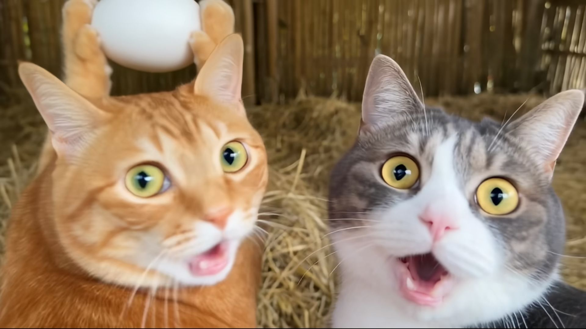 | 11.8万 | 2026-11-06 |
| [哈基米碰到猫爪拖鞋](https://www.bilibili.com/video/BV1kY4B6EECd) | 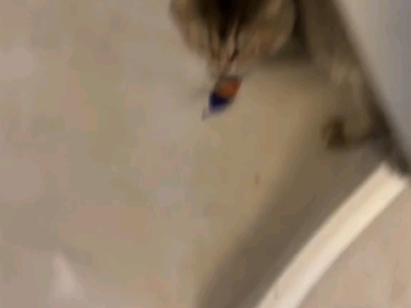 | 827 | 2026-11-06 |
| [hi 巨型布偶猫回村 居然怕大鹅【AI 全民制作人】](https://www.bilibili.com/video/BV1Kk4v61EEx) | 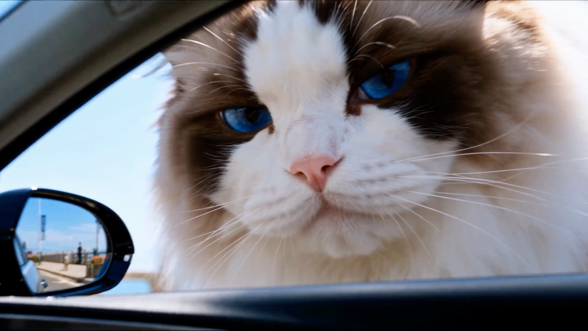 | 122.4万 | 2026-11-06 |
| [小橘猫想当宇航员，猫妈妈亲手把房间改造成太空舱🚀🌌](https://www.bilibili.com/video/BV1UWxR6vERe) |  | 6007 | 2026-11-06 |
| [轻松惬意的水族馆，可爱的小鸭子和好奇的猫咪🐥🐱🐠✨](https://www.bilibili.com/video/BV178486EEYb) | 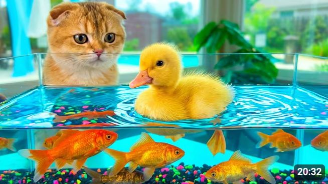 | 3845 | 2026-11-05 |
| [⚡古法训猫第一季完结⚡](https://www.bilibili.com/video/BV1RE4Y6pEbL) | 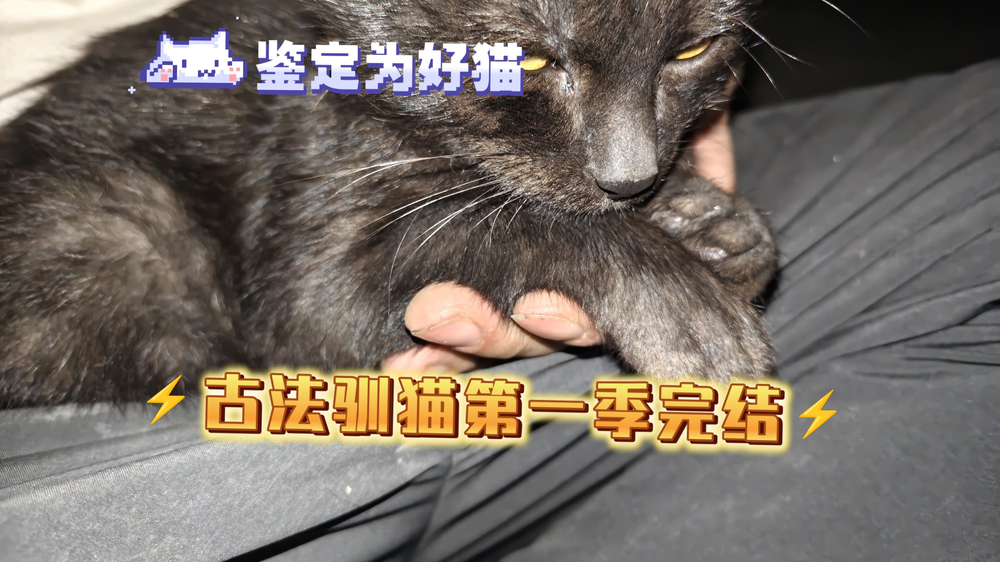 | 477 | 2026-11-05 |
| [【anny】曼波曼波曼曼波](https://www.bilibili.com/video/BV1QH4h6kEFR) |  | 2.7万 | 2026-11-05 |
| [疯狂动物园第三季-20](https://www.bilibili.com/video/BV1B24b6mEDL) | 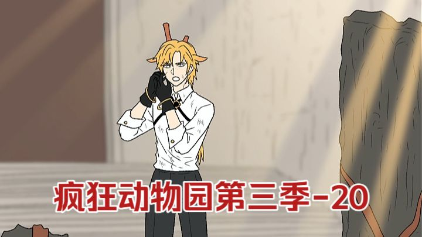 | 16.8万 | 2026-11-05 |
| [哈基米无处不在记录](https://www.bilibili.com/video/BV18P486KE9F) | 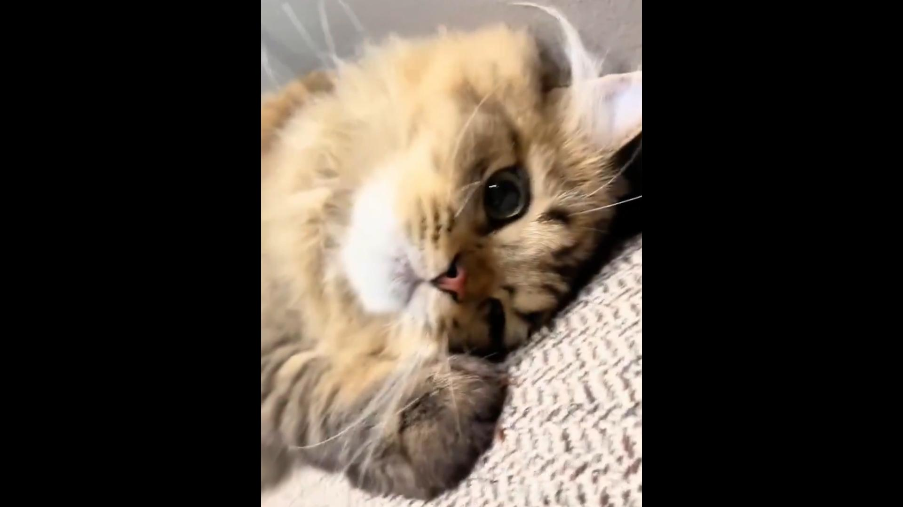 | 424 | 2026-11-05 |
| [盖瑞模组：为了救回误入森林被怪物抓走的市民，铁憨憨紧急出动！](https://www.bilibili.com/video/BV1xM4t6RE1X) |  | 3.5万 | 2026-11-05 |
| [感觉可以上手摸了](https://www.bilibili.com/video/BV1MmxZ62Ega) | 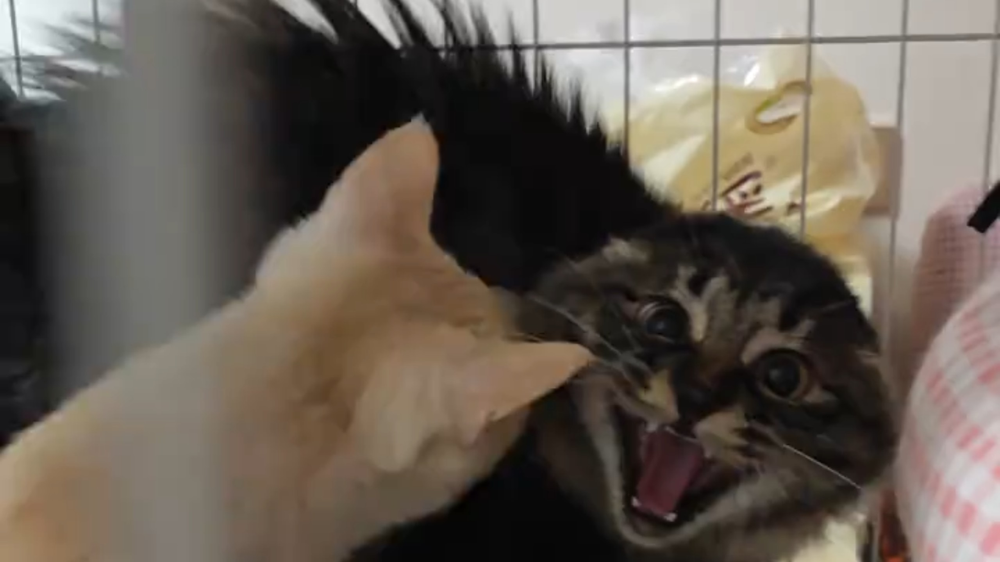 | 22.5万 | 2026-11-05 |
| [哈基米哈气连连](https://www.bilibili.com/video/BV1Dsxo6kEc7) | 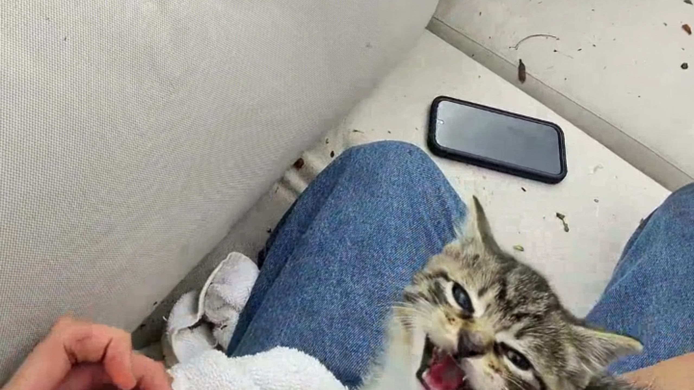 | 237 | 2026-11-05 |
| [哈基米吵架](https://www.bilibili.com/video/BV12Txd6KEhQ) | 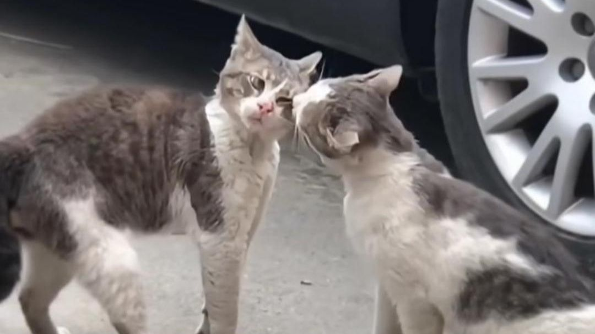 | 187 | 2026-11-04 |
| [差点就丢了](https://www.bilibili.com/video/BV1n7x96DEtC) | 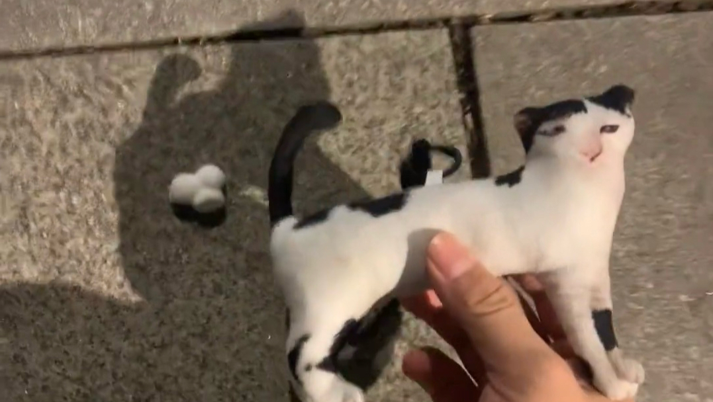 | 46.8万 | 2026-11-04 |
| [《小七的家》1-6超长合集纯享版，一口气看到爽【AI全民制作人】](https://www.bilibili.com/video/BV1fZxQ6yEio) |  | 288.0万 | 2026-11-04 |
| [咕嘎的大玉米#咕嘎#乐魂#后室#大玉米](https://www.bilibili.com/video/BV19FxU6oERb) |  | 3.6万 | 2026-11-03 |
| [可爱的姜黄色小猫和可爱的宠物朋友们一起享受游泳、看电影🍿和玩游戏�](https://www.bilibili.com/video/BV1aCxU6tEhm) |  | 1800 | 2026-11-03 |
| [11月1日 (1)](https://www.bilibili.com/video/BV1CC4G61E71) |  | 11.7万 | 2026-11-03 |
| [美味的我｜妙角维修猫激情购入盲盒的一天！](https://www.bilibili.com/video/BV1uP4u61EtE) |  | 295.3万 | 2026-11-03 |
| [猫和老鼠 ｜ 本喵做的饭吃着不烧心~](https://www.bilibili.com/video/BV1pp4F6rEYf) |  | 7.6万 | 2026-11-02 |
| [巨型猫咪，这个是把路压塌了](https://www.bilibili.com/video/BV1grxW6XEUe) | 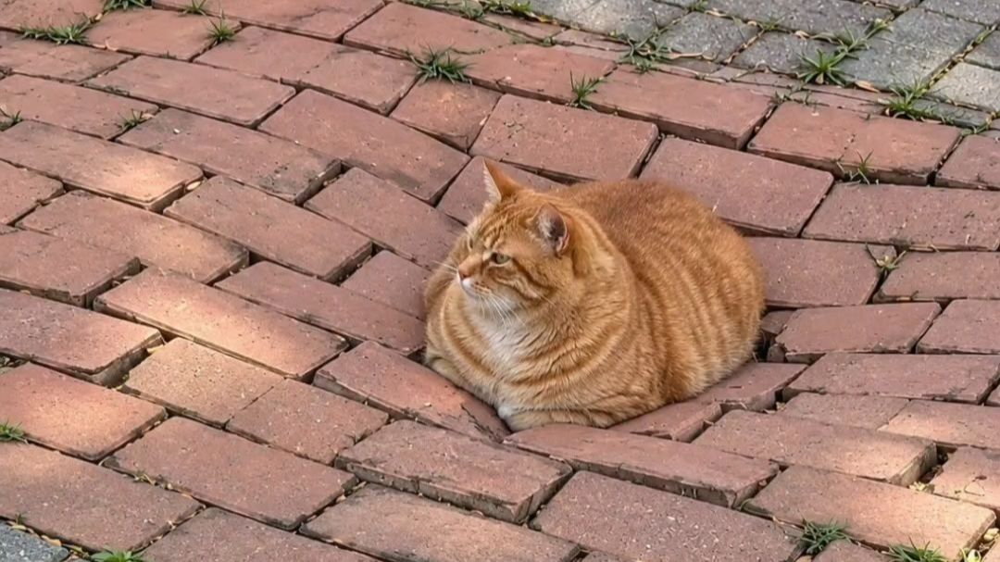 | 8.1万 | 2026-11-01 |
| [今天咪来探望二舅~他怎么带上痛苦面具了？【AI全民制作人】](https://www.bilibili.com/video/BV1buxW61EFX) |  | 6.4万 | 2026-11-01 |
| [叮咚！给跟猫条就走，绝不捣蛋拆家！](https://www.bilibili.com/video/BV1b1xy66EWx) |  | 3751 | 2026-10-31 |
| [希望所有流浪小咪都能平安度过这个冬天......](https://www.bilibili.com/video/BV1gHxC6MEAn) |  | 6159 | 2026-10-31 |
| [鼠咪vlog-比比拉布发烧就医记](https://www.bilibili.com/video/BV1Vuxr6BExZ) |  | 4450 | 2026-10-31 |
| [我和咕嘎乐魂被吸进了level92的气球空间！东西超级多，完全是大合集根本看不完！#咕咕嘎嘎#后室#可爱到爆炸💥](https://www.bilibili.com/video/BV1Uwxk6wEhu) |  | 1.0万 | 2026-10-31 |
| [尝尝咕嘎的臭屁枪](https://www.bilibili.com/video/BV1UQxA6sECR) |  | 1.5万 | 2026-10-29 |
| [😱🐱半夜的错误！姜小猫的糖果狂吃导致了痛苦的教训🦷💔](https://www.bilibili.com/video/BV15rxj66EAw) |  | 2917 | 2026-10-29 |
| [😢🐭 老鼠吃了小猫糖——猫妈妈做了一颗巨大的糖果给他加油❤️温馨的猫咪故事 🔥](https://www.bilibili.com/video/BV1CHxj6pECH) |  | 1029 | 2026-10-29 |
| [【中配】AI生成火龙果滑梯：宝宝快乐滑行与美食识别](https://www.bilibili.com/video/BV12YsX6oEWU) |  | 5.2万 | 2026-10-28 |
| [圣诞基米](https://www.bilibili.com/video/BV1GpnU65Eww) | 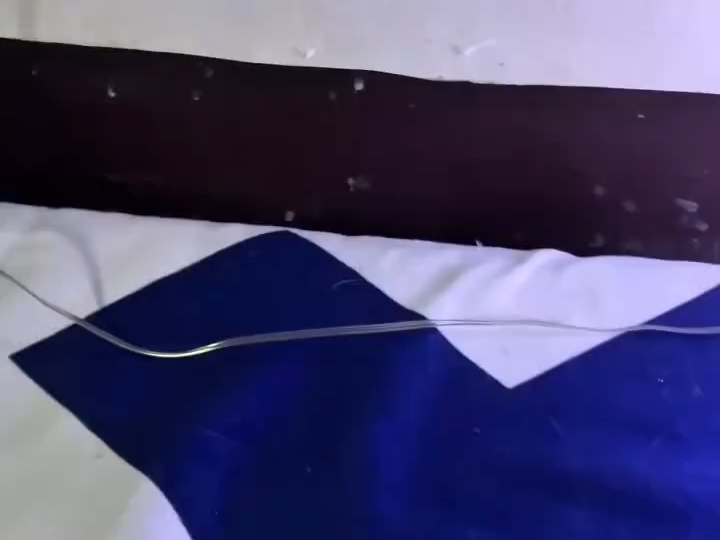 | 25.3万 | 2026-10-25 |
| [海豹团团第一次上岸经历了什么......](https://www.bilibili.com/video/BV1SzHK6xEpF) |  | 73.0万 | 2026-10-25 |
| [今天上白活儿](https://www.bilibili.com/video/BV1ymn865EMc) |  | 2.5万 | 2026-10-24 |
| [当你早读时唱热梗拼好歌](https://www.bilibili.com/video/BV1ABn26xEQD) |  | 6.9万 | 2026-10-22 |
| [谁偷吃了火龙果](https://www.bilibili.com/video/BV1H9nF6fEkm) | 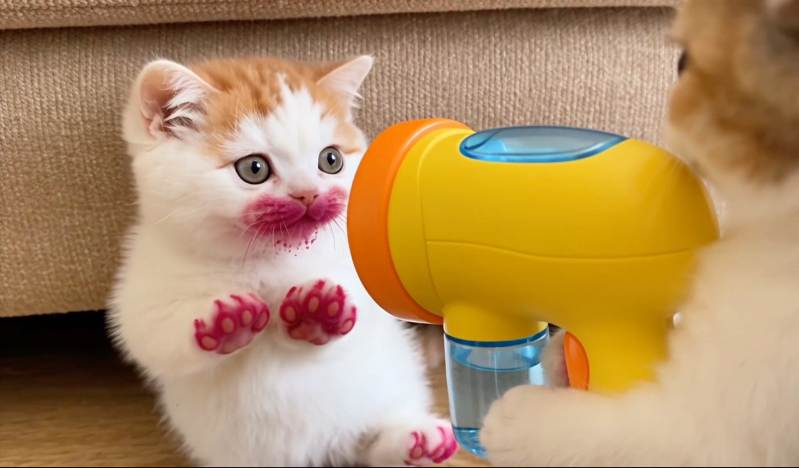 | 47.7万 | 2026-10-20 |
| [⚡️哈基米 世界巡演⚡️](https://www.bilibili.com/video/BV1wyJ96rET7) |  | 151 | 2026-10-19 |
| [曼波：计数排序](https://www.bilibili.com/video/BV1VaJU65EaC) |  | 5.7万 | 2026-10-15 |
| [Bringing my blade shield and Bibbilabu to deep-sea fishing, unexpectedly met cat](https://www.bilibili.com/video/BV1q1pi6oEHX) |  | 46.5万 | 2026-10-13 |
| [哒哒回森林就遇上新伙伴啦！ 嗖嗖~ #治愈系 #萌物 #治愈系动画 #哒哒的冒险](https://www.bilibili.com/video/BV17upf6DEAt) |  | 2464 | 2026-10-13 |
| [打工咪vlog ｜ 下班用闪身步闪进健身房（拒绝加班，当脱脂牛马）](https://www.bilibili.com/video/BV1TipM6cEjp) |  | 1.3万 | 2026-10-07 |
| [《曼波哈基米》哈基米音乐](https://www.bilibili.com/video/BV1BTSFBHEXc) |  | 1629 | 2025-11-29 |
| [猫咪挑战巨型迷宫？UP花3天3夜用60张纸板制作，它们能出来吗？](https://www.bilibili.com/video/BV15441137sv) | 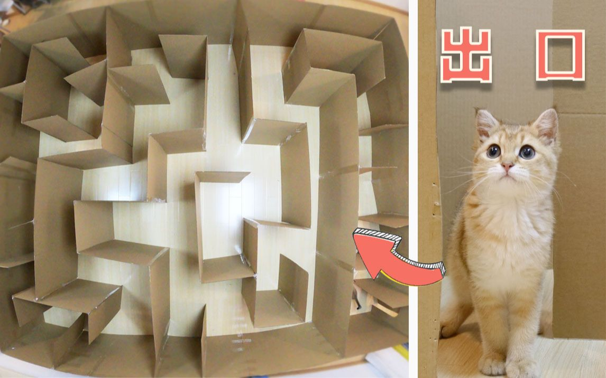 | 67.9万 | 2019-06-21 |

---
*最后更新: 2026-11-11 09:10:19 (自动生成)*
*数据来源: [Bilibili](https://www.bilibili.com)*

## 使用说明

运行以下命令更新视频列表:
```bash
python3 fetch_hajimi_videos.py
```
