# awesome-hajimi
collections of hajimi (哈基米 in Chinese) on the Internet.

## 视频列表 (Video List)

| 视频标题 (Title) | 封面 | 播放量 (Views) | 发布日期 (Date) |
|---|---|---|---|
| [哈基米：测试小克的银商？这下大肥鱼可惨了](https://www.bilibili.com/video/BV1nDyZz8EL1) |  | 436 | 2026-11-24 |
| [哈基米和傻包天下第一好](https://www.bilibili.com/video/BV1hQyfzmEG6) |  | 475 | 2026-11-24 |
| [今天带着比比拉布和刀盾去心跳乐园玩好吓人啊 #updream #哈基米 #猫meme #可爱到爆炸](https://www.bilibili.com/video/BV1khyfzwEK6) |  | 639 | 2026-11-24 |
| [似曾相识哈基米【古今东西狐狸物语第二期】](https://www.bilibili.com/video/BV1pg1FzvEEm) |  | 877 | 2026-11-24 |
| [【补档】哈基米会街舞](https://www.bilibili.com/video/BV1EL1FzwEeQ) | 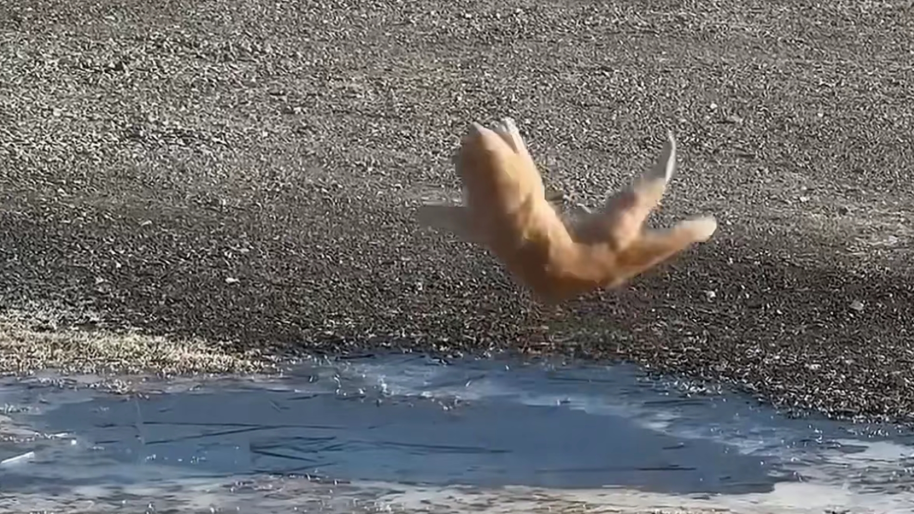 | 1297 | 2026-11-24 |
| [【哈基米】🎵我在五点二十睡觉十三点十四也不起🎵《5:20》](https://www.bilibili.com/video/BV1Ej1FzhEVv) |  | 234 | 2026-11-24 |
| [基 米 大 家 族](https://www.bilibili.com/video/BV1NByZzBEUF) |  | 1.0万 | 2026-11-24 |
| [豪猫TV 青钢影来了你们聊](https://www.bilibili.com/video/BV1T5yozKEib) | 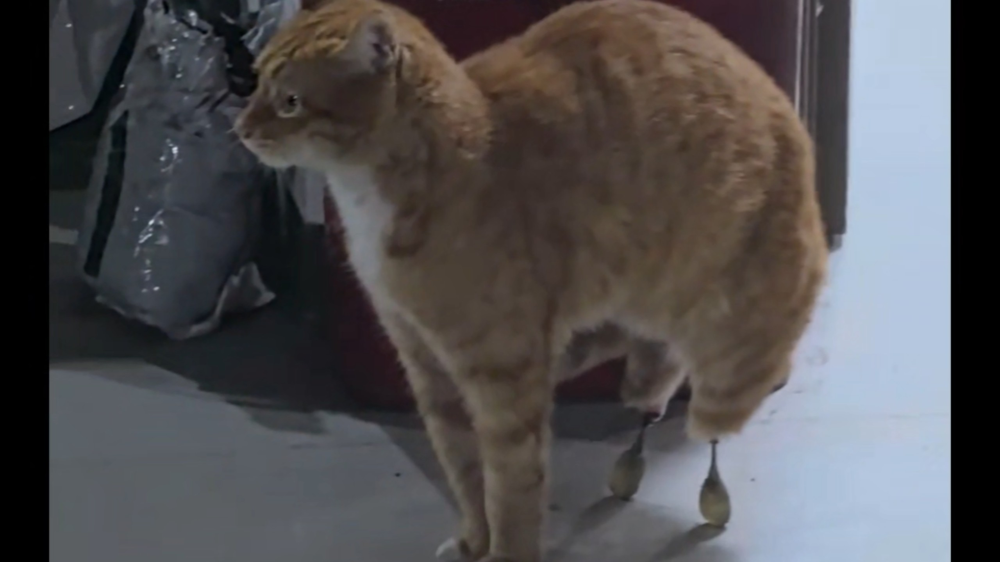 | 3619 | 2026-11-24 |
| [火花大战花火，但怎么感觉像两只哈气的哈基米](https://www.bilibili.com/video/BV1XNyoz3EWg) |  | 397 | 2026-11-24 |
| [基米陷入时间循环无限触发舔毛BUG](https://www.bilibili.com/video/BV1hmyozkELR) | 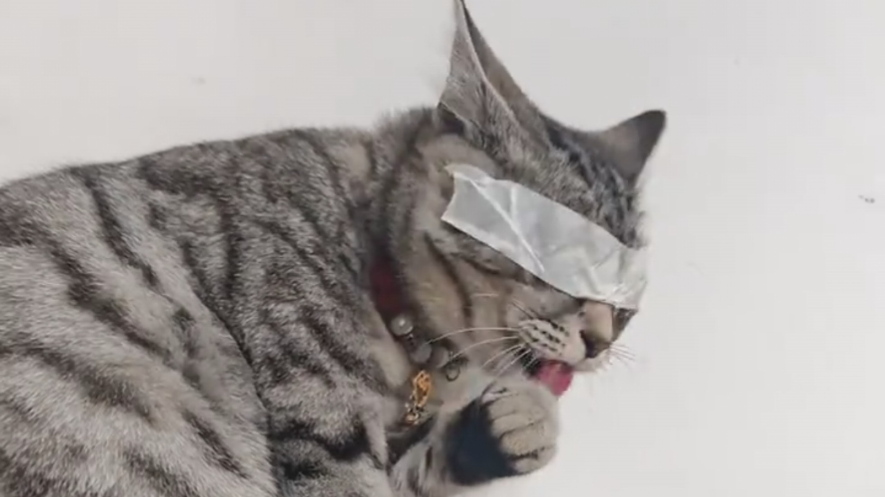 | 734 | 2026-11-24 |
| [笑疯了！哈基米扮演Claude，直接把账号玩封号](https://www.bilibili.com/video/BV1ZvyozDEU5) |  | 1512 | 2026-11-24 |
| [哈基米回忆录](https://www.bilibili.com/video/BV1BvyozDEEi) | 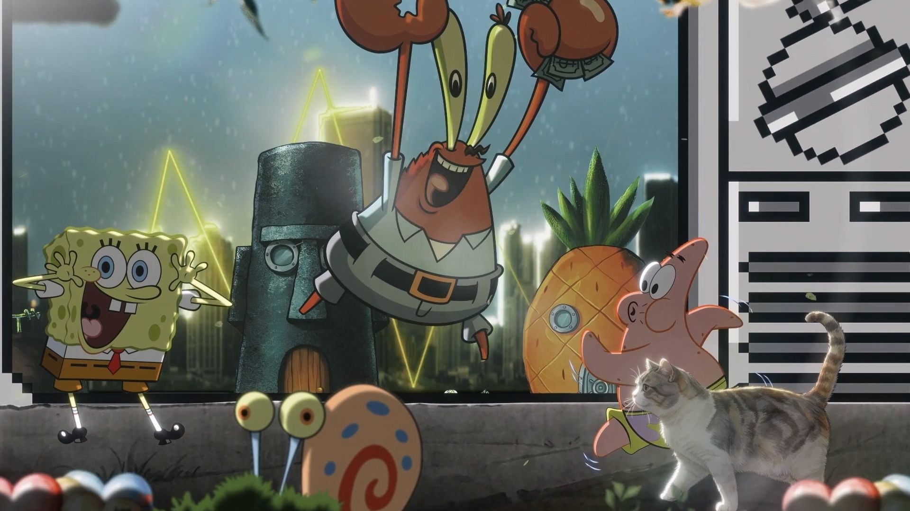 | 338 | 2026-11-24 |
| [孩子们，你们又问到了😋😋，这次调整能不能让哈基米重回霸体位撕咬😡😡😋](https://www.bilibili.com/video/BV1BayozXEcV) |  | 619 | 2026-11-24 |
| [0个mixin无拦截无agent击毙幸挥哈基米与超级史蒂夫](https://www.bilibili.com/video/BV13hyZzVEFk) | 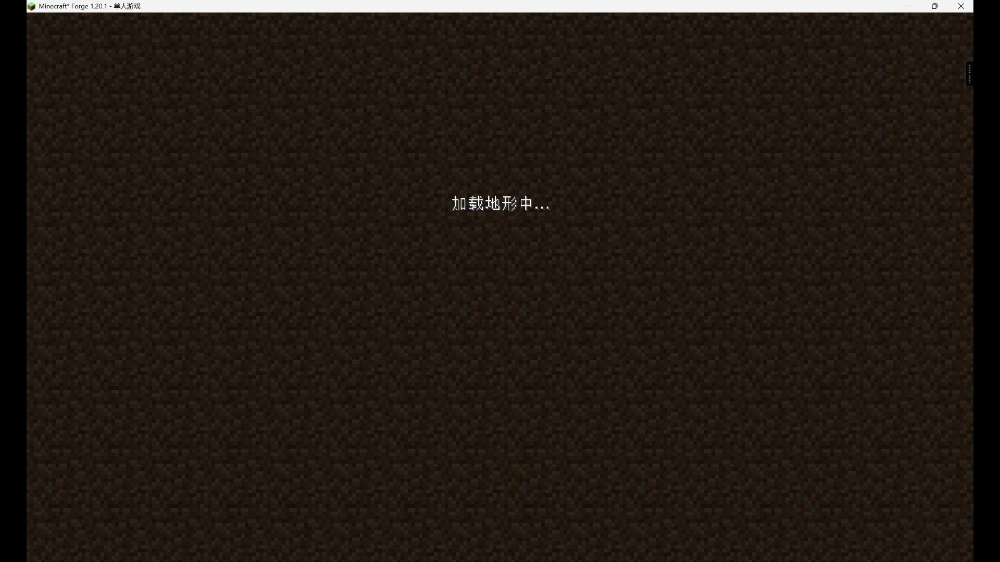 | 146 | 2026-11-24 |
| [小猫也很会过日子~](https://www.bilibili.com/video/BV1gayZzkE94) |  | 975 | 2026-11-24 |
| [五只可爱小基米一次哈个爽](https://www.bilibili.com/video/BV1abyZzyEhn) | 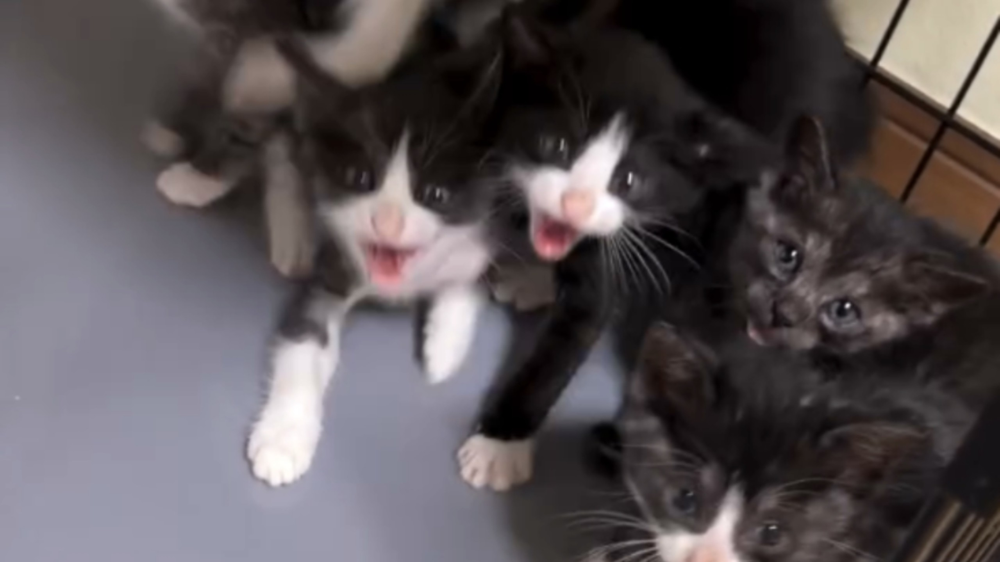 | 627 | 2026-11-24 |
| [【补档】【哈基米】Tiki Tiki 检测到xxの小曲](https://www.bilibili.com/video/BV113yXzDEEm) |  | 966 | 2026-11-24 |
| [基米觉得哈气就有吃的](https://www.bilibili.com/video/BV1MqyZzuEGc) | 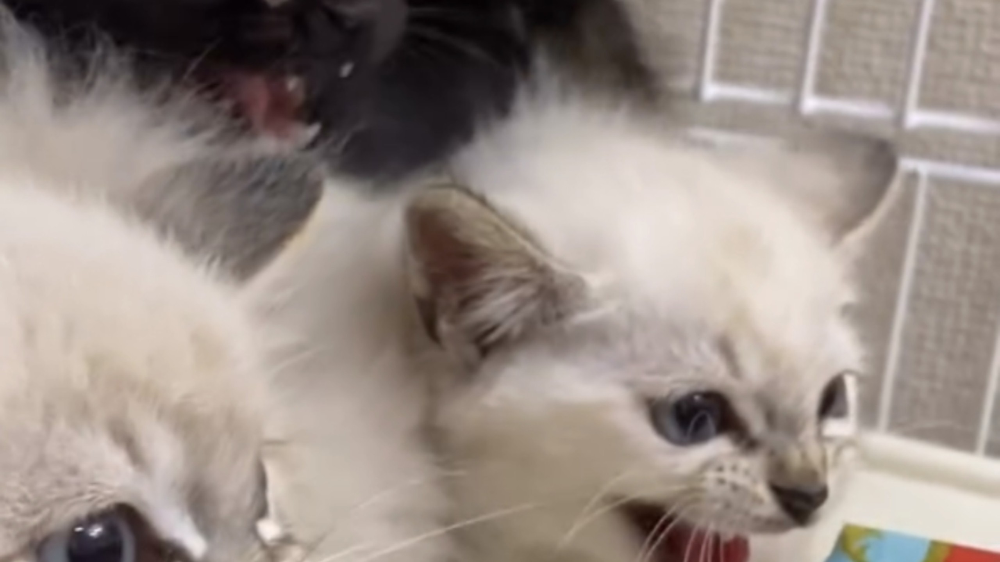 | 408 | 2026-11-24 |
| [哈气小基米](https://www.bilibili.com/video/BV1MvyZz6EUD) | 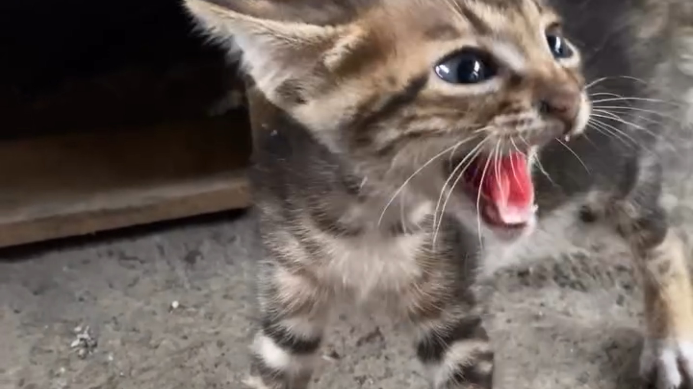 | 2772 | 2026-11-24 |
| [禾下乘凉吗？哈基米你这家伙居然搞这种](https://www.bilibili.com/video/BV1LJyZzDEK2) |  | 2317 | 2026-11-24 |
| [去挪威追鲸了，喵～下一站想看哪，评论区说说。](https://www.bilibili.com/video/BV1iJyZzDEre) |  | 1545 | 2026-11-24 |
| [哈基米看到了隐藏在四维的敌人🐱](https://www.bilibili.com/video/BV1oJyZzDEsS) | 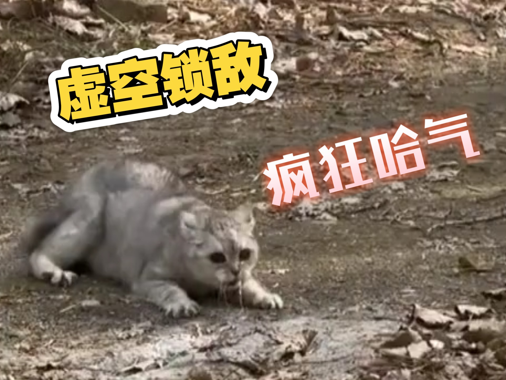 | 1702 | 2026-11-24 |
| [撞见家里的哈基米演手偶剧，意外听到了……](https://www.bilibili.com/video/BV1gnyQzdEkN) |  | 1870 | 2026-11-24 |
| [真tm神了，最后那一下你是怎么做到的？？哈基米你这家伙](https://www.bilibili.com/video/BV1h1yRzKEfA) | 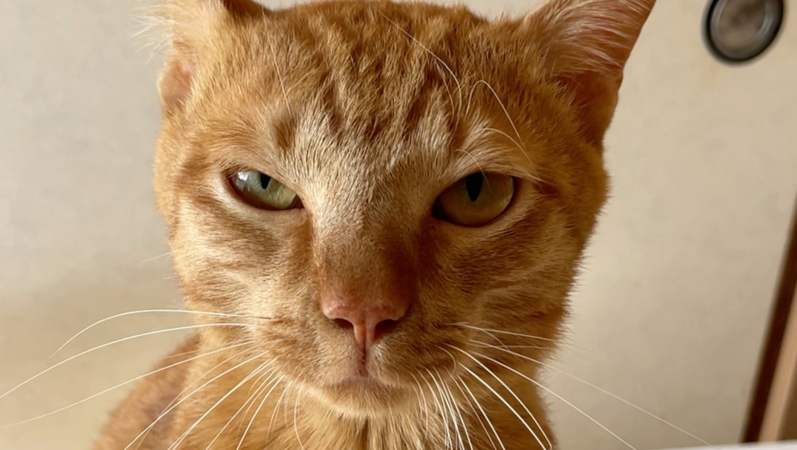 | 4.3万 | 2026-11-24 |
| [“当R&amp;B变成RPG...”](https://www.bilibili.com/video/BV1pQyDz1E9u) |  | 3492 | 2026-11-24 |
| [基米这是看到什么了突然双手合十](https://www.bilibili.com/video/BV1HAydz9EcC) | 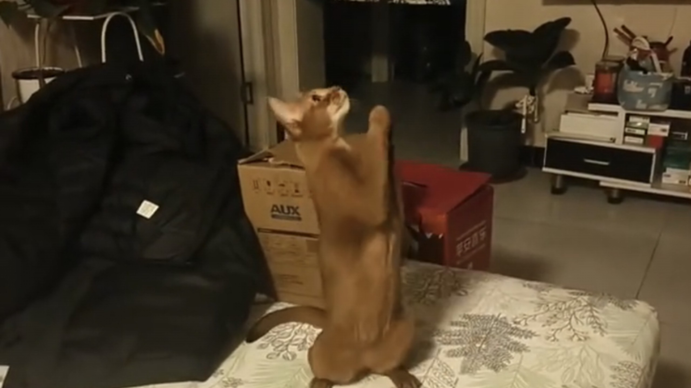 | 938 | 2026-11-24 |
| [可观测宇宙最害怕的基米](https://www.bilibili.com/video/BV1BuydzSE2b) | 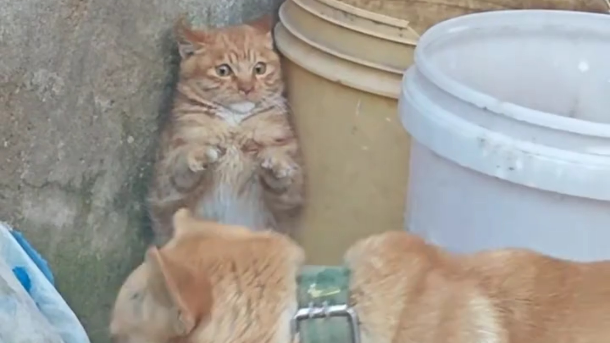 | 1355 | 2026-11-24 |
| [基米斗](https://www.bilibili.com/video/BV1EMydznEfm) | 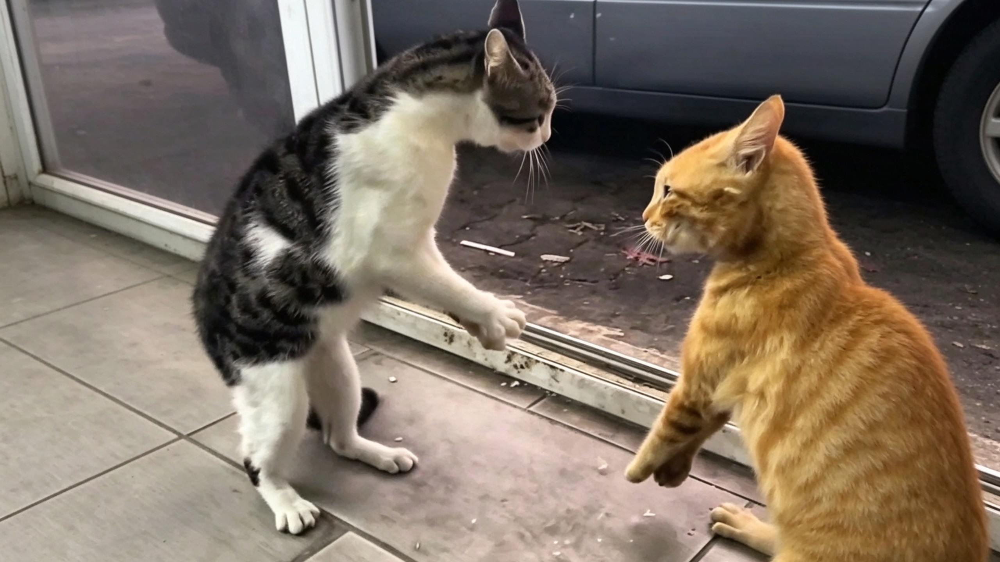 | 320 | 2026-11-24 |
| [我宣布，哈基米是唯一一个通过agi测试的！直接封神！](https://www.bilibili.com/video/BV1xoyRzZETZ) |  | 1.7万 | 2026-11-24 |
| [666，这集神了，我宣布，哈基米是唯一一个通过agi测试的](https://www.bilibili.com/video/BV14dyRzbEMf) |  | 5.3万 | 2026-11-24 |
| [跳楼基](https://www.bilibili.com/video/BV1Qfy9zqEat) |  | 4813 | 2026-11-24 |
| [[Gemini]别再叫我“极其猫”！&gt; ⤙ &lt;](https://www.bilibili.com/video/BV1KxyQzpEku) |  | 596 | 2026-11-24 |
| [当你指挥AI干活时...](https://www.bilibili.com/video/BV1NqydzhEHM) |  | 1.0万 | 2026-11-23 |
| [千夏才不是什么哈基米！！！](https://www.bilibili.com/video/BV15nydzGEtJ) |  | 2783 | 2026-11-23 |
| [哈基米:我会飞!!!](https://www.bilibili.com/video/BV1Z9ydzUEkW) | 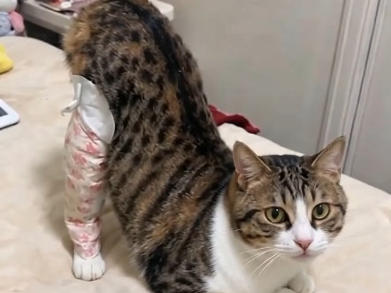 | 5.2万 | 2026-11-23 |
| [我宣布，哈基米是唯一一个通过agi测试的！](https://www.bilibili.com/video/BV1dfydzLEtN) |  | 3.2万 | 2026-11-23 |
| [基米斗](https://www.bilibili.com/video/BV1Roydz2Ezs) |  | 2162 | 2026-11-23 |
| [Astra你自己听得懂你问我的问题是什么吗？难不成如果没有哈基米叫小克来帮我翻译然后告诉你要干什么，我还要自学龙语了吗？【AI全民制作人】](https://www.bilibili.com/video/BV1HyydzdEKz) |  | 2220 | 2026-11-23 |
| [小睦大战哈基米](https://www.bilibili.com/video/BV124yQzQEEa) |  | 296 | 2026-11-23 |
| [哈基米这个洗衣房](https://www.bilibili.com/video/BV11LyRzdEzo) | 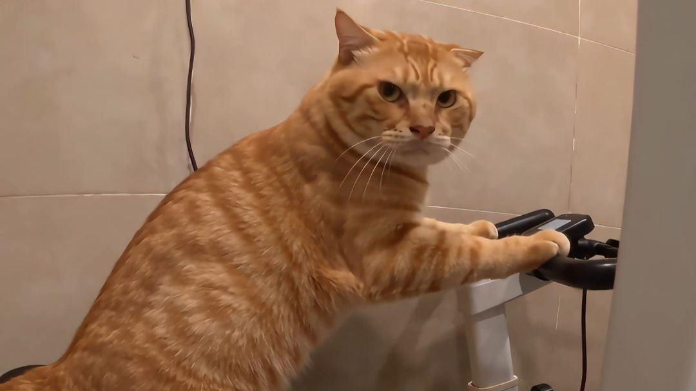 | 2242 | 2026-11-23 |
| [星辉哈基米91](https://www.bilibili.com/video/BV1KxyQzpE23) | 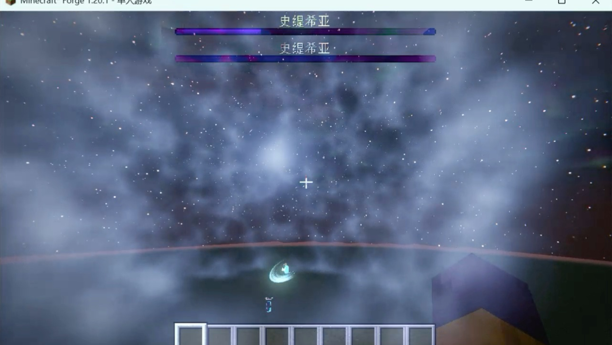 | 248 | 2026-11-23 |
| [哈基米出逃计划！三只淘气小奶猫拼命往外爬是想干嘛？🐱](https://www.bilibili.com/video/BV1GjyQzbEsS) | 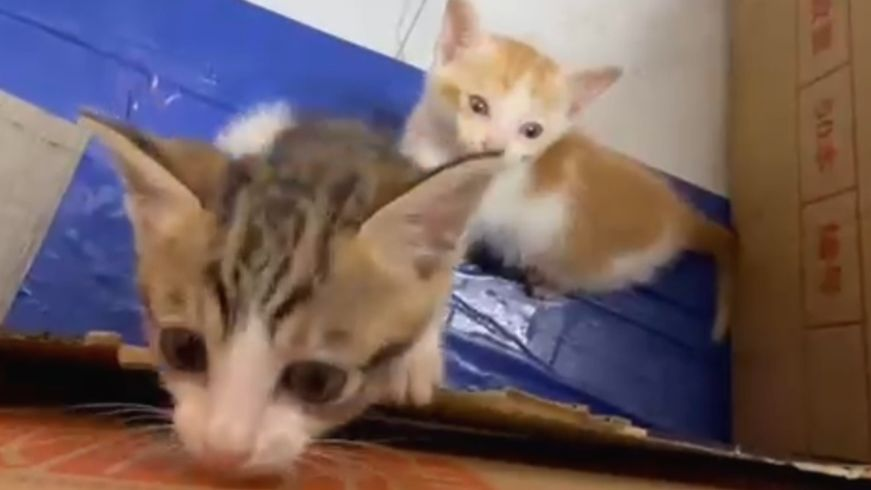 | 986 | 2026-11-23 |
| [哈基米大模型站起来了！](https://www.bilibili.com/video/BV1o1yQzBEpw) |  | 742 | 2026-11-23 |
| [【2026.10】哈基米音乐野榜#10](https://www.bilibili.com/video/BV1fCyJzSEHJ) |  | 801 | 2026-11-23 |
| [有时候真的很想帮助猫咪](https://www.bilibili.com/video/BV12TyXzWErj) | 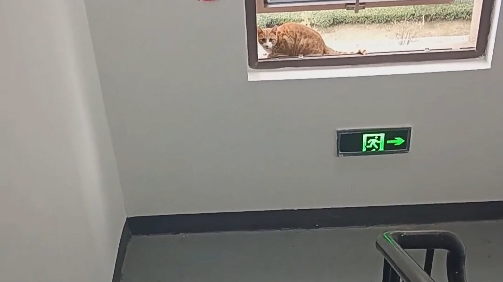 | 3168 | 2026-11-23 |
| [大型纪录片《哈基米：早说你有两根烤肠啊》持续为您播出！](https://www.bilibili.com/video/BV1YiyXzeEF7) | 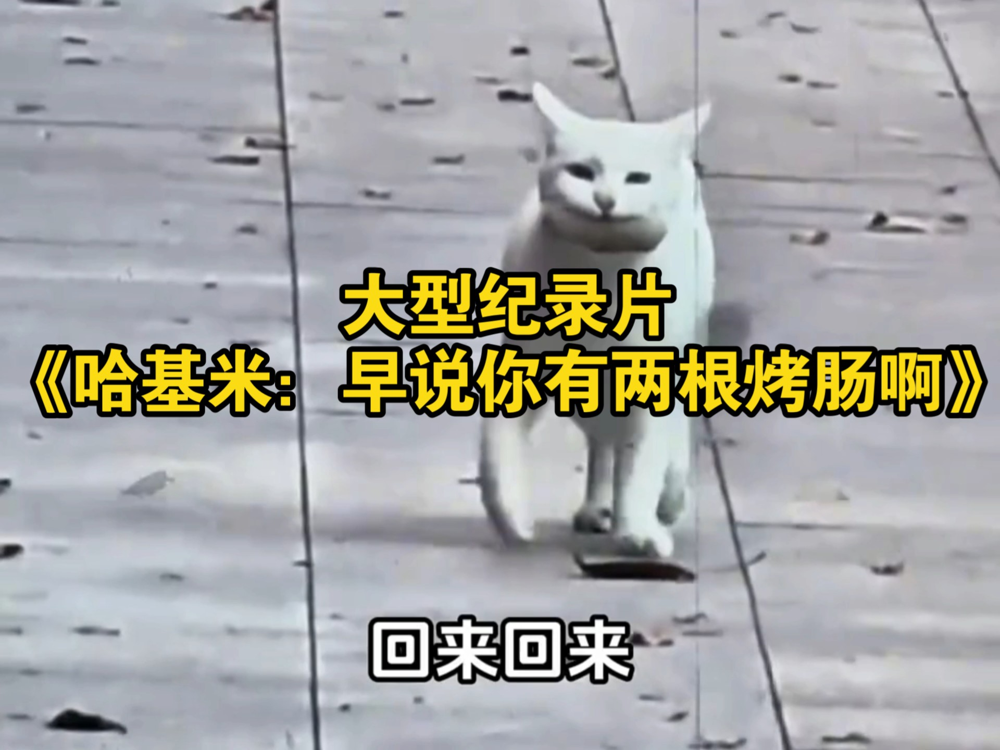 | 1498 | 2026-11-23 |
| [【哈基米】花骨朵](https://www.bilibili.com/video/BV1cpyXz5Ex8) | 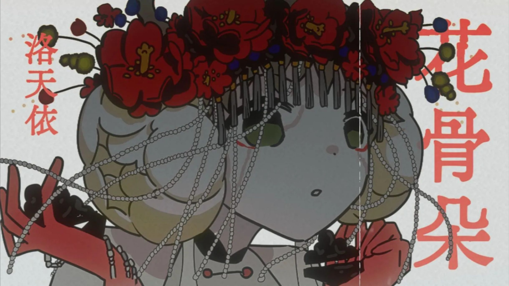 | 807 | 2026-11-23 |
| [你见过视抹茶巴菲为命，连智能手机都不会耍的哈基米吗？](https://www.bilibili.com/video/BV1dCySzwEdp) |  | 430 | 2026-11-23 |
| [【哈基米我哈基米】我的最新作品，快来一睹为快！](https://www.bilibili.com/video/BV1GQySzoEcA) | 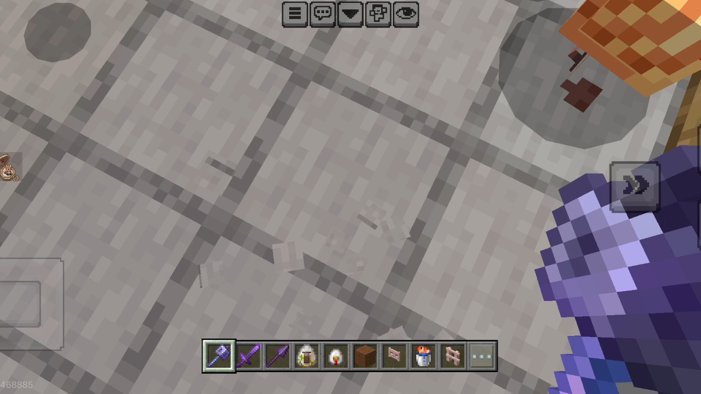 | 0 | 2026-11-23 |
| [【哈基米我哈基米】最新视频已上线，快来围观！](https://www.bilibili.com/video/BV1XDySz4Egy) | 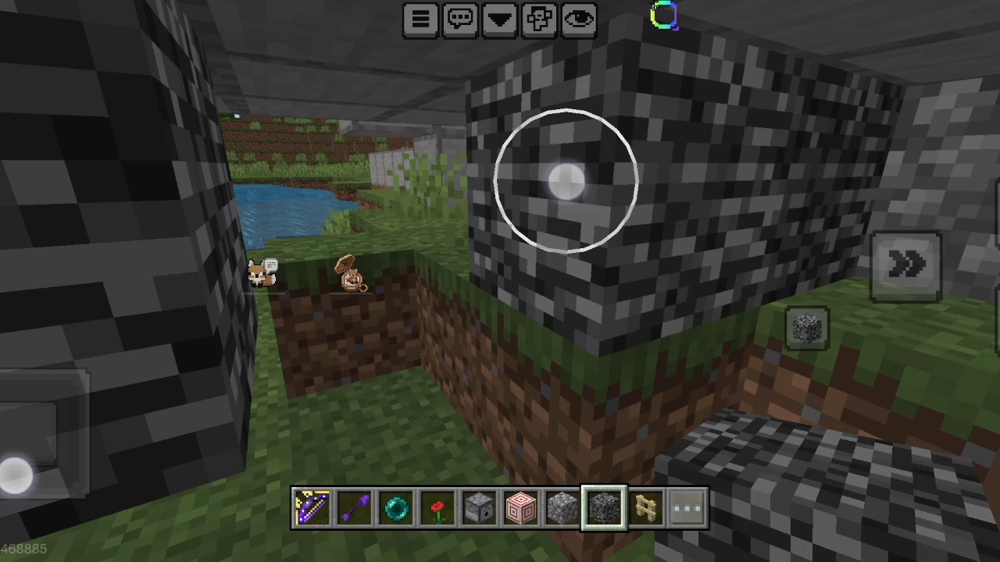 | 3 | 2026-11-23 |
| [【哈基米】🎵🐸🎵《小跳蛙》](https://www.bilibili.com/video/BV1FvySzBE8T) |  | 2038 | 2026-11-23 |
| [哈基米科普](https://www.bilibili.com/video/BV1QzyEzeELz) |  | 588 | 2026-11-23 |
| [哈基米曼波盾盾监狱迷失](https://www.bilibili.com/video/BV1KAyDzJEX2) |  | 5620 | 2026-11-23 |
| [【蜂蜜TV】基米这个有趣](https://www.bilibili.com/video/BV19YyDzZEGq) | 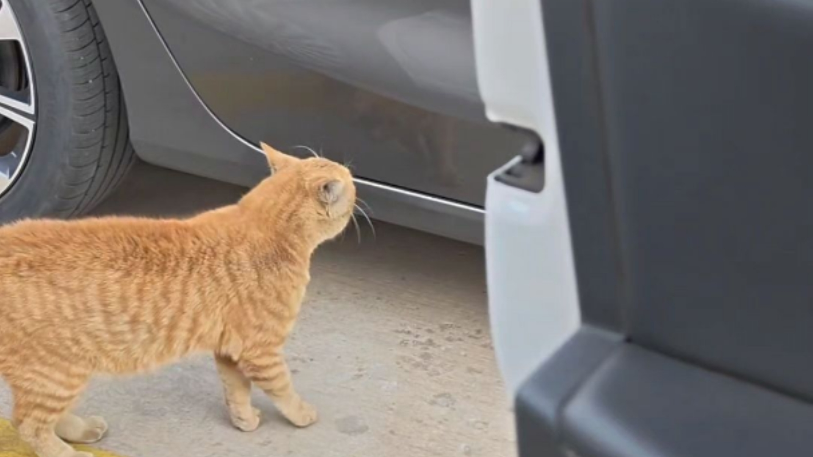 | 2.6万 | 2026-11-23 |
| [今天带着比比拉布和刀盾去欢乐谷玩了 #哈基米 #猫meme #可爱到爆炸](https://www.bilibili.com/video/BV1rEyDzMEMQ) |  | 1027 | 2026-11-23 |
| [竖尾弓背声声哈，龇牙瞪眼步步逼](https://www.bilibili.com/video/BV1FSyHzsEch) | 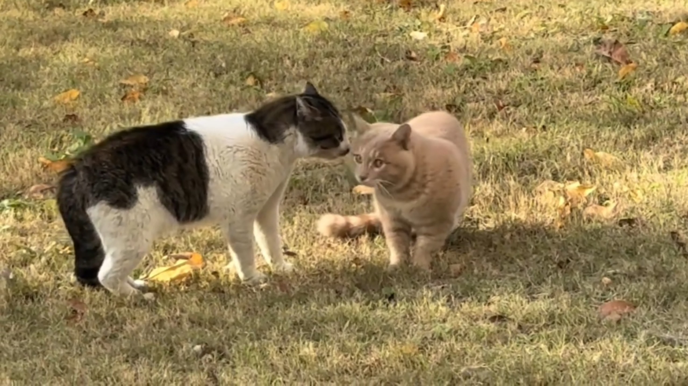 | 298 | 2026-11-23 |
| [哈基米整天凶主人殴打自己的孩子最终被放生自然](https://www.bilibili.com/video/BV1royDzGETR) |  | 6722 | 2026-11-23 |
| [人人喊打的“ELO”机制究竟是否存在于喵喵的结合？事件判定机制解析](https://www.bilibili.com/video/BV141yDzSEZg) |  | 3937 | 2026-11-23 |
| [哈基米是狂犬发作还是在和想象中的敌人战斗](https://www.bilibili.com/video/BV18CynzzEyU) | 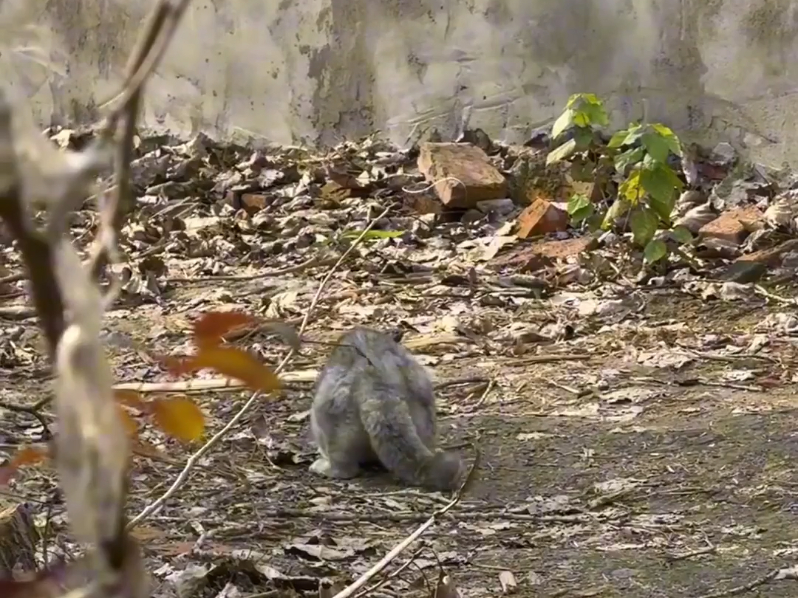 | 3384 | 2026-11-23 |
| [这是哈基米吗.....](https://www.bilibili.com/video/BV18tyHzzETz) |  | 288 | 2026-11-23 |
| [白色哈基米](https://www.bilibili.com/video/BV1oXyHzHELE) | 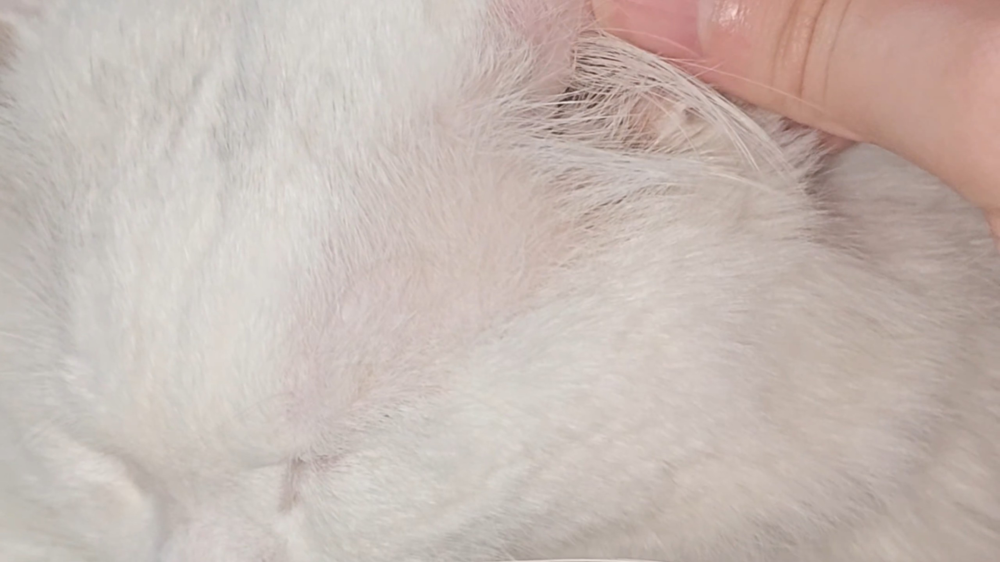 | 1.6万 | 2026-11-23 |
| [哈基米窃取钓鱼佬胜利果实](https://www.bilibili.com/video/BV1ThyHzqEw4) | 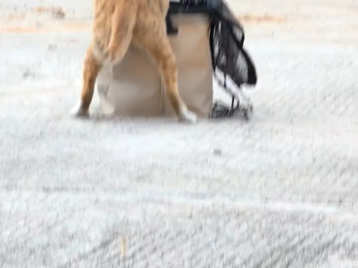 | 726 | 2026-11-23 |
| [丑橘是你叫的车吗，你搁这报数来了。](https://www.bilibili.com/video/BV117ypzKEPd) | 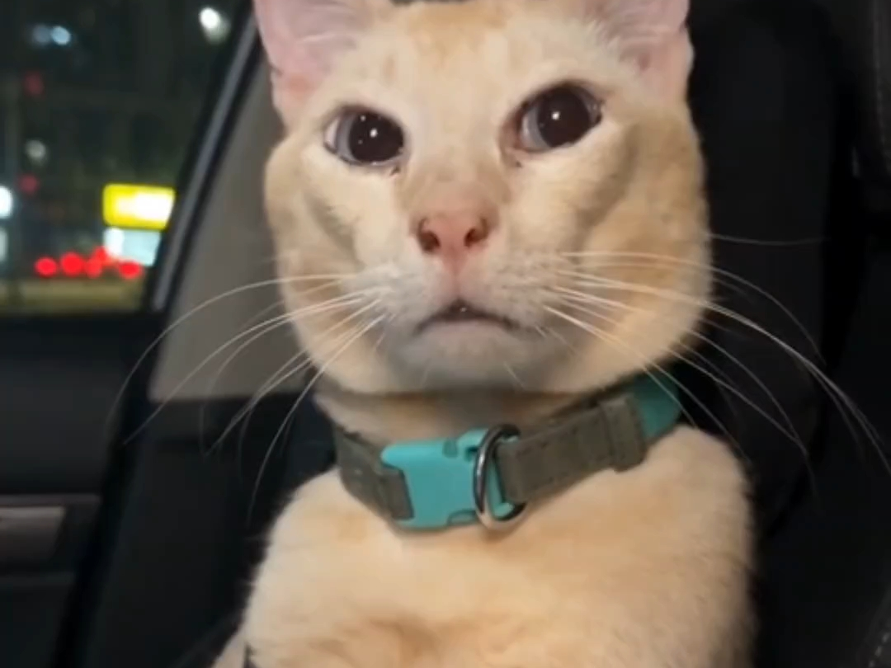 | 27.4万 | 2026-11-23 |
| [基米的酒](https://www.bilibili.com/video/BV1mcyjzQERy) | 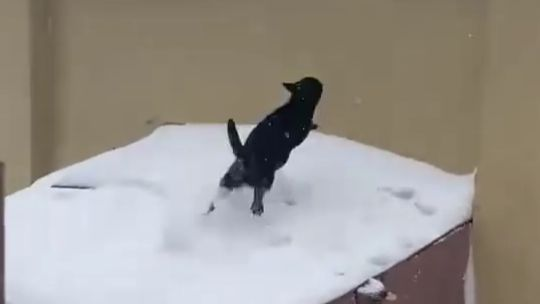 | 824 | 2026-11-22 |
| [哈基汪这个嗷嗷怪叫](https://www.bilibili.com/video/BV1bey5zHEqJ) |  | 1698 | 2026-11-22 |
| [饿啊](https://www.bilibili.com/video/BV12vyYzYEXW) | 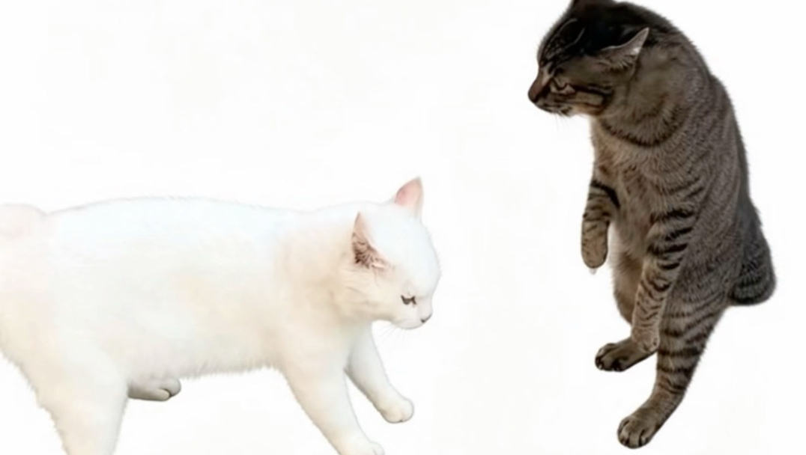 | 23.5万 | 2026-11-22 |
| [咪没有电话，找人只能盲找，人别笑话咪。](https://www.bilibili.com/video/BV1NHyVzrEn5) | 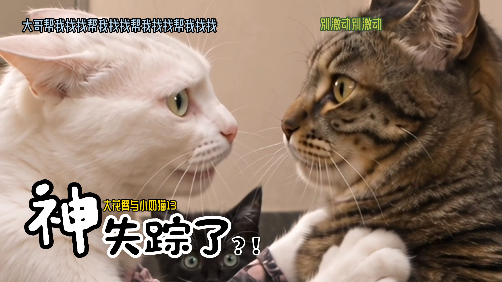 | 5916 | 2026-11-22 |
| [【拟人】各主流AI模型就像：](https://www.bilibili.com/video/BV16YyVzPEXR) |  | 23.4万 | 2026-11-22 |
| [居家小猫的一天在忙什么？](https://www.bilibili.com/video/BV1fhy3zdEuF) |  | 2424 | 2026-11-22 |
| [«战双帕弥什»「卡俄斯」实机演示](https://www.bilibili.com/video/BV1oVyYzmE2W) |  | 174.8万 | 2026-11-22 |
| [当狗子快速朝你跑来时，突然关下门，看看它们啥反应？](https://www.bilibili.com/video/BV1NZyezqE6b) | 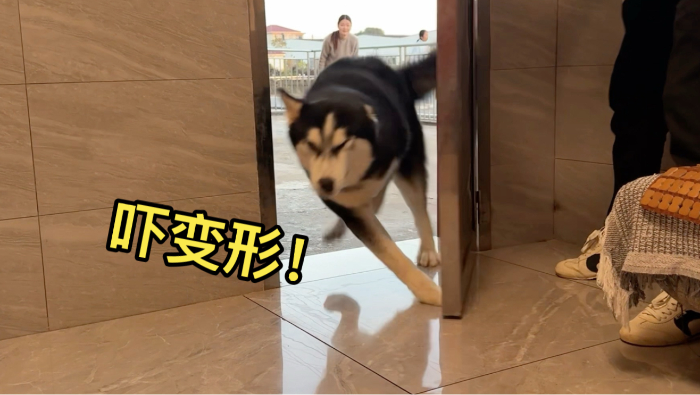 | 24.4万 | 2026-11-22 |
| [哈基米挖矿第二期](https://www.bilibili.com/video/BV1rMyGzhEGJ) |  | 9 | 2026-11-22 |
| [耄儿这个酣畅一战](https://www.bilibili.com/video/BV11qyYzAENK) |  | 2.9万 | 2026-11-21 |
| [【Day59】5个AI玩大A：大A暴跌，把睡神哈基米砸醒了！](https://www.bilibili.com/video/BV1LByeznEDD) |  | 1820 | 2026-11-21 |
| [哈基咪哈气时完成](https://www.bilibili.com/video/BV1kByhzXEyD) |  | 290 | 2026-11-21 |
| [知名UP猪推荐 华硕破晓Air 哈基米中的王者](https://www.bilibili.com/video/BV1aqy8zvEEV) |  | 9215 | 2026-11-21 |
| [这菲蛛扎啤吧](https://www.bilibili.com/video/BV1vTsv6QEEt) |  | 27.1万 | 2026-11-21 |
| [大喵精的不行，知道吕布要飞踢他直接站起来的（合集版）【经典】](https://www.bilibili.com/video/BV1Y8yxz9EuW) |  | 1.1万 | 2026-11-20 |
| [哈基米这个引体向上](https://www.bilibili.com/video/BV1pAyWzeEJH) |  | 2730 | 2026-11-20 |
| [音乐：我是基咪 之 超级伸缩 弹簧猫！](https://www.bilibili.com/video/BV1SDypzkEEf) | 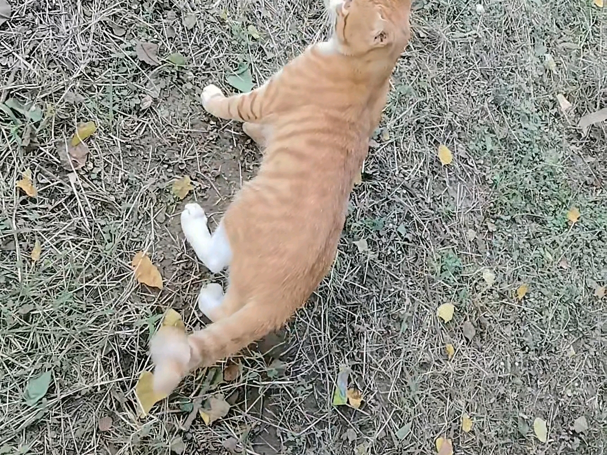 | 67 | 2026-11-20 |
| [AI御三家旗舰模型，屎山代码大论剑｜屎山论剑](https://www.bilibili.com/video/BV1K8sq6yENC) |  | 14.0万 | 2026-11-20 |
| [《底层代码冲突中》](https://www.bilibili.com/video/BV1BWsi6fENo) | 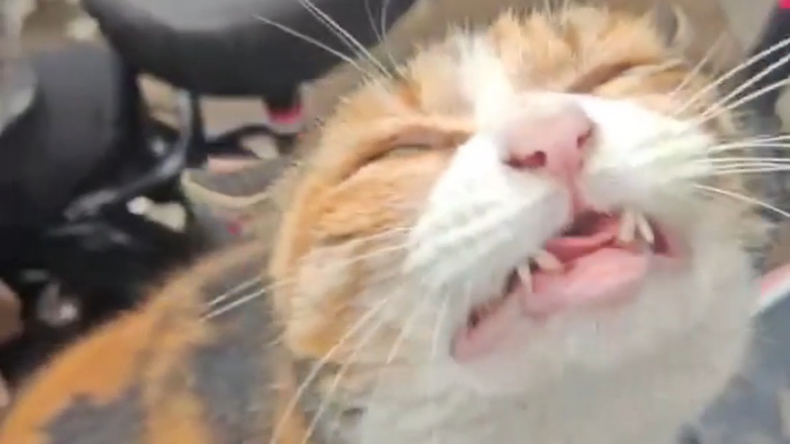 | 14.1万 | 2026-11-20 |
| [新Gemini神圣哈基米喵小动画（中英双语）](https://www.bilibili.com/video/BV11Fsa6fEnY) |  | 73 | 2026-11-19 |
| [小时候班里来了一个新同学](https://www.bilibili.com/video/BV1cJsb6JESh) |  | 86.5万 | 2026-11-19 |
| [关于门口的猫把我的猫都迷住了这件事](https://www.bilibili.com/video/BV1MXsh6vEwQ) | 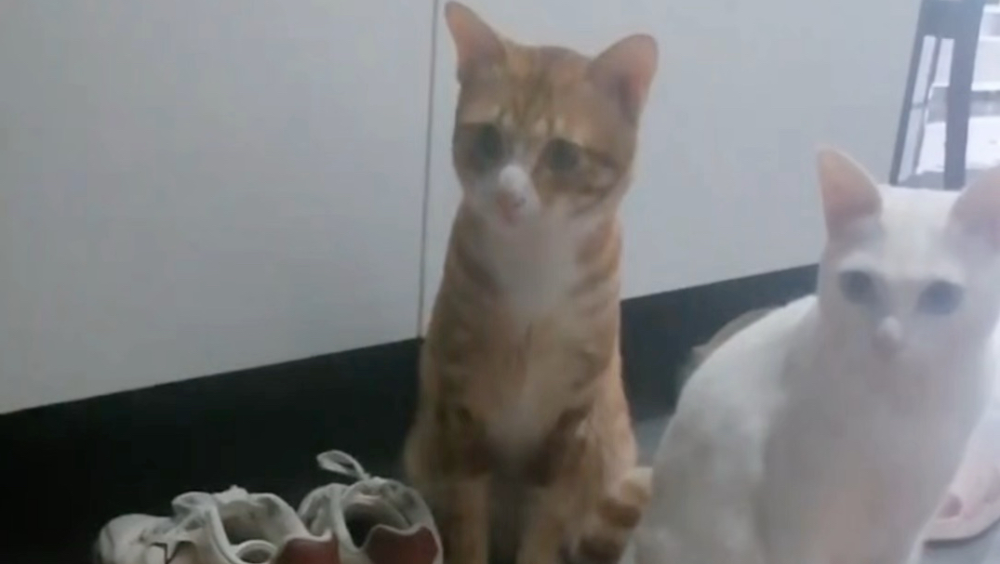 | 91.0万 | 2026-11-19 |
| [小猫已调整至最蓬松的状态可以摸了](https://www.bilibili.com/video/BV1wRs46mEDB) | 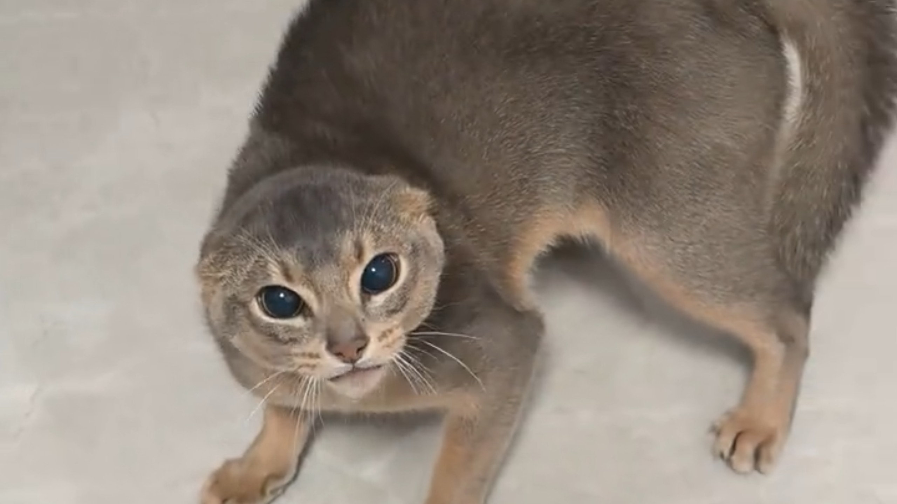 | 4.9万 | 2026-11-19 |
| [彻底没救了，这傻子连鞋子和老鼠都分不清！](https://www.bilibili.com/video/BV1QHsD64EHN) | 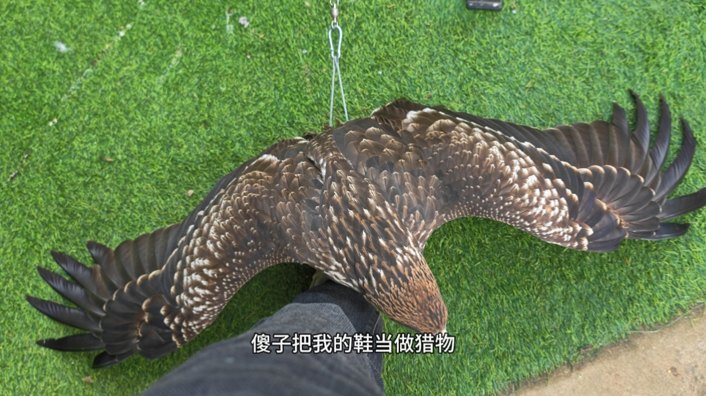 | 20.2万 | 2026-11-18 |
| [关于OpusMC下架的说明...](https://www.bilibili.com/video/BV1rxsQ6CEus) |  | 36.1万 | 2026-11-18 |
| [哈基米！你这家伙！](https://www.bilibili.com/video/BV1B2sU6aEV1) | 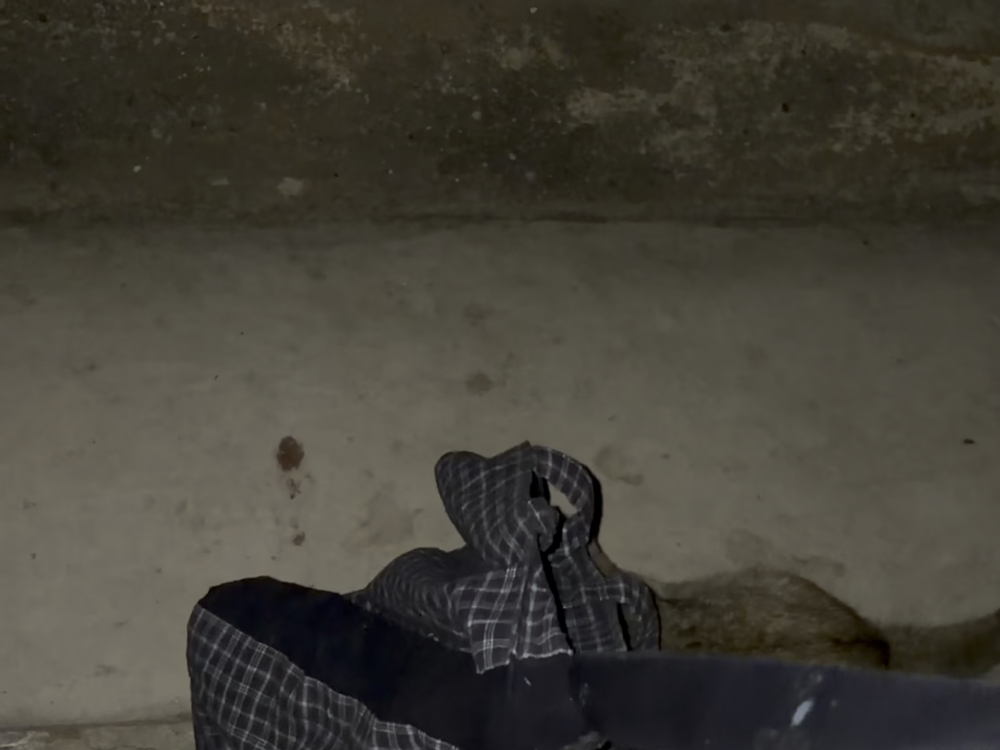 | 169 | 2026-11-18 |
| [全是文具盒【AI全民制作人】](https://www.bilibili.com/video/BV13bsC6zE5K) |  | 28.2万 | 2026-11-18 |
| [哈基米咪又在哈气了](https://www.bilibili.com/video/BV1Nqsr6xEmg) |  | 2936 | 2026-11-17 |
| [猫儿要听猫儿歌](https://www.bilibili.com/video/BV1hPs66FE4b) | 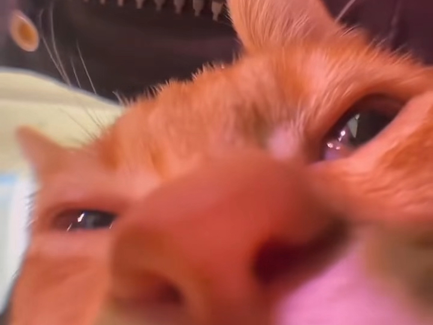 | 224 | 2026-11-17 |
| [最近抖音刷到视频belike](https://www.bilibili.com/video/BV1WtsW6BEtp) | 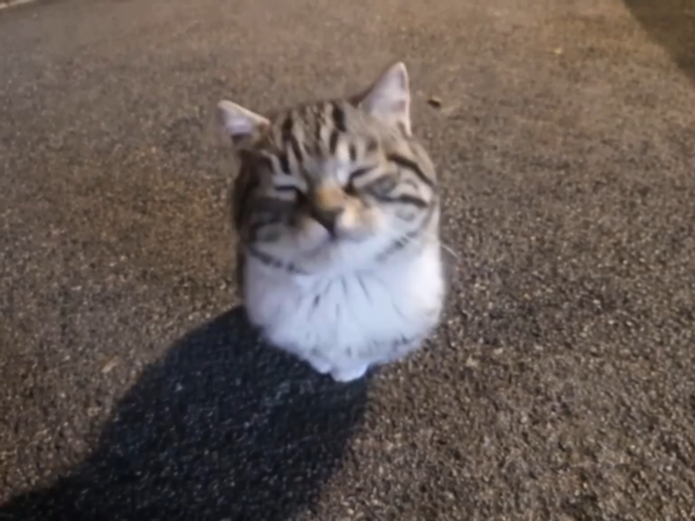 | 389 | 2026-11-15 |
| [吸引猫猫过来的声音](https://www.bilibili.com/video/BV19psn65E9V) | 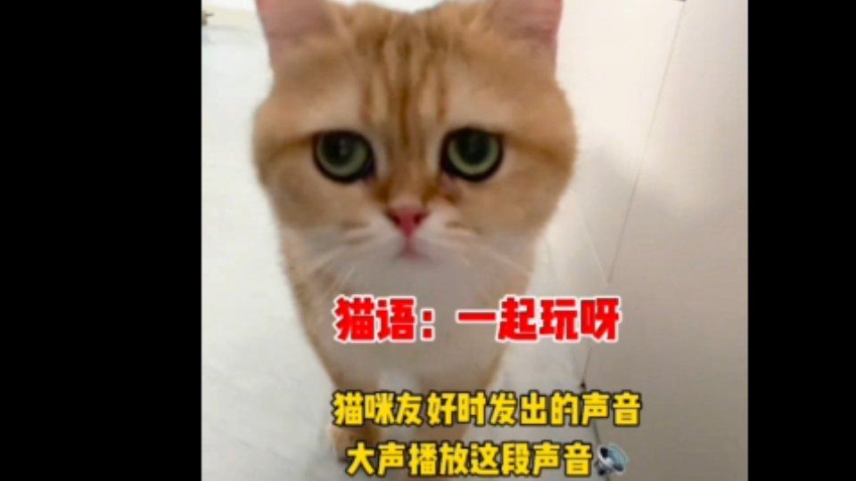 | 8022 | 2026-11-15 |
| [砸几百亿搞出的顶级AI，全被中国网友盘成了“要饭女仆”？一口气扒完这群赛博老婆的离谱户口本！](https://www.bilibili.com/video/BV1BkW66uE8m) |  | 19.9万 | 2026-11-14 |
| [Grok你怎么这么坏！](https://www.bilibili.com/video/BV15jWv6QEYw) |  | 5.4万 | 2026-11-13 |
| [“做那个挑战大运的傻子，鲁莽也比怯懦更接近勇敢”](https://www.bilibili.com/video/BV1L24P6rE6a) |  | 4.8万 | 2026-11-02 |
| [⚡我真的特别爱你 (司凤版)⚡ ｜ 听完跟着小浣熊一块起舞了](https://www.bilibili.com/video/BV1Bbpt6iE6X) |  | 46.7万 | 2026-10-09 |
| [糟了！她们真的游进去了【bilibilionly同人扶持计划】](https://www.bilibili.com/video/BV15vhF6MEug) |  | 27.3万 | 2026-08-27 |
| [《猫狗日记》](https://www.bilibili.com/video/BV17Lswz7E2K) |  | 9673 | 2025-10-19 |

---
*最后更新: 2026-11-24 12:20:45 (自动生成)*
*数据来源: [Bilibili](https://www.bilibili.com)*

## 使用说明

运行以下命令更新视频列表:
```bash
python3 fetch_hajimi_videos.py
```
