# awesome-hajimi
collections of hajimi (哈基米 in Chinese) on the Internet.

## 视频列表 (Video List)

| 视频标题 (Title) | 封面 | 播放量 (Views) | 发布日期 (Date) |
|---|---|---|---|
| [邪恶金渐层变成瞎眼哈基米了【倚天屠龙记reaction 04】](https://www.bilibili.com/video/BV1KZsJ6aENa) |  | 1013 | 2026-11-15 |
| [Köyün Kedilisi｜老吴VS基米 新场景解锁](https://www.bilibili.com/video/BV1Dbsn6gEBD) | 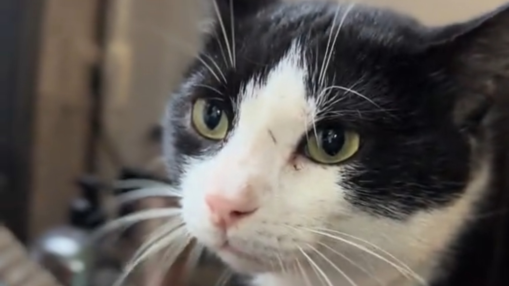 | 1586 | 2026-11-15 |
| [哈吉鸟试图觉醒哈基米的猎杀本能](https://www.bilibili.com/video/BV1yysn6FEAh) | 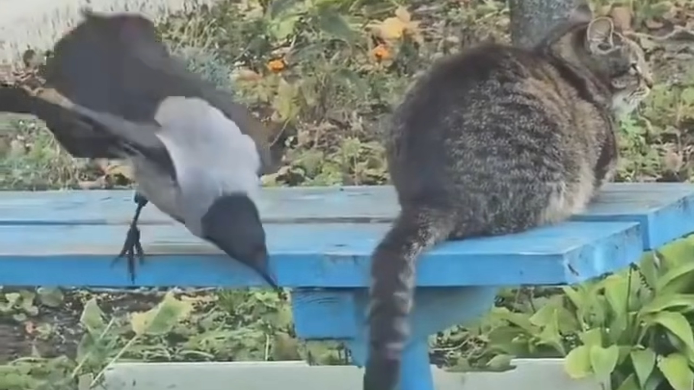 | 283 | 2026-11-15 |
| [[杀戮尖塔2]哈基米替换愚者「哇 啾 叽」旋律](https://www.bilibili.com/video/BV1k1sn6bEG4) |  | 4240 | 2026-11-15 |
| [【TNO/哈基米音乐】⚡️硅基之梦⚡️](https://www.bilibili.com/video/BV1cPsE6SEC2) |  | 73 | 2026-11-15 |
| [比过年的猪还难按](https://www.bilibili.com/video/BV17ts765EUw) | 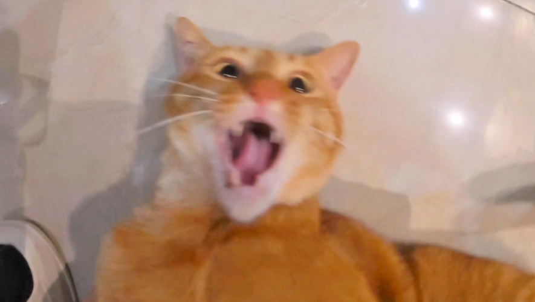 | 1.3万 | 2026-11-15 |
| [【全民枪神】半年后回归，哈基米重新登场！（哈基米爆破15.0）](https://www.bilibili.com/video/BV1Yxx46hEa1) |  | 592 | 2026-11-15 |
| [“哈基米最无语的一集！”](https://www.bilibili.com/video/BV1DssE6NE7m) |  | 722 | 2026-11-15 |
| [神人mod之哈基米叮咚鸡大狗叫替换旋律](https://www.bilibili.com/video/BV1WJsJ6tE77) | 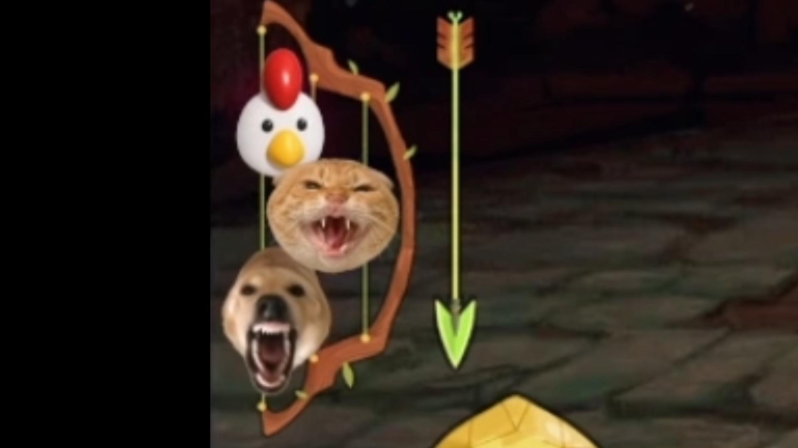 | 1.2万 | 2026-11-15 |
| [一只哈基米在地铁上被夹住了尾巴 结局舒适](https://www.bilibili.com/video/BV1Cesj6nEQS) |  | 1158 | 2026-11-15 |
| [哈基米是一对好咪友](https://www.bilibili.com/video/BV1hFs76YEz1) | 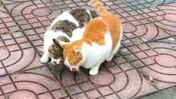 | 902 | 2026-11-14 |
| [哈基米这个大肥猫](https://www.bilibili.com/video/BV1hFs76YEQM) | 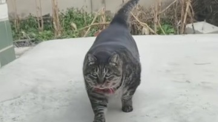 | 403 | 2026-11-14 |
| [混的入文明25买手机咯【AI全民制作人】](https://www.bilibili.com/video/BV1mNsL6HEyW) | 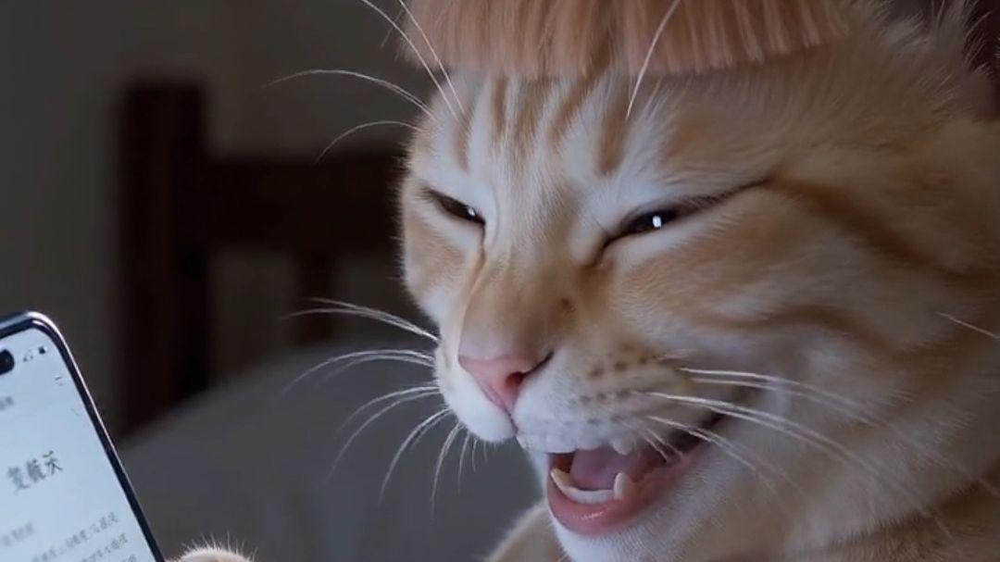 | 15.3万 | 2026-11-14 |
| [哈基人用上吊方式拯救哈基米](https://www.bilibili.com/video/BV18As76hEph) | 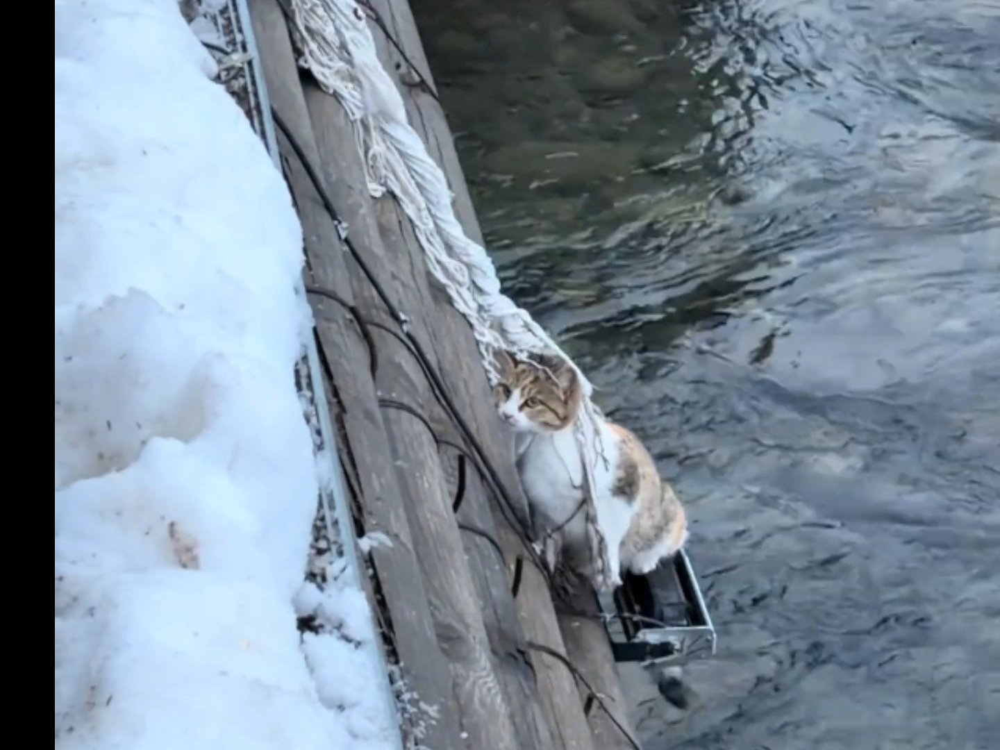 | 2261 | 2026-11-14 |
| [冰雪基米](https://www.bilibili.com/video/BV1jas76rEnm) | 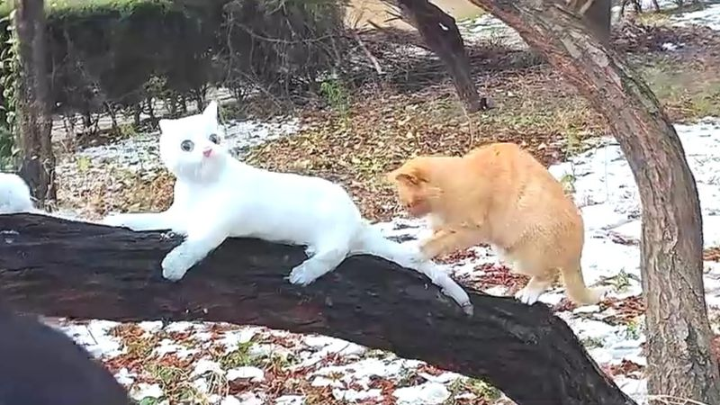 | 4819 | 2026-11-14 |
| [哈基米曼波鼠鼠得吃](https://www.bilibili.com/video/BV1KSsL6HEE2) |  | 781 | 2026-11-14 |
| [哈基米：严苛的训练几乎要了我的命](https://www.bilibili.com/video/BV1JjsV6KEzG) | 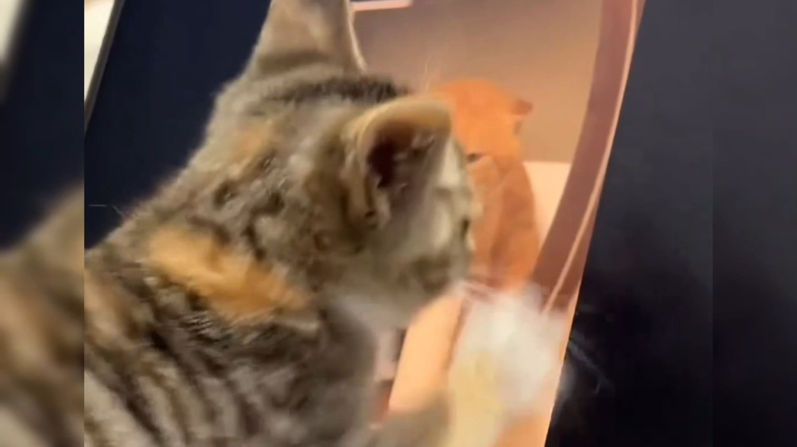 | 1038 | 2026-11-14 |
| [🐟你眨眼越快,大肥鱼和哈基米就跑的越快...🐟](https://www.bilibili.com/video/BV1uqsV6QEtU) |  | 6822 | 2026-11-14 |
| [11.14《4》老吴1万卖不卖？&amp;暴躁刀哥](https://www.bilibili.com/video/BV1j4sV6bEAz) | 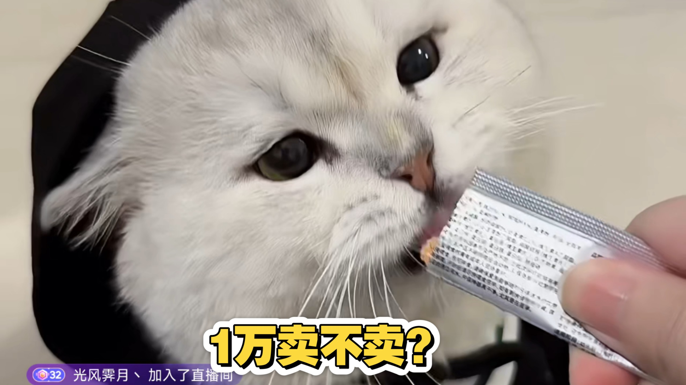 | 1585 | 2026-11-14 |
| [终于把抓车的哈基米给抓起来了](https://www.bilibili.com/video/BV1TksV6EEt3) | 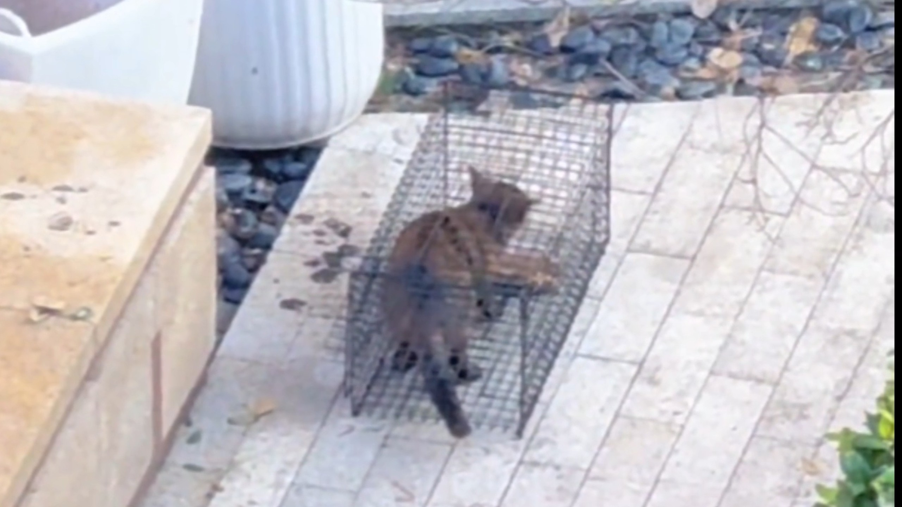 | 7012 | 2026-11-14 |
| [哈基米](https://www.bilibili.com/video/BV1v4sV6bEWD) |  | 5472 | 2026-11-14 |
| [哈基米：2026.11.1](https://www.bilibili.com/video/BV1dMs568Eug) |  | 48 | 2026-11-14 |
| [哈基米也要听UK garage](https://www.bilibili.com/video/BV1jNs56YE8u) | 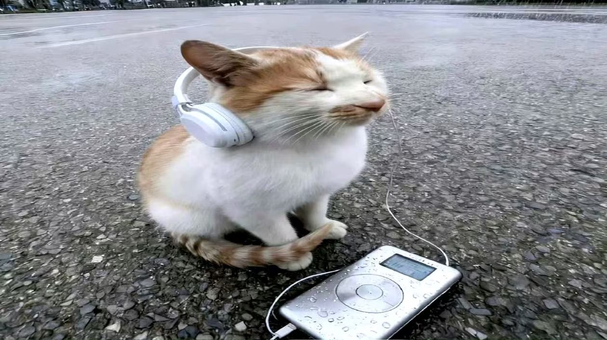 | 581 | 2026-11-14 |
| [《基关枪》](https://www.bilibili.com/video/BV1Nys36uEwR) | 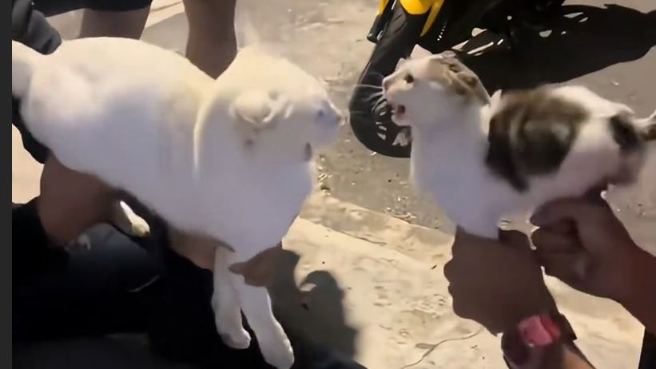 | 4.3万 | 2026-11-14 |
| [哈基米的幽默瞬间](https://www.bilibili.com/video/BV13gsG6HESY) | 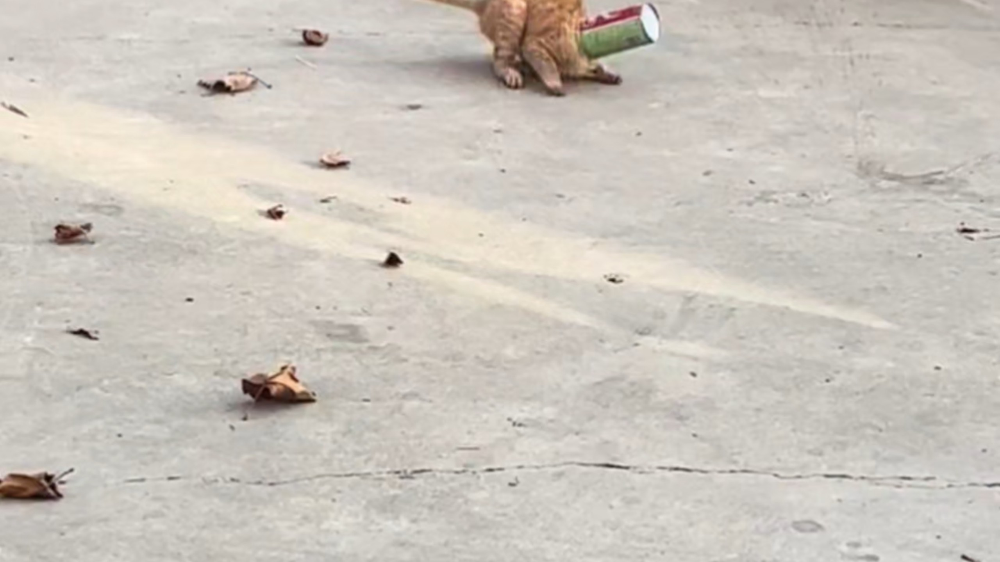 | 644 | 2026-11-14 |
| [哈基米糟蹋我的米](https://www.bilibili.com/video/BV1M7sG62E1E) | 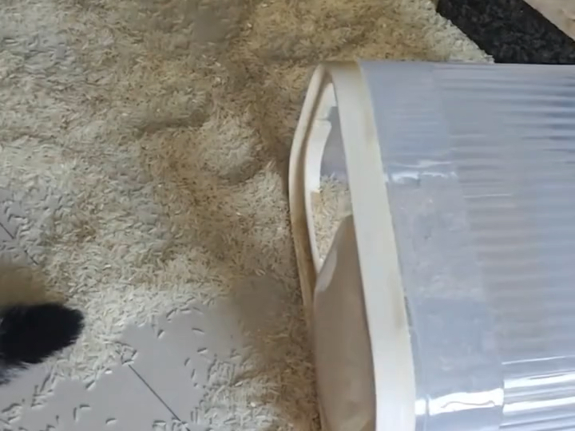 | 6559 | 2026-11-14 |
| [怎么可以这样对哈基米](https://www.bilibili.com/video/BV1m7sG61E3N) | 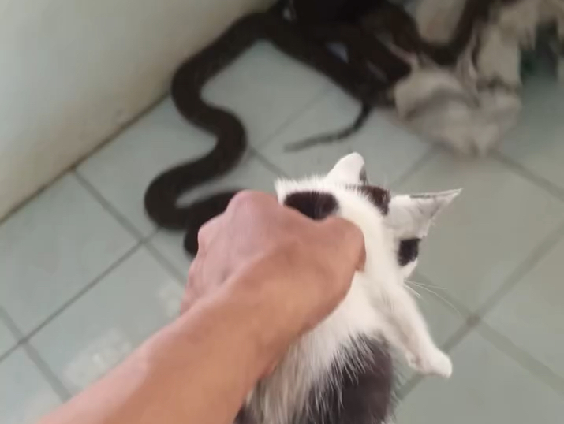 | 7324 | 2026-11-14 |
| [当你迷茫的时候，不如听听哈基米是怎么说的…](https://www.bilibili.com/video/BV1uJsG6LEuh) |  | 7196 | 2026-11-14 |
| [我真的是第一次!!!不太熟悉!!](https://www.bilibili.com/video/BV136WC6MEqS) |  | 9118 | 2026-11-14 |
| [调戏哈气小基米](https://www.bilibili.com/video/BV1uyWC6vECv) | 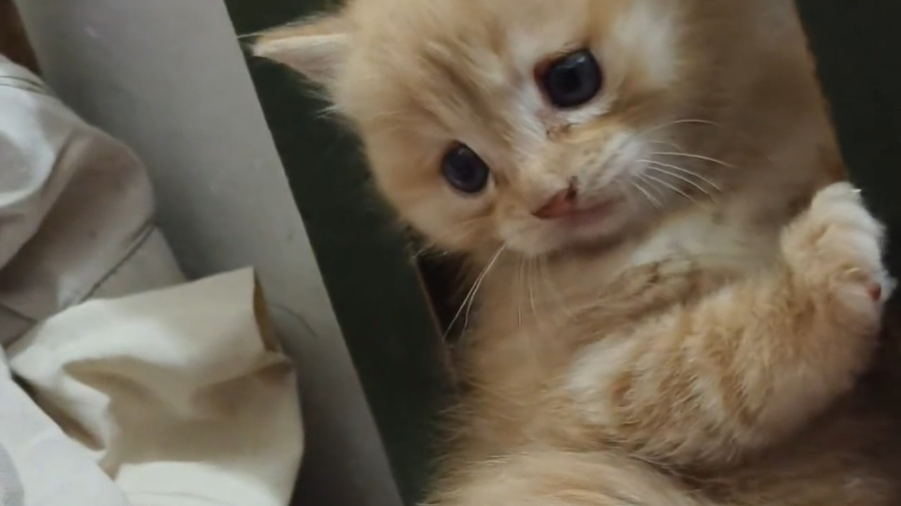 | 2470 | 2026-11-14 |
| [头顶树叶的哈基米](https://www.bilibili.com/video/BV1MrWr6fEs8) | 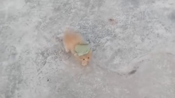 | 589 | 2026-11-13 |
| [哈基米学招财猫挥手](https://www.bilibili.com/video/BV1brWr6fEPp) |  | 910 | 2026-11-13 |
| [灭霸哈基米曼波鼠鼠得吃一分钟纯享版](https://www.bilibili.com/video/BV1kgWz6GEac) | 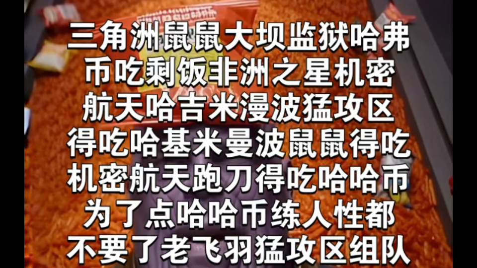 | 1988 | 2026-11-13 |
| [哈基米南北绿豆](https://www.bilibili.com/video/BV1bZWB6nEHt) | 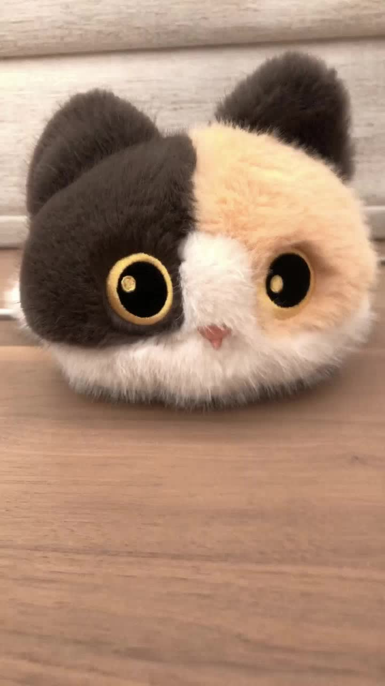 | 127 | 2026-11-13 |
| [哈基米](https://www.bilibili.com/video/BV1VrWi6sEvM) |  | 3456 | 2026-11-13 |
| [朋友突然寄1只小猫给我，打开纸箱后，我和猫都傻了5分钟](https://www.bilibili.com/video/BV1ekWi6XEat) | 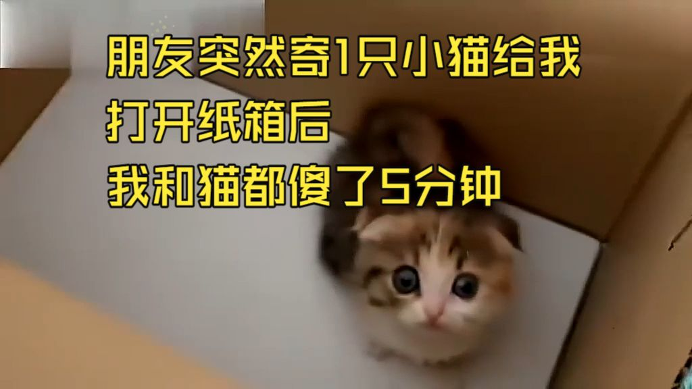 | 11.6万 | 2026-11-13 |
| [疯狂动物园第三季-22](https://www.bilibili.com/video/BV18QWi62EcQ) | 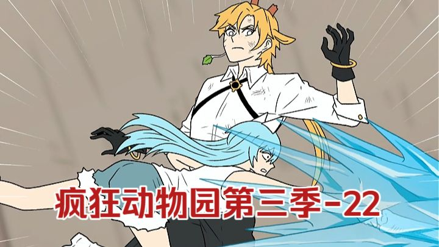 | 24.1万 | 2026-11-13 |
| [哈基米](https://www.bilibili.com/video/BV1WwWv6wEAT) |  | 11 | 2026-11-13 |
| [大狗都几点了？还不起床！](https://www.bilibili.com/video/BV16NWv6FEjo) | 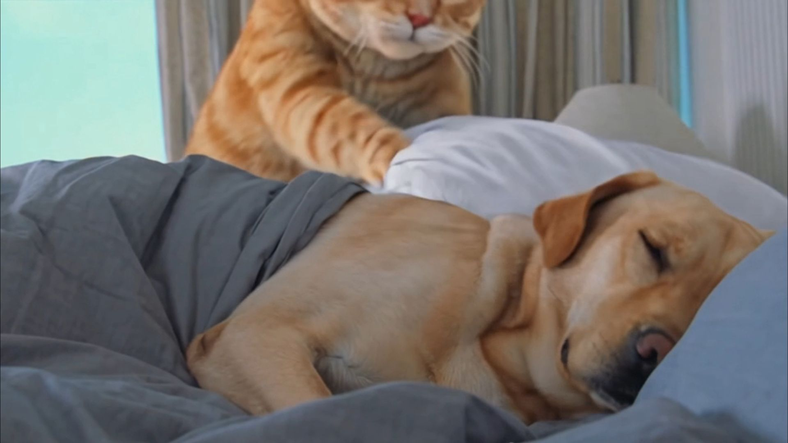 | 1.4万 | 2026-11-13 |
| [哈基米尝试连接蓝牙](https://www.bilibili.com/video/BV181Wa6NENU) | 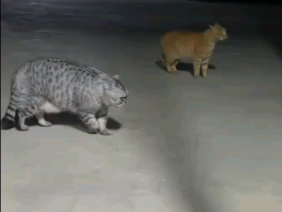 | 152 | 2026-11-13 |
| [哈基米:我能跟你玩一天](https://www.bilibili.com/video/BV181Wa6NETW) | 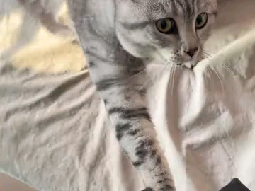 | 691 | 2026-11-13 |
| [制作一些让小猫舒服的音乐](https://www.bilibili.com/video/BV1wWWo64E7G) | 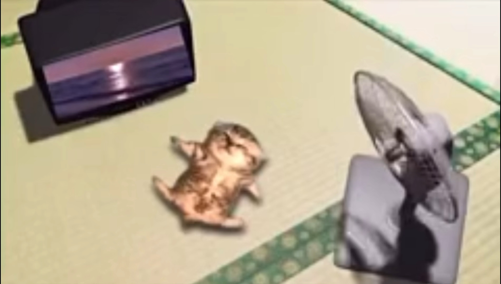 | 4061 | 2026-11-12 |
| [哈基米的曼波](https://www.bilibili.com/video/BV1GPWo6gENT) |  | 51 | 2026-11-12 |
| [alan 阿兰哈基米女王《神曼波》饭拍视角](https://www.bilibili.com/video/BV1gSWo6zEgQ) |  | 1912 | 2026-11-12 |
| [哈基米完全不受控制，再大点我都按不住了](https://www.bilibili.com/video/BV1ZbWR65EoU) | 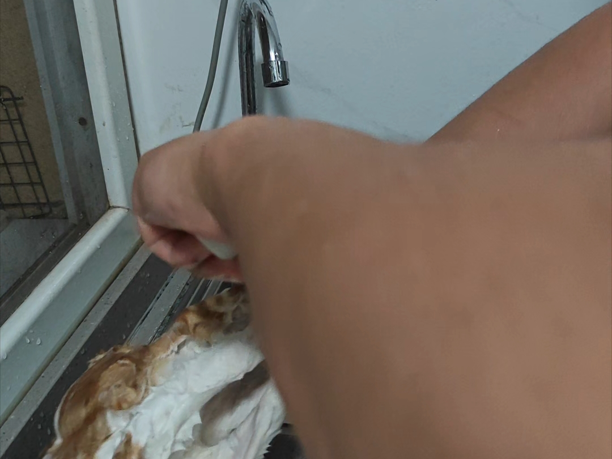 | 3488 | 2026-11-12 |
| [哈基米奏鸣曲：《大锤钢琴奏鸣曲 Op. 106》第4乐章](https://www.bilibili.com/video/BV1SxWd6KEbq) |  | 2870 | 2026-11-12 |
| [路上第一次遇到高需求小猫](https://www.bilibili.com/video/BV1t8Wd6YET9) | 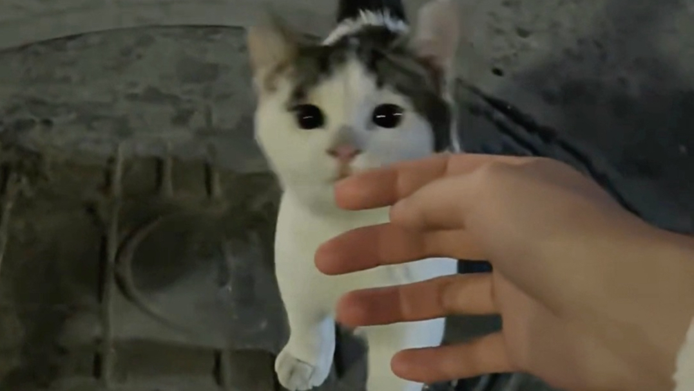 | 5.3万 | 2026-11-12 |
| [《柴进の小曲》升6key！就这个高音戏腔爽！【AI音乐】](https://www.bilibili.com/video/BV1xmWX6sEdw) |  | 3059 | 2026-11-12 |
| [仙人抚我顶，老吴授基米。](https://www.bilibili.com/video/BV1kSWD65EZc) | 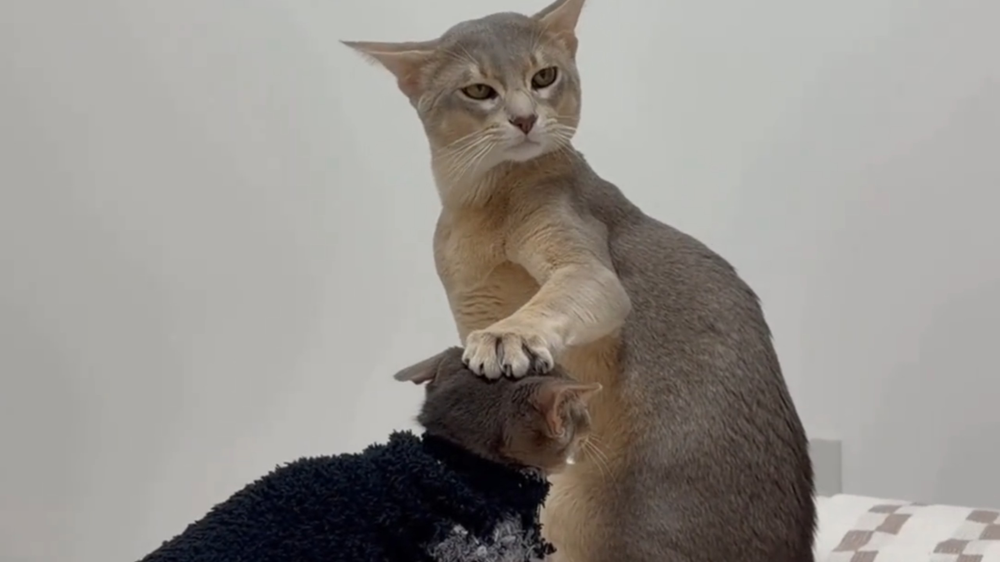 | 12.6万 | 2026-11-12 |
| [【中配】《恶搞之家》的自我毁灭 - It&#x27;s Blanko](https://www.bilibili.com/video/BV1ArW26NEyZ) |  | 7.9万 | 2026-11-11 |
| [“基米拔剑四顾心茫然”](https://www.bilibili.com/video/BV12eWy6cE42) | 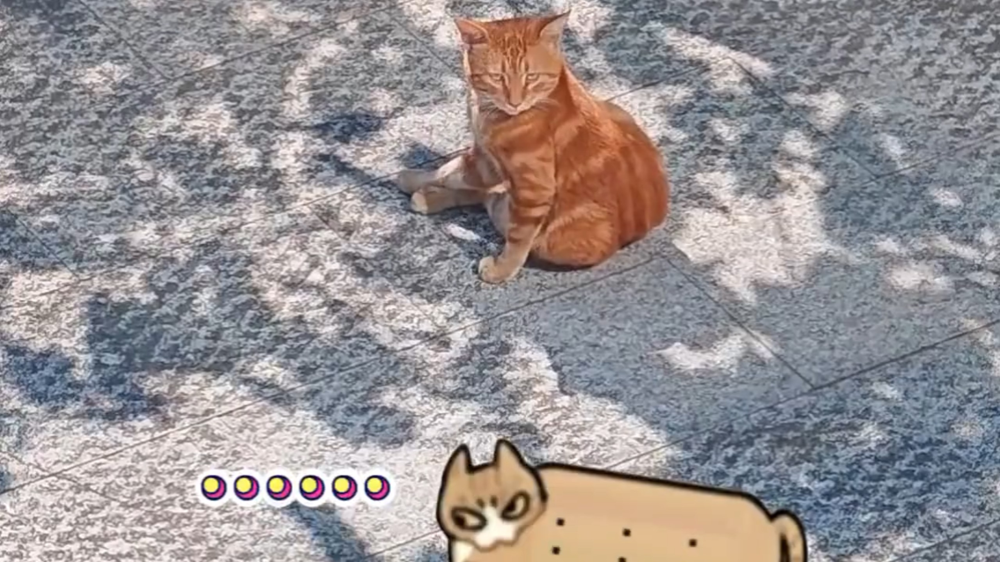 | 17.5万 | 2026-11-11 |
| [🐱✨每一个愿望都值得被实现！懂事小猫的治愈日常，笑容超甜💖⚡](https://www.bilibili.com/video/BV1YcW16CEpr) |  | 377 | 2026-11-11 |
| [周年庆闹鼠灾？用PLZ05高效灭杀](https://www.bilibili.com/video/BV1psWL6yEoE) | 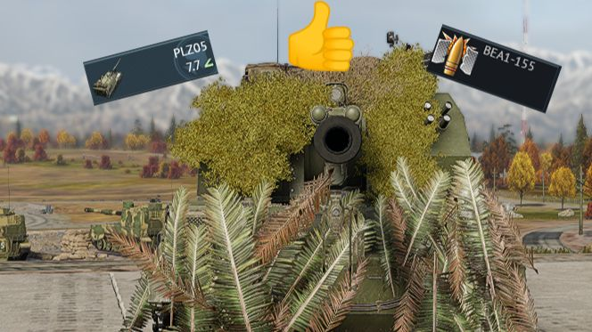 | 1.5万 | 2026-11-11 |
| [姜小猫在 40°C 的夏日用心形泳池给朋友们带来惊喜！](https://www.bilibili.com/video/BV1kJ4n6PE9h) |  | 502 | 2026-11-11 |
| [当怕冷的狗遇到了二哈，笑死了，直接寄生上去！](https://www.bilibili.com/video/BV1XJWG6nEFc) | 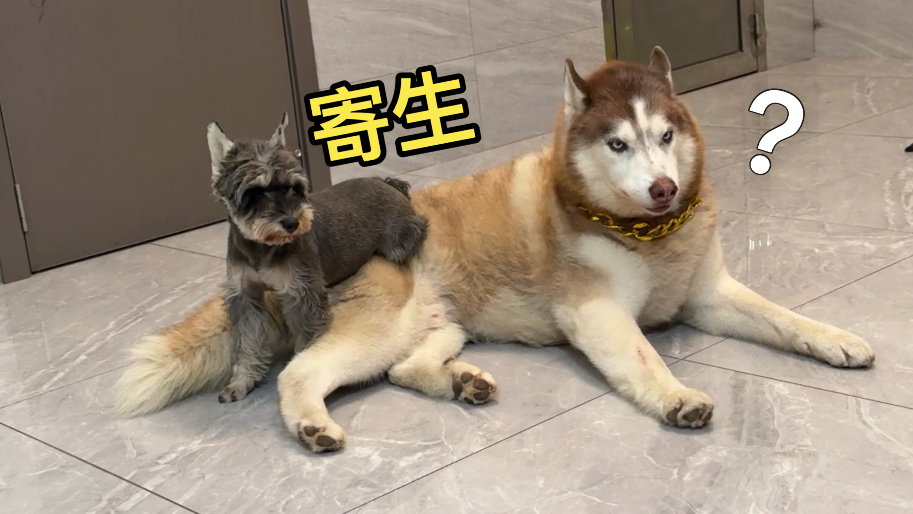 | 42.9万 | 2026-11-11 |
| [植物大战僵尸6～10合集！ #植物大战僵尸 #PV](https://www.bilibili.com/video/BV1KZWV65EZd) |  | 2.4万 | 2026-11-11 |
| [当哈基人在外面摸了猫，回家后家里的猫生气了](https://www.bilibili.com/video/BV16MW56qEbe) | 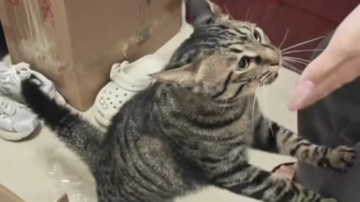 | 8004 | 2026-11-10 |
| [🐾🧼洗香香时间！吹干后毛茸茸的小猫像一颗行走的蒲公英😆✨](https://www.bilibili.com/video/BV1ZZW56AEv3) |  | 528 | 2026-11-10 |
| [奶糖来啦](https://www.bilibili.com/video/BV1RMWK6eEFj) |  | 248.4万 | 2026-11-10 |
| [核辐射危机史蒂夫消亡！钓上蜘蛛蟹，豌豆射手笑到喷饭！#咕嘎咕嘎 #乐室](https://www.bilibili.com/video/BV1MnWK64EKH) |  | 3.3万 | 2026-11-09 |
| [所有未来动物（起源与解释）——拯救动物 - OnlyGOD - 西班牙语原声/中配](https://www.bilibili.com/video/BV1bXWP6dENt) |  | 6.1万 | 2026-11-09 |
| [米粒与锅巴：“羁绊”](https://www.bilibili.com/video/BV1qEWt6TEhA) |  | 5.8万 | 2026-11-09 |
| [可以摸了](https://www.bilibili.com/video/BV1WrWx6CEx1) | 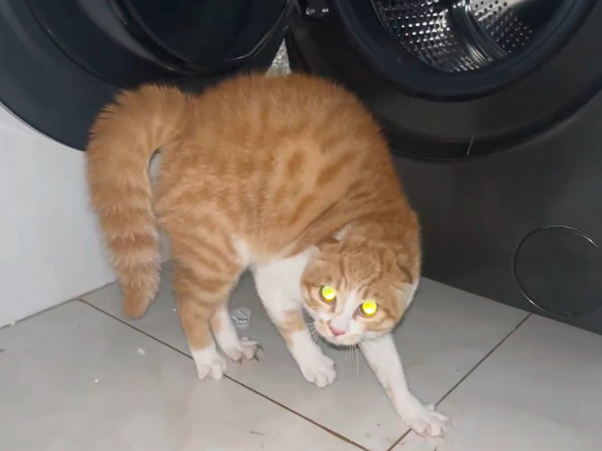 | 5169 | 2026-11-09 |
| [循环歌曲｜&#x27;以前的小孩vs现在的小孩’｜《人类一败涂地AIの小曲》higher](https://www.bilibili.com/video/BV1Cs4e6MEg7) |  | 63.3万 | 2026-11-09 |
| [哈士奇：有牛啊，不对，有狗啊！](https://www.bilibili.com/video/BV12eWW66EED) | 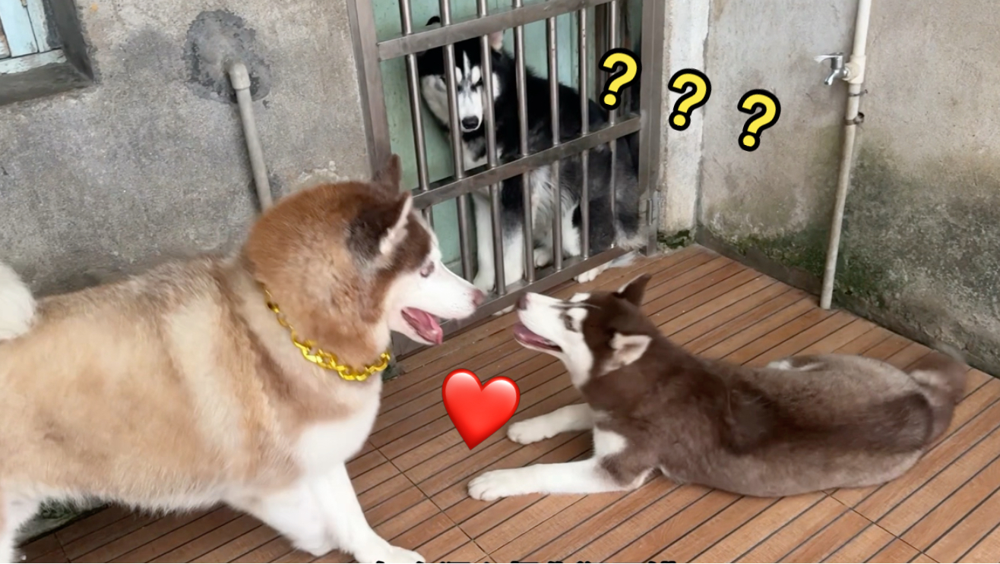 | 30.8万 | 2026-11-09 |
| [小时候喜欢遛牛](https://www.bilibili.com/video/BV1LAW76BEGq) | 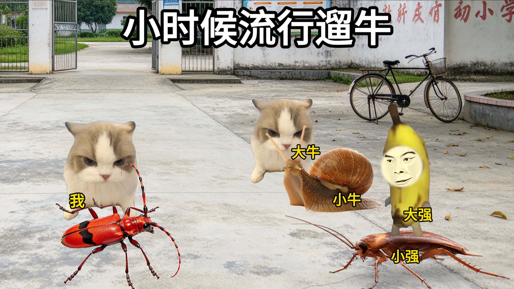 | 280.6万 | 2026-11-08 |
| [人类，你带来了梦想（看完不哭算我输，自带纸巾）（Happy End，放心食用）](https://www.bilibili.com/video/BV1zkWJ6UEd2) |  | 6922 | 2026-11-08 |
| [你变成了仓鼠！还要挑战伪人？](https://www.bilibili.com/video/BV1UjW76ZEeJ) | 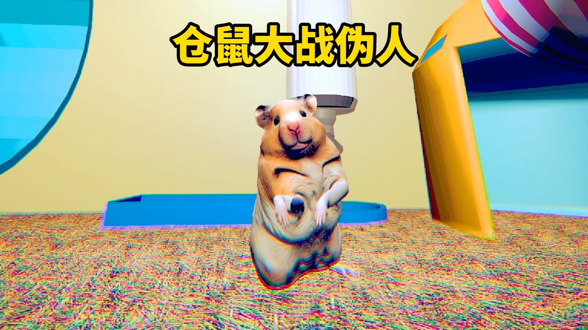 | 21.0万 | 2026-11-08 |
| [动物搞笑合集](https://www.bilibili.com/video/BV13oW76hEP3) | 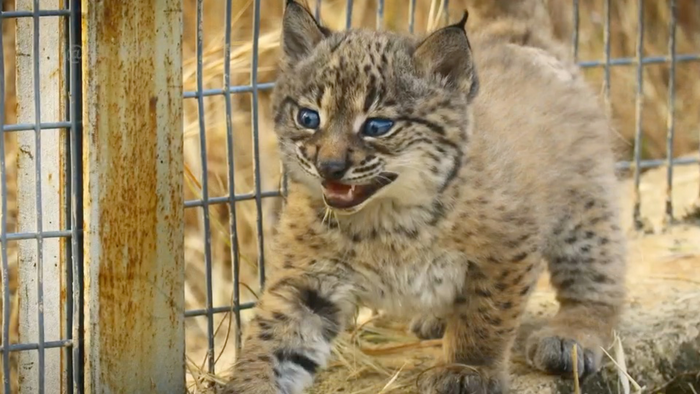 | 5311 | 2026-11-08 |
| [一家6狗螃蟹自由有多快乐？](https://www.bilibili.com/video/BV1ix4x6vEVG) | 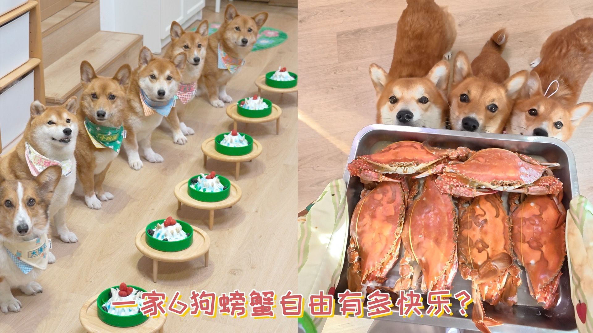 | 3.2万 | 2026-11-08 |
| [姜汁小猫和猫妈妈一起潜入海中探索珊瑚礁🐱🌊](https://www.bilibili.com/video/BV1a34B6YEXG) |  | 1138 | 2026-11-08 |
| [⚡️全 都 回 来 了⚡️](https://www.bilibili.com/video/BV1oU4J6sEDH) |  | 57.8万 | 2026-11-07 |
| [欺负一只哥布林？](https://www.bilibili.com/video/BV12T4E6eEk6) |  | 242.9万 | 2026-11-07 |
| [buddy says](https://www.bilibili.com/video/BV1jg4J6HEBe) |  | 6.4万 | 2026-11-07 |
| [【汪汪喵爸 第一季 1~13 合集】两只流浪狗捡到被遗弃的小奶猫，一路从垃圾堆走到雪山草原，从一无所有到慢慢成了一个家，30分钟治愈系萌宠长篇一口气看完！](https://www.bilibili.com/video/BV1Vz486GET6) |  | 6.0万 | 2026-11-06 |
| [猫咪:天冷了，我要回我的狗窝睡觉觉了!](https://www.bilibili.com/video/BV1AV4q6VEFm) | 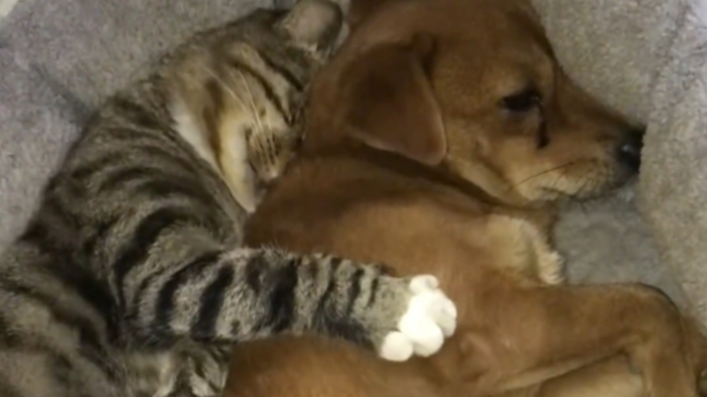 | 10.1万 | 2026-11-06 |
| [凑猫](https://www.bilibili.com/video/BV1UY4v6DEoW) | 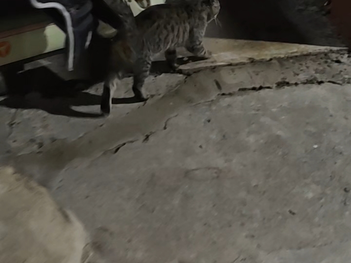 | 22.3万 | 2026-11-06 |
| [【Giantess Growth】Mon3tr的无限巨大化（完整版）](https://www.bilibili.com/video/BV1Ds4h66ED9) |  | 12.9万 | 2026-11-05 |
| [从 零 开 始 机 枪](https://www.bilibili.com/video/BV1FaxD6yEv2) |  | 153.7万 | 2026-11-04 |
| [老吴！老吴！老吴！](https://www.bilibili.com/video/BV1eqx269Ekh) | 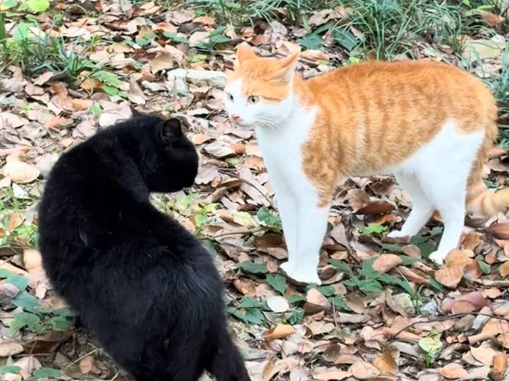 | 6663 | 2026-11-03 |
| [循环歌曲｜&#x27;以前的小孩vs现在的小孩’｜《人类一败涂地AIの小曲》higher](https://www.bilibili.com/video/BV1tNxW67EYB) |  | 223.9万 | 2026-11-03 |
| [🐱✨【治愈日常】懂事小橘猫和猫妈妈的温馨故事！看一秒烦恼全消💖](https://www.bilibili.com/video/BV1eQ4P6MEqD) |  | 7665 | 2026-11-02 |
| [funny animal animation cartoon](https://www.bilibili.com/video/BV1tj4w6WEFK) |  | 6971 | 2026-11-02 |
| [黑客大肥鱼·监狱篇合集](https://www.bilibili.com/video/BV1PP4A6HEqv) |  | 66.0万 | 2026-11-02 |
| [“.!盘点近期全网爆火的梗小曲!”](https://www.bilibili.com/video/BV1Z1xC6DEbt) |  | 430.5万 | 2026-10-31 |
| [“灭建国是谁呀😄？？”](https://www.bilibili.com/video/BV18cxv6SEe7) |  | 292.1万 | 2026-10-30 |
| [戴夫一觉醒来变美女，连豌豆射手都认不出，草坪彻底乱成一锅粥](https://www.bilibili.com/video/BV16uxL6kETU) |  | 2.5万 | 2026-10-28 |
| [包吃包住我才来的](https://www.bilibili.com/video/BV1v9nx69E1k) |  | 51.0万 | 2026-10-25 |
| [人是杂鱼？！ ｜ 巨大娘雌小鬼版 人是猫](https://www.bilibili.com/video/BV1iZHw6oEtQ) |  | 5.5万 | 2026-10-24 |
| [一口气看完奶家人文明！](https://www.bilibili.com/video/BV1FxJ86iE1T) |  | 34.3万 | 2026-10-17 |
| [基米这个翘头冲锋](https://www.bilibili.com/video/BV1VNHU6SEUW) | 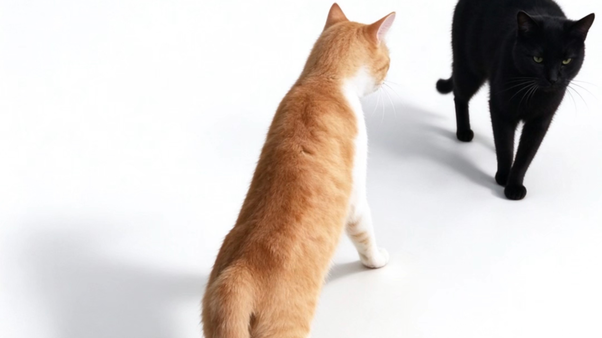 | 4.9万 | 2026-10-07 |
| [鼠咪去学游泳翻车的vlog](https://www.bilibili.com/video/BV1FqYX6eEn6) | 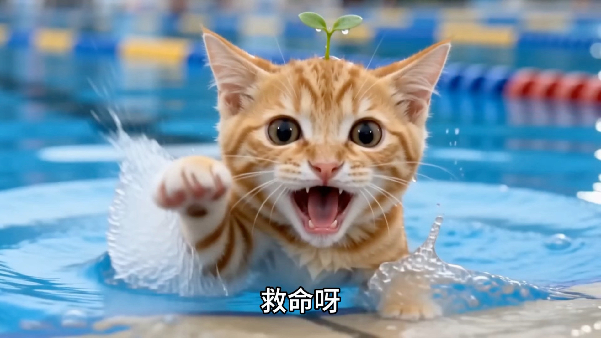 | 94.7万 | 2026-09-12 |
| [又救了一只被撞的小猫没救活](https://www.bilibili.com/video/BV1kRNW6HEfC) | 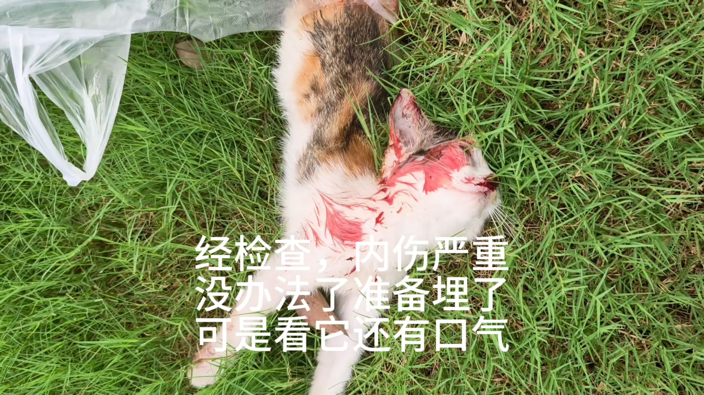 | 50.2万 | 2026-07-11 |
| [【粥基米音乐】基米协议](https://www.bilibili.com/video/BV1g3QQBtEo8) |  | 1.7万 | 2026-03-23 |
| [小猫吉妮和猫妈妈的四个温暖故事](https://www.bilibili.com/video/BV14bYPzREpz) |  | 38.2万 | 2025-09-09 |
| [【AI小动物吃播合集】超级可爱｜22min｜吃播｜助眠｜解压｜ASMR｜触发音｜情景模拟｜合集](https://www.bilibili.com/video/BV1xd4ozxENA) |  | 5.9万 | 2025-08-06 |
| [实拍猫狗游泳比赛：打不倒我的只会让我更强！](https://www.bilibili.com/video/BV1rb8wzKEaA) | 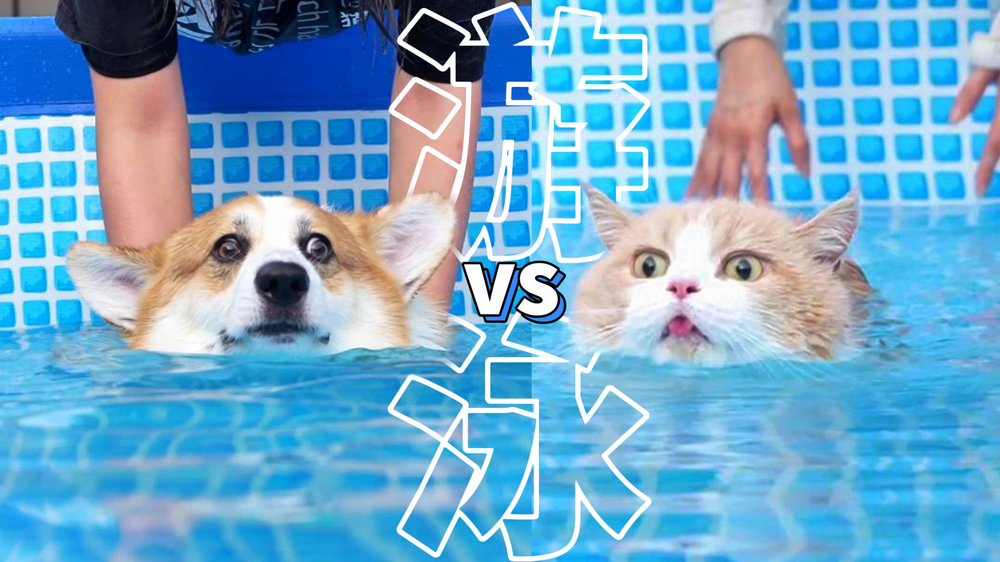 | 102.5万 | 2025-07-24 |
| [🎵哈基米之The Great Gig In The Sky🎵](https://www.bilibili.com/video/BV1EPTRz9Erz) |  | 8.0万 | 2025-06-08 |
| [妈耶出去玩发现了一只小奶猫](https://www.bilibili.com/video/BV1bz42167E1) | 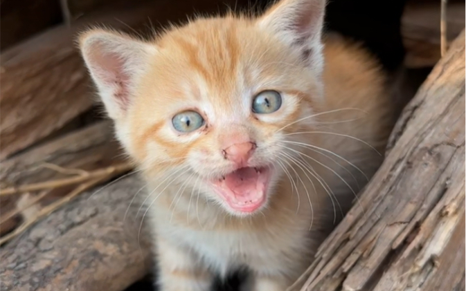 | 703.3万 | 2024-04-25 |

---
*最后更新: 2026-11-15 09:07:58 (自动生成)*
*数据来源: [Bilibili](https://www.bilibili.com)*

## 使用说明

运行以下命令更新视频列表:
```bash
python3 fetch_hajimi_videos.py
```
