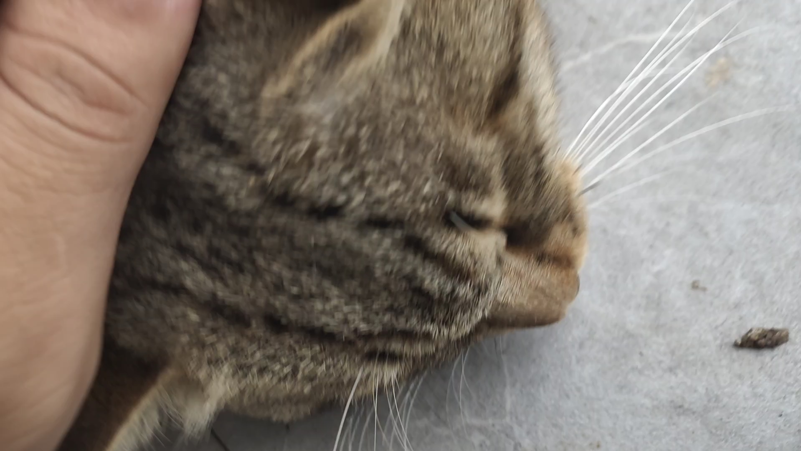
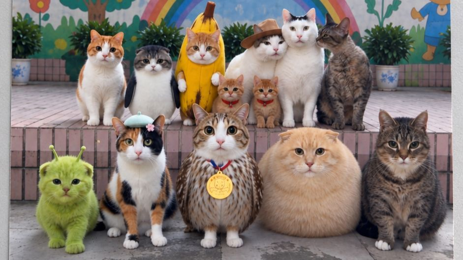

# awesome-hajimi
collections of hajimi (哈基米 in Chinese) on the Internet.

## 视频列表 (Video List)

| 视频标题 (Title) | 封面 | 播放量 (Views) | 发布日期 (Date) |
|---|---|---|---|
| [被哈基米咬到了](https://www.bilibili.com/video/BV1J3nj6aE3v) |  | 4467 | 2026-10-19 |
| [以后我就靠流浪猫生活了](https://www.bilibili.com/video/BV1Urn36iE2A) |  | 5.1万 | 2026-10-18 |
| [喵owl日记（哈基咪运动会）](https://www.bilibili.com/video/BV1wfJD6eE35) |  | 1.8万 | 2026-10-16 |
| [巨型布偶猫来袭 统统闪开！！！](https://www.bilibili.com/video/BV1mLWw65EsT) |  | 303.7万 | 2026-10-13 |

---
*最后更新: 2026-10-20 07:26:31 (自动生成)*
*数据来源: [Bilibili](https://www.bilibili.com)*

## 使用说明

运行以下命令更新视频列表:
```bash
python3 fetch_hajimi_videos.py
```
